
세션 12개 · 사진 74장

<ul class="toc">
<li><a href="#perf">perf — 성능</a></li>
<li><a href="#Handoff">Handoff — Handoff</a></li>
<li><a href="#Handoffs">Handoffs — Handoffs</a></li>
<li><a href="#audio">audio — 소리</a></li>
<li><a href="#design">design — 기획</a></li>
<li><a href="#engine-traps">engine-traps — engine-traps</a></li>
<li><a href="#material">material — 재질</a></li>
<li><a href="#terran">terran — 테란 아군</a></li>
<li><a href="#traps">traps — traps</a></li>
<li><a href="#vfx">vfx — 이펙트</a></li>
<li><a href="#weapon">weapon — 무기</a></li>
<li><a href="#zerg">zerg — 저그</a></li>
</ul>
<h2 id="perf">perf <small>성능</small></h2>

프레임 저하의 원인을 찾아 텍스처 용량과 성능을 측정했습니다.

<a href="/assets/d/2026-09-24/WindowsEditor_RiderMCP_20260923-202339_viewport.jpg" target="_blank">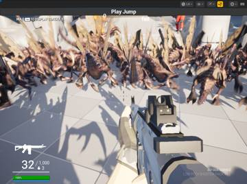</a>
<a href="/assets/d/2026-09-24/WindowsEditor_HighresScreenshot00000.jpg" target="_blank">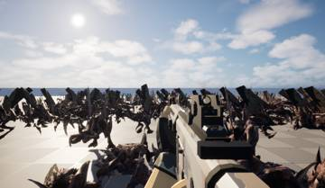</a>
<a href="/assets/d/2026-09-24/WindowsEditor_HighresScreenshot00001.jpg" target="_blank">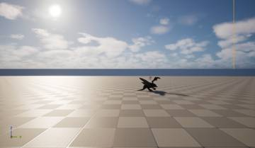</a>
<a href="/assets/d/2026-09-24/WindowsEditor_HighresScreenshot00002.jpg" target="_blank">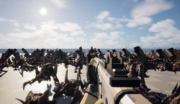</a>
<a href="/assets/d/2026-09-24/WindowsEditor_HighresScreenshot00003.jpg" target="_blank">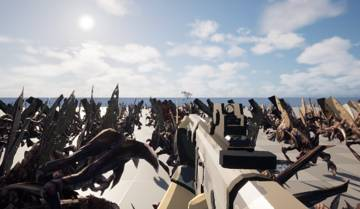</a>
<a href="/assets/d/2026-09-24/WindowsEditor_HighresScreenshot00004.jpg" target="_blank">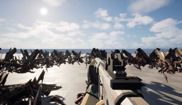</a>
<a href="/assets/d/2026-09-24/WindowsEditor_HighresScreenshot00005.jpg" target="_blank">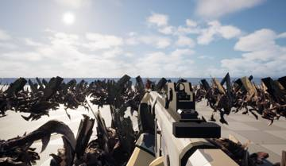</a>
<a href="/assets/d/2026-09-24/WindowsEditor_HighresScreenshot00006.jpg" target="_blank">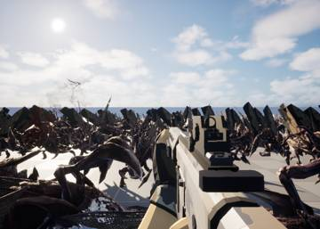</a>
<a href="/assets/d/2026-09-24/WindowsEditor_HighresScreenshot00007.jpg" target="_blank">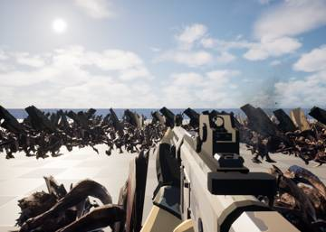</a>
<a href="/assets/d/2026-09-24/WindowsEditor_HighresScreenshot00008.jpg" target="_blank">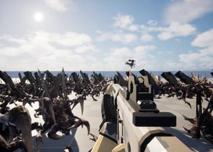</a>
<a href="/assets/d/2026-09-24/WindowsEditor_HighresScreenshot00009.jpg" target="_blank">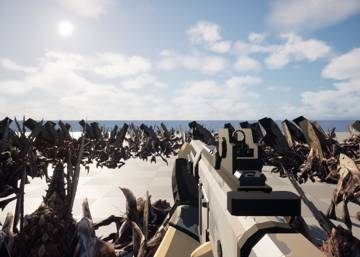</a>
<a href="/assets/d/2026-09-24/WindowsEditor_HighresScreenshot00010.jpg" target="_blank">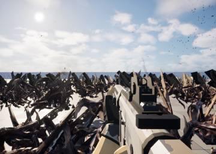</a>
<a href="/assets/d/2026-09-24/WindowsEditor_HighresScreenshot00011.jpg" target="_blank">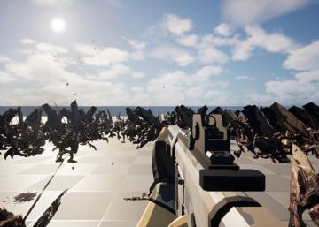</a>
<a href="/assets/d/2026-09-24/WindowsEditor_HighresScreenshot00012.jpg" target="_blank">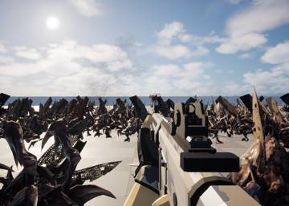</a>
<a href="/assets/d/2026-09-24/WindowsEditor_HighresScreenshot00013.jpg" target="_blank">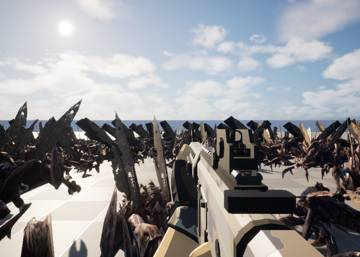</a>
<a href="/assets/d/2026-09-24/WindowsEditor_HighresScreenshot00014.jpg" target="_blank">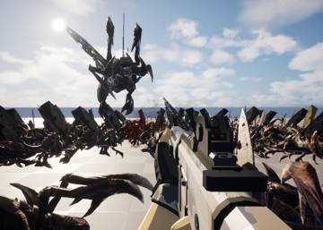</a>
<a href="/assets/d/2026-09-24/WindowsEditor_HighresScreenshot00015.jpg" target="_blank">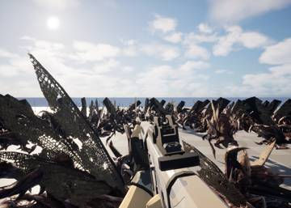</a>
<a href="/assets/d/2026-09-24/WindowsEditor_HighresScreenshot00016.jpg" target="_blank">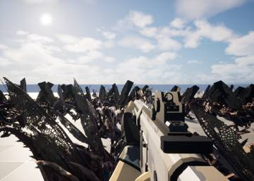</a>
<a href="/assets/d/2026-09-24/WindowsEditor_HighresScreenshot00017.jpg" target="_blank">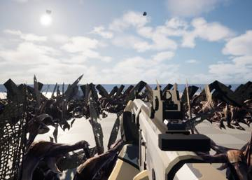</a>
<a href="/assets/d/2026-09-24/mat_wing_side.jpg" target="_blank">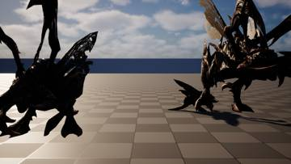</a>
<a href="/assets/d/2026-09-24/mat_wing_top.jpg" target="_blank">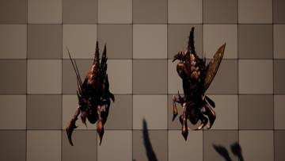</a>
<a href="/assets/d/2026-09-24/mat_wing_after_side.jpg" target="_blank">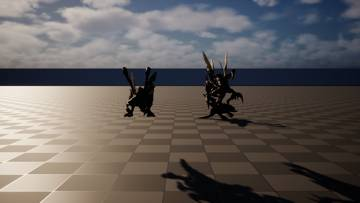</a>
<a href="/assets/d/2026-09-24/mat_wing_after_back.jpg" target="_blank">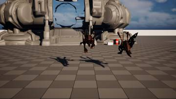</a>
<a href="/assets/d/2026-09-24/mat_wing_cmp_grid.jpg" target="_blank">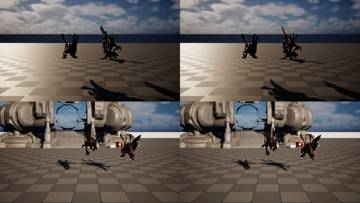</a>
<a href="/assets/d/2026-09-24/WindowsEditor_HighresScreenshot00019.jpg" target="_blank">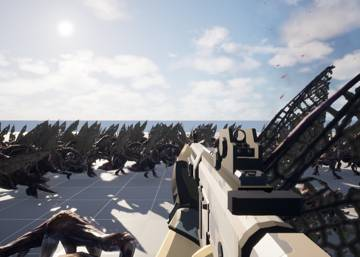</a>
<a href="/assets/d/2026-09-24/WindowsEditor_HighresScreenshot00020.jpg" target="_blank">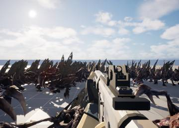</a>
<a href="/assets/d/2026-09-24/WindowsEditor_HighresScreenshot00021.jpg" target="_blank">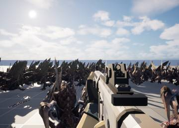</a>
<a href="/assets/d/2026-09-24/WindowsEditor_HighresScreenshot00022.jpg" target="_blank">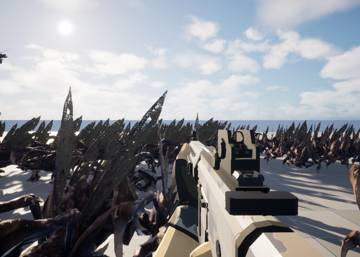</a>
<a href="/assets/d/2026-09-24/WindowsEditor_HighresScreenshot00023.jpg" target="_blank">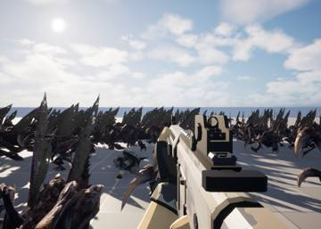</a>
<a href="/assets/d/2026-09-24/WindowsEditor_HighresScreenshot00024.jpg" target="_blank">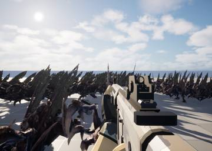</a>
<a href="/assets/d/2026-09-24/WindowsEditor_HighresScreenshot00025.jpg" target="_blank">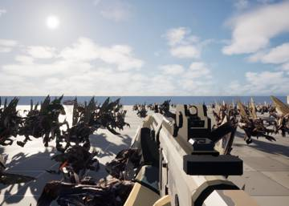</a>
<a href="/assets/d/2026-09-24/WindowsEditor_HighresScreenshot00026.jpg" target="_blank">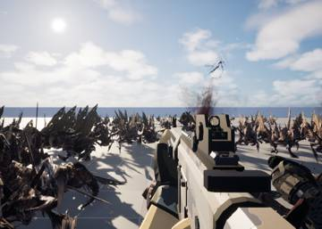</a>
<a href="/assets/d/2026-09-24/WindowsEditor_HighresScreenshot00027.jpg" target="_blank">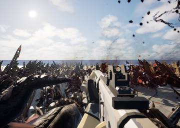</a>
<a href="/assets/d/2026-09-24/WindowsEditor_HighresScreenshot00028.jpg" target="_blank">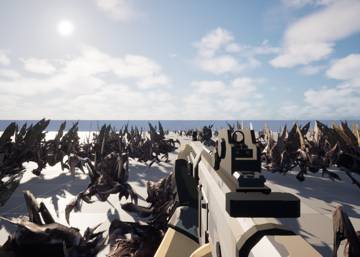</a>
<a href="/assets/d/2026-09-24/WindowsEditor_HighresScreenshot00029.jpg" target="_blank">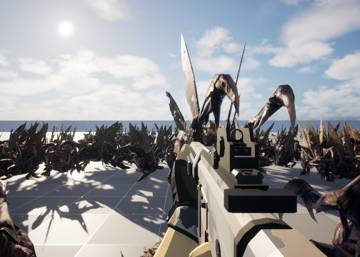</a>
<a href="/assets/d/2026-09-24/WindowsEditor_HighresScreenshot00030.jpg" target="_blank">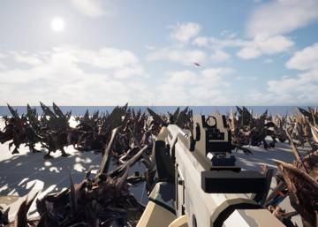</a>
<a href="/assets/d/2026-09-24/WindowsEditor_HighresScreenshot00031.jpg" target="_blank">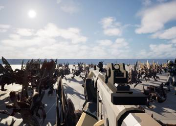</a>
<a href="/assets/d/2026-09-24/WindowsEditor_HighresScreenshot00032.jpg" target="_blank">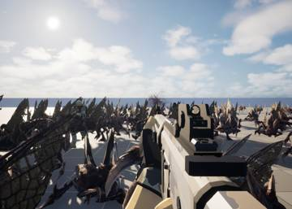</a>
<a href="/assets/d/2026-09-24/WindowsEditor_HighresScreenshot00033.jpg" target="_blank">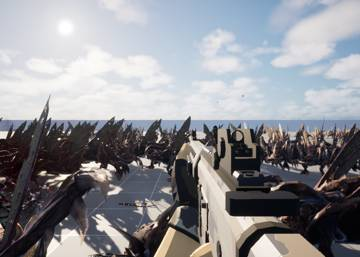</a>
<a href="/assets/d/2026-09-24/WindowsEditor_HighresScreenshot00034.jpg" target="_blank">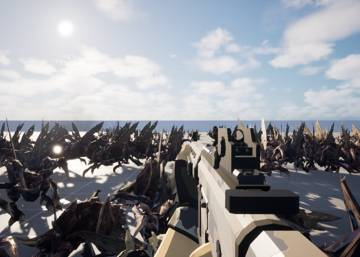</a>
<a href="/assets/d/2026-09-24/WindowsEditor_HighresScreenshot00035.jpg" target="_blank">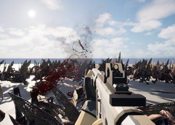</a>
<a href="/assets/d/2026-09-24/WindowsEditor_HighresScreenshot00036.jpg" target="_blank">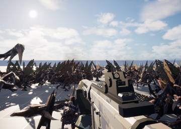</a>
<a href="/assets/d/2026-09-24/WindowsEditor_HighresScreenshot00037.jpg" target="_blank">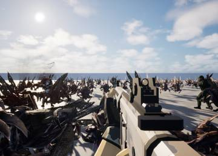</a>
<a href="/assets/d/2026-09-24/WindowsEditor_HighresScreenshot00038.jpg" target="_blank">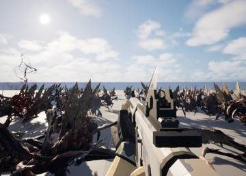</a>
<a href="/assets/d/2026-09-24/WindowsEditor_HighresScreenshot00039.jpg" target="_blank">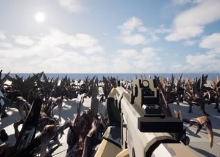</a>
<a href="/assets/d/2026-09-24/WindowsEditor_HighresScreenshot00040.jpg" target="_blank">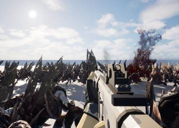</a>
<a href="/assets/d/2026-09-24/WindowsEditor_HighresScreenshot00041.jpg" target="_blank">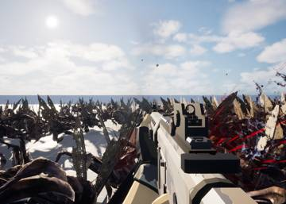</a>
<a href="/assets/d/2026-09-24/WindowsEditor_HighresScreenshot00042.jpg" target="_blank">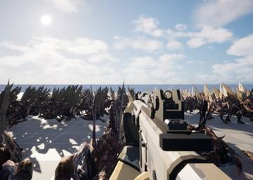</a>
<a href="/assets/d/2026-09-24/WindowsEditor_HighresScreenshot00043.jpg" target="_blank">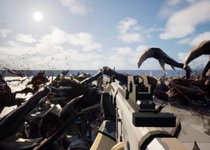</a>
<a href="/assets/d/2026-09-24/WindowsEditor_HighresScreenshot00044.jpg" target="_blank">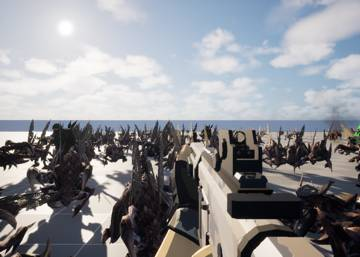</a>

05:23 증분 링크로 빌드 시간을 35초에서 16초로 줄이고 엔진 함정 기록을 더했습니다.

21:02 테스트 문서에 성능 측정 결과와 풀링 결과를 정리했습니다.

<h2 id="Handoff">Handoff <small>Handoff</small></h2>

다른 담당에게 실험 결과를 전달했습니다.

<h2 id="Handoffs">Handoffs <small>Handoffs</small></h2>

담당끼리 작업 내용을 주고받았습니다.

<h2 id="audio">audio <small>소리</small></h2>

저글링 울음소리와 무리 배경음을 새로 구성했습니다.

<h2 id="design">design <small>기획</small></h2>

저글링 소리와 게임 규칙 등 설계 방향을 정리했습니다.

<h2 id="engine-traps">engine-traps <small>engine-traps</small></h2>

에디터 작업 중 주의할 점을 기록했습니다.

<h2 id="material">material <small>재질</small></h2>

제작 도구를 정비하고 시험했습니다.

<h2 id="terran">terran <small>테란 아군</small></h2>

아군 AI의 동작 부담을 줄이고 따라오기 확인 화면을 만들었습니다.

<h2 id="traps">traps <small>traps</small></h2>

작업 중 만난 함정과 해결 방법을 기록했습니다.

<h2 id="vfx">vfx <small>이펙트</small></h2>

피와 충격 효과의 수를 줄여 가볍게 만들었습니다.

<h2 id="weapon">weapon <small>무기</small></h2>

아군이 사격하는지 자동으로 검사하고 건물 메뉴 첫 단계를 만들었습니다.

<h2 id="zerg">zerg <small>저그</small></h2>

저글링 시체가 남아도 프레임이 떨어지지 않도록 처리 방식을 손봤습니다.

