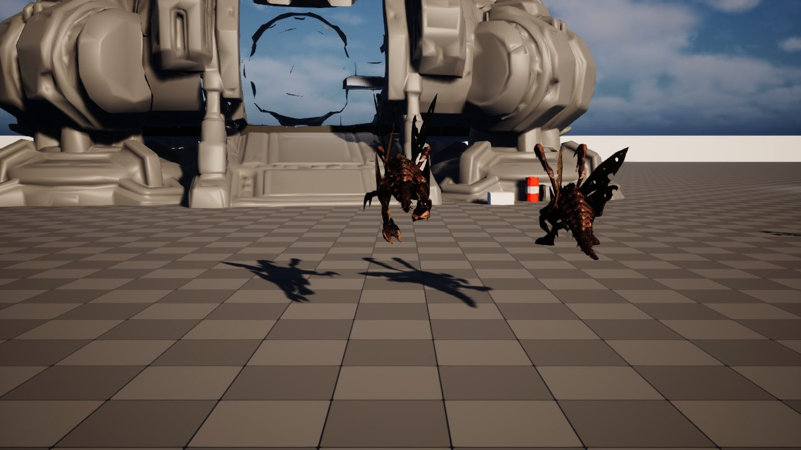

오늘부터 개발일지를 씁니다.

## 어떤 게임인가

스타크래프트 세계관의 1인칭 호드 슈터입니다.
저그에게 점령된 지역에 테란 정화팀 10명이 들어갑니다.
플레이어 1명과 AI 아군 9명이 저그 1000마리와 싸우면서 기지를 지킵니다.

- 정화팀이라 캐릭터·차량·건물이 모두 흰색입니다.
- 무기 상점 화면 대신, 기지 안의 실제 무기 거치대에서 총을 고릅니다.
- 효과는 현실에서 설명되는 것만 씁니다. 예를 들어 전투 자극제는 주사라서 총의 연사 속도를 올릴 수 없습니다.

## 기술

- Unreal Engine 5.8
- 저그는 Mass Entity로 1000마리를 돌립니다.
- 1인칭 사격의 바탕은 Low Poly Shooter Pack입니다.
- 목표: FHD에서 저그 1000마리와 싸우는 중에도 1% low 60fps 이상

*첫 주. 회색 바닥에 저글링 두 마리와 커맨드센터를 세워 놓고 재질을 맞췄습니다.*
