
세션 11개 · 사진 60장

<ul class="toc">
<li><a href="#zerg">zerg — 저그</a></li>
<li><a href="#material">material — 재질</a></li>
<li><a href="#vfx">vfx — 이펙트</a></li>
<li><a href="#terran">terran — 테란 아군</a></li>
<li><a href="#perf">perf — 성능</a></li>
<li><a href="#design">design — 기획</a></li>
<li><a href="#anim">anim — 애니메이션</a></li>
<li><a href="#level">level — 맵</a></li>
<li><a href="#audio">audio — 소리</a></li>
<li><a href="#swarm">swarm — 저그 무리</a></li>
<li><a href="#weapon">weapon — 무기</a></li>
</ul>
<h2 id="zerg">zerg <small>저그</small></h2>

저글링 달리기 속도를 빠르게 하고 발 미끄러짐을 고쳤습니다.

<a href="/assets/d/2026-09-25/capture_vatcd_side.jpg" target="_blank">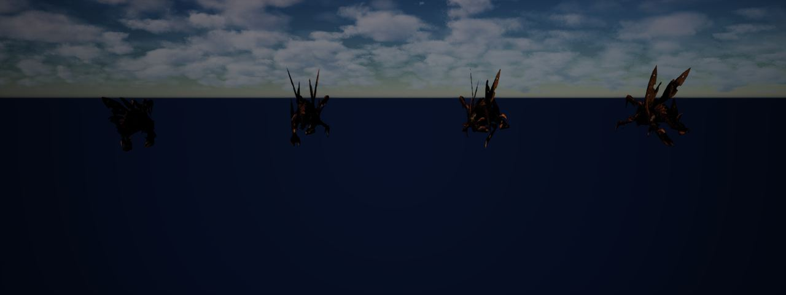</a>

00:46 지상 유닛과 대량 유닛 사이 애니메이션을 이어주는 할 일을 정리했습니다

<a href="/assets/d/2026-09-25/WindowsEditor_HighresScreenshot00084.jpg" target="_blank">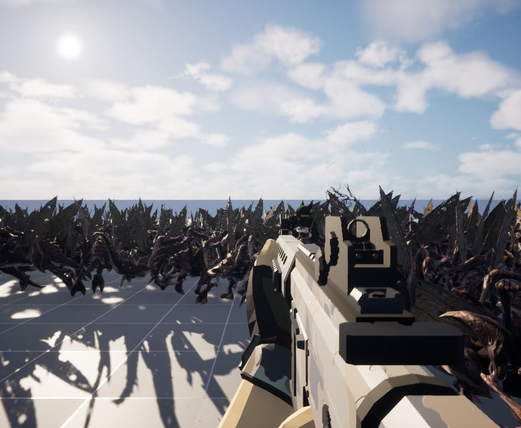</a>

01:00 저그 애니메이션용 데이터 값을 늘리고 화면 변화 확인 도구를 넣었습니다.

<a href="/assets/d/2026-09-25/WindowsEditor_flowprobe_before_base_eye.jpg" target="_blank">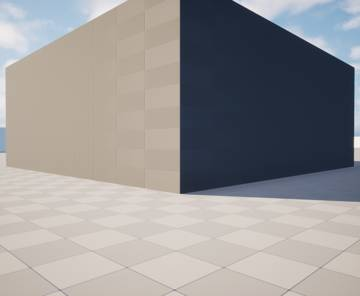</a>
<a href="/assets/d/2026-09-25/WindowsEditor_flowprobe_before_dust04_eye.jpg" target="_blank">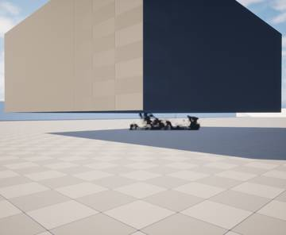</a>
<a href="/assets/d/2026-09-25/WindowsEditor_flowprobe_known.jpg" target="_blank">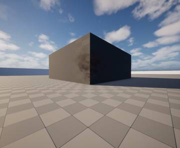</a>
<a href="/assets/d/2026-09-25/WindowsEditor_flowprobe_known_d.jpg" target="_blank">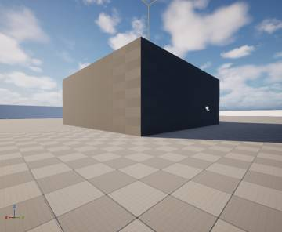</a>

11:14 화면 밖 적이 스스로 움직이게 해 새 맵에서 멈추던 문제를 고쳤습니다.

<a href="/assets/d/2026-09-25/WindowsEditor_gib_015.jpg" target="_blank">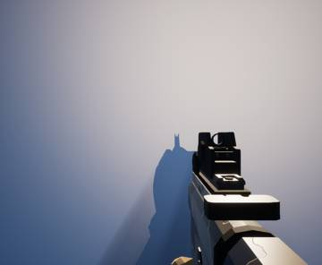</a>
<a href="/assets/d/2026-09-25/WindowsEditor_gib_020.jpg" target="_blank">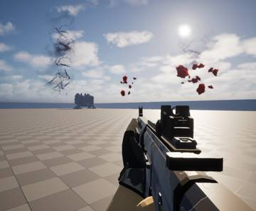</a>

15:28 적 앞줄이 멈춰버리던 문제를 고쳐 처치 수가 1239에서 1522로 늘었습니다.

<a href="/assets/d/2026-09-25/WindowsEditor_vfx_winghole.jpg" target="_blank">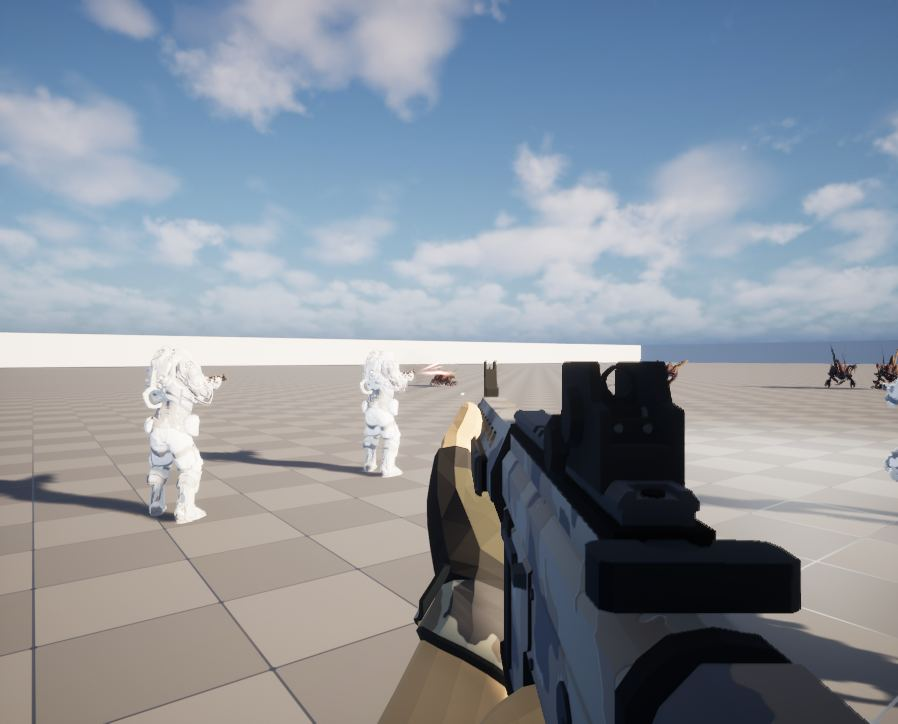</a>

19:37 저그 크기 유지와 날개 피격 반응 등 할 일을 정리했습니다

<h2 id="material">material <small>재질</small></h2>

하얀 피부 재질과 잘린 단면 재질을 만들었습니다.

<a href="/assets/d/2026-09-25/capture_vatcd_A.jpg" target="_blank">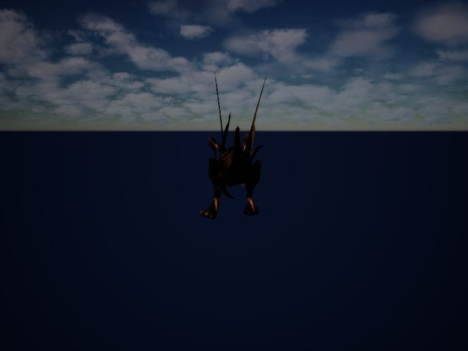</a>

00:50 실행 중에는 불가능한 촬영 옵션이 분명한 오류를 내도록 고쳤습니다

<a href="/assets/d/2026-09-25/capture_murdock_white_v3.jpg" target="_blank">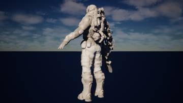</a>
<a href="/assets/d/2026-09-25/capture_murdock_orig_v3.jpg" target="_blank">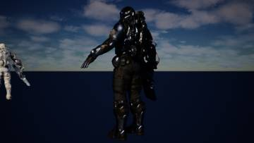</a>
<a href="/assets/d/2026-09-25/capture_murdock_whiteback_v3.jpg" target="_blank">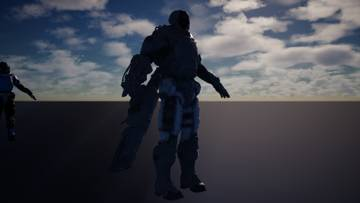</a>

14:00 머독 흰색 피부를 더 하얗게 조정했습니다.

<a href="/assets/d/2026-09-25/capture_murdock_rt_side.jpg" target="_blank">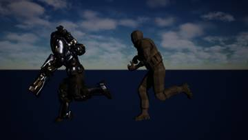</a>
<a href="/assets/d/2026-09-25/capture_murdock_rt_front.jpg" target="_blank">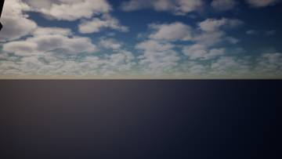</a>
<a href="/assets/d/2026-09-25/capture_murdock_ld_side.jpg" target="_blank">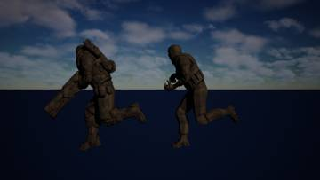</a>
<a href="/assets/d/2026-09-25/capture_murdock_ld_front.jpg" target="_blank">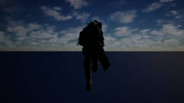</a>
<a href="/assets/d/2026-09-25/capture_murdock_final_side.jpg" target="_blank">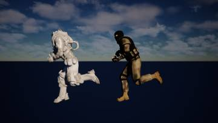</a>
<a href="/assets/d/2026-09-25/capture_murdock_final_front.jpg" target="_blank">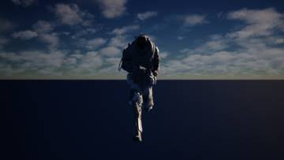</a>

14:08 머독의 재질을 흰색으로 바꾸고 포즈를 맞췄습니다

<h2 id="vfx">vfx <small>이펙트</small></h2>

바닥에 피 자국이 남고 피 표현이 더 작고 어두워졌습니다.

<a href="/assets/d/2026-09-25/WindowsEditor_vfxcap_blank_r0.jpg" target="_blank">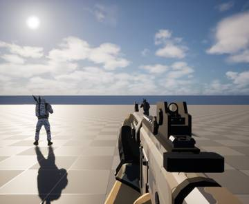</a>

<a href="/assets/d/2026-09-25/WindowsEditor_HighresScreenshot00085.jpg" target="_blank">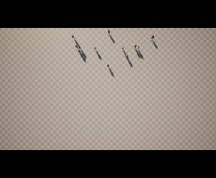</a>

01:24 피 묻은 면적을 비교하는 수치를 재고 촬영 스크립트를 만들었습니다.

<a href="/assets/d/2026-09-25/WindowsEditor_vfxglow_blank_r0.jpg" target="_blank">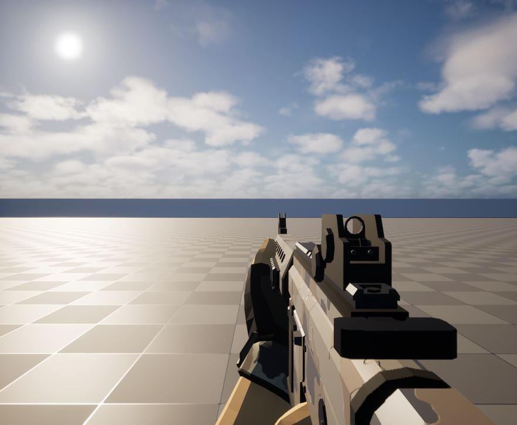</a>

10:26 피가 붉게 보이도록 피 전용 발광 재질을 조정했습니다.

<a href="/assets/d/2026-09-25/WindowsEditor_flowprobe_v1q_dust04_eye.jpg" target="_blank">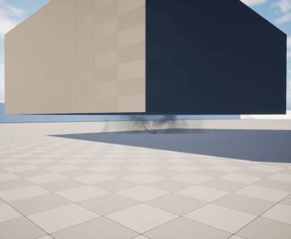</a>

11:21 먼지와 증기 효과를 점검하는 화면을 찍고 개선 계획을 적었습니다.

<a href="/assets/d/2026-09-25/WindowsEditor_flowprobe_new2_dust30_eye.jpg" target="_blank">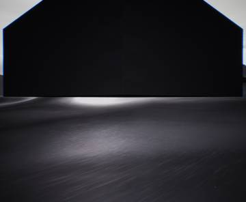</a>
<a href="/assets/d/2026-09-25/WindowsEditor_flowprobe_new2_base2_eye.jpg" target="_blank">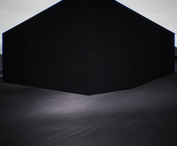</a>

11:46 먼지와 증기 효과 25개를 복사해 연출 템플릿에 적용했습니다

<a href="/assets/d/2026-09-25/WindowsEditor_q0_blank_r0.jpg" target="_blank">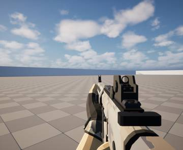</a>
<a href="/assets/d/2026-09-25/WindowsEditor_q0_near_r1.jpg" target="_blank">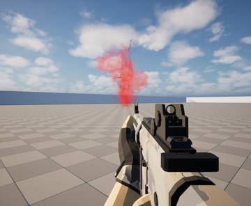</a>
<a href="/assets/d/2026-09-25/WindowsEditor_q0_blank_r4.jpg" target="_blank">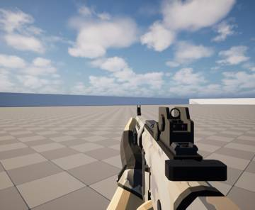</a>
<a href="/assets/d/2026-09-25/WindowsEditor_q3_blank_r0.jpg" target="_blank">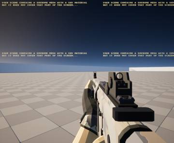</a>
<a href="/assets/d/2026-09-25/WindowsEditor_q3_near_r2.jpg" target="_blank">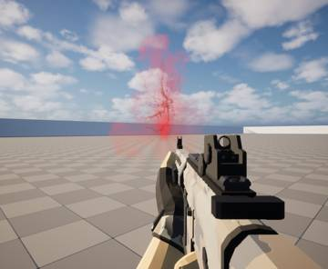</a>
<a href="/assets/d/2026-09-25/WindowsEditor_p3_blank_r0.jpg" target="_blank">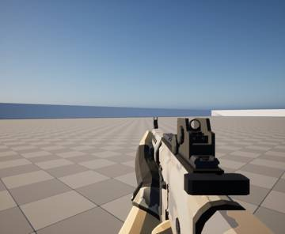</a>
<a href="/assets/d/2026-09-25/WindowsEditor_p0_dyn_r0.jpg" target="_blank">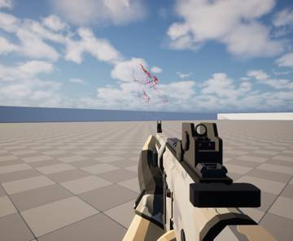</a>
<a href="/assets/d/2026-09-25/WindowsEditor_p0_near_r3.jpg" target="_blank">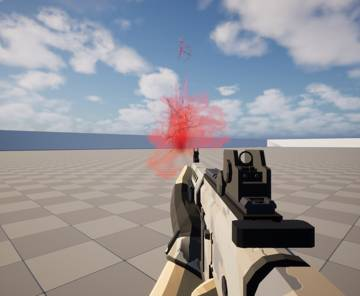</a>

12:03 피 표현 품질을 다시 점검하고 촬영 옵션을 추가했습니다

<a href="/assets/d/2026-09-25/WindowsEditor_vfx_bodydecal.jpg" target="_blank">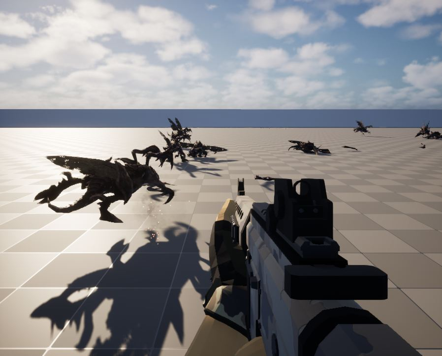</a>

21:30 상처 자국이 총알 경로를 따라 몸에 정확히 붙도록 고치고 크기도 줄였습니다

<a href="/assets/d/2026-09-25/vfx_floorblood_1.jpg" target="_blank">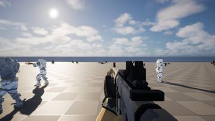</a>
<a href="/assets/d/2026-09-25/vfx_floorblood_2.jpg" target="_blank">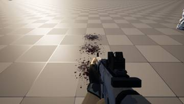</a>

23:05 저글링이 가까이서 죽으면 바닥에 핏자국이 남게 했습니다.

<h2 id="terran">terran <small>테란 아군</small></h2>

아군이 쏠 때만 총구 앞을 피하도록 하고 하얀 몸 외형을 적용했습니다.

<a href="/assets/d/2026-09-25/WindowsEditor_HighresScreenshot00086.jpg" target="_blank">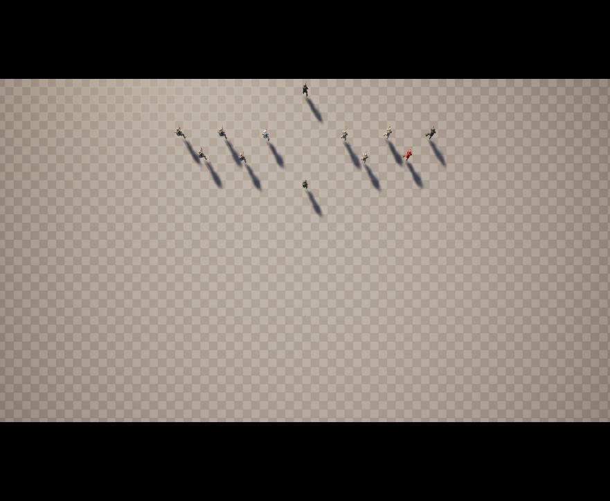</a>

01:26 인계 문서에 아군 따라가기 항목을 정리했습니다.

<a href="/assets/d/2026-09-25/WindowsEditor_HighresScreenshot00094.jpg" target="_blank">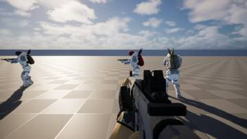</a>
<a href="/assets/d/2026-09-25/WindowsEditor_HighresScreenshot00095.jpg" target="_blank">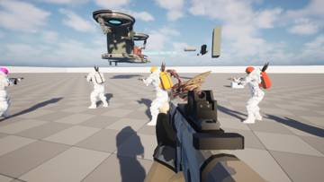</a>
<a href="/assets/d/2026-09-25/WindowsEditor_HighresScreenshot00096.jpg" target="_blank">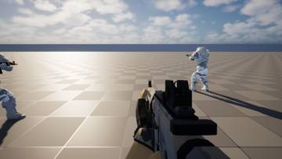</a>

18:41 플레이어와 아군에게 머독 흰색 몸을 입혔습니다.

<h2 id="perf">perf <small>성능</small></h2>

아군 11명이 있을 때 프레임이 얼마나 떨어지는지 측정했습니다.

<a href="/assets/d/2026-09-25/WindowsEditor_HighresScreenshot00088.jpg" target="_blank">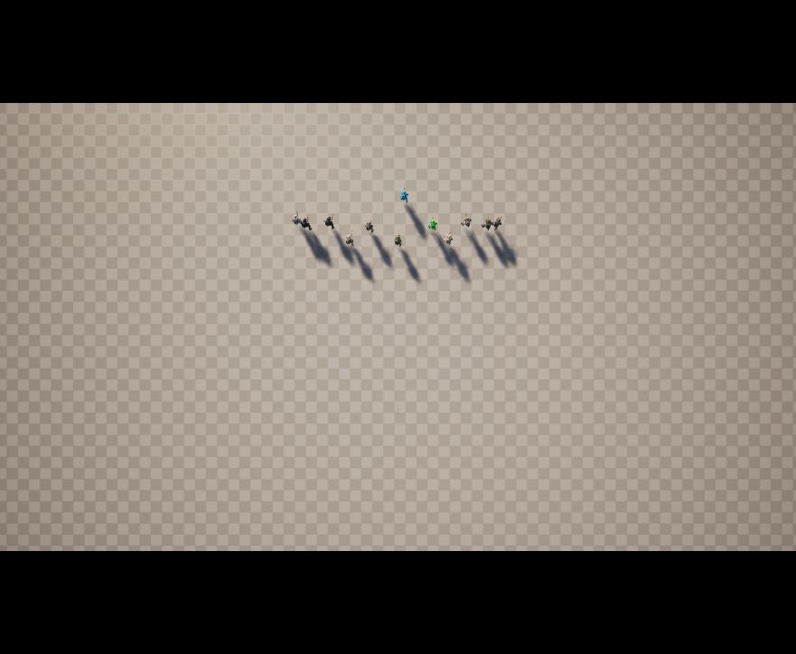</a>

01:48 메모리 정리 설정을 확인했지만 끊김의 원인은 아직 확인하지 못했습니다.

<h2 id="design">design <small>기획</small></h2>

저글링 속도와 웨이브 진행 방식 등 설계를 정했습니다.

<a href="/assets/d/2026-09-25/WindowsEditor_flowprobe_new_base_eye.jpg" target="_blank">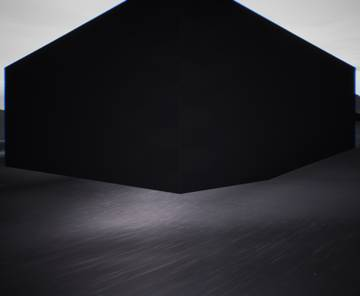</a>
<a href="/assets/d/2026-09-25/WindowsEditor_flowprobe_new_lift_eye.jpg" target="_blank">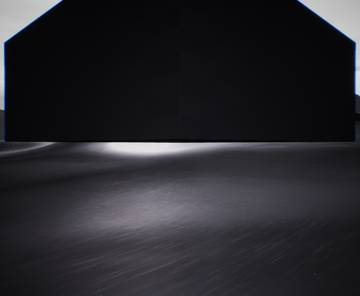</a>

11:45 가우스 총의 부착물 문의에 답변을 남겼습니다.

<h2 id="anim">anim <small>애니메이션</small></h2>

저글링 달리기 발 접지를 고쳐 미끄러짐을 줄였습니다.

<a href="/assets/d/2026-09-25/WindowsEditor_check_todo26-jump.jpg" target="_blank">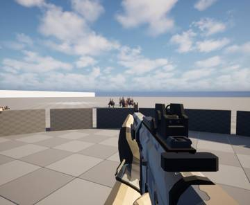</a>
<a href="/assets/d/2026-09-25/WindowsEditor_check_todo23-detail100.jpg" target="_blank">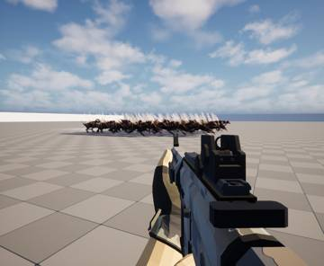</a>
<a href="/assets/d/2026-09-25/WindowsEditor_check_todo9-surround.jpg" target="_blank">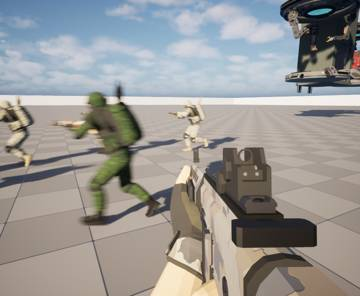</a>
<a href="/assets/d/2026-09-25/WindowsEditor_check_todo16-push.jpg" target="_blank">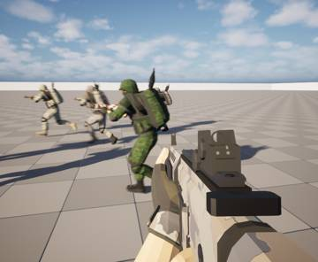</a>
<a href="/assets/d/2026-09-25/WindowsEditor_check_todo27-death.jpg" target="_blank">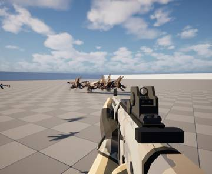</a>
<a href="/assets/d/2026-09-25/WindowsEditor_check_todo27-corpse-bullets.jpg" target="_blank">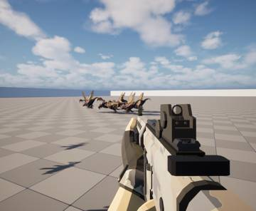</a>
<a href="/assets/d/2026-09-25/WindowsEditor_check_todo7-blood-amount.jpg" target="_blank">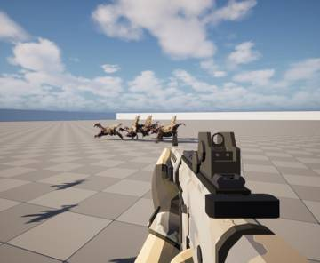</a>

13:22 저글링 도약 동작을 다시 맞췄지만 달라붙는 공격은 아직 막혀 있습니다.

13:57 저그 도약 동작 32개를 가져오고 60프레임 복사본도 만들었습니다

<h2 id="level">level <small>맵</small></h2>

시험용 맵을 만들고 아군 11명이 나오게 했습니다.

22:37 테스트용 지형 맵을 만들어 같은 장면의 fps가 62.33으로 같게 나오는지 확인했습니다.

<h2 id="audio">audio <small>소리</small></h2>

멀리서 들리는 무리 소리와 바람 같은 배경음을 넣었습니다.

<h2 id="swarm">swarm <small>저그 무리</small></h2>

저글링이 죽을 때 날아가는 거리와 절단 효과를 손봤습니다.

<h2 id="weapon">weapon <small>무기</small></h2>

파도처럼 몰려오는 저글링 흐름을 만드는 진행 방식을 넣었습니다.

