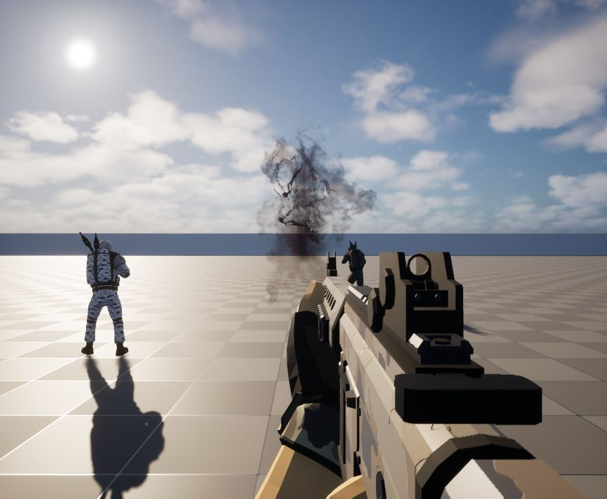
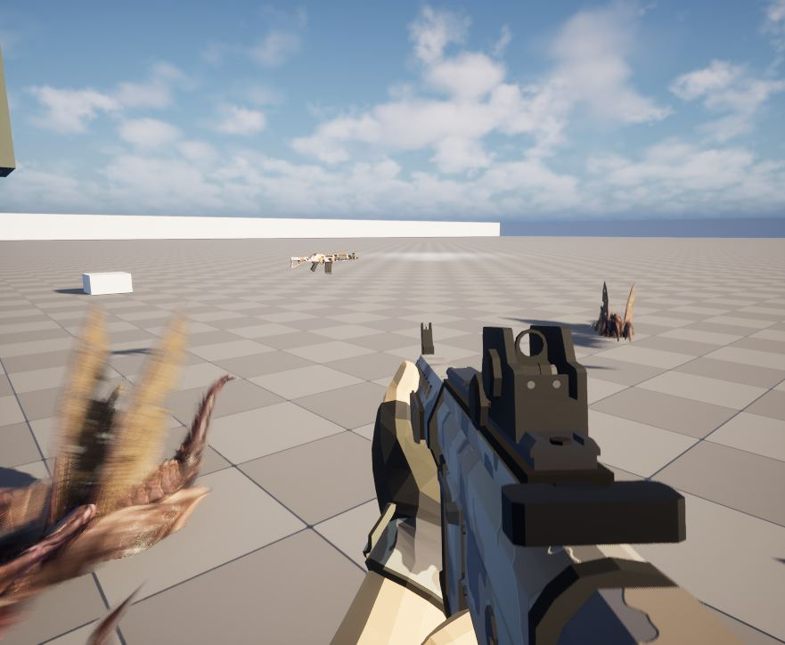
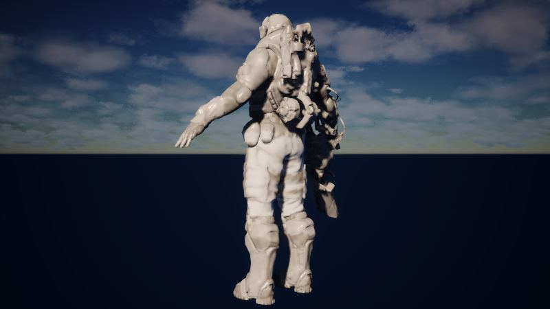
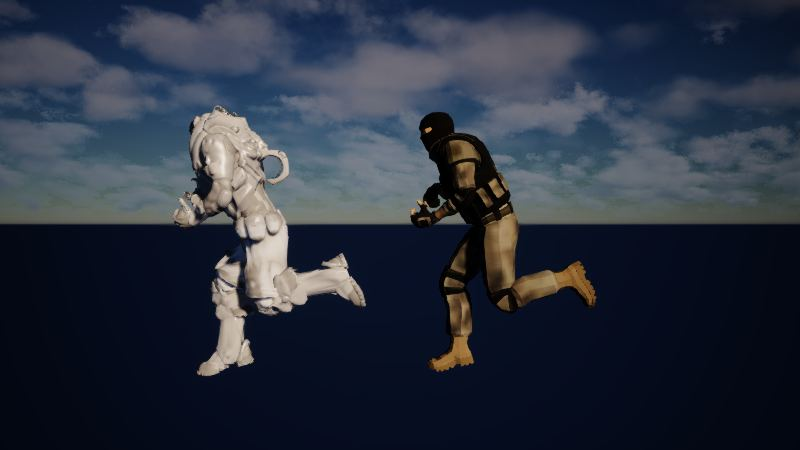
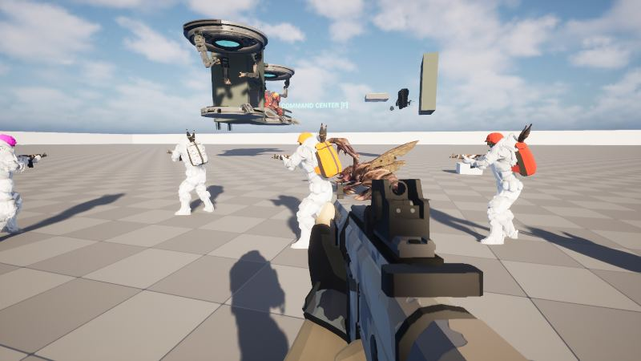
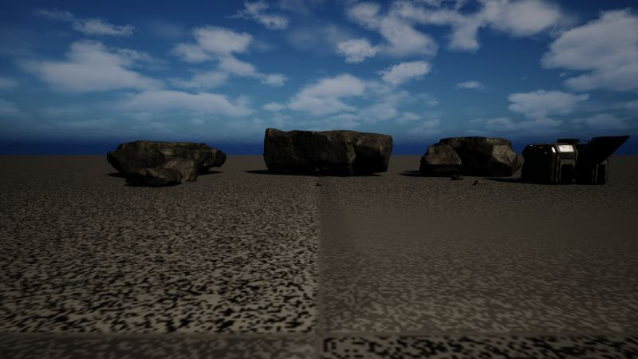

작업 6개 · 사진 9장

<ul class="toc">
<li><a href="#vfx">이펙트</a></li>
<li><a href="#zerg">저그</a></li>
<li><a href="#anim">애니메이션</a></li>
<li><a href="#material">재질</a></li>
<li><a href="#terran">테란 아군</a></li>
<li><a href="#level">맵</a></li>
</ul>
<h2 id="vfx">이펙트</h2>

피 표현을 다듬고 죽은 자리에 핏자국이 남게 했습니다.

01:24 피가 튀는 범위를 줄여 더 작게 보이게 했습니다.

10:26 피가 더 붉게 보이도록 고쳤습니다.

11:46 승강장에 먼지와 증기 효과를 넣었습니다.

12:03 피 효과의 품질을 다시 확인하고 다듬었습니다.

21:30 총알 상처 자국이 몸에 정확히 붙도록 고쳤습니다.

23:05 저글링이 죽으면 바닥에 핏자국이 남게 했습니다.

<h2 id="zerg">저그</h2>

저그가 스스로 움직이게 하고 멈추던 문제를 고쳤습니다.

11:14 화면 밖의 저그가 스스로 움직이게 해 멈추던 문제를 고쳤습니다.

15:28 저그 무리의 앞줄이 멈춰 서던 문제를 고쳤습니다.

19:37 저글링 날개를 맞았을 때 반응하도록 했습니다.

<h2 id="anim">애니메이션</h2>

저글링 덮치기 동작을 새로 가져왔습니다.

13:22 저글링 덮치기 동작을 새로 맞췄습니다.

13:57 저글링 덮치기 동작들을 게임에 넣었습니다.

<h2 id="material">재질</h2>

머독의 흰색 피부를 더 하얗게 조정했습니다.

14:00 머독 전투복의 흰색 피부를 더 하얗게 조정했습니다.

14:08 머독 재질을 흰색으로 바꾸고 동작을 맞췄습니다.

<h2 id="terran">테란 아군</h2>

플레이어와 아군에게 흰색 몸 외형을 입혔습니다.

18:41 플레이어와 아군에게 머독의 흰색 몸을 입혔습니다.

<h2 id="level">맵</h2>

시험용 맵에 지형과 건물을 만들었습니다.

22:37 시험용 맵에 지형과 건물을 만들었습니다.

