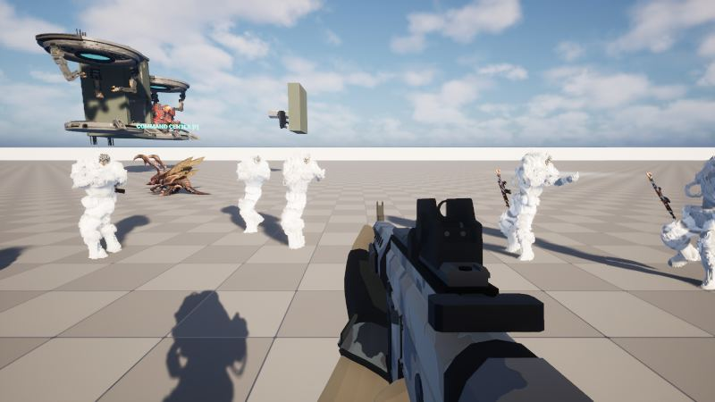
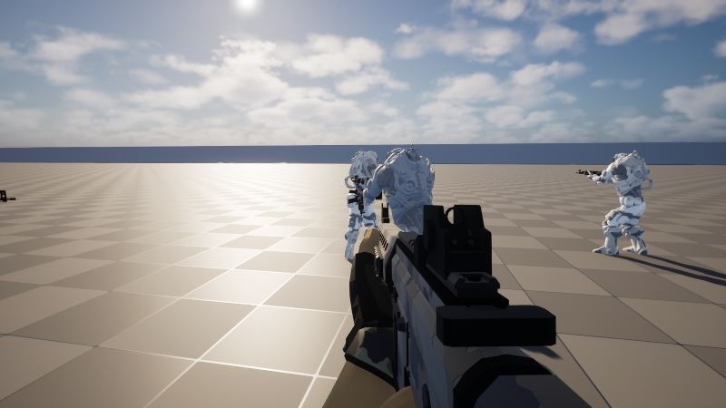
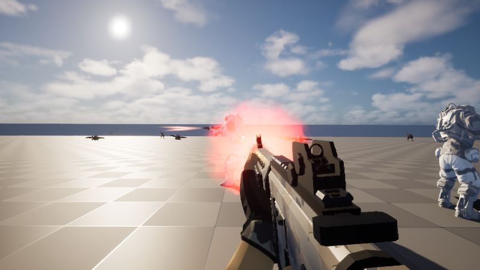

작업 2개 · 사진 5장

<ul class="toc">
<li><a href="#zerg">저그</a></li>
<li><a href="#terran">테란 아군</a></li>
</ul>
<h2 id="zerg">저그</h2>

저글링이 지그재그로 달려오게 했습니다.

08:28 저글링을 그리는 새로운 방식을 시험했습니다.

21:44 저글링이 지그재그로 달려오게 했습니다.

<h2 id="terran">테란 아군</h2>

아군의 조준을 다듬고 조절 패널을 만들었습니다.

14:52 아군의 상체 동작을 예전 방식으로 이어 붙였습니다.

15:01 아군이 두 손으로 조준하도록 고쳤습니다.

17:52 아군이 더 먼 거리의 저그도 알아보고 노리게 했습니다.

20:08 게임 안에서 값을 조절하는 패널을 만들었습니다.

20:20 머독의 흰색을 덜 하얗게 다듬었습니다.

20:23 머독의 흰색 정도를 패널에서 조절하게 했습니다.

20:37 조절 패널을 항목별 탭으로 나누고 마지막 탭을 기억하게 했습니다.

20:44 조절 패널에 의견을 적는 칸을 넣었습니다.

20:45 조절 패널에 항목별 초기화 버튼과 값 입력칸을 넣었습니다.

21:21 아군이 사격할 때 총을 어깨에 대도록 했습니다.

