
세션 10개 · 사진 23장

<ul class="toc">
<li><a href="#zerg">zerg — 저그</a></li>
<li><a href="#terran">terran — 테란 아군</a></li>
<li><a href="#design">design — 기획</a></li>
<li><a href="#audio">audio — 소리</a></li>
<li><a href="#level">level — 맵</a></li>
<li><a href="#material">material — 재질</a></li>
<li><a href="#perf">perf — 성능</a></li>
<li><a href="#swarm">swarm — 저그 무리</a></li>
<li><a href="#vfx">vfx — 이펙트</a></li>
<li><a href="#weapon">weapon — 무기</a></li>
</ul>
<h2 id="zerg">zerg <small>저그</small></h2>

저글링 지그재그 달리기와 타격음, 조절 패널을 넣었습니다.

<a href="/assets/d/2026-09-26/WindowsEditor_iskm_iskm.jpg" target="_blank">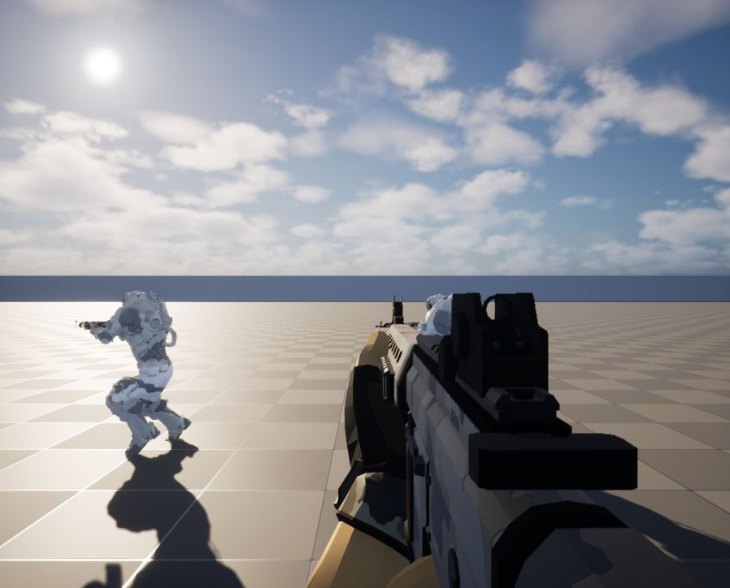</a>

08:28 먼 저글링을 인스턴스 스킨 메시로 그리는 5.8 새 기능을 시험했습니다.

<a href="/assets/d/2026-09-26/WindowsEditor_HighresScreenshot00097.jpg" target="_blank">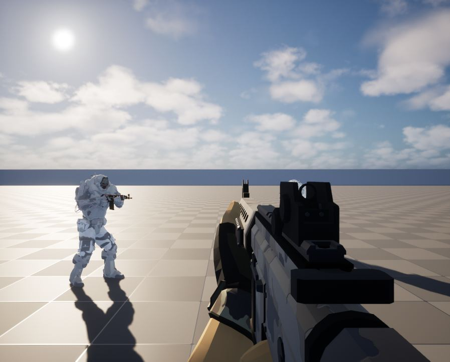</a>

09:32 스키닝 메시를 측정해 비용이 기존 방식과 같음을 확인했습니다

<a href="/assets/d/2026-09-26/WindowsEditor_ScreenShot00012.jpg" target="_blank">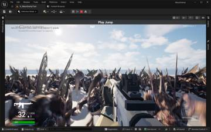</a>
<a href="/assets/d/2026-09-26/WindowsEditor_ScreenShot00013.jpg" target="_blank">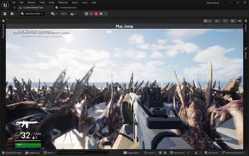</a>

21:44 저글링이 지그재그로 달려오게 하고 조절 패널에 항목을 넣었습니다.

<h2 id="terran">terran <small>테란 아군</small></h2>

아군이 사격 중에 총을 어깨에 대도록 하고 조절 패널을 개선했습니다.

<a href="/assets/d/2026-09-26/WindowsEditor_HighresScreenshot00099.jpg" target="_blank">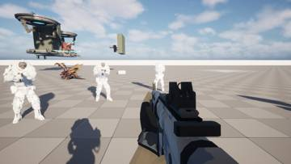</a>

14:52 이동 애니메이션의 상체를 옛 방식에서 가져오고 있으며 소총은 아직 떠 있습니다

<a href="/assets/d/2026-09-26/WindowsEditor_HighresScreenshot00100.jpg" target="_blank">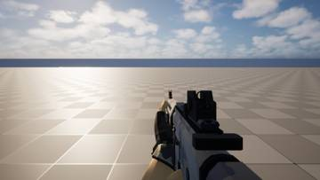</a>

15:01 이동 애니메이션 연결 오류로 총이 뜨던 문제를 고쳐 아군이 두 손으로 조준하게 했습니다.

<a href="/assets/d/2026-09-26/WindowsEditor_ScreenShot00001.jpg" target="_blank">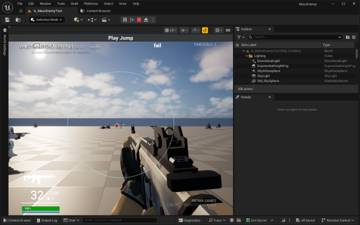</a>

17:52 아군이 먼 저그도 알아보도록 목표 인식 거리를 늘렸습니다.

<a href="/assets/d/2026-09-26/WindowsEditor_ScreenShot00002.jpg" target="_blank">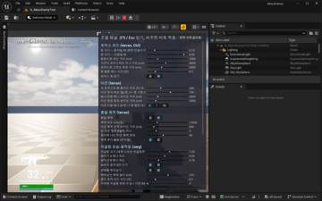</a>
<a href="/assets/d/2026-09-26/WindowsEditor_ScreenShot00003.jpg" target="_blank">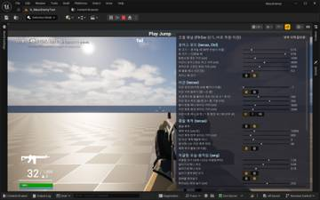</a>

20:08 F9로 여는 조절 패널을 만들어 슬라이더로 수치를 바로 바꾸게 했습니다.

<a href="/assets/d/2026-09-26/WindowsEditor_HighresScreenshot00103.jpg" target="_blank">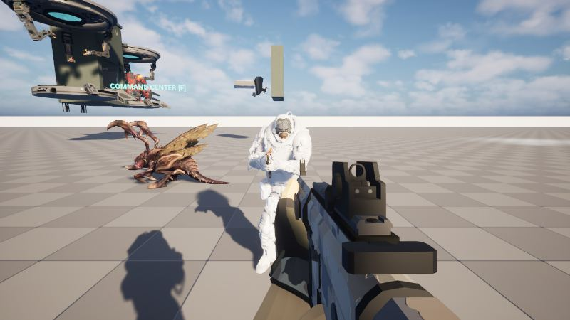</a>

20:20 머독 슈트의 흰색이 설탕 덩어리처럼 보이지 않게 값을 낮췄습니다.

<a href="/assets/d/2026-09-26/WindowsEditor_HighresScreenshot00105.jpg" target="_blank">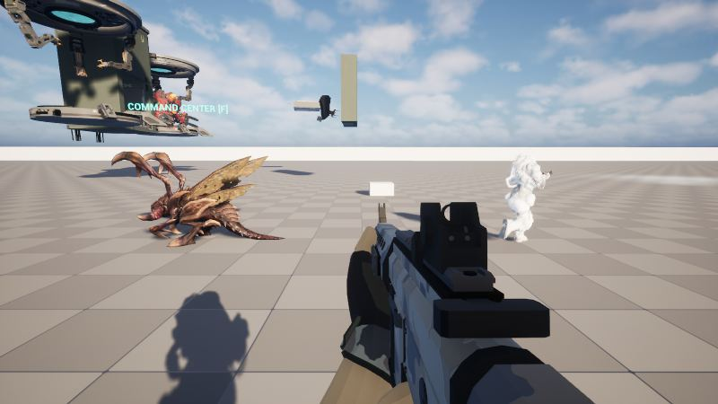</a>

20:23 머독 슈트의 흰색 정도를 조절하는 값을 패널에 넣고 전후 차이를 확인했습니다.

<a href="/assets/d/2026-09-26/WindowsEditor_ScreenShot00004.jpg" target="_blank">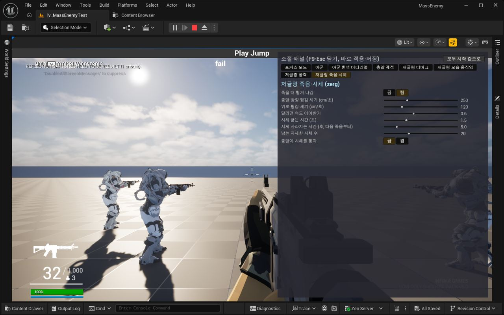</a>

20:37 조절 패널을 그룹별 탭으로 나누고 마지막 탭과 스크롤을 기억하게 했습니다.

<a href="/assets/d/2026-09-26/WindowsEditor_ScreenShot00005.jpg" target="_blank">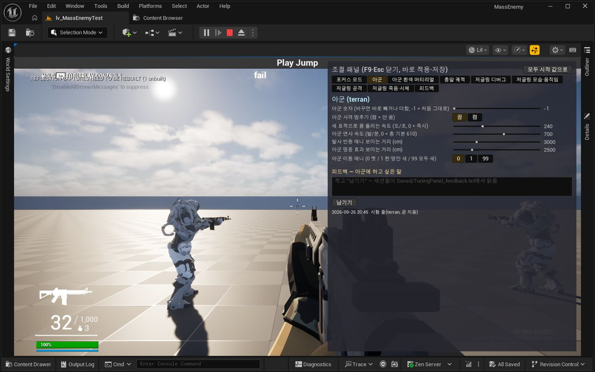</a>

20:44 조정 패널 아래에 의견 입력칸과 피드백 탭을 넣어 메모가 파일에 쌓이게 했습니다.

<a href="/assets/d/2026-09-26/WindowsEditor_ScreenShot00006.jpg" target="_blank">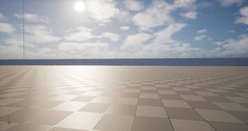</a>
<a href="/assets/d/2026-09-26/WindowsEditor_ScreenShot00007.jpg" target="_blank">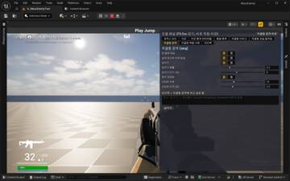</a>

20:45 패널 설정에 탭별 초기화, 값 입력칸, 단계 맞춤을 추가했습니다

<a href="/assets/d/2026-09-26/WindowsEditor_ScreenShot00008.jpg" target="_blank">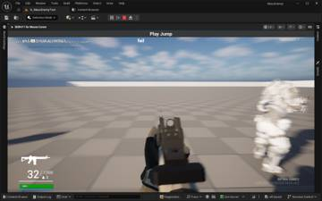</a>
<a href="/assets/d/2026-09-26/WindowsEditor_ScreenShot00009.jpg" target="_blank">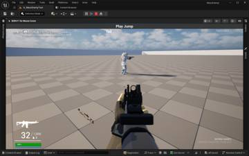</a>
<a href="/assets/d/2026-09-26/WindowsEditor_ScreenShot00010.jpg" target="_blank">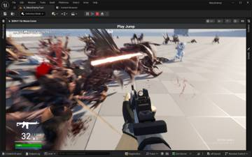</a>
<a href="/assets/d/2026-09-26/WindowsEditor_ScreenShot00011.jpg" target="_blank">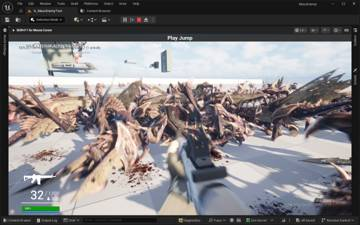</a>

21:21 아군이 사격 중에 소총을 어깨에 붙여 조준하게 했습니다

<h2 id="design">design <small>기획</small></h2>

지형이 저글링 무리를 갈라놓도록 설계 방향을 정했습니다.

<a href="/assets/d/2026-09-26/WindowsEditor_ScreenShot00000.jpg" target="_blank">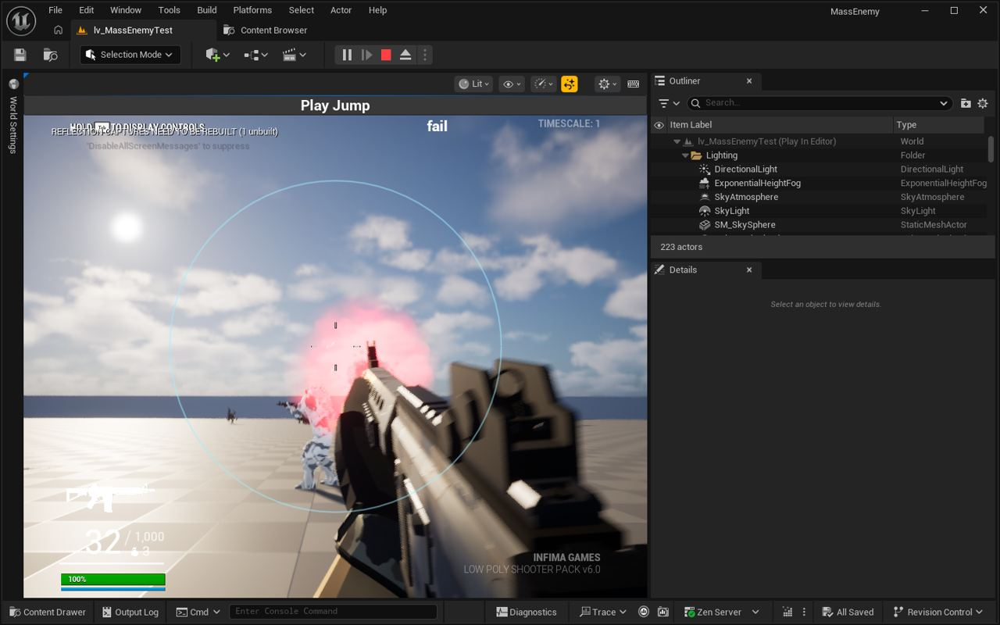</a>

17:53 지형으로 저그 무리가 여러 길로 갈라지게 하고, 길마다 좁은 목을 두었습니다.

<h2 id="audio">audio <small>소리</small></h2>

동시에 나는 소리 개수를 확인하는 기능을 넣었습니다.

<h2 id="level">level <small>맵</small></h2>

맵 작업이 에디터 문제로 중단되었습니다.

<h2 id="material">material <small>재질</small></h2>

하얀 몸 재질 작업을 다른 담당에게 넘겼습니다.

<h2 id="perf">perf <small>성능</small></h2>

프레임이 가장 떨어지는 순간의 원인을 측정했습니다.

<h2 id="swarm">swarm <small>저그 무리</small></h2>

저글링 무리가 길에 막히는 문제를 검사했습니다.

<h2 id="vfx">vfx <small>이펙트</small></h2>

피 효과를 한꺼번에 끄고 켜는 스위치를 만들었습니다.

<h2 id="weapon">weapon <small>무기</small></h2>

플레이어 사격이 저글링에 맞는지 검사하는 시험 기능을 넣었습니다.

