
세션 10개 · 사진 59장

<ul class="toc">
<li><a href="#terran">terran — 테란 아군</a></li>
<li><a href="#audio">audio — 소리</a></li>
<li><a href="#level">level — 맵</a></li>
<li><a href="#vfx">vfx — 이펙트</a></li>
<li><a href="#anim">anim — 애니메이션</a></li>
<li><a href="#audio+zerg">audio+zerg — audio+zerg</a></li>
<li><a href="#design">design — 기획</a></li>
<li><a href="#material">material — 재질</a></li>
<li><a href="#perf">perf — 성능</a></li>
<li><a href="#zerg">zerg — 저그</a></li>
</ul>
<h2 id="terran">terran <small>테란 아군</small></h2>

아군 AI의 부담을 줄이는 설정들을 추가했습니다.

<a href="/assets/d/2026-09-27/WindowsEditor_ScreenShot00014.jpg" target="_blank">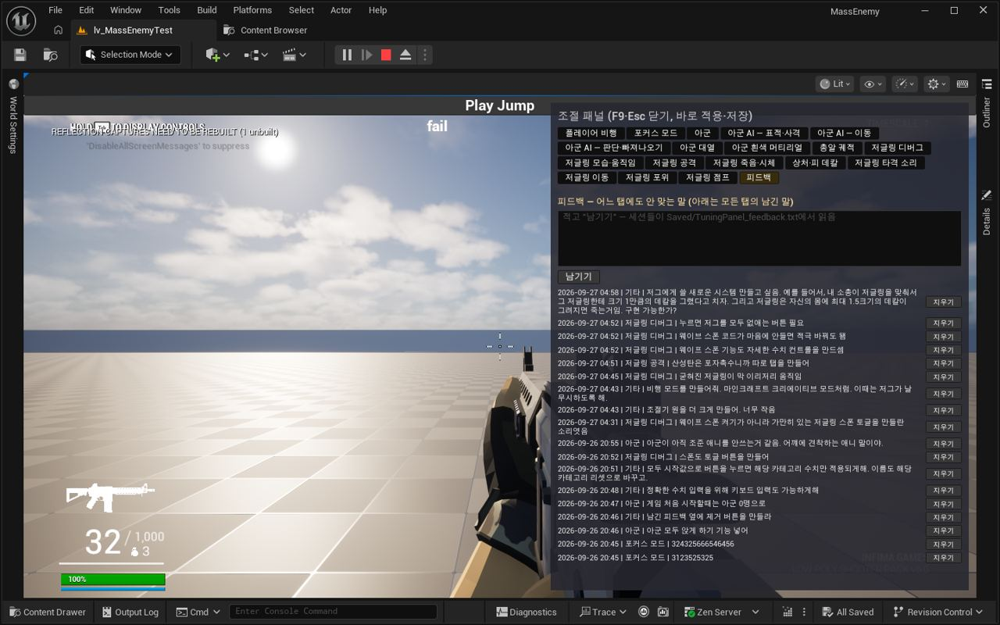</a>

05:05 비행 모드와 아군 앉기 옵션, 피드백 삭제 버튼을 패널 의견에 맞춰 넣었습니다.

<a href="/assets/d/2026-09-27/WindowsEditor_HighresScreenshot00109.jpg" target="_blank">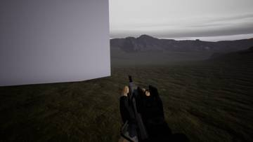</a>
<a href="/assets/d/2026-09-27/WindowsEditor_HighresScreenshot00110.jpg" target="_blank">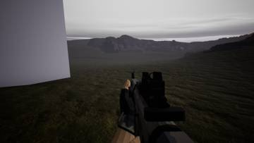</a>

14:51 준비, 습격, 방어 단계로 이어지는 방어전 흐름을 만들었습니다.

<h2 id="audio">audio <small>소리</small></h2>

저글링 무리의 숨소리와 먼지 소리 등 새 소리 층을 만들었습니다.

<a href="/assets/d/2026-09-27/WindowsEditor_HighresScreenshot00107.jpg" target="_blank">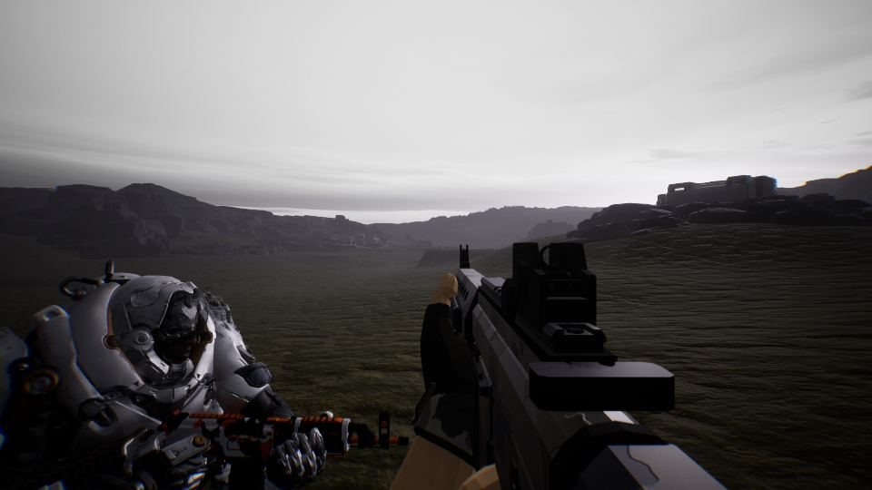</a>

14:46 아군 목소리를 실전 영상 10개에서 더 뽑아 전투 대사를 늘렸습니다.

<h2 id="level">level <small>맵</small></h2>

맵의 조명과 바위 등을 가볍게 바꿔 성능을 높였습니다.

<a href="/assets/d/2026-09-27/WindowsEditor_HighresScreenshot00111.jpg" target="_blank">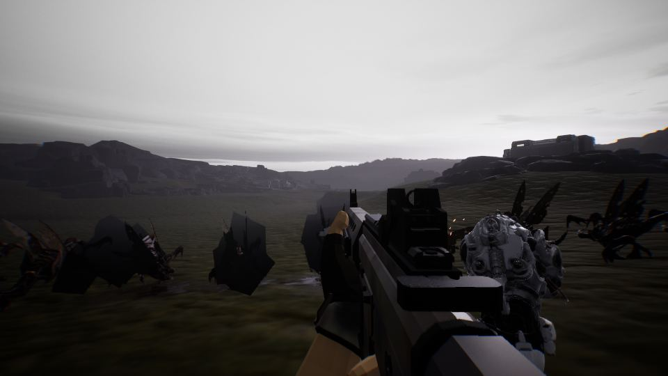</a>

14:55 안개와 하늘을 손봐 가까이서 저그의 실루엣이 잘 보이게 했습니다.

<a href="/assets/d/2026-09-27/capture_lvl4_a_cliffrock.jpg" target="_blank">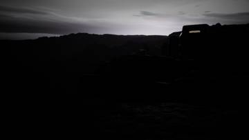</a>
<a href="/assets/d/2026-09-27/capture_lvl4_b_rocks.jpg" target="_blank">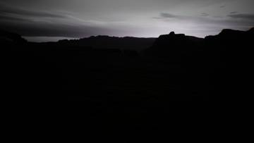</a>
<a href="/assets/d/2026-09-27/WindowsEditor_HighresScreenshot00113.jpg" target="_blank">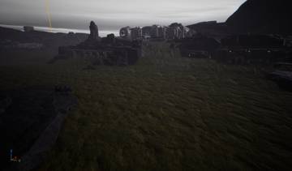</a>
<a href="/assets/d/2026-09-27/WindowsEditor_HighresScreenshot00114.jpg" target="_blank">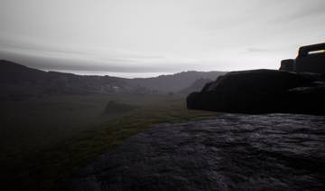</a>
<a href="/assets/d/2026-09-27/WindowsEditor_HighresScreenshot00115.jpg" target="_blank">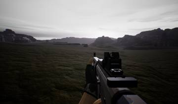</a>
<a href="/assets/d/2026-09-27/WindowsEditor_HighresScreenshot00116.jpg" target="_blank">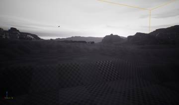</a>
<a href="/assets/d/2026-09-27/WindowsEditor_HighresScreenshot00119.jpg" target="_blank">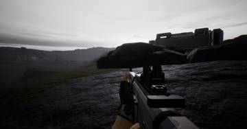</a>
<a href="/assets/d/2026-09-27/WindowsEditor_HighresScreenshot00120.jpg" target="_blank">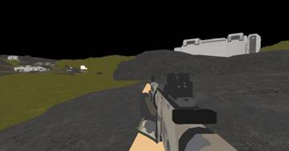</a>
<a href="/assets/d/2026-09-27/WindowsEditor_HighresScreenshot00121.jpg" target="_blank">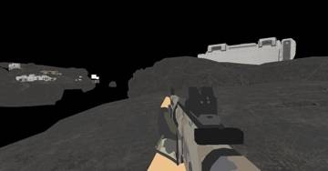</a>
<a href="/assets/d/2026-09-27/WindowsEditor_HighresScreenshot00122.jpg" target="_blank">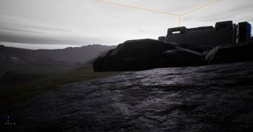</a>
<a href="/assets/d/2026-09-27/WindowsEditor_HighresScreenshot00123.jpg" target="_blank">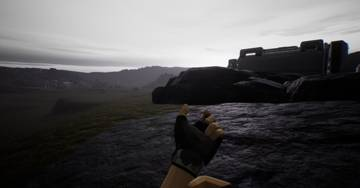</a>

16:55 새 맵의 땅 색을 올리브색에서 회색으로 바꾸고 풀 식생을 지웠습니다.

<a href="/assets/d/2026-09-27/WindowsEditor_HighresScreenshot00124.jpg" target="_blank">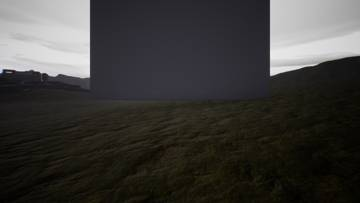</a>
<a href="/assets/d/2026-09-27/WindowsEditor_HighresScreenshot00127.jpg" target="_blank">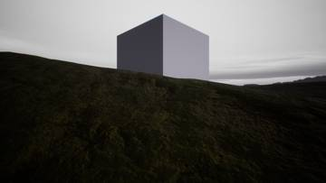</a>
<a href="/assets/d/2026-09-27/WindowsEditor_HighresScreenshot00129.jpg" target="_blank">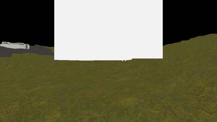</a>
<a href="/assets/d/2026-09-27/WindowsEditor_HighresScreenshot00130.jpg" target="_blank">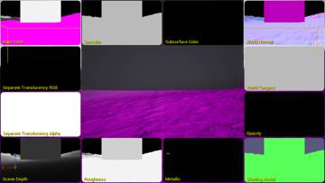</a>

17:09 메인 레벨에 촬영용 카메라 다섯 대를 배치하고 지형 재질을 다시 저장했습니다.

<a href="/assets/d/2026-09-27/WindowsEditor_HighresScreenshot00134.jpg" target="_blank">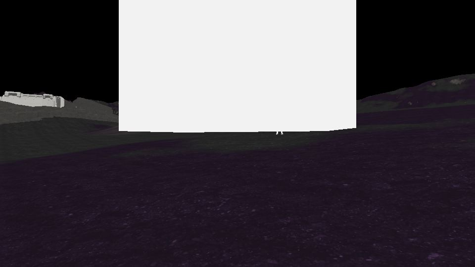</a>

17:30 평지가 올리브색으로 보이던 지형 색을 바로잡았습니다

<a href="/assets/d/2026-09-27/WindowsEditor_HighresScreenshot00140.jpg" target="_blank">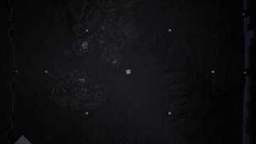</a>
<a href="/assets/d/2026-09-27/WindowsEditor_HighresScreenshot00141.jpg" target="_blank">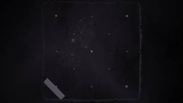</a>

17:35 플레이 영역 둘레에 상자를 둘러 10개 입구가 열린 모형을 만들었습니다.

<a href="/assets/d/2026-09-27/WindowsEditor_HighresScreenshot00143.jpg" target="_blank">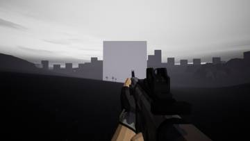</a>
<a href="/assets/d/2026-09-27/WindowsEditor_HighresScreenshot00144.jpg" target="_blank">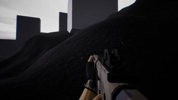</a>
<a href="/assets/d/2026-09-27/WindowsEditor_HighresScreenshot00145.jpg" target="_blank">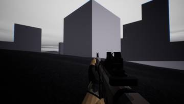</a>
<a href="/assets/d/2026-09-27/WindowsEditor_HighresScreenshot00146.jpg" target="_blank">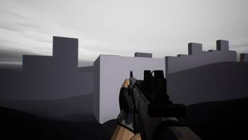</a>
<a href="/assets/d/2026-09-27/WindowsEditor_HighresScreenshot00147.jpg" target="_blank">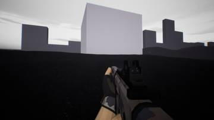</a>
<a href="/assets/d/2026-09-27/WindowsEditor_HighresScreenshot00148.jpg" target="_blank">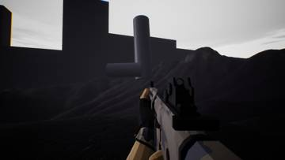</a>
<a href="/assets/d/2026-09-27/WindowsEditor_HighresScreenshot00149.jpg" target="_blank">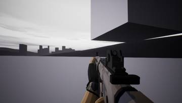</a>
<a href="/assets/d/2026-09-27/WindowsEditor_HighresScreenshot00150.jpg" target="_blank">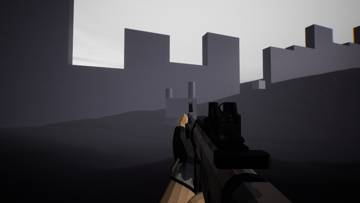</a>
<a href="/assets/d/2026-09-27/WindowsEditor_HighresScreenshot00151.jpg" target="_blank">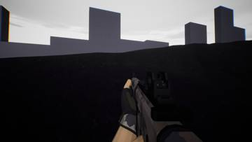</a>
<a href="/assets/d/2026-09-27/WindowsEditor_HighresScreenshot00152.jpg" target="_blank">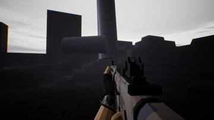</a>
<a href="/assets/d/2026-09-27/WindowsEditor_HighresScreenshot00155.jpg" target="_blank">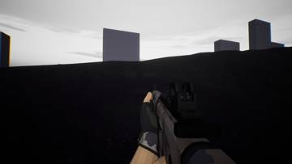</a>
<a href="/assets/d/2026-09-27/WindowsEditor_HighresScreenshot00157.jpg" target="_blank">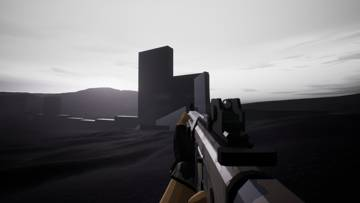</a>

17:47 맵 구역마다 부서진 탑, 가스 추출기, 추락한 수송선 등의 랜드마크를 놓았습니다.

<a href="/assets/d/2026-09-27/WindowsEditor_HighresScreenshot00159.jpg" target="_blank">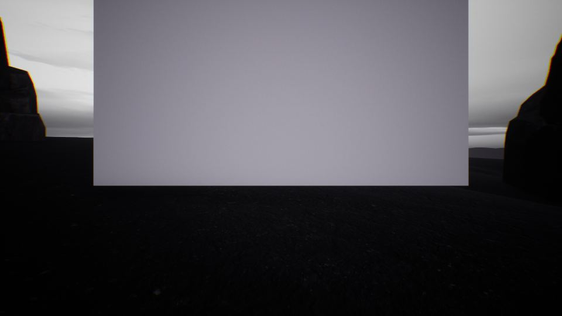</a>

17:55 임시 벽을 절벽 222개로 바꾸고 이동 경로를 다시 계산했습니다

<a href="/assets/d/2026-09-27/WindowsEditor_HighresScreenshot00160.jpg" target="_blank">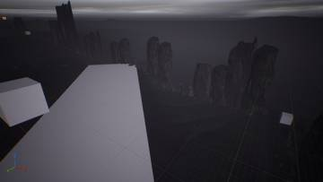</a>
<a href="/assets/d/2026-09-27/WindowsEditor_HighresScreenshot00162.jpg" target="_blank">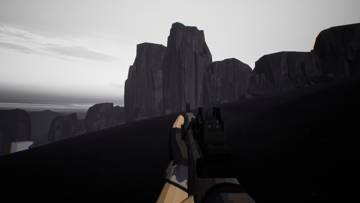</a>

17:57 바위 식생 925개를 절벽 아래와 건물 가장자리에 심어 이음매를 가렸습니다.

<a href="/assets/d/2026-09-27/WindowsEditor_HighresScreenshot00163.jpg" target="_blank">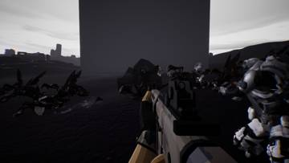</a>
<a href="/assets/d/2026-09-27/WindowsEditor_HighresScreenshot00164.jpg" target="_blank">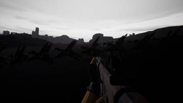</a>
<a href="/assets/d/2026-09-27/WindowsEditor_HighresScreenshot00167.jpg" target="_blank">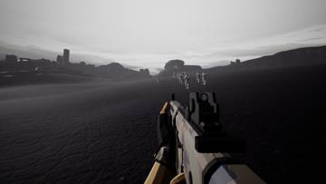</a>
<a href="/assets/d/2026-09-27/WindowsEditor_HighresScreenshot00170.jpg" target="_blank">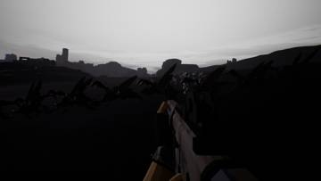</a>
<a href="/assets/d/2026-09-27/WindowsEditor_HighresScreenshot00171.jpg" target="_blank">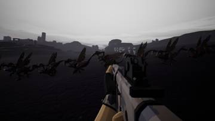</a>
<a href="/assets/d/2026-09-27/WindowsEditor_HighresScreenshot00173.jpg" target="_blank">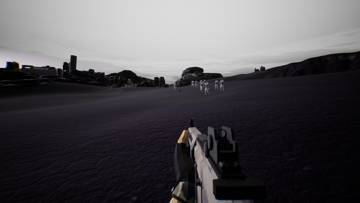</a>

17:59 하늘을 훨씬 어둡게 바꿔 저그의 실루엣이 더 짙게 보이도록 했습니다

<a href="/assets/d/2026-09-27/WindowsEditor_HighresScreenshot00178.jpg" target="_blank">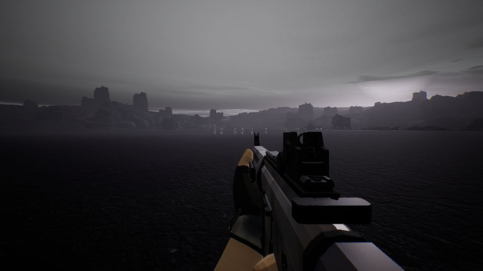</a>

18:22 맵 중앙 원 안의 건물과 바위를 바깥으로 옮기고 길찾기를 다시 만들었습니다.

<a href="/assets/d/2026-09-27/capture_gauss_side_m1.jpg" target="_blank">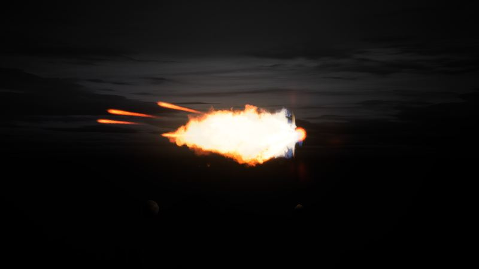</a>

18:52 임시 이펙트를 지운 뒤 메인 레벨을 다시 저장했습니다.

<h2 id="vfx">vfx <small>이펙트</small></h2>

총알 충격 효과의 수를 제한해 가볍게 만들었습니다.

<a href="/assets/d/2026-09-27/capture_vfxtmp_orig.jpg" target="_blank">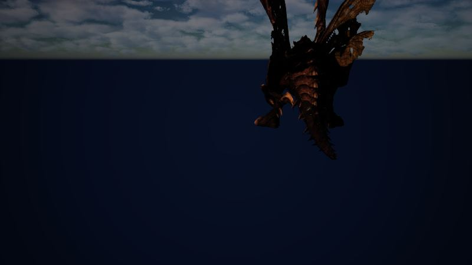</a>

15:17 날개 촬영 메모를 남겼습니다

<a href="/assets/d/2026-09-27/capture_gauss_t1_side.jpg" target="_blank">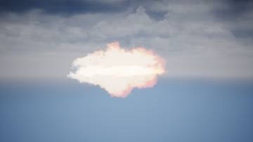</a>
<a href="/assets/d/2026-09-27/capture_gauss_t1_q.jpg" target="_blank">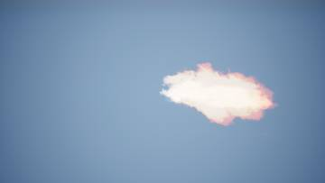</a>
<a href="/assets/d/2026-09-27/capture_gauss_t2_side.jpg" target="_blank">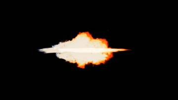</a>

18:40 가우스 소총 총구 섬광을 만드는 중이며 아직 별 모양이 덜 맞습니다

18:57 가우스 총구 화염을 네 갈래 별 모양으로 고쳤습니다.

<h2 id="anim">anim <small>애니메이션</small></h2>

저글링이 달라붙는 동작을 좌우 대칭으로 다듬었습니다.

<h2 id="audio+zerg">audio+zerg <small>audio+zerg</small></h2>

소리 조절 패널에 저글링 소리 항목들을 정리했습니다.

<h2 id="design">design <small>기획</small></h2>

저글링이 사방에서 오고 터렛이 중앙에만 놓이도록 설계했습니다.

<h2 id="material">material <small>재질</small></h2>

날개 구멍과 시체 사라짐에 대한 답변을 정리했습니다.

<h2 id="perf">perf <small>성능</small></h2>

시체 처리를 가볍게 해서 평균 62프레임, 하위 1% 45프레임까지 올렸습니다.

<h2 id="zerg">zerg <small>저그</small></h2>

저글링 시체와 점프 동작에서 생기는 끊김을 줄였습니다.

