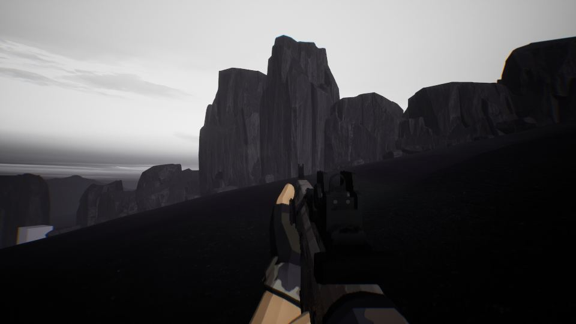

작업 4개 · 사진 11장

<ul class="toc">
<li><a href="#terran">테란 아군</a></li>
<li><a href="#audio">소리</a></li>
<li><a href="#level">맵</a></li>
<li><a href="#vfx">이펙트</a></li>
</ul>
<h2 id="terran">테란 아군</h2>

비행 모드와 방어 진행 흐름을 넣었습니다.

05:05 공중을 날아다니는 비행 모드를 넣었습니다.

14:51 준비, 습격, 방어로 이어지는 진행 흐름을 넣었습니다.

<h2 id="audio">소리</h2>

아군 대사를 더 다양하게 늘렸습니다.

14:46 아군이 외치는 대사를 더 다양하게 늘렸습니다.

<h2 id="level">맵</h2>

맵의 땅과 하늘, 절벽과 지형지물을 새로 꾸몄습니다.

14:55 안개와 하늘을 다듬어 저그의 모습이 잘 보이게 했습니다.

16:56 새 맵의 땅을 회색으로 바꾸고 풀과 식물을 심었습니다.

17:09 맵에 촬영용 카메라를 놓았습니다.

17:30 평지가 올리브색으로 보이던 지형 색을 고쳤습니다.

17:47 맵 곳곳에 탑과 가스 시설 같은 지형지물을 세웠습니다.

17:55 임시 벽을 절벽 모양으로 바꿨습니다.

17:57 절벽 아래와 건물 주변에 바위를 깔아 이음새를 감췄습니다.

17:59 하늘을 어둡게 바꿔 분위기를 살렸습니다.

18:22 맵 한가운데를 비우고 건물을 옆으로 옮겼습니다.

<h2 id="vfx">이펙트</h2>

가우스 소총의 총구 불꽃을 새로 만들었습니다.

18:40 가우스 소총의 총구 불꽃을 새로 만들고 있습니다.

18:57 가우스 소총 총구 불꽃을 별 모양으로 다듬었습니다.

