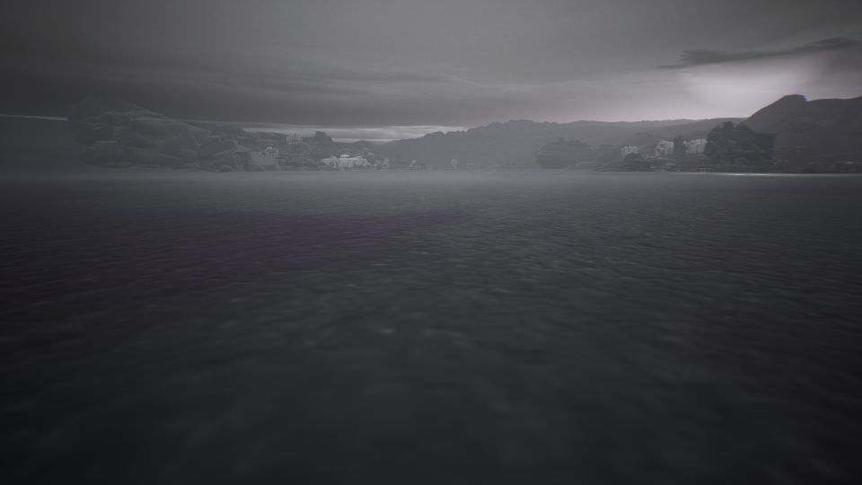

세션 7개 · 사진 1장

<ul class="toc">
<li><a href="#terran">terran — 테란 아군</a></li>
<li><a href="#audio">audio — 소리</a></li>
<li><a href="#design">design — 기획</a></li>
<li><a href="#level">level — 맵</a></li>
<li><a href="#perf">perf — 성능</a></li>
<li><a href="#vfx">vfx — 이펙트</a></li>
<li><a href="#zerg">zerg — 저그</a></li>
</ul>
<h2 id="terran">terran <small>테란 아군</small></h2>

아군의 상체가 시선 방향을 부드럽게 따르도록 고쳤습니다.

10:15 총소리 꼬리음을 아군 사격과 플레이어 총에 넣고 아군 이동 옵션을 추가했습니다.

<h2 id="audio">audio <small>소리</small></h2>

조절 패널의 소리 항목 이름을 알기 쉽게 바꾸고 총소리를 바꿨습니다.

<h2 id="design">design <small>기획</small></h2>

아군을 9명으로 줄이고 건물별 시간대를 정했습니다.

<h2 id="level">level <small>맵</small></h2>

안개를 옅게 하고 건물 300개를 묶어 맵을 가볍게 했습니다.

<h2 id="perf">perf <small>성능</small></h2>

저글링 이동 관련 처리들의 속도를 비교 측정했습니다.

<h2 id="vfx">vfx <small>이펙트</small></h2>

바닥 핏자국이 거울처럼 하얗게 보이던 문제를 고쳤습니다.

<h2 id="zerg">zerg <small>저그</small></h2>

저글링이 서로 피하는 거리를 조정하고 타격음 항목을 넣었습니다.

