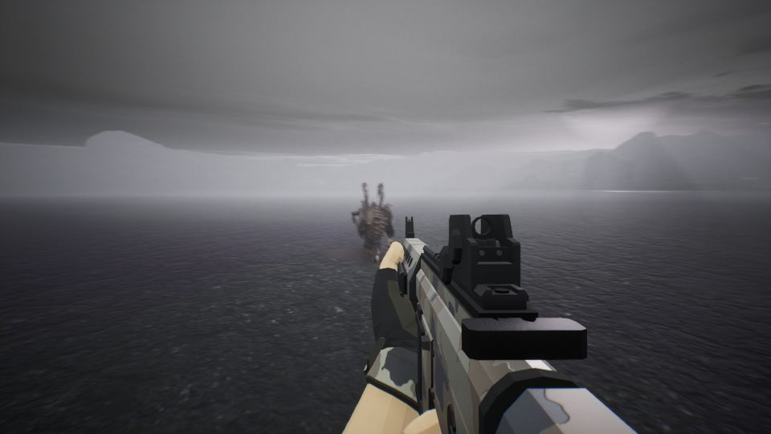
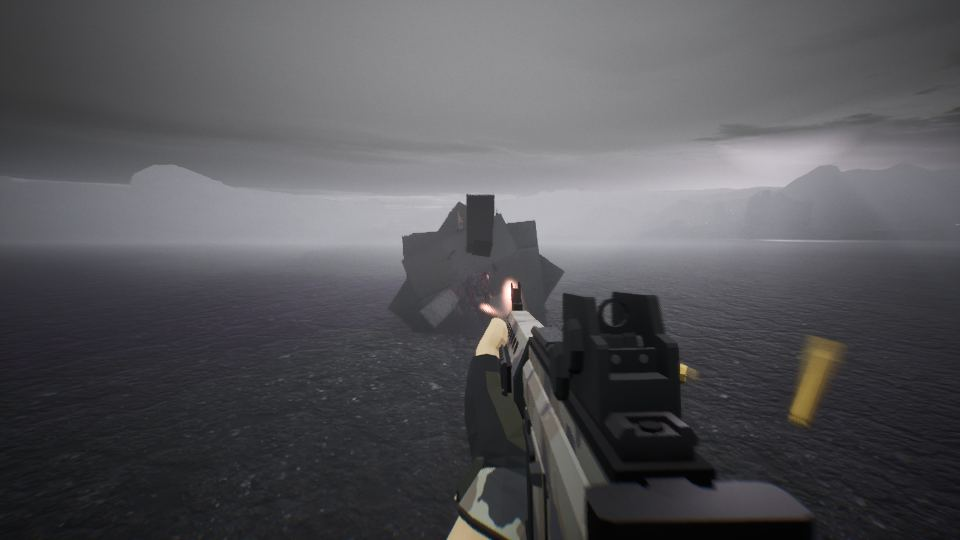
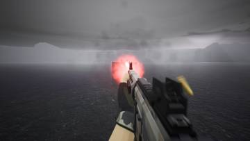
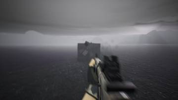
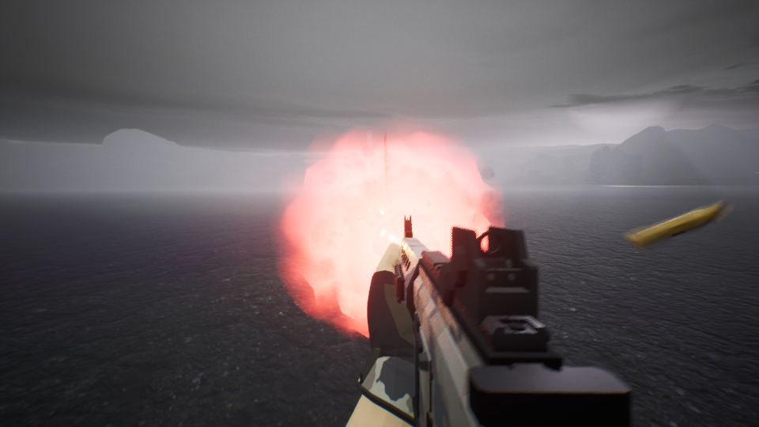
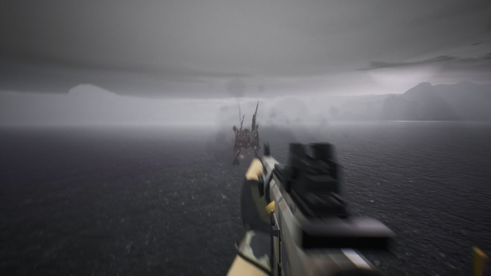
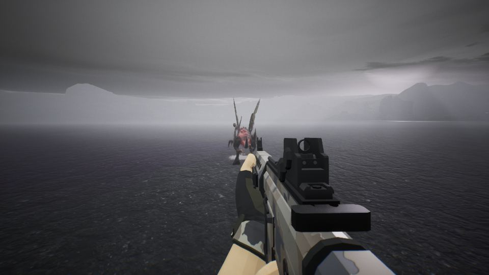

세션 8개 · 사진 7장

<ul class="toc">
<li><a href="#building">building — 건물</a></li>
<li><a href="#terran">terran — 테란 아군</a></li>
<li><a href="#vfx">vfx — 이펙트</a></li>
<li><a href="#perf">perf — 성능</a></li>
<li><a href="#zerg">zerg — 저그</a></li>
<li><a href="#audio">audio — 소리</a></li>
<li><a href="#design">design — 기획</a></li>
<li><a href="#level">level — 맵</a></li>
</ul>
<h2 id="building">building <small>건물</small></h2>

사령부 건물의 색과 구멍 난 부분을 다듬었습니다.

16:35 사령부 대략적인 모양을 만들어 정문과 내부 방을 뚫었습니다

<h2 id="terran">terran <small>테란 아군</small></h2>

아군이 플레이어 곁에서 다리가 걸리지 않게 하고 반응 속도 설정을 넣었습니다.

18:52 사령부를 임시 건물 모델로 세우고 입구 판정과 포탑 둘레를 넓혔습니다.

<h2 id="vfx">vfx <small>이펙트</small></h2>

저글링 몸의 상처 흔적을 더 크고 잘 보이게 키웠습니다.

19:00 피 효과에 색 조절을 연결했으나 화면에서는 아직 확인하지 못했습니다

21:42 바닥에 피가 남는 효과를 정리해 다음 작업 목록에 반영했습니다.

<h2 id="perf">perf <small>성능</small></h2>

총알 효과 묶음이 성능에 미치는 영향을 측정했습니다.

19:37 팩을 껐을 때 느려지는 문제가 대부분 팩 바깥 원인임을 확인했습니다.

<h2 id="zerg">zerg <small>저그</small></h2>

멀리 있는 저글링에도 총알 흔적이 남도록 했습니다.

20:58 먼 곳 저그의 피격 부위와 화염, 수류탄 대 장갑 정리를 디자인에 전달했습니다.

<h2 id="audio">audio <small>소리</small></h2>

쓸 만한 효과음 묶음을 조사했습니다.

<h2 id="design">design <small>기획</small></h2>

울트라리스크 추가와 사령부 내부 구조를 정했습니다.

<h2 id="level">level <small>맵</small></h2>

안 보인다는 의견에 따라 높이 안개를 껐습니다.

