
세션 9개 · 사진 12장

<ul class="toc">
<li><a href="#vfx">vfx — 이펙트</a></li>
<li><a href="#level">level — 맵</a></li>
<li><a href="#terran">terran — 테란 아군</a></li>
<li><a href="#design">design — 기획</a></li>
<li><a href="#audio">audio — 소리</a></li>
<li><a href="#building">building — 건물</a></li>
<li><a href="#input">input — input</a></li>
<li><a href="#perf">perf — 성능</a></li>
<li><a href="#zerg">zerg — 저그</a></li>
</ul>
<h2 id="vfx">vfx <small>이펙트</small></h2>

저글링 몸에 상처가 남는 방식을 새로 맞췄습니다.

<a href="/assets/d/2026-09-30/capture_pie_wpo.jpg" target="_blank">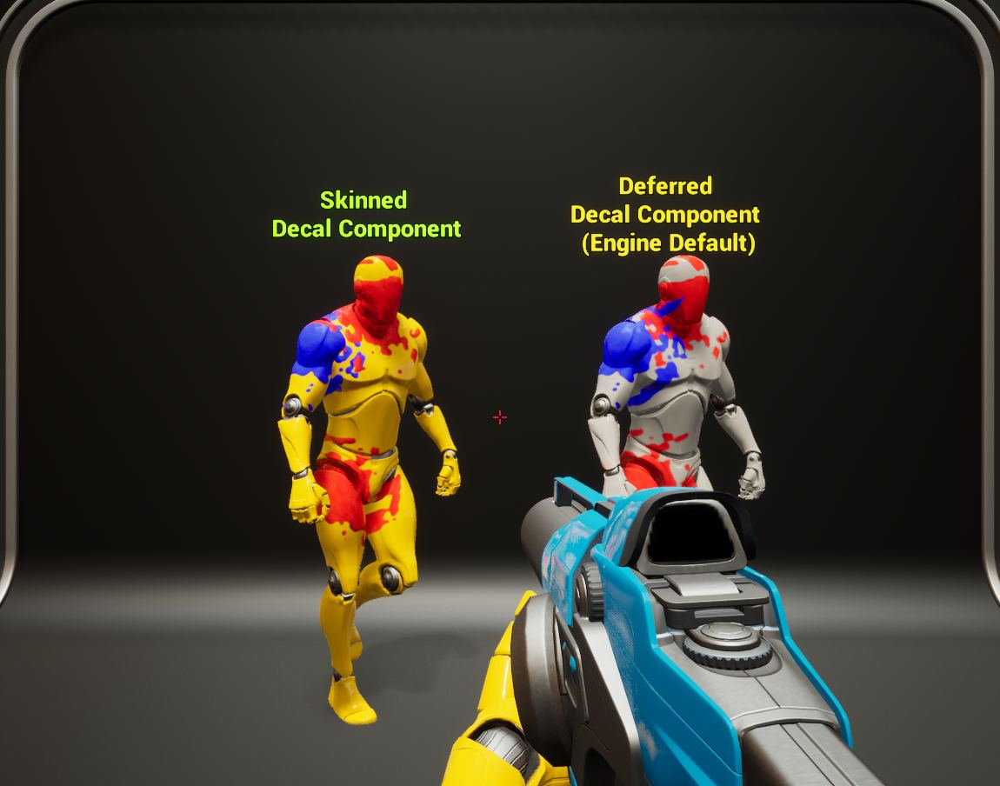</a>

19:22 저글링 몸 재질을 플러그인 문서 방식으로 새로 만들어 상처 데칼을 붙게 했습니다.

<a href="/assets/d/2026-09-30/capture_near2_m1_a.jpg" target="_blank">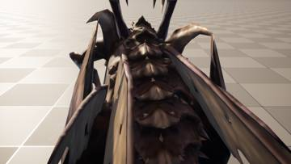</a>
<a href="/assets/d/2026-09-30/capture_near2_m1_b.jpg" target="_blank">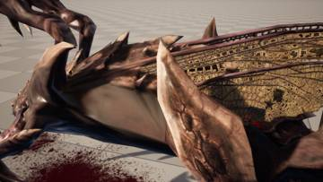</a>

23:57 저글링을 가까이서 찍는 명령을 만들어 상처 표현을 확인했습니다

<h2 id="level">level <small>맵</small></h2>

사령부 건물을 맵에 배치하고 보라색 얼룩을 없앴습니다.

<a href="/assets/d/2026-09-30/capture_wpo2.jpg" target="_blank">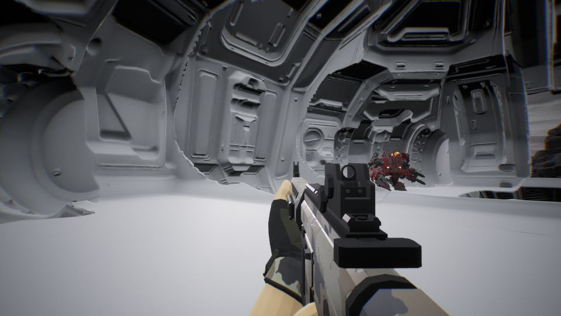</a>

19:37 지형의 보라색 얼룩을 없앴습니다

<h2 id="terran">terran <small>테란 아군</small></h2>

양손 권총과 새 기관단총 모델을 넣고 손 위치를 조절할 수 있게 했습니다.

<a href="/assets/d/2026-09-30/capture_wpo_m0.jpg" target="_blank">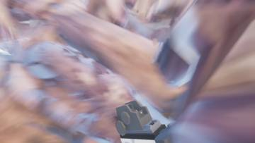</a>
<a href="/assets/d/2026-09-30/capture_wpo_m1.jpg" target="_blank">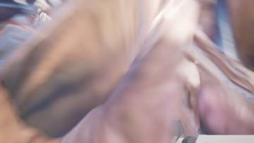</a>
<a href="/assets/d/2026-09-30/WindowsEditor_HighresScreenshot00182.jpg" target="_blank">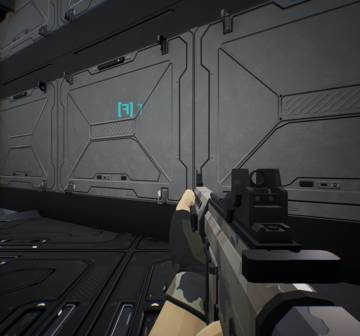</a>
<a href="/assets/d/2026-09-30/capture_wpo2_m0.jpg" target="_blank">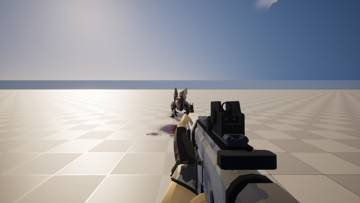</a>

21:54 사령부와 방어 건물 입구가 하나의 보급 메뉴를 열도록 만들었습니다.

<a href="/assets/d/2026-09-30/capture_near_m1_a.jpg" target="_blank">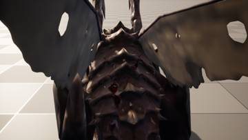</a>
<a href="/assets/d/2026-09-30/capture_near_m1_b.jpg" target="_blank">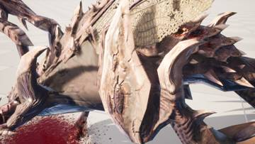</a>

23:45 F9 메뉴에 손 뻗기 옵션을 넣어 손이 카메라에 너무 가깝던 문제를 고쳤습니다.

<h2 id="design">design <small>기획</small></h2>

새 UI 담당을 정하고 총기 손 위치와 재장전 방식을 정했습니다.

<a href="/assets/d/2026-09-30/capture_near_m0_a.jpg" target="_blank">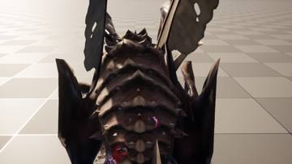</a>
<a href="/assets/d/2026-09-30/capture_near_m0_b.jpg" target="_blank">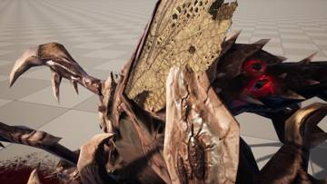</a>

23:44 아이템 화면, 총 옆 표시, 조준점을 맡는 새 담당을 만들었습니다.

<h2 id="audio">audio <small>소리</small></h2>

총소리 비교용 소리를 만들었습니다.

<h2 id="building">building <small>건물</small></h2>

사령부 입구가 열리고 닫히며 안테나가 낮아졌습니다.

<h2 id="input">input <small>input</small></h2>

조작 키 설정을 추가했습니다.

<h2 id="perf">perf <small>성능</small></h2>

측정 도구가 설정 값의 의미를 알려 주도록 고쳤습니다.

<h2 id="zerg">zerg <small>저그</small></h2>

저글링 상처 문제의 원인을 정리했습니다.

