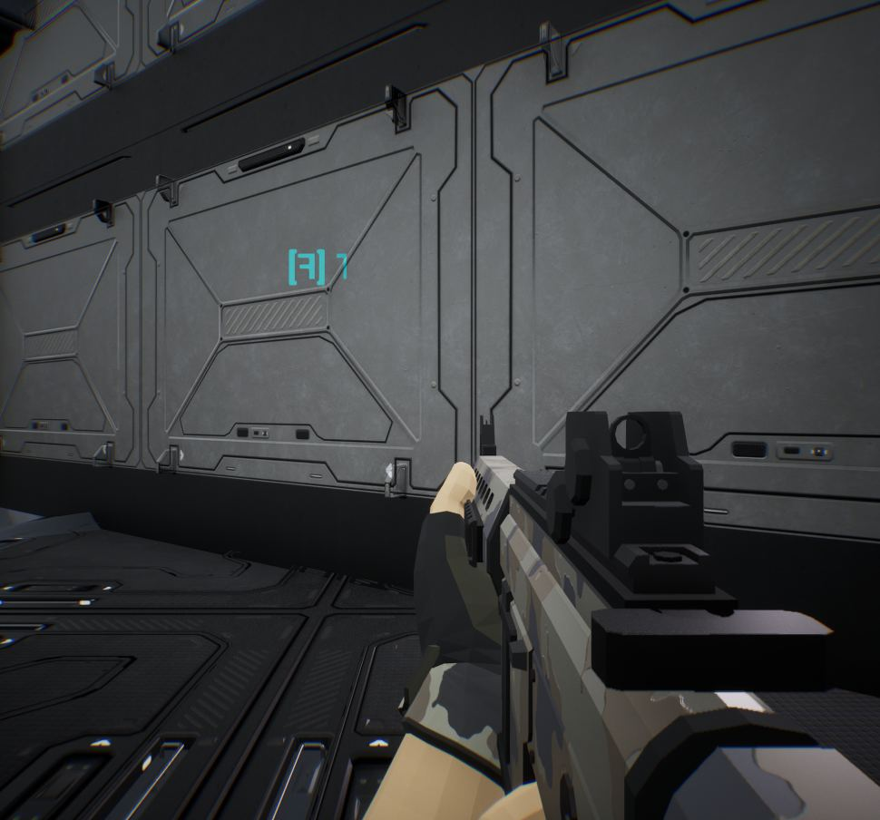

작업 3개 · 사진 1장

<ul class="toc">
<li><a href="#vfx">이펙트</a></li>
<li><a href="#level">맵</a></li>
<li><a href="#terran">테란 아군</a></li>
</ul>
<h2 id="vfx">이펙트</h2>

저글링 몸에 상처 자국이 새겨지는 방식을 바꿨습니다.

19:22 저글링 몸에 상처 자국이 새겨지는 방식을 바꿨습니다.

<h2 id="level">맵</h2>

지형의 보라색 얼룩을 없앴습니다.

19:37 지형의 보라색 얼룩을 없앴습니다.

<h2 id="terran">테란 아군</h2>

보급 메뉴를 하나로 합치고 손을 앞으로 뻗게 했습니다.

21:54 사령부와 방어 건물의 보급 메뉴를 하나로 합쳤습니다.

23:45 손을 화면 앞쪽으로 더 뻗게 조절할 수 있게 했습니다.

