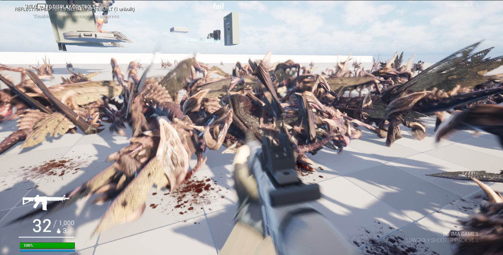
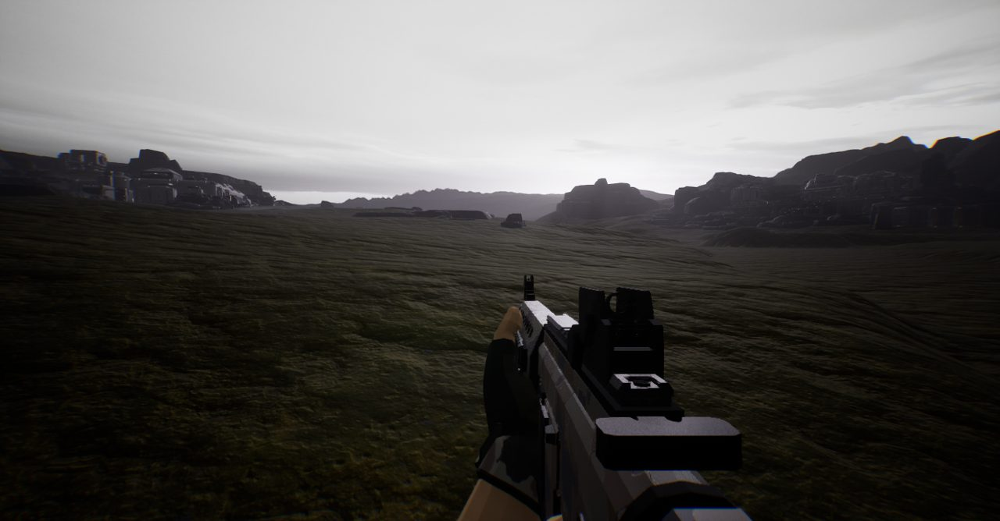

## 한 일

- 저글링 애니메이션: 절벽 도약, 지그재그 이동, 덮치기 등 5종을 넣었습니다.
- 저글링 피격·사망 소리, 연속 처치 때 음높이가 올라가는 효과를 넣었습니다.
- 새 피 이펙트(구름·튀김)와 가우스 소총 총구 화염을 만들었습니다.
- 개틀링 터렛을 기지 중앙 6개, 구역마다 3개 세웠습니다. 부서지면 수리할 수 있습니다.
- AI 아군 9명이 재장전하고, 허리를 돌려 조준하고, 거리에 따라 총소리가 줄어듭니다.
- 새 맵에 낮게 깔린 안개, 회색 땅, 풀 약 2만 5천 그루를 깔았습니다.
- 커맨드센터 모델(25조각, 약 193만 폴리곤, 길이 30m)을 들여왔습니다.

*저글링 무리를 처음 띄워 본 화면입니다.*

*안개와 풀을 깐 새 맵입니다.*

## 막혔던 것

- **저글링이 점점 커짐**: 죽은 저글링을 다시 쓸 때마다 크기가 1.25배씩 쌓였습니다. 재사용할 때 크기를 되돌리게 고쳤습니다.
- **피가 네모로 보임**: 파티클 재질 4개가 컴파일에 실패해 있었습니다. 색 계산 경로를 고쳐서 해결했습니다.
- **가끔 끊김**: 가비지 컬렉션이 5초마다 돌면서 1% low를 10fps쯤 깎았습니다. 간격을 600초로 늘렸습니다.

## 성능

아군 9명 기준으로 평균 약 70fps, 1% low 약 47fps에서 시작했습니다.
기본 설정을 다듬은 뒤 평균 86~92fps, 1% low 50~66fps까지 올라갔습니다.
