
세션 8개 · 사진 34장

<ul class="toc">
<li><a href="#ui">ui — 화면 UI</a></li>
<li><a href="#perf">perf — 성능</a></li>
<li><a href="#vfx">vfx — 이펙트</a></li>
<li><a href="#zerg">zerg — 저그</a></li>
<li><a href="#anim">anim — 애니메이션</a></li>
<li><a href="#audio">audio — 소리</a></li>
<li><a href="#design">design — 기획</a></li>
<li><a href="#terran">terran — 테란 아군</a></li>
</ul>
<h2 id="ui">ui <small>화면 UI</small></h2>

총 옆 화면이 번지던 문제를 고치고 위치를 조절할 수 있게 했습니다.

<a href="/assets/d/2026-10-01/WindowsEditor_ScreenShot00016.jpg" target="_blank">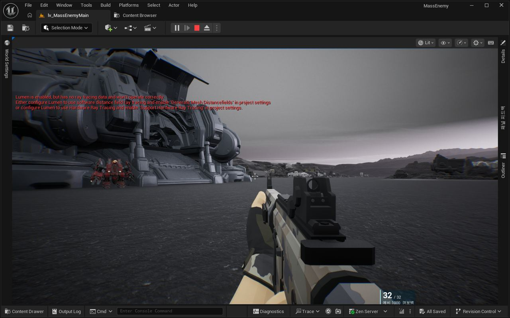</a>

00:37 총 옆에 탄약 표시를 띄워 총과 함께 흔들리게 하고, 십자 조준점도 만들었습니다.

<a href="/assets/d/2026-10-01/WindowsEditor_ScreenShot00022.jpg" target="_blank">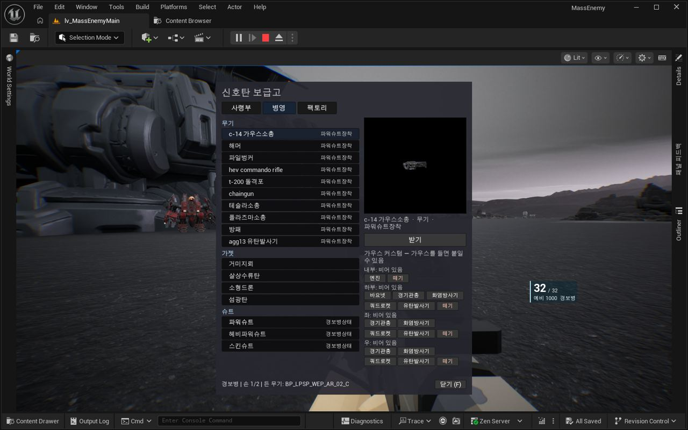</a>

00:56 에디터 재시작 스크립트가 이름이 바뀐 파일에서 멈추던 문제를 고쳤습니다.

<a href="/assets/d/2026-10-01/WindowsEditor_ScreenShot00024.jpg" target="_blank">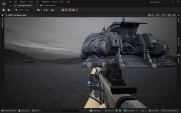</a>
<a href="/assets/d/2026-10-01/WindowsEditor_ScreenShot00025.jpg" target="_blank">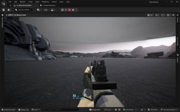</a>
<a href="/assets/d/2026-10-01/WindowsEditor_ScreenShot00026.jpg" target="_blank">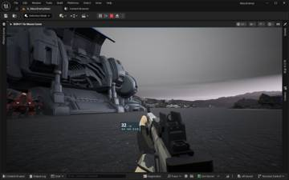</a>

00:59 탄약 패널을 총 왼쪽 가까이로 옮겼습니다.

<a href="/assets/d/2026-10-01/WindowsEditor_ScreenShot00036.jpg" target="_blank">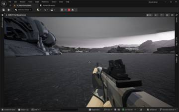</a>
<a href="/assets/d/2026-10-01/WindowsEditor_ScreenShot00037.jpg" target="_blank">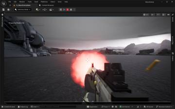</a>

01:13 탄약 패널을 총 본체에 붙여 총을 따라다니게 했습니다

<a href="/assets/d/2026-10-01/capture_demo_cmp.jpg" target="_blank">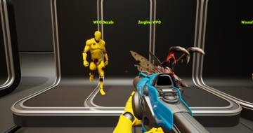</a>
<a href="/assets/d/2026-10-01/capture_demo_man.jpg" target="_blank">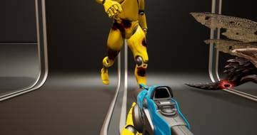</a>
<a href="/assets/d/2026-10-01/capture_demo_zer.jpg" target="_blank">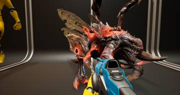</a>
<a href="/assets/d/2026-10-01/capture_legs_a.jpg" target="_blank">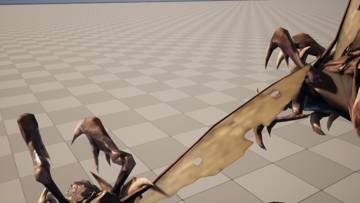</a>
<a href="/assets/d/2026-10-01/capture_legs_b.jpg" target="_blank">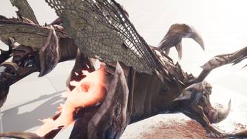</a>

16:32 총 패널에 슈트 상태 막대를 넣고 30% 아래에서는 붉게 표시했습니다.

<a href="/assets/d/2026-10-01/WindowsEditor_ScreenShot00044.jpg" target="_blank">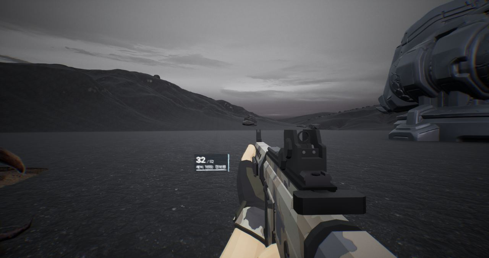</a>

20:51 총 옆 HUD 패널의 위치와 크기를 조절하는 설정 탭을 만들었습니다

<a href="/assets/d/2026-10-01/WindowsEditor_ScreenShot00053.jpg" target="_blank">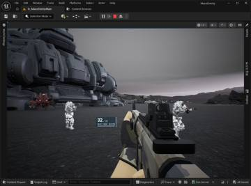</a>
<a href="/assets/d/2026-10-01/WindowsEditor_ScreenShot00054.jpg" target="_blank">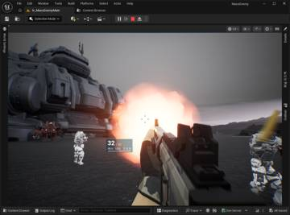</a>

21:10 총 패널이 움직일 때 번져 보이던 문제를 고쳤습니다

<h2 id="perf">perf <small>성능</small></h2>

전투 하위 1% 프레임 61.4를 달성했습니다.

<a href="/assets/d/2026-10-01/WindowsEditor_ScreenShot00021.jpg" target="_blank">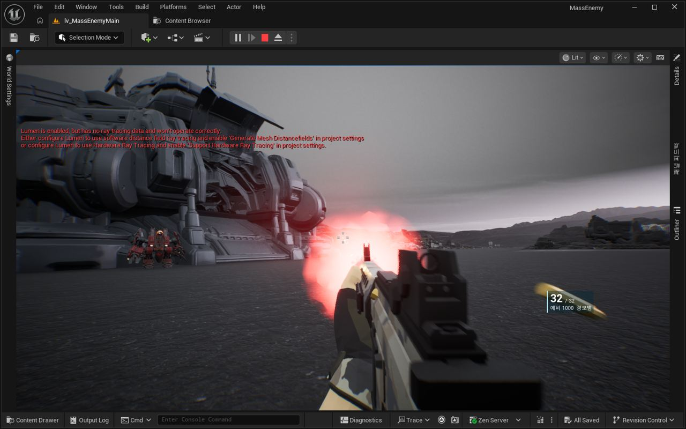</a>

00:41 맵 후처리가 일으키던 불필요한 루멘 조명 계산을 껐습니다

<h2 id="vfx">vfx <small>이펙트</small></h2>

총알이 처음 닿는 곳에 상처가 생기도록 고쳤습니다.

<a href="/assets/d/2026-10-01/capture_pie_m1_top.jpg" target="_blank">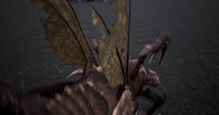</a>
<a href="/assets/d/2026-10-01/capture_pie_m1_side.jpg" target="_blank">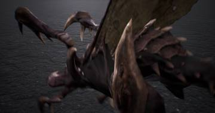</a>
<a href="/assets/d/2026-10-01/capture_pie_m1_bright.jpg" target="_blank">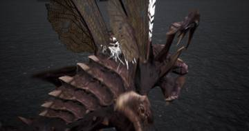</a>
<a href="/assets/d/2026-10-01/capture_pie_m1_red.jpg" target="_blank">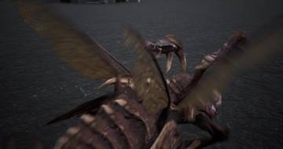</a>
<a href="/assets/d/2026-10-01/capture_pie_red_l.jpg" target="_blank">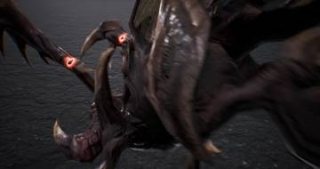</a>
<a href="/assets/d/2026-10-01/capture_pie_red_r.jpg" target="_blank">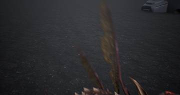</a>

12:31 저글링 상처 표시를 짙은 빨강으로 바꿔 어두운 몸에서도 보이게 했습니다.

<h2 id="zerg">zerg <small>저그</small></h2>

저글링에게 덮치기를 당하면 시야가 실제로 바닥으로 쓰러지게 했습니다.

<a href="/assets/d/2026-10-01/WindowsEditor_ScreenShot00055.jpg" target="_blank">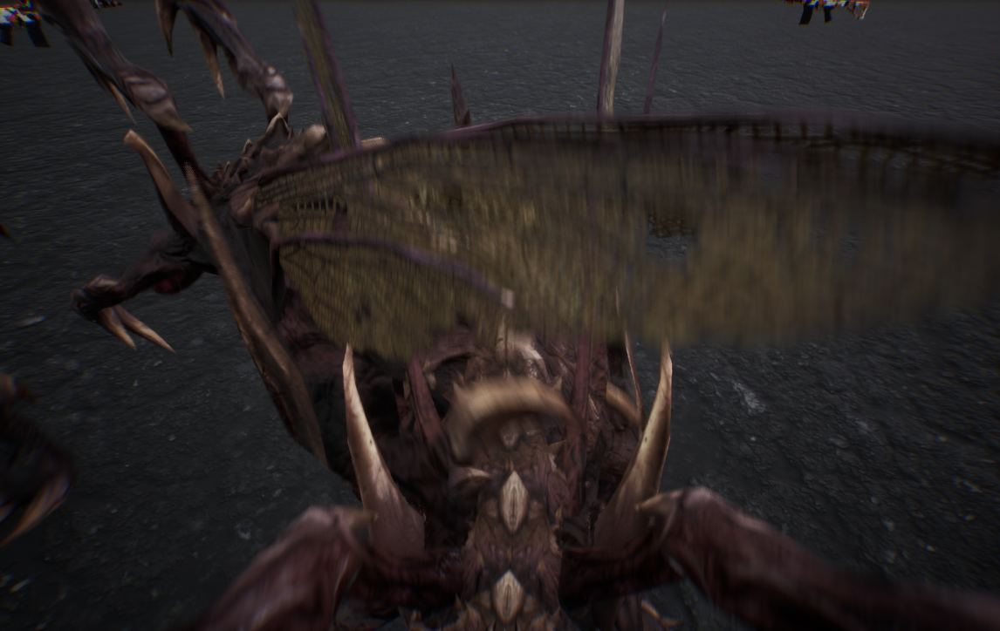</a>

22:51 저글링 덮치기가 기본으로 켜지도록 바꿨습니다.

<a href="/assets/d/2026-10-01/WindowsEditor_ScreenShot00056.jpg" target="_blank">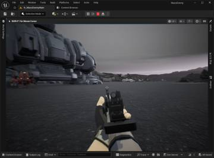</a>
<a href="/assets/d/2026-10-01/WindowsEditor_ScreenShot00057.jpg" target="_blank">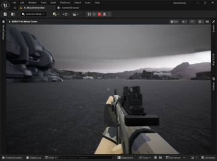</a>
<a href="/assets/d/2026-10-01/WindowsEditor_ScreenShot00063.jpg" target="_blank">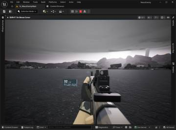</a>
<a href="/assets/d/2026-10-01/WindowsEditor_ScreenShot00064.jpg" target="_blank">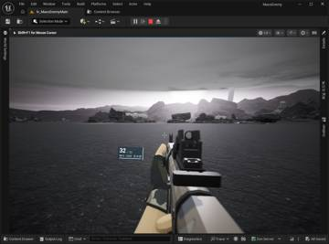</a>
<a href="/assets/d/2026-10-01/WindowsEditor_ScreenShot00067.jpg" target="_blank">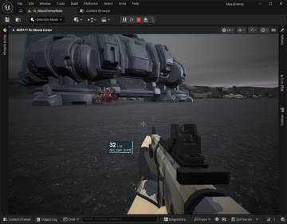</a>
<a href="/assets/d/2026-10-01/WindowsEditor_ScreenShot00070.jpg" target="_blank">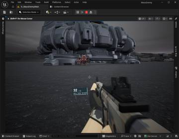</a>
<a href="/assets/d/2026-10-01/WindowsEditor_ScreenShot00071.jpg" target="_blank">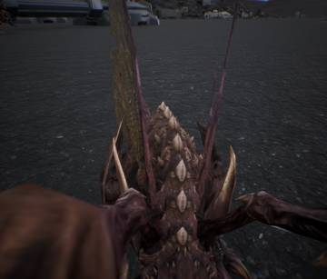</a>
<a href="/assets/d/2026-10-01/WindowsEditor_ScreenShot00072.jpg" target="_blank">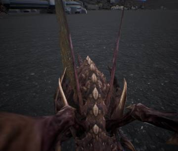</a>
<a href="/assets/d/2026-10-01/WindowsEditor_ScreenShot00073.jpg" target="_blank">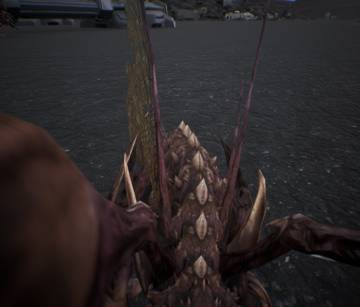</a>
<a href="/assets/d/2026-10-01/WindowsEditor_ScreenShot00074.jpg" target="_blank">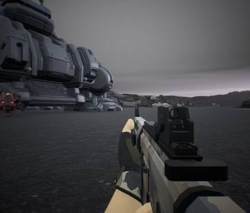</a>
<a href="/assets/d/2026-10-01/WindowsEditor_ScreenShot00075.jpg" target="_blank">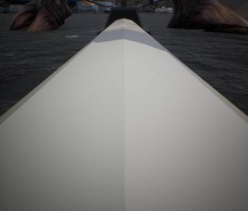</a>

23:00 쓰러졌을 때 시점이 실제로 낮아지도록 카메라 처리를 고쳤습니다.

<h2 id="anim">anim <small>애니메이션</small></h2>

저글링 덮치기 동작을 똑바로 향하게 다시 가져왔습니다.

<h2 id="audio">audio <small>소리</small></h2>

마음에 들지 않던 새 총소리를 예전 소리로 되돌렸습니다.

<h2 id="design">design <small>기획</small></h2>

전투복 종류에 따라 쓰러지는 정도가 달라지도록 정했습니다.

<h2 id="terran">terran <small>테란 아군</small></h2>

덮치기를 당하면 시야가 내려가고 걷는 속도가 느려지게 했습니다.

