
세션 4개 · 사진 27장

<ul class="toc">
<li><a href="#ui">ui — 화면 UI</a></li>
<li><a href="#zerg">zerg — 저그</a></li>
<li><a href="#design">design — 기획</a></li>
<li><a href="#terran">terran — 테란 아군</a></li>
</ul>
<h2 id="ui">ui <small>화면 UI</small></h2>

헬멧 화면에 팀 처치 수를 표시하고 양손 총마다 패널을 만들었습니다.

<a href="/assets/d/2026-10-02/WindowsEditor_ScreenShot00076.jpg" target="_blank">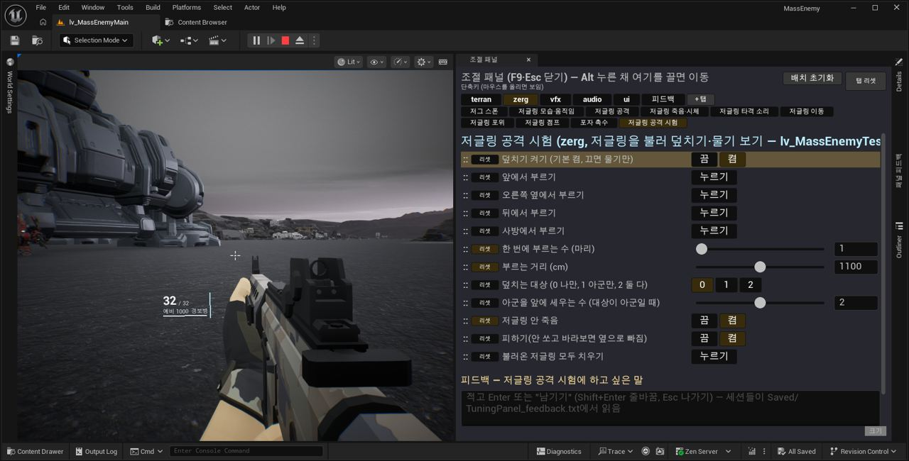</a>

13:38 총 패널이 총과 함께 덜덜 떨리는 현상을 고쳤습니다.

<a href="/assets/d/2026-10-02/WindowsEditor_ScreenShot00094.jpg" target="_blank">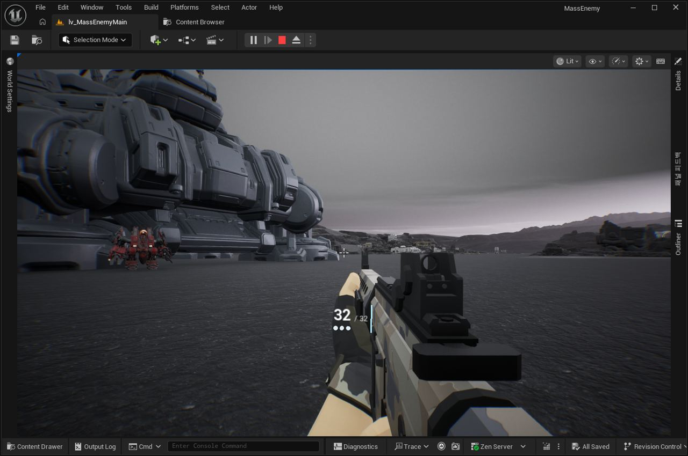</a>

13:52 총 패널을 탄 수와 상태 점 세 개로 단순하게 만들고 움직임을 부드럽게 했습니다.

<a href="/assets/d/2026-10-02/WindowsEditor_ScreenShot00097.jpg" target="_blank">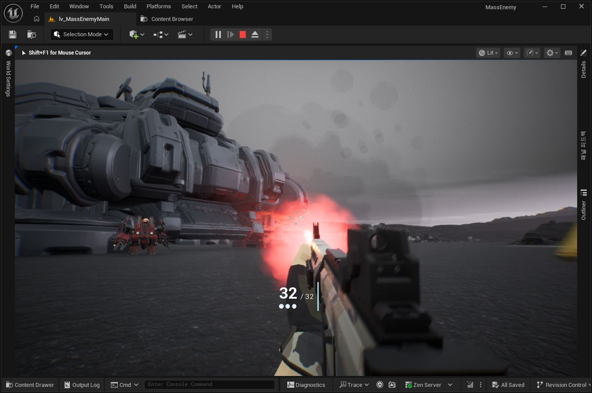</a>

13:58 총 패널 글자가 흐릿하고 계단져 보이던 것을 또렷하게 고쳤습니다.

<a href="/assets/d/2026-10-02/WindowsEditor_ScreenShot00098.jpg" target="_blank">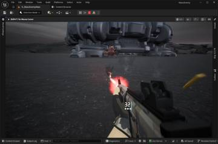</a>
<a href="/assets/d/2026-10-02/WindowsEditor_ScreenShot00099.jpg" target="_blank">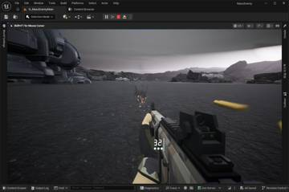</a>

14:01 남은 탄을 LCD 시계 같은 7세그먼트 숫자로 표시했습니다

<a href="/assets/d/2026-10-02/WindowsEditor_ScreenShot00115.jpg" target="_blank">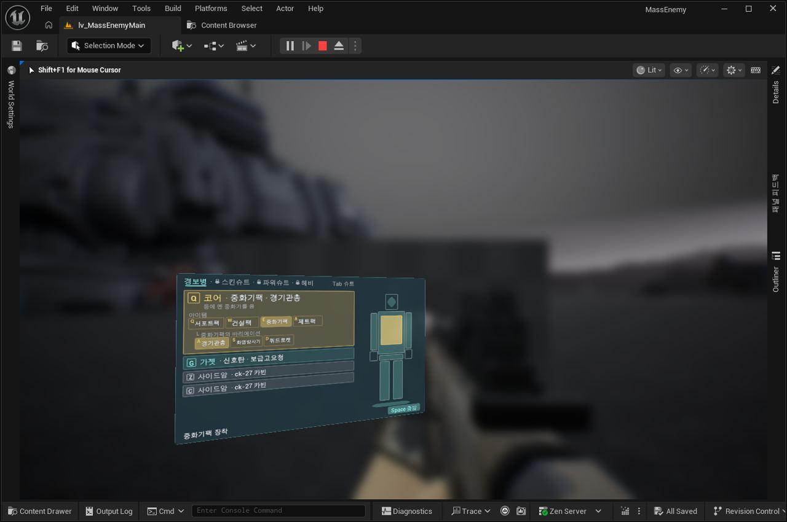</a>

19:15 장비 화면을 입구에서 F 키로 여는 방식을 넣었습니다.

<a href="/assets/d/2026-10-02/WindowsEditor_ScreenShot00118.jpg" target="_blank">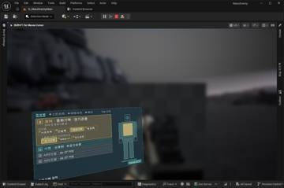</a>
<a href="/assets/d/2026-10-02/WindowsEditor_ScreenShot00120.jpg" target="_blank">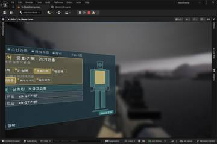</a>

19:22 탄약 패널이 장비 선택 화면으로 커졌다가 다시 줄어들도록 만들었습니다.

<a href="/assets/d/2026-10-02/WindowsEditor_ScreenShot00141.jpg" target="_blank">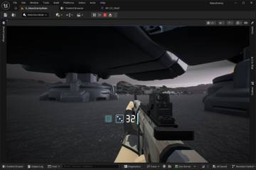</a>
<a href="/assets/d/2026-10-02/WindowsEditor_ScreenShot00142.jpg" target="_blank">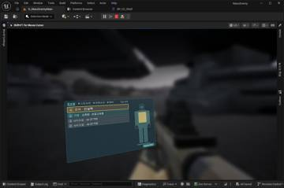</a>

19:38 사령부 문 앞에서 F를 누르면 흐름 없이도 장비 화면이 열리게 했습니다.

<a href="/assets/d/2026-10-02/WindowsEditor_ScreenShot00143.jpg" target="_blank">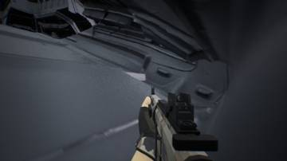</a>
<a href="/assets/d/2026-10-02/WindowsEditor_ScreenShot00144.jpg" target="_blank">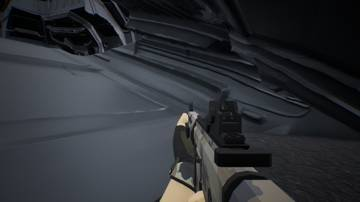</a>

19:43 장비창을 사령부 건물 입구 구역 안에서 열리게 했습니다

<a href="/assets/d/2026-10-02/WindowsEditor_ScreenShot00145.jpg" target="_blank">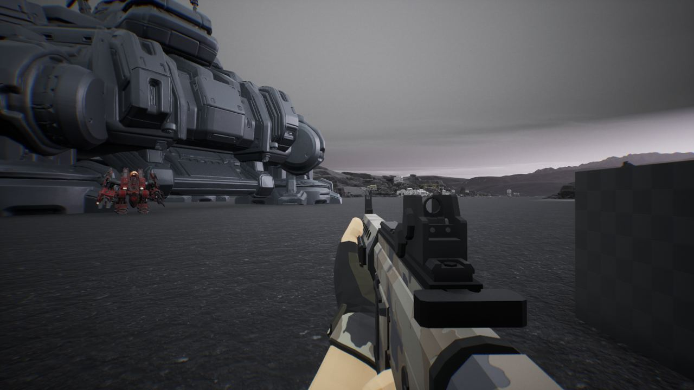</a>

19:47 상태 주사위는 0일 때만 붉게 깜빡이고 평소에는 흰색으로 바꿨습니다.

<h2 id="zerg">zerg <small>저그</small></h2>

저글링 덮치기의 모든 수치를 조절 패널에 넣었습니다.

<a href="/assets/d/2026-10-02/WindowsEditor_ScreenShot00078.jpg" target="_blank">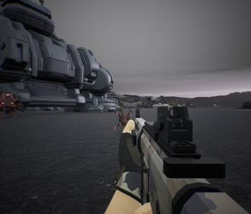</a>
<a href="/assets/d/2026-10-02/WindowsEditor_ScreenShot00079.jpg" target="_blank">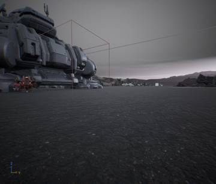</a>
<a href="/assets/d/2026-10-02/WindowsEditor_ScreenShot00083.jpg" target="_blank">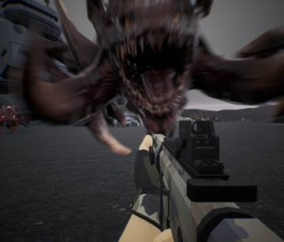</a>
<a href="/assets/d/2026-10-02/WindowsEditor_ScreenShot00084.jpg" target="_blank">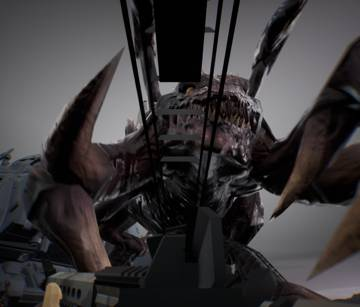</a>
<a href="/assets/d/2026-10-02/WindowsEditor_ScreenShot00085.jpg" target="_blank">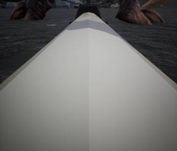</a>

13:40 저글링 도약 동작을 달리기 점프 클립으로 바꾸고 이어지는 전환을 부드럽게 했습니다.

<a href="/assets/d/2026-10-02/WindowsEditor_ScreenShot00086.jpg" target="_blank">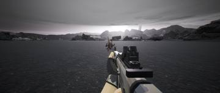</a>
<a href="/assets/d/2026-10-02/WindowsEditor_ScreenShot00090.jpg" target="_blank">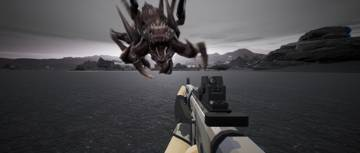</a>
<a href="/assets/d/2026-10-02/WindowsEditor_ScreenShot00091.jpg" target="_blank">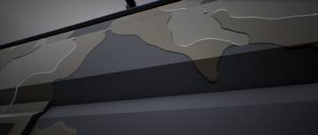</a>
<a href="/assets/d/2026-10-02/WindowsEditor_ScreenShot00092.jpg" target="_blank">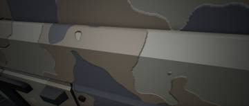</a>

13:45 저글링 덮치기의 모든 수치를 조정 패널 한 탭에 모았습니다.

<h2 id="design">design <small>기획</small></h2>

총 옆 장비 표시 위치와 키 글자 표시 방식을 정했습니다.

<a href="/assets/d/2026-10-02/WindowsEditor_ScreenShot00100.jpg" target="_blank">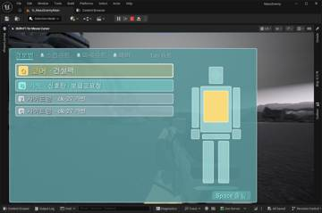</a>
<a href="/assets/d/2026-10-02/WindowsEditor_ScreenShot00101.jpg" target="_blank">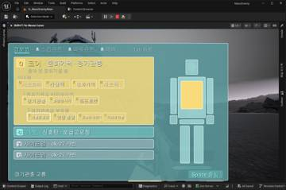</a>
<a href="/assets/d/2026-10-02/WindowsEditor_ScreenShot00103.jpg" target="_blank">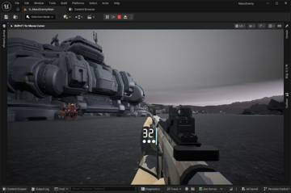</a>
<a href="/assets/d/2026-10-02/WindowsEditor_ScreenShot00105.jpg" target="_blank">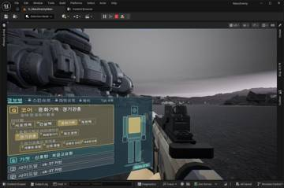</a>
<a href="/assets/d/2026-10-02/WindowsEditor_ScreenShot00108.jpg" target="_blank">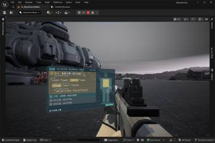</a>

19:01 장비 화면은 총과 함께 입체로 떠야 한다고 문서를 바로잡았습니다.

<h2 id="terran">terran <small>테란 아군</small></h2>

좌우 기울이기를 없애고 조준 방식을 선택할 수 있게 했습니다.

