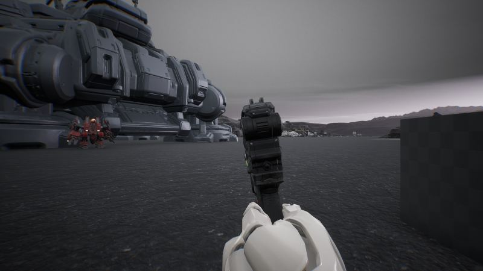
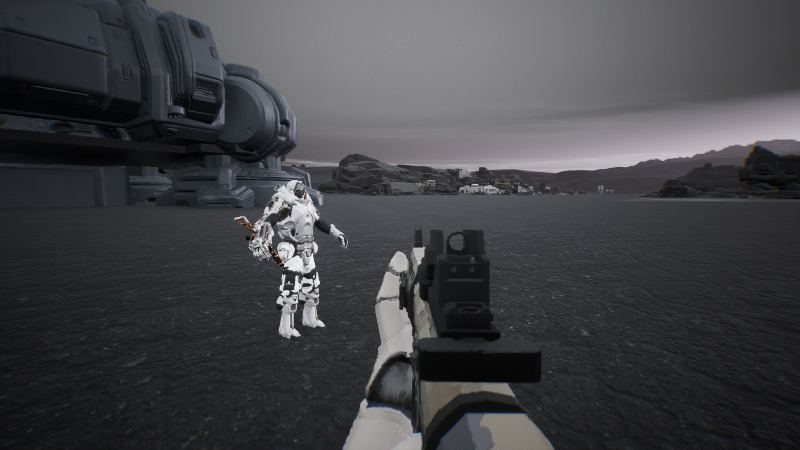
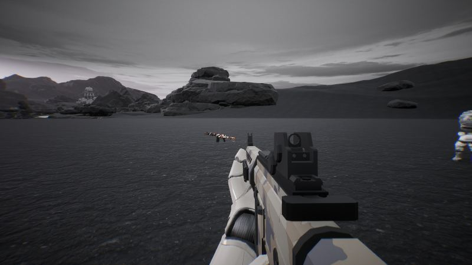
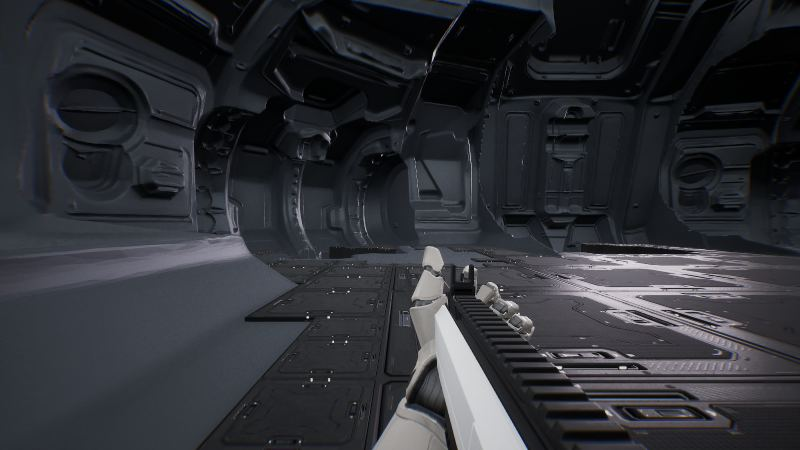
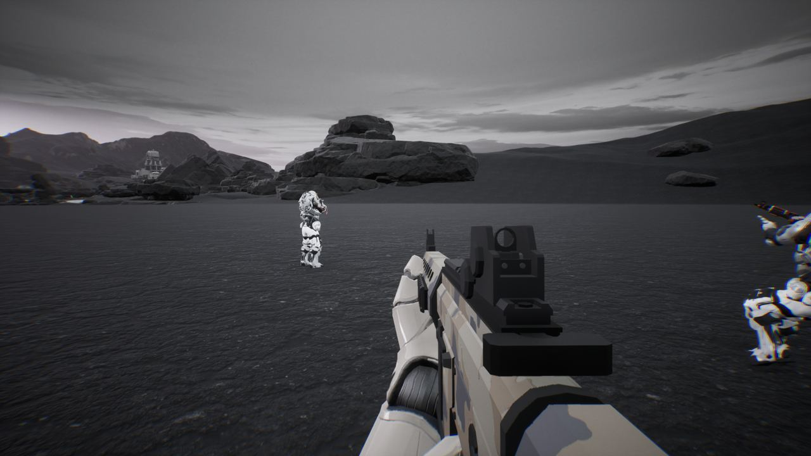

작업 4개 · 사진 12장

<ul class="toc">
<li><a href="#terran">테란 아군</a></li>
<li><a href="#zerg">저그</a></li>
<li><a href="#ui">화면 UI</a></li>
<li><a href="#building">건물</a></li>
</ul>
<h2 id="terran">테란 아군</h2>

아군의 걷는 동작을 고치고 맨손으로 시작하게 했습니다.

00:46 1인칭 팔을 새 마네킹 팔로 바꿀 수 있게 했습니다.

21:02 아군이 걷는 동작을 새 방식으로 이어가기 시작했습니다.

21:21 아군의 걷는 동작이 실제로 움직이게 고쳤습니다.

21:36 아군이 어색한 자세로 뒤뚱거리던 문제를 고쳤습니다.

22:45 아군의 발걸음이 땅에 맞게 걷도록 다시 켰습니다.

23:29 소총과 산탄총 모델을 바꾸고 맨손으로 시작하게 했습니다.

<h2 id="zerg">저그</h2>

쓰러지면 팔과 총이 내려가고 몸이 누워 버립니다.

01:29 쓰러지면 팔과 총이 시야 아래로 내려가 발톱이 보이게 했습니다.

01:53 방어구에 따라 덮치기에 쓰러지는 횟수가 달라지게 했습니다.

20:47 쓰러진 몸이 등을 대고 누운 모습으로 바뀌었습니다.

<h2 id="ui">화면 UI</h2>

장비 화면에 몸 모형을 넣고 화면 색을 통일했습니다.

02:40 장비 화면에 전투복 몸 모형을 선으로 보여 줬습니다.

22:08 총 옆 표시판이 총 위치에 다시 맞춰 붙게 했습니다.

22:26 화면의 파란색을 없애고 호박색으로 통일했습니다.

<h2 id="building">건물</h2>

사령부 입구 바닥과 경사로를 다듬었습니다.

20:40 사령부 입구 바닥과 경사로가 닫힐 때 모습을 다듬었습니다.

