
세션 9개 · 사진 59장

<ul class="toc">
<li><a href="#terran">terran — 테란 아군</a></li>
<li><a href="#design">design — 기획</a></li>
<li><a href="#zerg">zerg — 저그</a></li>
<li><a href="#ui">ui — 화면 UI</a></li>
<li><a href="#building">building — 건물</a></li>
<li><a href="#weapon">weapon — 무기</a></li>
<li><a href="#audio">audio — 소리</a></li>
<li><a href="#level">level — 맵</a></li>
<li><a href="#vfx">vfx — 이펙트</a></li>
</ul>
<h2 id="terran">terran <small>테란 아군</small></h2>

무기 모델을 바꾸고 맨손으로 시작하게 했습니다.

<a href="/assets/d/2026-10-03/arms_check.jpg" target="_blank">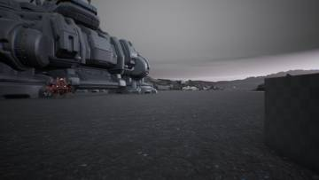</a>
<a href="/assets/d/2026-10-03/arms_check2.jpg" target="_blank">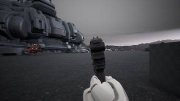</a>

00:46 1인칭 팔을 마네킹 팔 모델로 바꿔 기존 애니메이션을 그대로 쓰게 했습니다

<a href="/assets/d/2026-10-03/gasp_allies.jpg" target="_blank">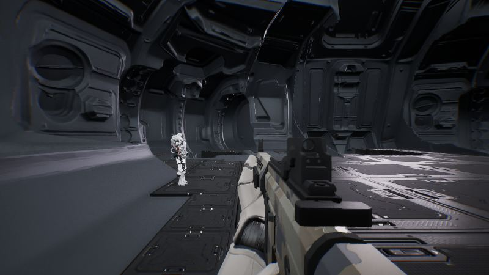</a>

21:02 아군 움직임을 자연스럽게 하는 모션 매칭의 첫 단계를 넣었습니다.

<a href="/assets/d/2026-10-03/gasp_a1.jpg" target="_blank">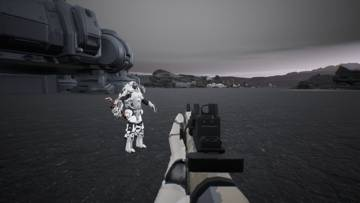</a>
<a href="/assets/d/2026-10-03/gasp_b1.jpg" target="_blank">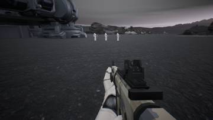</a>
<a href="/assets/d/2026-10-03/gasp_d1.jpg" target="_blank">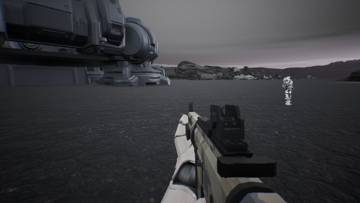</a>
<a href="/assets/d/2026-10-03/gasp_e1.jpg" target="_blank">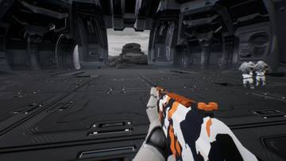</a>
<a href="/assets/d/2026-10-03/gasp_e6.jpg" target="_blank">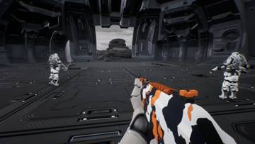</a>
<a href="/assets/d/2026-10-03/gasp_e_grid.jpg" target="_blank">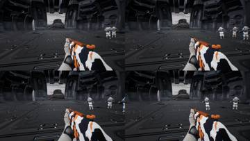</a>

21:21 아군의 모션 매칭이 얼어 있던 문제를 고쳐 이제 움직입니다.

<a href="/assets/d/2026-10-03/gasp_f1.jpg" target="_blank">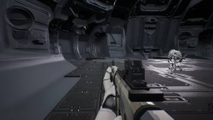</a>
<a href="/assets/d/2026-10-03/gasp_f2.jpg" target="_blank">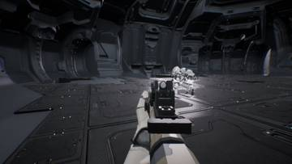</a>
<a href="/assets/d/2026-10-03/gasp_f3.jpg" target="_blank">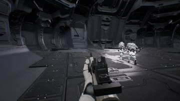</a>
<a href="/assets/d/2026-10-03/gasp_f_grid.jpg" target="_blank">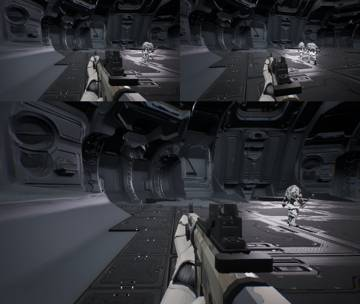</a>
<a href="/assets/d/2026-10-03/gasp_g_grid.jpg" target="_blank">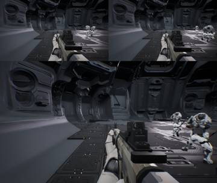</a>
<a href="/assets/d/2026-10-03/gasp_h1.jpg" target="_blank">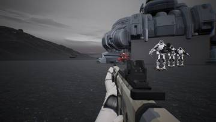</a>
<a href="/assets/d/2026-10-03/gasp_i1.jpg" target="_blank">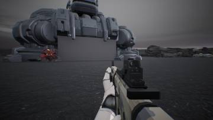</a>
<a href="/assets/d/2026-10-03/gasp_i_grid.jpg" target="_blank">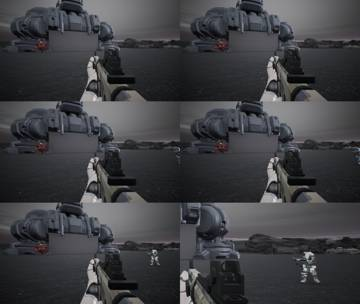</a>
<a href="/assets/d/2026-10-03/gasp_j_grid.jpg" target="_blank">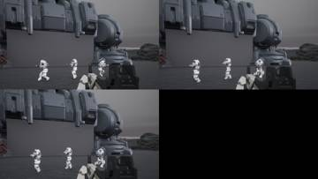</a>

21:36 아군 동작이 어색하게 뒤뚱거리던 문제를 고쳐 자연스러운 이동을 기본으로 켰습니다

<a href="/assets/d/2026-10-03/odd_b1.jpg" target="_blank">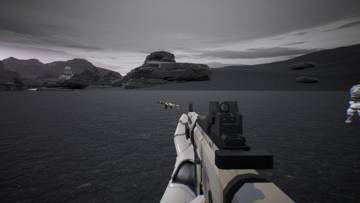</a>
<a href="/assets/d/2026-10-03/odd_b_grid.jpg" target="_blank">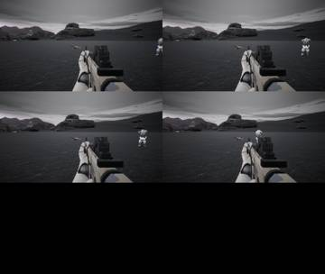</a>

22:45 아군의 보폭 보정이 깨진 원인 두 가지를 찾아 다시 켰습니다.

<a href="/assets/d/2026-10-03/gun_ck27.jpg" target="_blank">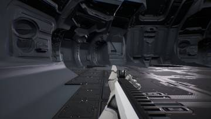</a>
<a href="/assets/d/2026-10-03/gun_fn92.jpg" target="_blank">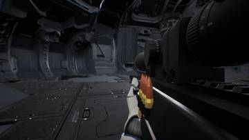</a>
<a href="/assets/d/2026-10-03/gun2_SR8.jpg" target="_blank">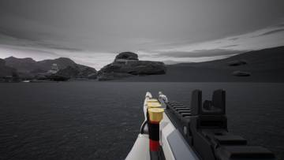</a>
<a href="/assets/d/2026-10-03/gun2_grid.jpg" target="_blank">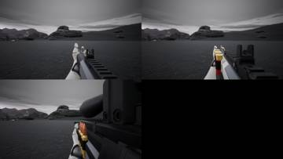</a>

23:29 소총과 샷건 모델을 새로 바꾸고 빈손으로 시작하게 했습니다.

<h2 id="design">design <small>기획</small></h2>

카빈과 M60 등 무기 모델 방향을 정했습니다.

<a href="/assets/d/2026-10-03/gadget_rail.jpg" target="_blank">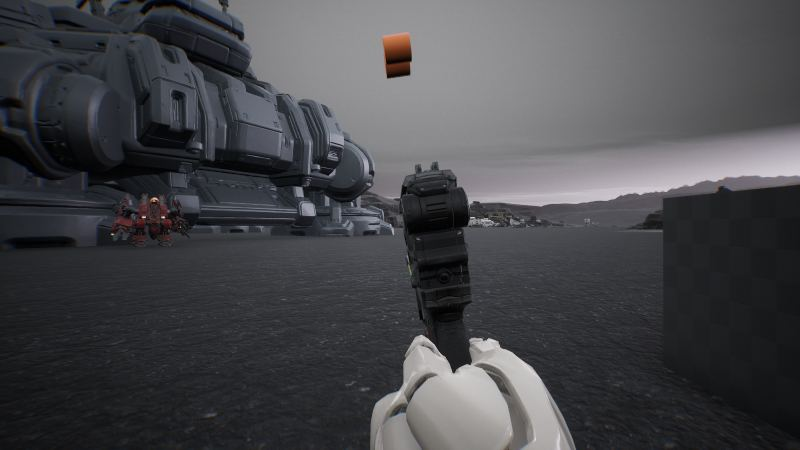</a>

00:53 중장갑 등짐 무기는 재장전 없이 등짐에서 탄을 공급받게 했습니다.

<a href="/assets/d/2026-10-03/start1.jpg" target="_blank">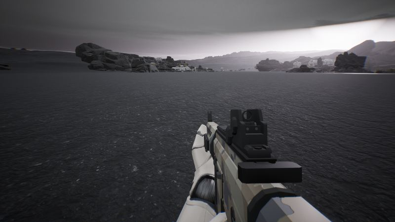</a>

23:06 M60 개머리판 윗면을 평평하게 하고 가늠쇠를 없앴습니다.

<h2 id="zerg">zerg <small>저그</small></h2>

쓰러진 몸이 맥없이 늘어지는 모습으로 바뀌었습니다.

<a href="/assets/d/2026-10-03/WindowsEditor_ScreenShot00170.jpg" target="_blank">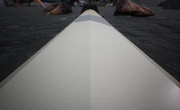</a>
<a href="/assets/d/2026-10-03/WindowsEditor_ScreenShot00171.jpg" target="_blank">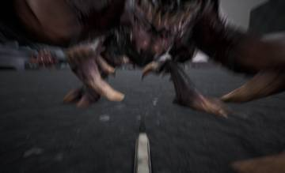</a>
<a href="/assets/d/2026-10-03/WindowsEditor_ScreenShot00172.jpg" target="_blank">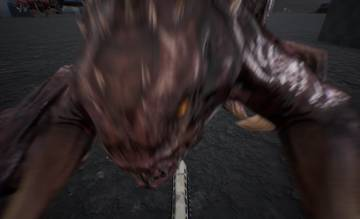</a>

01:29 쓰러졌을 때 시점이 바닥에 파묻혀 발톱이 안 보여서, 팔과 총을 아래로 내렸습니다.

<a href="/assets/d/2026-10-03/WindowsEditor_ScreenShot00173.jpg" target="_blank">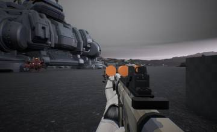</a>
<a href="/assets/d/2026-10-03/WindowsEditor_ScreenShot00177.jpg" target="_blank">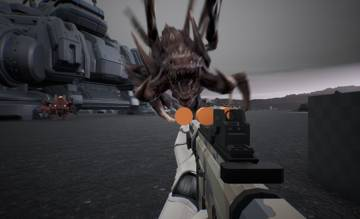</a>
<a href="/assets/d/2026-10-03/WindowsEditor_ScreenShot00178.jpg" target="_blank">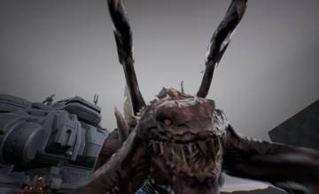</a>
<a href="/assets/d/2026-10-03/WindowsEditor_ScreenShot00179.jpg" target="_blank">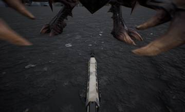</a>
<a href="/assets/d/2026-10-03/WindowsEditor_ScreenShot00180.jpg" target="_blank">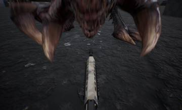</a>

01:53 쓰러뜨림 횟수 계산에 덮치기 버티기 보너스를 넣었습니다.

<a href="/assets/d/2026-10-03/WindowsEditor_ScreenShot00201.jpg" target="_blank">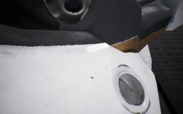</a>
<a href="/assets/d/2026-10-03/WindowsEditor_ScreenShot00202.jpg" target="_blank">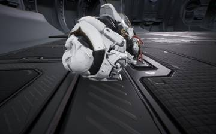</a>
<a href="/assets/d/2026-10-03/WindowsEditor_ScreenShot00203.jpg" target="_blank">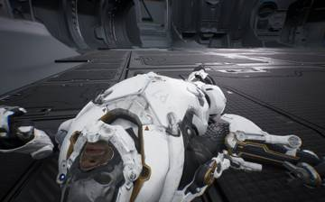</a>

20:47 쓰러진 몸이 축 늘어진 인형처럼 눕도록 물리 처리를 넣었습니다.

<h2 id="ui">ui <small>화면 UI</small></h2>

화면 색을 호박색으로 통일하고 무기별 총 패널 위치를 조절하게 했습니다.

<a href="/assets/d/2026-10-03/capture_cmp_demo_front.jpg" target="_blank">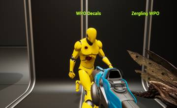</a>
<a href="/assets/d/2026-10-03/capture_cmp_zg_front.jpg" target="_blank">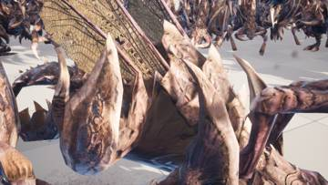</a>
<a href="/assets/d/2026-10-03/capture_cmp_zg_side.jpg" target="_blank">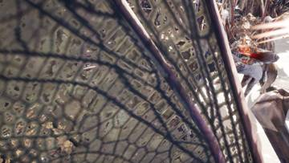</a>

02:40 능력치 화면에 슈트 몸체를 와이어프레임으로 띄웠습니다

<a href="/assets/d/2026-10-03/lyra_a1.jpg" target="_blank">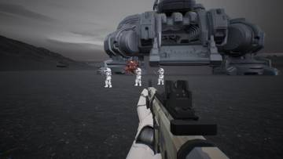</a>
<a href="/assets/d/2026-10-03/lyra_a_grid.jpg" target="_blank">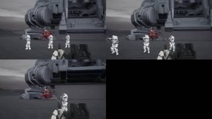</a>
<a href="/assets/d/2026-10-03/lyra_b1.jpg" target="_blank">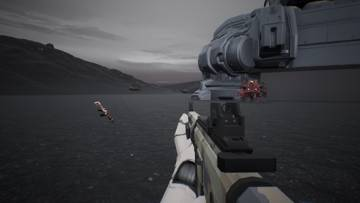</a>
<a href="/assets/d/2026-10-03/lyra_b_grid.jpg" target="_blank">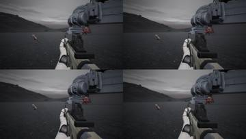</a>
<a href="/assets/d/2026-10-03/lyra_c1.jpg" target="_blank">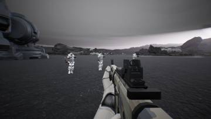</a>
<a href="/assets/d/2026-10-03/lyra_c_grid.jpg" target="_blank">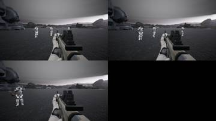</a>
<a href="/assets/d/2026-10-03/lyra_d_grid.jpg" target="_blank">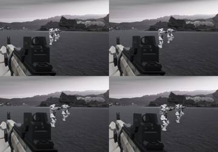</a>
<a href="/assets/d/2026-10-03/lyra_e2.jpg" target="_blank">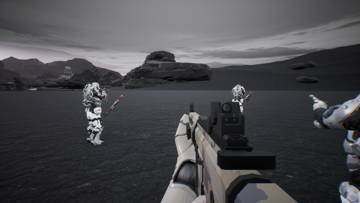</a>
<a href="/assets/d/2026-10-03/lyra_e_grid.jpg" target="_blank">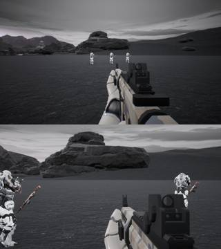</a>
<a href="/assets/d/2026-10-03/lyra_f_grid.jpg" target="_blank">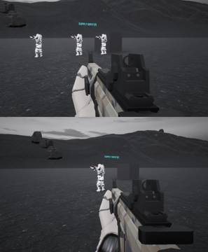</a>

22:08 총 패널이 무기 자세가 변하면 다시 제자리에 붙도록 고쳤습니다.

22:26 파란색을 걷어내고 화면 UI를 호박색 계열로 통일했습니다

<h2 id="building">building <small>건물</small></h2>

사령부 문과 경사로가 스타크래프트 2처럼 열리고 닫히게 했습니다.

20:40 사령부 안쪽 입구의 바닥, 해치, 경사로 개폐 동작을 다듬었습니다

<h2 id="weapon">weapon <small>무기</small></h2>

23:31 

<h2 id="audio">audio <small>소리</small></h2>

총마다 다른 총소리가 나오도록 했습니다.

<h2 id="level">level <small>맵</small></h2>

사령부 건물 위치를 바로잡고 바닥 무늬 반복을 줄였습니다.

<h2 id="vfx">vfx <small>이펙트</small></h2>

저글링 몸의 상처 모양이 무작위로 나오게 했습니다.

