
세션 6개 · 사진 18장

<ul class="toc">
<li><a href="#terran">terran — 테란 아군</a></li>
<li><a href="#design">design — 기획</a></li>
<li><a href="#zerg">zerg — 저그</a></li>
<li><a href="#building">building — 건물</a></li>
<li><a href="#perf">perf — 성능</a></li>
<li><a href="#weapon">weapon — 무기</a></li>
</ul>
<h2 id="terran">terran <small>테란 아군</small></h2>

저글링에게 잡힌 아군이 쓰러졌다가 일어나게 했습니다.

<a href="/assets/d/2026-10-04/terran_murdock1.jpg" target="_blank">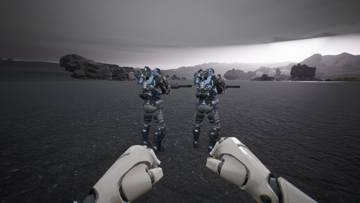</a>
<a href="/assets/d/2026-10-04/terran_murdock2.jpg" target="_blank">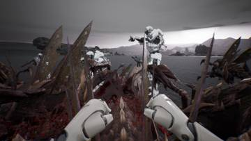</a>

02:18 새 아군이 머독 슈트를 입고 움직이게 연결했습니다.

<a href="/assets/d/2026-10-04/terran_lyra_fight.jpg" target="_blank">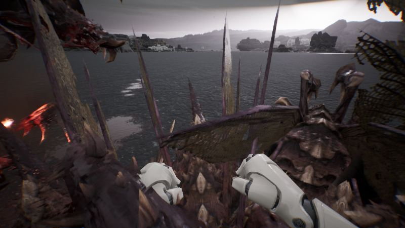</a>

06:06 아군이 기본으로 영웅 캐릭터를 쓰게 하고 발사 상태를 직접 전달하게 했습니다

<a href="/assets/d/2026-10-04/terran_lyra_player.jpg" target="_blank">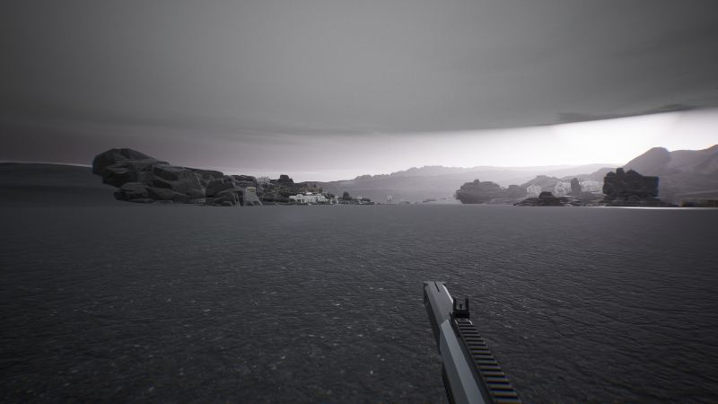</a>

06:17 플레이어를 아군과 같은 영웅 캐릭터로 바꾸는 첫 단계를 만들었습니다

<a href="/assets/d/2026-10-04/WindowsEditor_HighresScreenshot00195.jpg" target="_blank">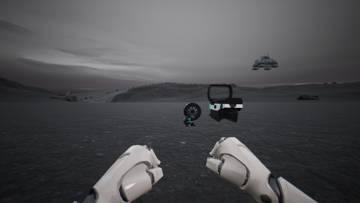</a>
<a href="/assets/d/2026-10-04/WindowsEditor_HighresScreenshot00197.jpg" target="_blank">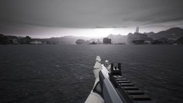</a>

12:19 다른 캐릭터 몸체를 플레이어에게 씌울 수 있는 설정을 추가했습니다.

<a href="/assets/d/2026-10-04/WindowsEditor_HighresScreenshot00199.jpg" target="_blank">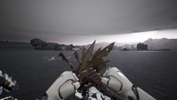</a>
<a href="/assets/d/2026-10-04/WindowsEditor_HighresScreenshot00200.jpg" target="_blank">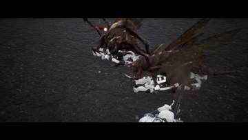</a>

17:35 저글링에게 잡힌 아군이 쓰러졌다가 숨을 몰아쉬며 일어나게 했습니다

<h2 id="design">design <small>기획</small></h2>

아군 AI가 사람처럼 판단하도록 성격과 우선순위를 정했습니다.

<a href="/assets/d/2026-10-04/WindowsEditor_HighresScreenshot00184.jpg" target="_blank">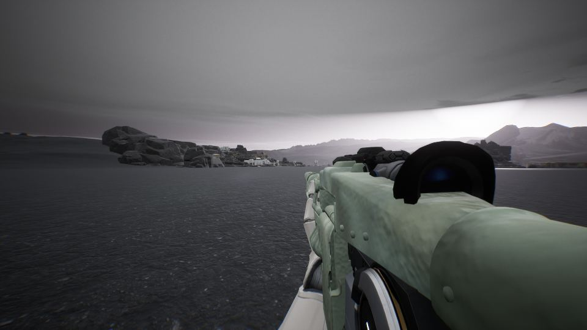</a>

05:06 M60을 사용자가 맞춘 Blender 수치로 다시 불러왔습니다.

<a href="/assets/d/2026-10-04/WindowsEditor_HighresScreenshot00185.jpg" target="_blank">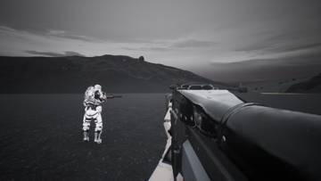</a>
<a href="/assets/d/2026-10-04/capture_m60_fp.jpg" target="_blank">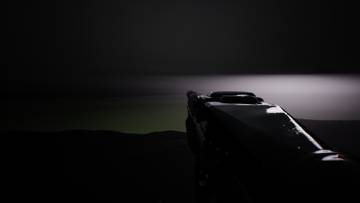</a>
<a href="/assets/d/2026-10-04/WindowsEditor_HighresScreenshot00186.jpg" target="_blank">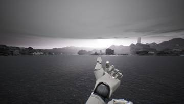</a>

05:32 M60에 고해상도 텍스처와 재질을 입히고 기존 몸체를 숨겼습니다.

<a href="/assets/d/2026-10-04/WindowsEditor_HighresScreenshot00189.jpg" target="_blank">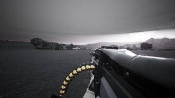</a>
<a href="/assets/d/2026-10-04/WindowsEditor_HighresScreenshot00190.jpg" target="_blank">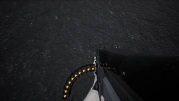</a>

05:39 M60에 탄띠와 탄약 통로, 탄약 가방을 달았습니다.

<a href="/assets/d/2026-10-04/WindowsEditor_HighresScreenshot00191.jpg" target="_blank">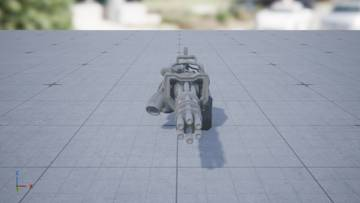</a>
<a href="/assets/d/2026-10-04/WindowsEditor_HighresScreenshot00192.jpg" target="_blank">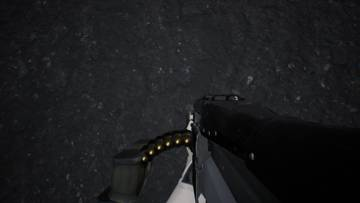</a>
<a href="/assets/d/2026-10-04/WindowsEditor_HighresScreenshot00194.jpg" target="_blank">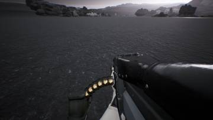</a>

05:48 M60 등짐을 개틀링 탄약 상자로 바꾸고 탄띠 급탄관을 곡선으로 이었습니다.

<h2 id="zerg">zerg <small>저그</small></h2>

방어막 돔이 저글링을 막도록 했습니다.

<a href="/assets/d/2026-10-04/WindowsEditor_HighresScreenshot00201.jpg" target="_blank">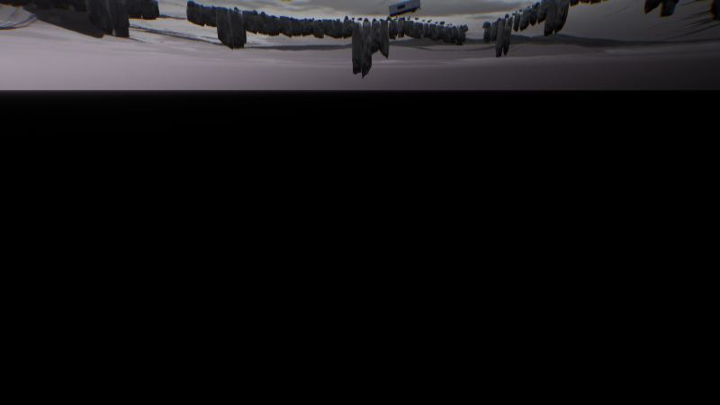</a>

17:41 아군 래그돌에서 실제로 확인한 결과를 보고서에 반영했습니다.

<h2 id="building">building <small>건물</small></h2>

사령부 경사로의 구멍을 메웠습니다.

<h2 id="perf">perf <small>성능</small></h2>

측정 한 번을 45초 안에 끝내도록 줄였습니다.

<h2 id="weapon">weapon <small>무기</small></h2>

유탄발사기 보조무기와 방어막 장비를 넣었습니다.

