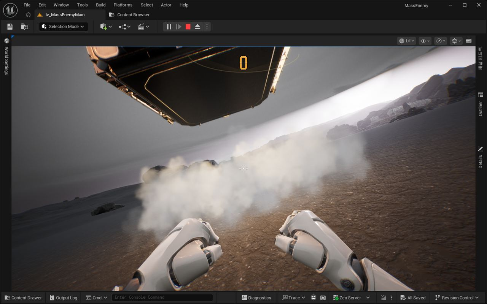

작업 2개 · 사진 2장

<ul class="toc">
<li><a href="#weapon">무기</a></li>
<li><a href="#ui">화면 UI</a></li>
</ul>
<h2 id="weapon">무기</h2>

보급고가 불꽃을 뿜으며 내려앉고 신호탄을 부릅니다.

16:09 전투복이 보조무기와 기본 장비를 계속 지니게 했습니다.

16:39 사령부 건물을 하늘에서 땅 위로 옮겼습니다.

16:51 맨손일 때 장비 화면이 눈앞에 열리게 했습니다.

17:11 무전기 팩으로 보급 신호탄을 부를 수 있게 했습니다.

17:18 지붕 아래에서는 신호탄을 부를 수 없게 했습니다.

17:30 보급고가 불꽃을 뿜으며 천천히 내려앉게 했습니다.

<h2 id="ui">화면 UI</h2>

장비 화면과 처치 수 표시를 다듬었습니다.

16:47 처치 수가 켜진 숫자만 가운데에 표시되게 했습니다.

16:53 처치 수 숫자가 기울지 않고 평평하게 보이게 했습니다.

16:54 맨손 장비 화면을 주먹 위 가운데에 띄웠습니다.

17:02 장비 칸 사이를 오가는 조작을 매끄럽게 다듬었습니다.

17:05 장비 화면에 장비 포인트 표시를 넣었습니다.

