
세션 5개 · 사진 18장

<ul class="toc">
<li><a href="#weapon">weapon — 무기</a></li>
<li><a href="#ui">ui — 화면 UI</a></li>
<li><a href="#building">building — 건물</a></li>
<li><a href="#design">design — 기획</a></li>
<li><a href="#zerg">zerg — 저그</a></li>
</ul>
<h2 id="weapon">weapon <small>무기</small></h2>

보급고가 하늘에서 불꽃을 뿜으며 천천히 내려앉게 했습니다.

<a href="/assets/d/2026-10-05/weapon_unarmed.jpg" target="_blank">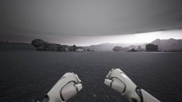</a>
<a href="/assets/d/2026-10-05/weapon_armed.jpg" target="_blank">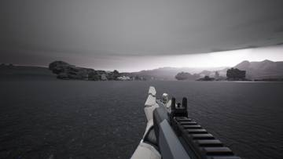</a>

16:09 슈트를 입어도 보조 무기와 코어 팩을 유지하게 하고 벗으면 다시 들게 했습니다.

<a href="/assets/d/2026-10-05/start_1_spawn.jpg" target="_blank">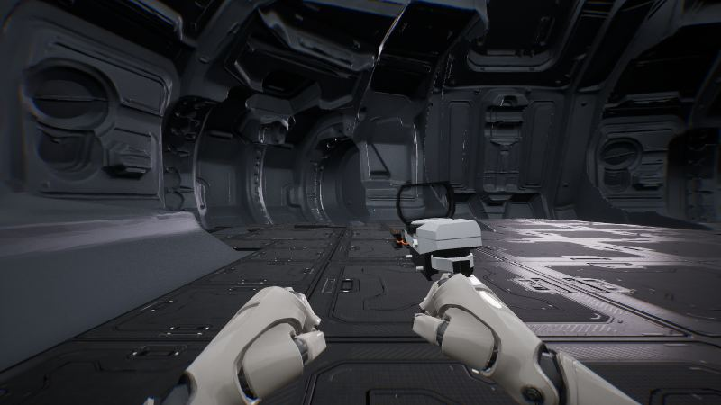</a>

16:39 사령부 건물을 하늘에 떠 있던 위치에서 땅 위로 내렸습니다

<a href="/assets/d/2026-10-05/WindowsEditor_ScreenShot00206.jpg" target="_blank">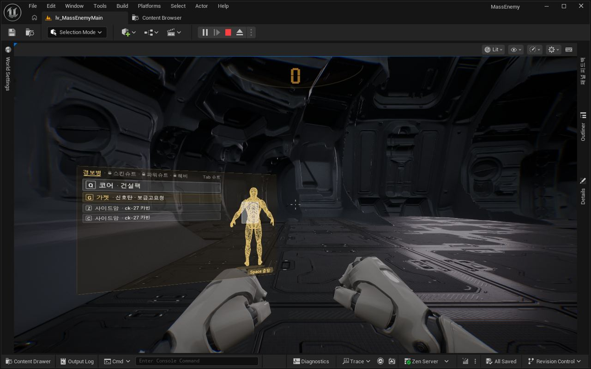</a>

16:51 맨손일 때 장비창이 카메라 앞에서 열리도록 고쳤습니다

<a href="/assets/d/2026-10-05/WindowsEditor_ScreenShot00220.jpg" target="_blank">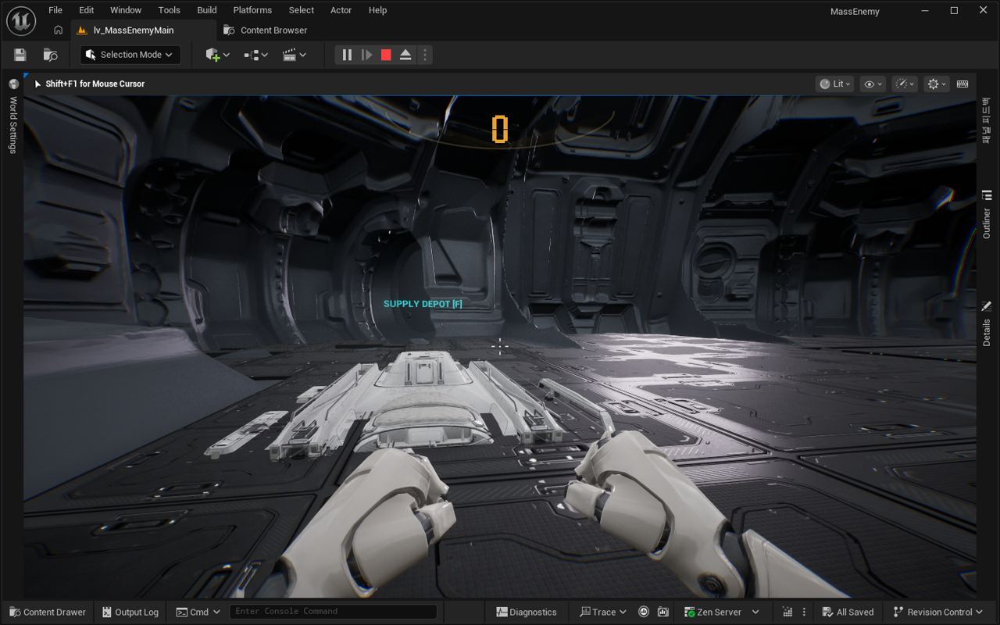</a>

17:11 무전기 팩의 Q로 조명탄을 부르고 60초 재사용 대기를 넣었습니다

<a href="/assets/d/2026-10-05/WindowsEditor_ScreenShot00221.jpg" target="_blank">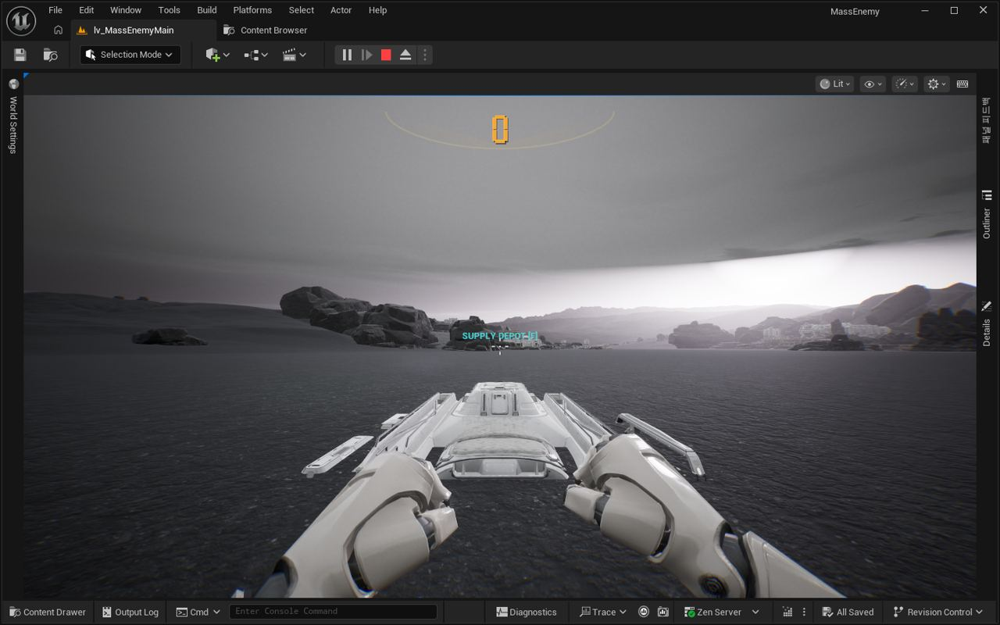</a>

17:18 조명탄은 지붕 아래에서는 쓸 수 없게 막았고, 실내에서 거부되는 것을 확인했습니다.

<a href="/assets/d/2026-10-05/WindowsEditor_ScreenShot00223.jpg" target="_blank">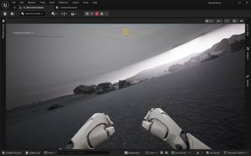</a>
<a href="/assets/d/2026-10-05/WindowsEditor_ScreenShot00224.jpg" target="_blank">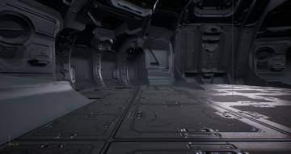</a>

17:30 보급고가 하늘에서 불꽃을 뿜으며 천천히 내려앉는 착륙 연출을 넣었습니다

<h2 id="ui">ui <small>화면 UI</small></h2>

장비 점수 표시와 장비 선택 화면을 다듬었습니다.

<a href="/assets/d/2026-10-05/WindowsEditor_ScreenShot00204.jpg" target="_blank">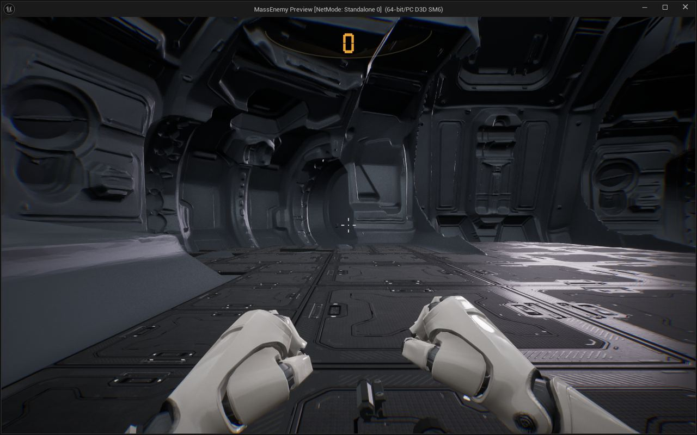</a>

16:47 헬멧 킬 카운터가 켜진 숫자만 가운데에 보이게 했습니다

<a href="/assets/d/2026-10-05/WindowsEditor_ScreenShot00207.jpg" target="_blank">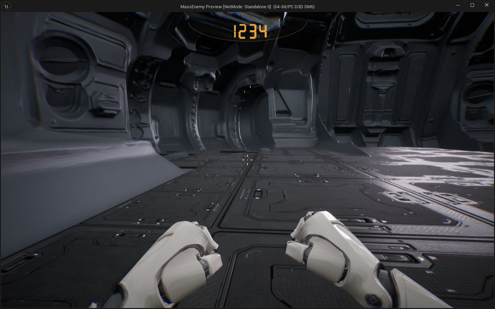</a>

16:53 헬멧 킬 카운터 숫자를 기울이지 않고 수평으로 보이게 했습니다

<a href="/assets/d/2026-10-05/WindowsEditor_ScreenShot00208.jpg" target="_blank">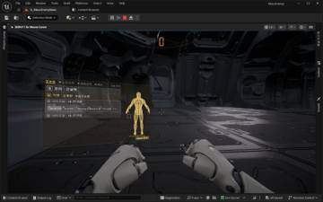</a>
<a href="/assets/d/2026-10-05/WindowsEditor_ScreenShot00209.jpg" target="_blank">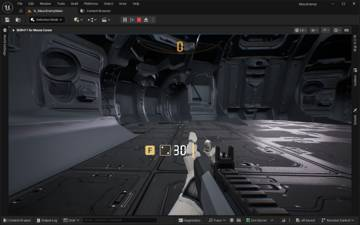</a>
<a href="/assets/d/2026-10-05/WindowsEditor_ScreenShot00210.jpg" target="_blank">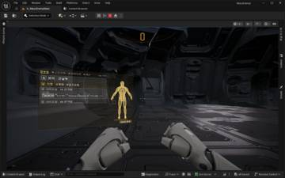</a>
<a href="/assets/d/2026-10-05/WindowsEditor_ScreenShot00211.jpg" target="_blank">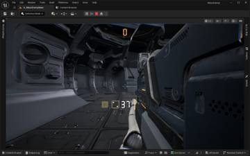</a>

16:54 맨손 장비 화면을 주먹 위 가운데에 비스듬히 눕혀 띄웠습니다.

<a href="/assets/d/2026-10-05/WindowsEditor_ScreenShot00214.jpg" target="_blank">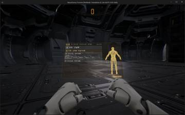</a>
<a href="/assets/d/2026-10-05/WindowsEditor_ScreenShot00215.jpg" target="_blank">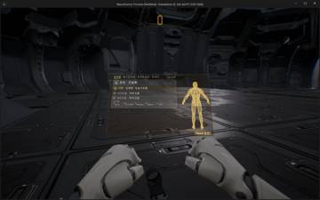</a>

17:02 장비 화면에서 다른 슬롯 키를 누르면 슬롯이 바뀌게 하고 긴 이름을 줄임표로 잘랐습니다.

<a href="/assets/d/2026-10-05/WindowsEditor_ScreenShot00216.jpg" target="_blank">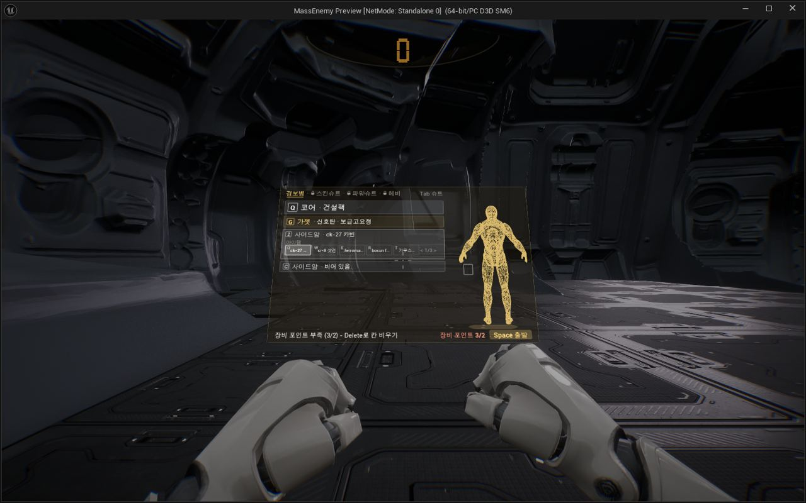</a>

17:05 장비 선택 화면에 사용 중인 장비 포인트를 표시하고 초과하면 막게 했습니다.

<h2 id="building">building <small>건물</small></h2>

사령부 경사로 아래 벽을 없애고 도구 경로를 정리했습니다.

<h2 id="design">design <small>기획</small></h2>

SCV 시뮬레이터 구상을 넣고 폴더를 정리했습니다.

<h2 id="zerg">zerg <small>저그</small></h2>

다음 의견 반영을 위해 작업 목록을 정리했습니다.

