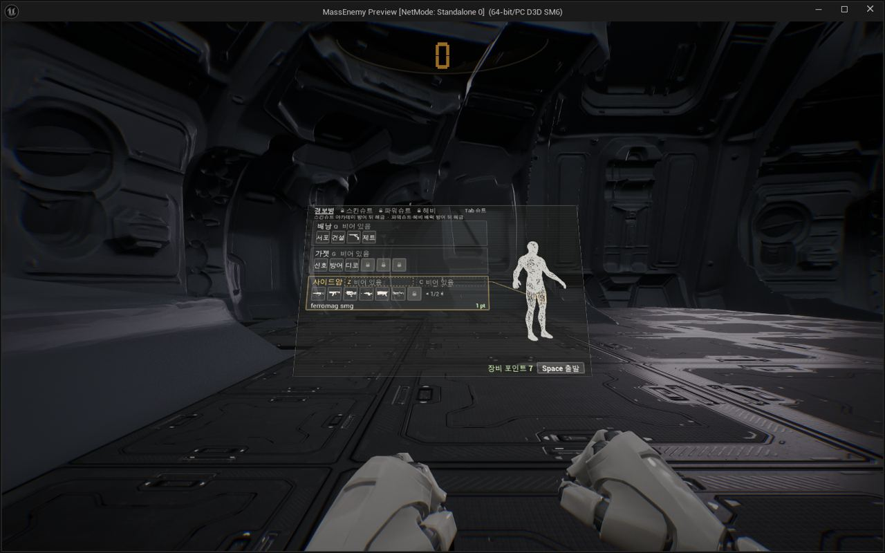
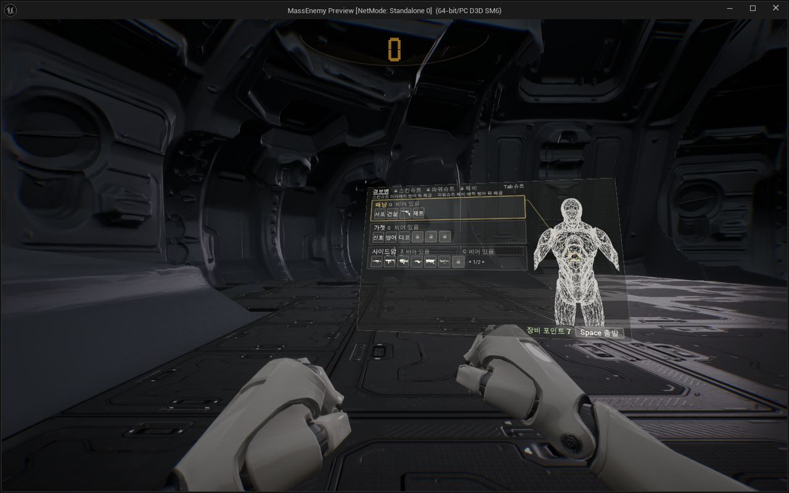

작업 2개 · 사진 4장

<ul class="toc">
<li><a href="#ui">화면 UI</a></li>
<li><a href="#weapon">무기</a></li>
</ul>
<h2 id="ui">화면 UI</h2>

장비 화면의 몸 모형에 무전기 팩을 올렸습니다.

10:18 장비 화면의 몸 모형에 무전기 팩이 보이게 했습니다.

14:25 장비 화면의 몸 모형 등에 무전기 모양을 올렸습니다.

<h2 id="weapon">무기</h2>

장비 화면과 맨손 자세를 다듬었습니다.

14:40 총 모델 위치를 3D 조절판으로 맞출 수 있게 했습니다.

15:19 장비 화면을 흰 바탕에 선택 항목만 주황색인 색으로 바꿨습니다.

15:37 장비 아이콘을 3D 모델 썸네일로 바꿨습니다.

15:51 맨손일 때 오른 주먹이 더 앞으로 나오게 했습니다.

16:53 총과 손, 팔 위치를 탭으로 골라 조절할 수 있게 했습니다.

21:09 맨손 장비 화면이 총 옆과 같은 자리에 열리게 했습니다.

21:19 맨손일 때 손목 장치처럼 팔뚝 위에 장비 화면이 열리게 했습니다.

22:20 중화기 팩으로 무기를 집어넣어 맨손이 되게 했습니다.

