
세션 5개 · 사진 44장

<ul class="toc">
<li><a href="#ui">ui — 화면 UI</a></li>
<li><a href="#weapon">weapon — 무기</a></li>
<li><a href="#design">design — 기획</a></li>
<li><a href="#building">building — 건물</a></li>
<li><a href="#terran">terran — 테란 아군</a></li>
</ul>
<h2 id="ui">ui <small>화면 UI</small></h2>

총 패널이 화면 밖으로 튀지 않게 고쳤습니다.

<a href="/assets/d/2026-10-06/WindowsEditor_grab_000.jpg" target="_blank">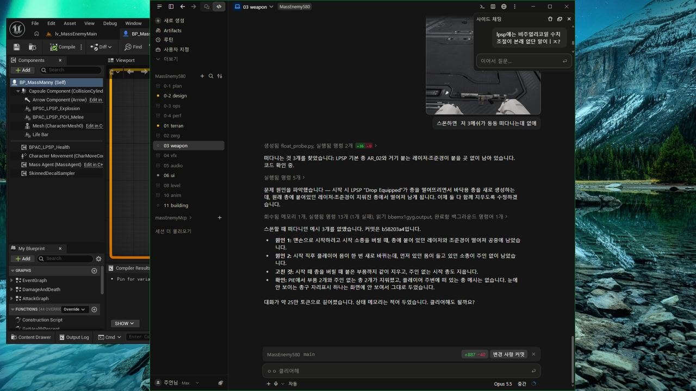</a>

10:18 착용한 무전기 팩이 장비창 몸체 와이어프레임에도 보이게 했습니다

<a href="/assets/d/2026-10-06/WindowsEditor_ScreenShot00226.jpg" target="_blank">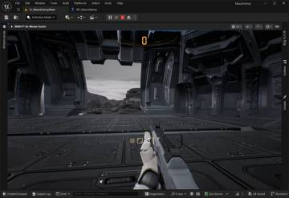</a>
<a href="/assets/d/2026-10-06/WindowsEditor_ScreenShot00228.jpg" target="_blank">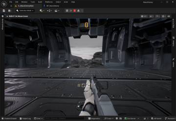</a>
<a href="/assets/d/2026-10-06/WindowsEditor_ScreenShot00229.jpg" target="_blank">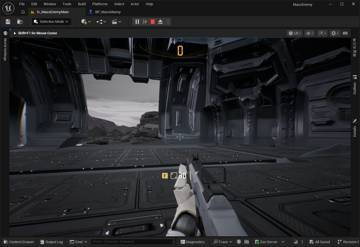</a>
<a href="/assets/d/2026-10-06/WindowsEditor_ScreenShot00232.jpg" target="_blank">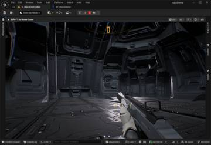</a>

14:25 등에 메는 무전기 팩을 새 무전기 모델로 바꿨습니다

<h2 id="weapon">weapon <small>무기</small></h2>

보급고 착지 연기를 넣고 들고 있는 총이 벽에 걸리지 않게 했습니다.

<a href="/assets/d/2026-10-06/WindowsEditor_HighresScreenshot00203.jpg" target="_blank">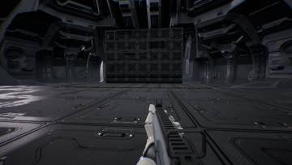</a>
<a href="/assets/d/2026-10-06/WindowsEditor_HighresScreenshot00204.jpg" target="_blank">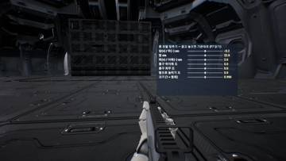</a>

14:40 F7으로 총 모델 위치를 총 옆의 3D 슬라이더 패널에서 조절하게 했습니다.

<a href="/assets/d/2026-10-06/WindowsEditor_ScreenShot00248.jpg" target="_blank">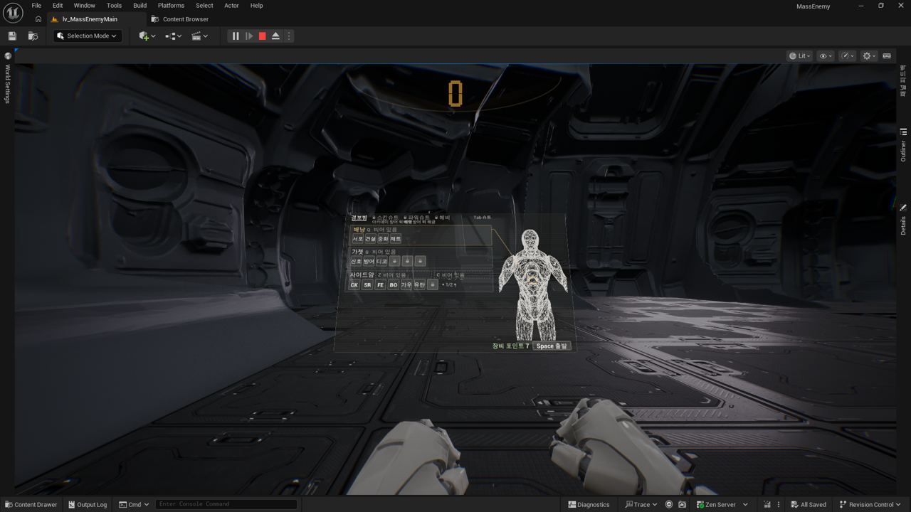</a>

15:19 장비창을 새 설계에 맞춰 따뜻한 흰색과 호박색 팔레트로 다시 짰습니다

<a href="/assets/d/2026-10-06/WindowsEditor_ScreenShot00253.jpg" target="_blank">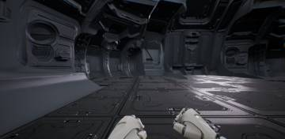</a>
<a href="/assets/d/2026-10-06/WindowsEditor_ScreenShot00262.jpg" target="_blank">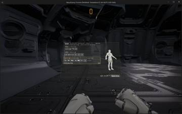</a>
<a href="/assets/d/2026-10-06/WindowsEditor_ScreenShot00263.jpg" target="_blank">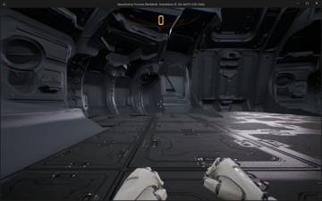</a>

15:37 장비 아이콘을 와이어프레임 모양의 3D 모델 썸네일로 만들었습니다.

<a href="/assets/d/2026-10-06/WindowsEditor_ScreenShot00264.jpg" target="_blank">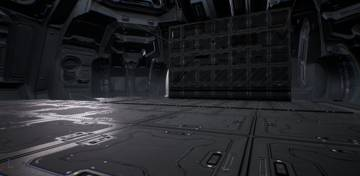</a>
<a href="/assets/d/2026-10-06/WindowsEditor_ScreenShot00265.jpg" target="_blank">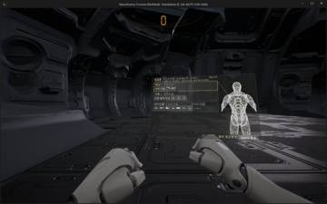</a>

15:51 맨손일 때 오른 주먹을 더 앞으로 내고 장비 판을 가운데로 돌렸습니다.

<a href="/assets/d/2026-10-06/WindowsEditor_ScreenShot00270.jpg" target="_blank">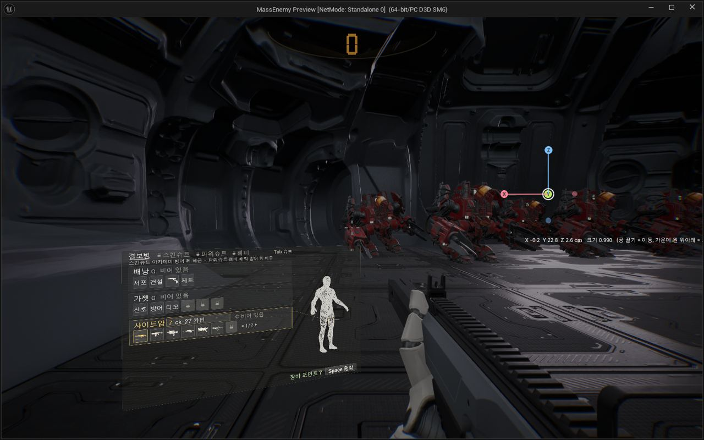</a>

16:05 F7 총 위치 조절을 블렌더 같은 X, Y, Z 축 조절 구슬로 바꿨습니다.

<a href="/assets/d/2026-10-06/WindowsEditor_ScreenShot00271.jpg" target="_blank">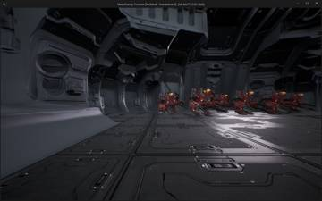</a>
<a href="/assets/d/2026-10-06/WindowsEditor_ScreenShot00272.jpg" target="_blank">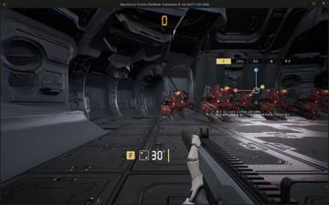</a>

16:53 조절 도구에 총, 손, 팔, 패널 탭을 만들어 각각 따로 맞추게 했습니다

<a href="/assets/d/2026-10-06/WindowsEditor_ScreenShot00274.jpg" target="_blank">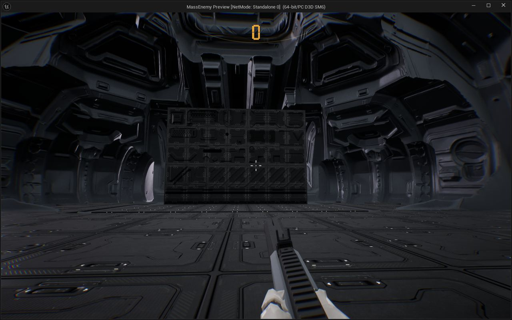</a>

20:59 보조무기를 든 채 장비 화면을 조작하면 플레이어가 사라지던 문제를 고쳤습니다.

<a href="/assets/d/2026-10-06/WindowsEditor_ScreenShot00275.jpg" target="_blank">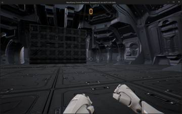</a>
<a href="/assets/d/2026-10-06/WindowsEditor_ScreenShot00276.jpg" target="_blank">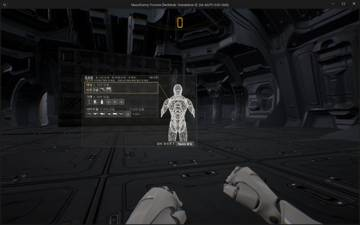</a>
<a href="/assets/d/2026-10-06/WindowsEditor_ScreenShot00277.jpg" target="_blank">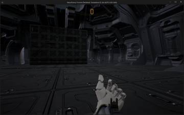</a>
<a href="/assets/d/2026-10-06/WindowsEditor_ScreenShot00278.jpg" target="_blank">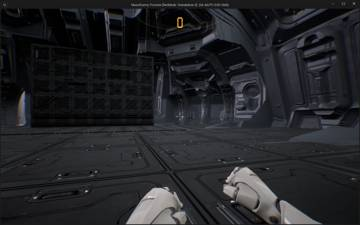</a>
<a href="/assets/d/2026-10-06/WindowsEditor_ScreenShot00279.jpg" target="_blank">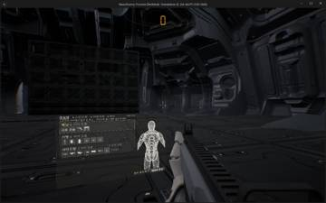</a>
<a href="/assets/d/2026-10-06/WindowsEditor_ScreenShot00280.jpg" target="_blank">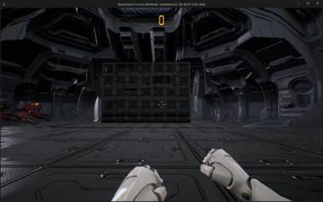</a>
<a href="/assets/d/2026-10-06/WindowsEditor_ScreenShot00281.jpg" target="_blank">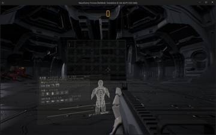</a>
<a href="/assets/d/2026-10-06/WindowsEditor_ScreenShot00282.jpg" target="_blank">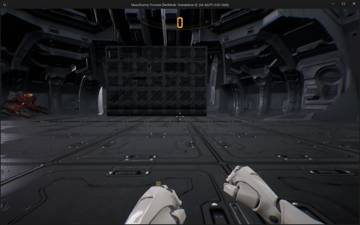</a>
<a href="/assets/d/2026-10-06/WindowsEditor_ScreenShot00283.jpg" target="_blank">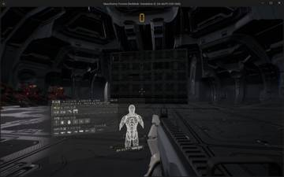</a>

21:09 맨손 장비 화면이 총을 들었을 때와 같은 자리에 열리고 F 표시가 깜빡이게 했습니다.

<a href="/assets/d/2026-10-06/WindowsEditor_ScreenShot00285.jpg" target="_blank">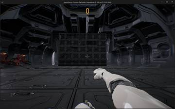</a>
<a href="/assets/d/2026-10-06/WindowsEditor_ScreenShot00286.jpg" target="_blank">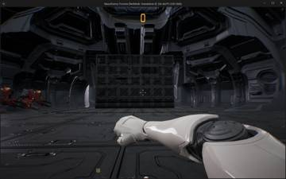</a>
<a href="/assets/d/2026-10-06/WindowsEditor_ScreenShot00287.jpg" target="_blank">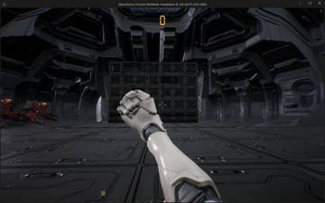</a>
<a href="/assets/d/2026-10-06/WindowsEditor_ScreenShot00288.jpg" target="_blank">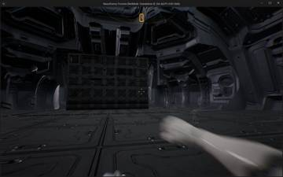</a>
<a href="/assets/d/2026-10-06/WindowsEditor_ScreenShot00291.jpg" target="_blank">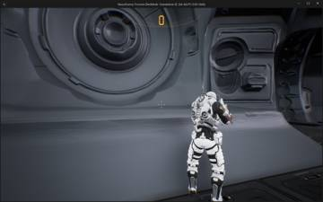</a>

21:19 장비창에서 빈손일 때 손목에 화면이 보이는 팔찌형 연출을 넣었습니다

<a href="/assets/d/2026-10-06/WindowsEditor_ScreenShot00293.jpg" target="_blank">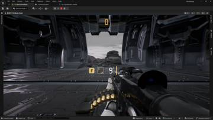</a>
<a href="/assets/d/2026-10-06/WindowsEditor_ScreenShot00294.jpg" target="_blank">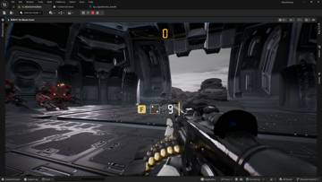</a>

22:20 중화기 팩에서 무기를 넣으면 맨손이 되도록 Q 키 동작을 고쳤습니다.

<h2 id="design">design <small>기획</small></h2>

중화기 팩과 EMP 장비 등 구성을 정했습니다.

<a href="/assets/d/2026-10-06/WindowsEditor_ScreenShot00233.jpg" target="_blank">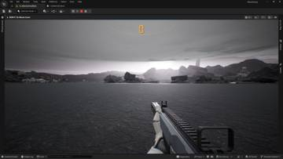</a>
<a href="/assets/d/2026-10-06/WindowsEditor_ScreenShot00235.jpg" target="_blank">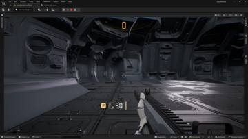</a>
<a href="/assets/d/2026-10-06/WindowsEditor_ScreenShot00236.jpg" target="_blank">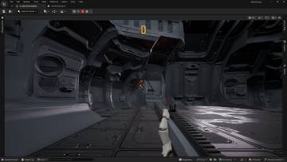</a>

14:53 장비 선택 화면을 흰 바탕에 선택만 호박색으로 바꾸고 보조 무기를 한 줄에 놓았습니다.

<a href="/assets/d/2026-10-06/WindowsEditor_ScreenShot00238.jpg" target="_blank">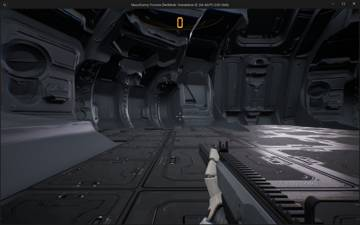</a>
<a href="/assets/d/2026-10-06/WindowsEditor_ScreenShot00240.jpg" target="_blank">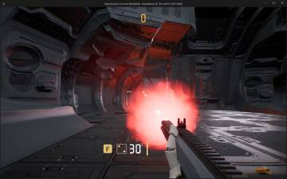</a>
<a href="/assets/d/2026-10-06/WindowsEditor_ScreenShot00242.jpg" target="_blank">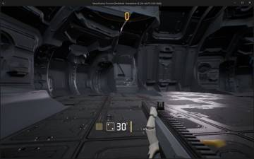</a>
<a href="/assets/d/2026-10-06/WindowsEditor_ScreenShot00243.jpg" target="_blank">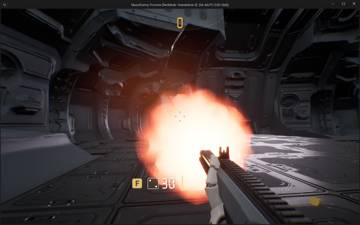</a>
<a href="/assets/d/2026-10-06/WindowsEditor_ScreenShot00244.jpg" target="_blank">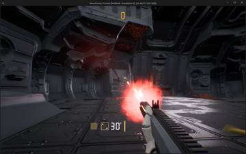</a>
<a href="/assets/d/2026-10-06/WindowsEditor_ScreenShot00245.jpg" target="_blank">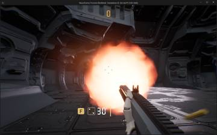</a>
<a href="/assets/d/2026-10-06/WindowsEditor_ScreenShot00247.jpg" target="_blank">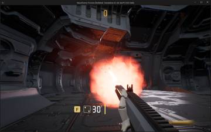</a>

15:00 장비 화면의 줄을 몸 부위별로 나누고 키 글자를 작은 회색 표시로 바꿨습니다.

<a href="/assets/d/2026-10-06/WindowsEditor_ScreenShot00266.jpg" target="_blank">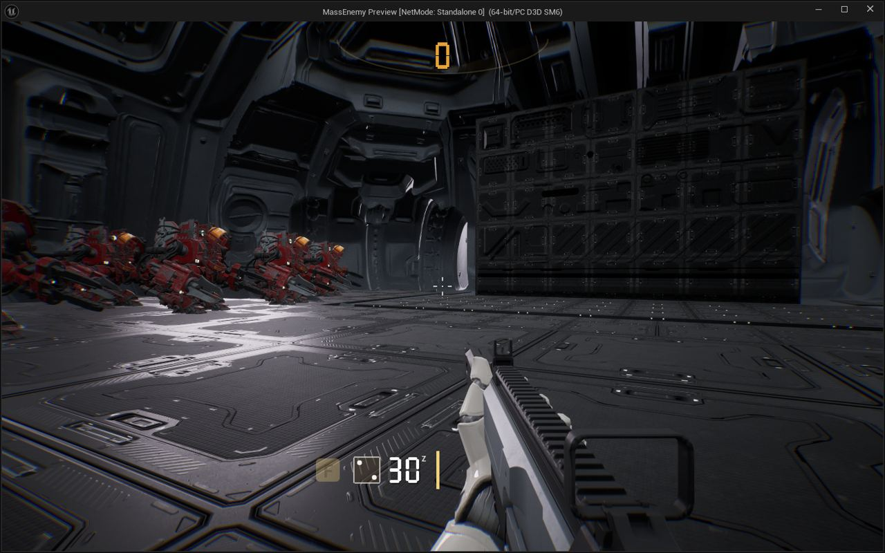</a>

15:56 마지막 총은 버릴 수 없게 하고 맨손 패널과 쌍권총 가능 무기를 정했습니다.

<h2 id="building">building <small>건물</small></h2>

사령부 경사로가 닫힐 때 방패처럼 서 있지 않게 했습니다.

<h2 id="terran">terran <small>테란 아군</small></h2>

아군이 두리번거리는 횟수를 줄이고 SCV 모델을 가져왔습니다.

