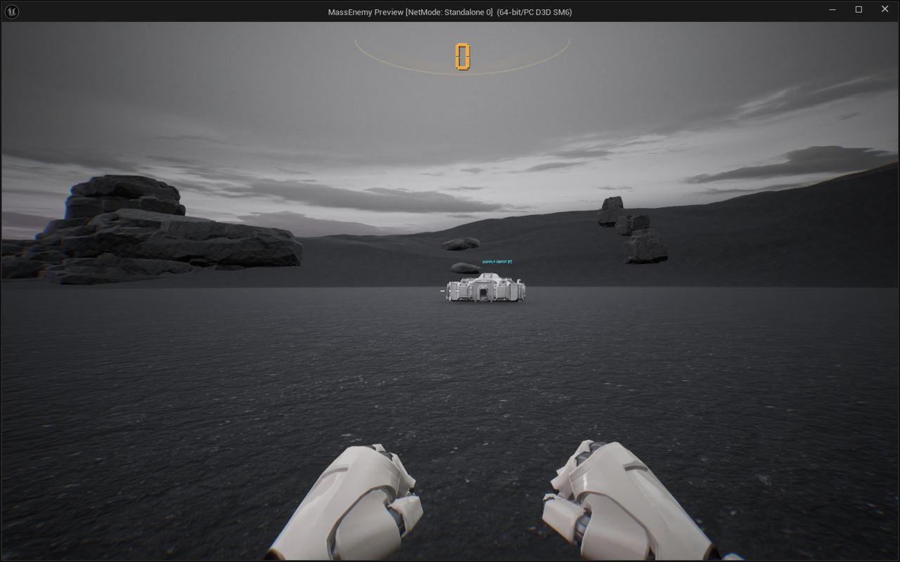
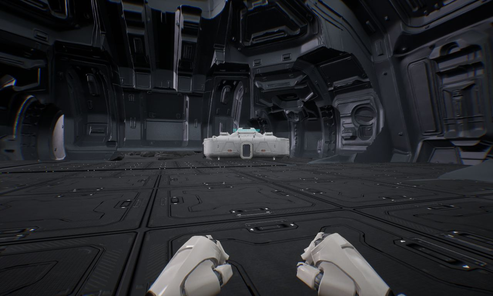
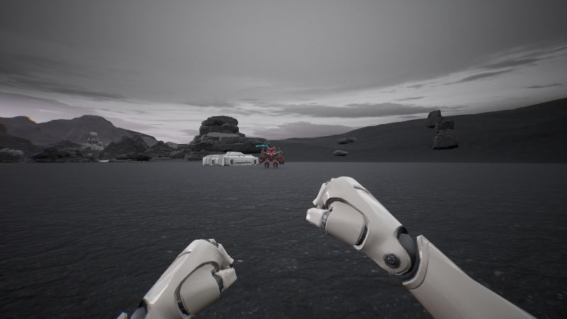
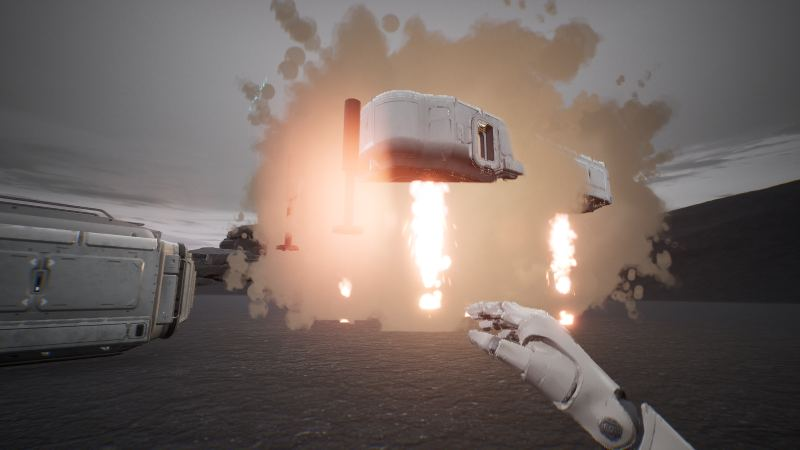
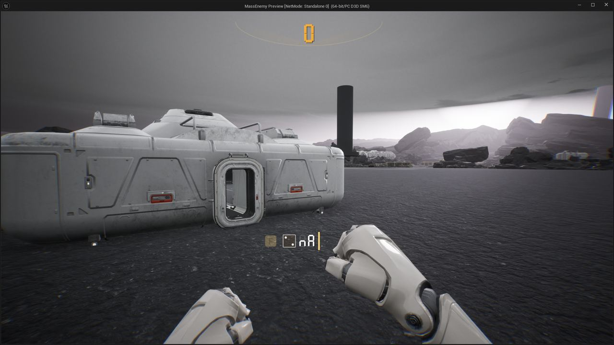
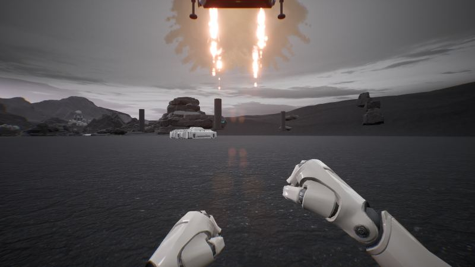
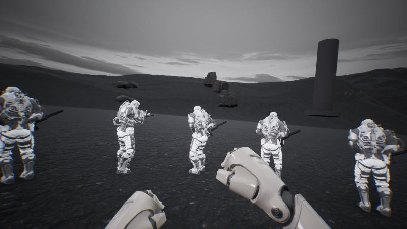

작업 6개 · 사진 7장

<ul class="toc">
<li><a href="#weapon">무기</a></li>
<li><a href="#building">건물</a></li>
<li><a href="#zerg">저그</a></li>
<li><a href="#terran">테란 아군</a></li>
<li><a href="#ui">화면 UI</a></li>
<li><a href="#vfx">이펙트</a></li>
</ul>
<h2 id="weapon">무기</h2>

보급고 연기와 방어막 설치, 맨손 패널을 손봤습니다.

00:16 보급고 착지 연기가 쌓이지 않고 일정량만 남게 했습니다.

01:39 방어막 발생기를 미리보기로 확인한 뒤 설치하게 했습니다.

02:06 맨손일 때 주먹을 푸는 동작이 바로 멈추게 했습니다.

02:10 맨손일 때도 총 패널이 손 옆에 표시되게 했습니다.

02:27 맨손일 때 패널에 사용 불가 표시가 뜨게 했습니다.

<h2 id="building">건물</h2>

보급고가 피스톤 다리로 착지하도록 만들었습니다.

02:15 보급고가 피스톤 다리로 착지하게 했습니다.

<h2 id="zerg">저그</h2>

저글링 생성 처리를 줄여 끊김을 줄였습니다.

03:23 누운 아군 위의 저글링이 머리를 향하게 했습니다.

<h2 id="terran">테란 아군</h2>

느린 장면에서는 아군 피격 효과를 건너뛰게 했습니다.

03:38 주변에 저글링이 없으면 아군이 총을 내리게 했습니다.

<h2 id="ui">화면 UI</h2>

화면 표시를 가볍게 다듬었습니다.

<h2 id="vfx">이펙트</h2>

피 구름과 충격 효과를 가볍게 해 전투 끊김을 줄였습니다.

