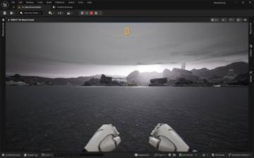
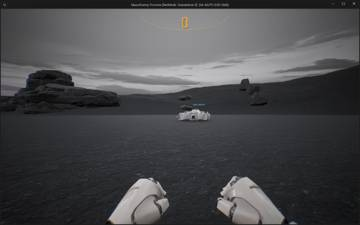
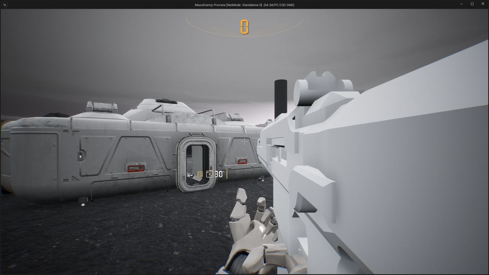
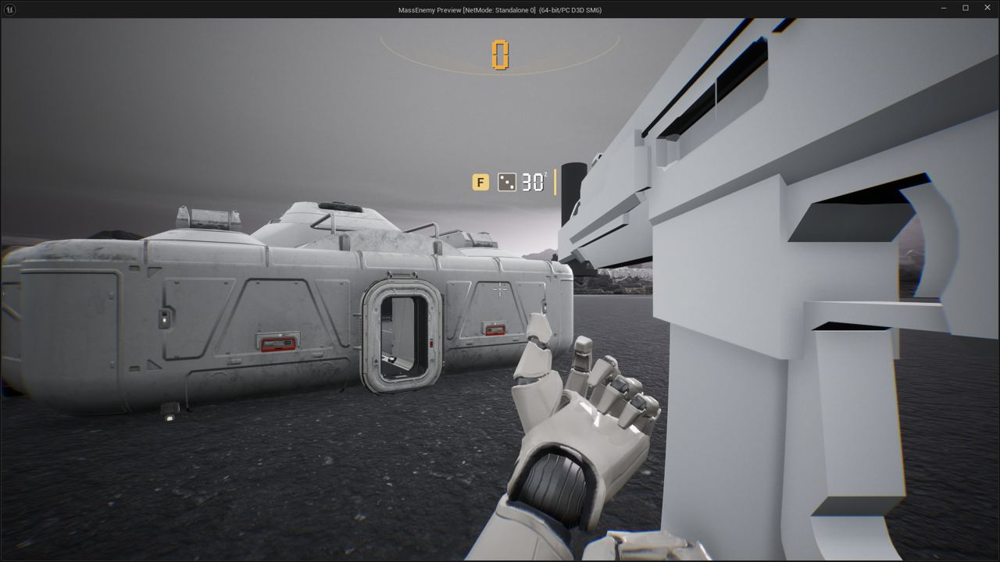

세션 9개 · 사진 10장

<ul class="toc">
<li><a href="#weapon">weapon — 무기</a></li>
<li><a href="#building">building — 건물</a></li>
<li><a href="#design">design — 기획</a></li>
<li><a href="#zerg">zerg — 저그</a></li>
<li><a href="#terran">terran — 테란 아군</a></li>
<li><a href="#level">level — 맵</a></li>
<li><a href="#perf">perf — 성능</a></li>
<li><a href="#ui">ui — 화면 UI</a></li>
<li><a href="#vfx">vfx — 이펙트</a></li>
</ul>
<h2 id="weapon">weapon <small>무기</small></h2>

카빈 모델을 새로 넣고 첫 발사 때 끊기는 문제를 줄였습니다.

00:16 보급고 바닥 연기에 상한을 두어 쌓이지 않게 했습니다.

01:39 방어막 발생기를 미리보기로 놓고 다시 눌러 설치하는 방식으로 바꿨습니다

02:06 맨손으로 총을 꺼낼 때 나오던 손 풀기 동작을 시작하자마자 멈추게 했습니다.

02:10 맨주먹일 때 사라지던 총 패널이 다시 보이게 고쳤습니다.

02:27 빈손일 때 패널에 n/a를 칠세그먼트 숫자로 표시했습니다.

<h2 id="building">building <small>건물</small></h2>

보급고가 피스톤 다리로 착지하도록 만들었습니다.

02:15 보급고 착륙용 피스톤과 전용 블루프린트를 만들어 쿵 떨어지던 문제를 고쳤습니다

<h2 id="design">design <small>기획</small></h2>

대기 중인 저글링이 링 위에 서 있도록 정하고 문서를 정리했습니다.

03:22 끝난 이전 안내서를 지우고 옛 엔진 메모를 보관 폴더로 옮겼습니다

<h2 id="zerg">zerg <small>저그</small></h2>

저글링 생성 처리를 줄여 프레임을 안정시켰습니다.

03:23 쓰러진 아군 가슴 위의 저글링이 머리를 향하도록 고쳤습니다.

<h2 id="terran">terran <small>테란 아군</small></h2>

느린 프레임에는 아군 피격 효과를 건너뛰게 했습니다.

03:38 적이 가까이 없으면 아군이 소총을 내리고 쉬는 자세를 취하게 했습니다

<h2 id="level">level <small>맵</small></h2>

에디터 경고를 일으키던 잘못된 연결을 정리했습니다.

<h2 id="perf">perf <small>성능</small></h2>

풀HD 하위 1% 60프레임 목표를 달성했습니다.

<h2 id="ui">ui <small>화면 UI</small></h2>

화면 표시가 프레임을 덜 쓰도록 다듬었습니다.

<h2 id="vfx">vfx <small>이펙트</small></h2>

피 구름과 충격 효과를 가볍게 해 전투 끊김을 줄였습니다.

