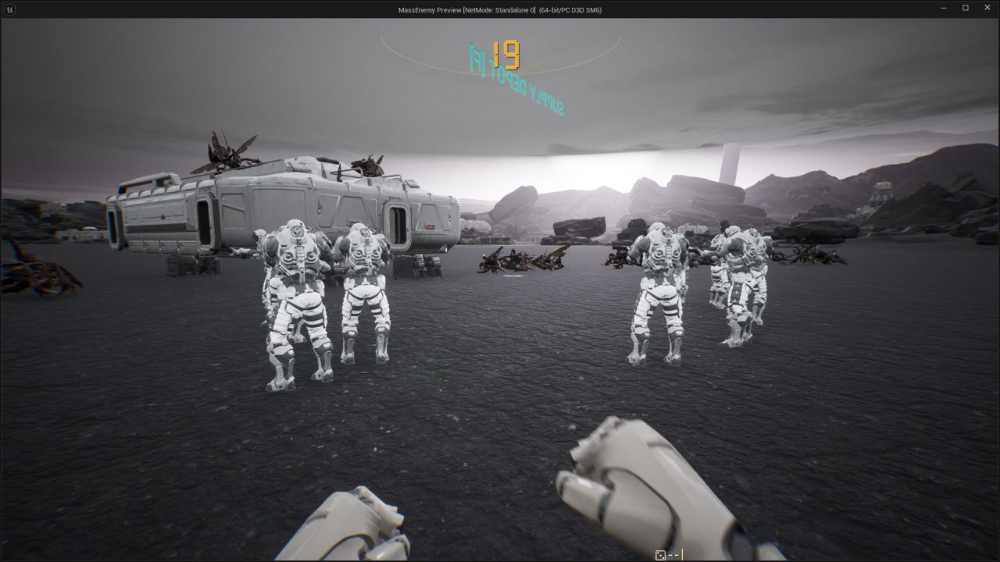

작업 8개 · 사진 7장

<ul class="toc">
<li><a href="#zerg">저그</a></li>
<li><a href="#weapon">무기</a></li>
<li><a href="#design">기획</a></li>
<li><a href="#ui">화면 UI</a></li>
<li><a href="#building">건물</a></li>
<li><a href="#level">맵</a></li>
<li><a href="#terran">테란 아군</a></li>
<li><a href="#vfx">이펙트</a></li>
</ul>
<h2 id="zerg">저그</h2>

저글링 동작이 부드럽게 움직이도록 고쳤습니다.

20:02 빗나간 총알이 저글링에 맞은 것으로 처리되지 않게 했습니다.

<h2 id="weapon">무기</h2>

총 패널 크기를 일정하게 하고 장비 화면을 다듬었습니다.

20:22 맨손 총 패널을 검지 손가락 위에 붙였습니다.

20:31 맨손 총 패널을 엄지 손가락 쪽으로 옮겼습니다.

21:14 장비 화면의 몸 그림에 테두리를 두르고 아이콘을 키웠습니다.

21:45 장비 화면에서 선택하면 슬롯이 바로 접히게 했습니다.

22:07 장비 화면이 벨트와 허벅지 줄에서도 몸을 확대해 보여 줍니다.

22:39 장비 화면에서 선택한 장비의 비교 정보를 보여 줍니다.

23:13 총 패널이 거리와 해상도와 상관없이 같은 크기로 보이게 했습니다.

<h2 id="design">기획</h2>

제트팩 종류와 장비 설계를 정했습니다.

22:33 장비 화면 색을 호박색 계열로 정했습니다.

23:06 장비 포인트를 해금 포인트로 바꾸고 환불되게 했습니다.

23:37 건설 팩 글자를 원작 단축키에 맞추기로 정했습니다.

23:51 제트팩은 위아래로 한 칸 뛰는 도약 방식으로 정했습니다.

23:57 제트팩 종류별 특성을 원작을 따라 정했습니다.

<h2 id="ui">화면 UI</h2>

총 패널의 F 글자를 숫자판 모양으로 바꿨습니다.

23:20 총 패널의 F 글자를 숫자판 모양으로 바꿨습니다.

<h2 id="building">건물</h2>

보급고가 피스톤 네 개 위에 서도록 배치했습니다.

<h2 id="level">맵</h2>

사령부 건물이 엉뚱한 곳으로 떨어지는 문제를 고쳤습니다.

<h2 id="terran">테란 아군</h2>

쓰러진 아군이 떨리지 않게 했습니다.

<h2 id="vfx">이펙트</h2>

빗나간 총알은 저글링에 맞은 것으로 치지 않게 했습니다.

