
세션 9개 · 사진 16장

<ul class="toc">
<li><a href="#zerg">zerg — 저그</a></li>
<li><a href="#weapon">weapon — 무기</a></li>
<li><a href="#design">design — 기획</a></li>
<li><a href="#ui">ui — 화면 UI</a></li>
<li><a href="#building">building — 건물</a></li>
<li><a href="#level">level — 맵</a></li>
<li><a href="#perf">perf — 성능</a></li>
<li><a href="#terran">terran — 테란 아군</a></li>
<li><a href="#vfx">vfx — 이펙트</a></li>
</ul>
<h2 id="zerg">zerg <small>저그</small></h2>

저글링 동작이 매 프레임 부드럽게 움직이도록 고쳤습니다.

<a href="/assets/d/2026-10-08/WindowsEditor_ScreenShot00303.jpg" target="_blank">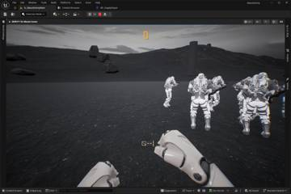</a>
<a href="/assets/d/2026-10-08/WindowsEditor_ScreenShot00304.jpg" target="_blank">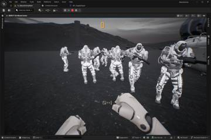</a>

20:02 저그에게 총알이 실제 몸에 맞았는지 판정해서 빗나가면 다음 적으로 날아가게 했습니다.

<h2 id="weapon">weapon <small>무기</small></h2>

총 패널 크기를 화면 해상도와 상관없이 같게 하고 장비 화면을 다듬었습니다.

<a href="/assets/d/2026-10-08/WindowsEditor_ScreenShot00305.jpg" target="_blank">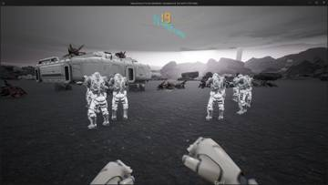</a>
<a href="/assets/d/2026-10-08/WindowsEditor_ScreenShot00306.jpg" target="_blank">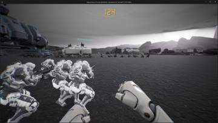</a>

20:22 맨손 총 패널이 검지 관절에 붙어 손을 따라 움직이게 했습니다

<a href="/assets/d/2026-10-08/WindowsEditor_ScreenShot00307.jpg" target="_blank">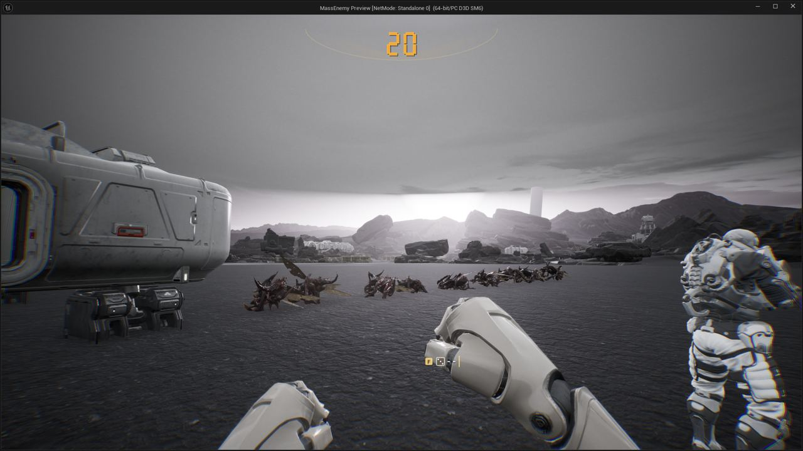</a>

20:31 맨손 총 패널을 검지 대신 엄지에 붙였습니다.

<a href="/assets/d/2026-10-08/WindowsEditor_ScreenShot00308.jpg" target="_blank">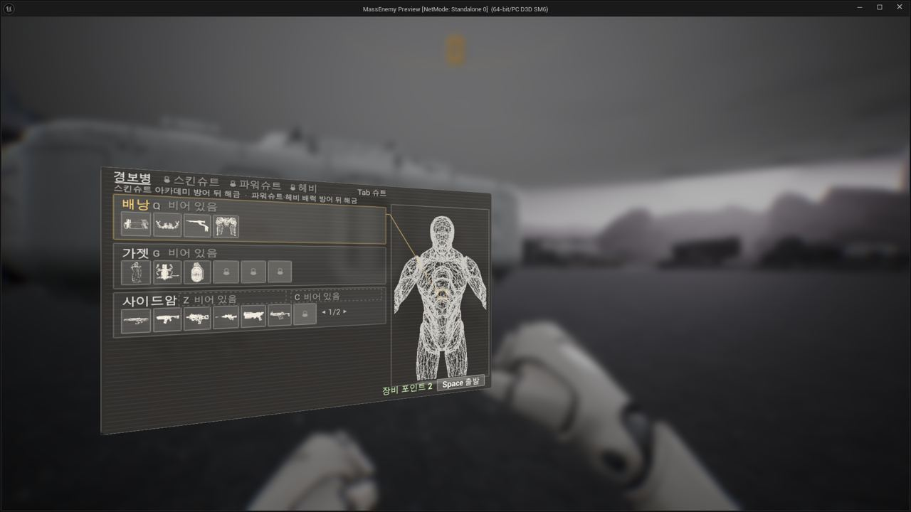</a>

21:14 장비 화면의 와이어프레임 몸 둘레에 틀을 두르고 아이콘을 키웠습니다.

<a href="/assets/d/2026-10-08/WindowsEditor_ScreenShot00309.jpg" target="_blank">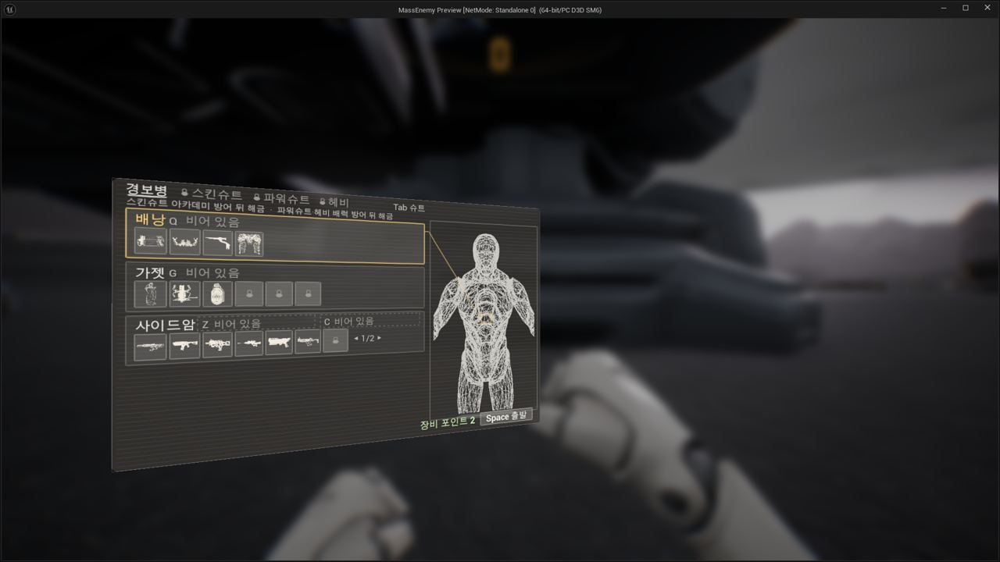</a>

21:45 장비 화면에서 Enter가 슬롯을 고르고 접도록 바꿨습니다.

<a href="/assets/d/2026-10-08/WindowsEditor_ScreenShot00312.jpg" target="_blank">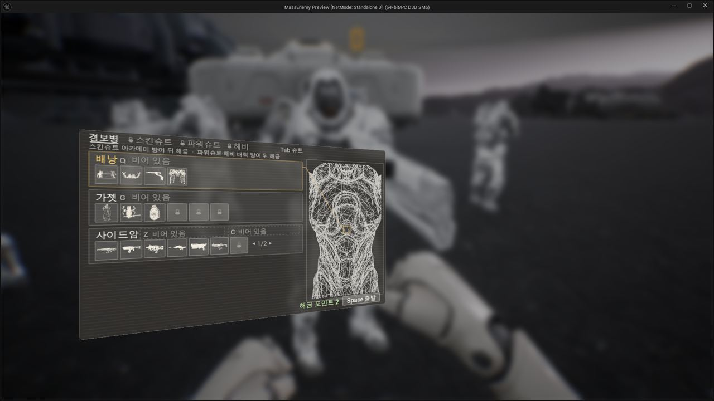</a>

22:07 장비 화면의 와이어프레임이 가젯과 보조무기 줄에서도 확대되게 했습니다.

<a href="/assets/d/2026-10-08/WindowsEditor_ScreenShot00320.jpg" target="_blank">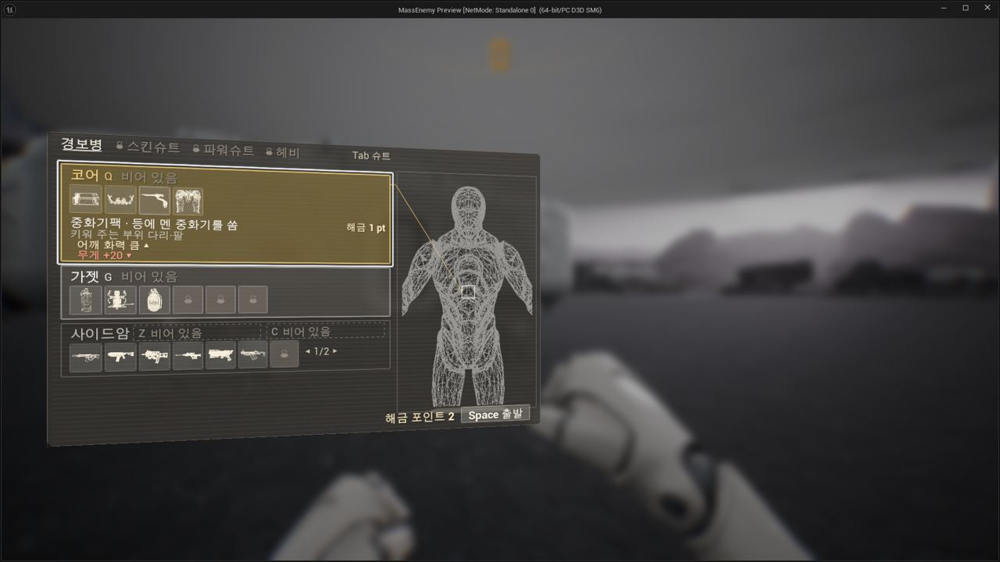</a>

22:39 장비창에서 커서 아래 아이템과 현재 장비를 비교해 보여주게 했습니다

<a href="/assets/d/2026-10-08/WindowsEditor_ScreenShot00325.jpg" target="_blank">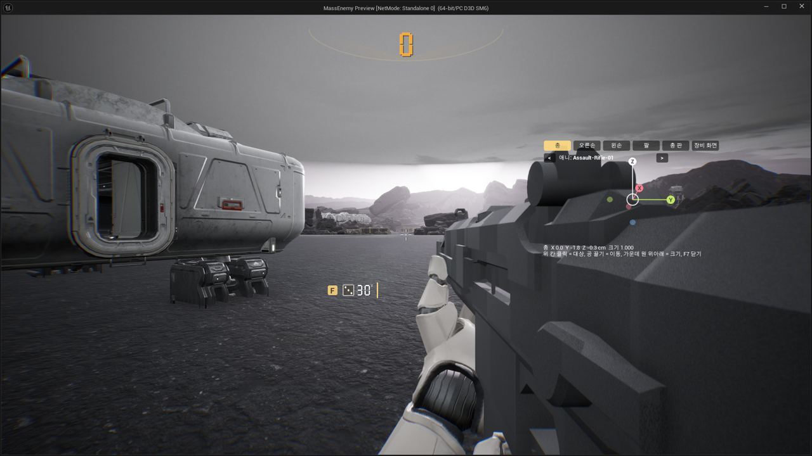</a>

23:13 총 패널이 거리와 화면 크기에 상관없이 같은 비율로 보이게 했습니다.

<h2 id="design">design <small>기획</small></h2>

제트팩 종류와 시간팩 효과 등 장비 설계를 정했습니다.

<a href="/assets/d/2026-10-08/WindowsEditor_ScreenShot00318.jpg" target="_blank">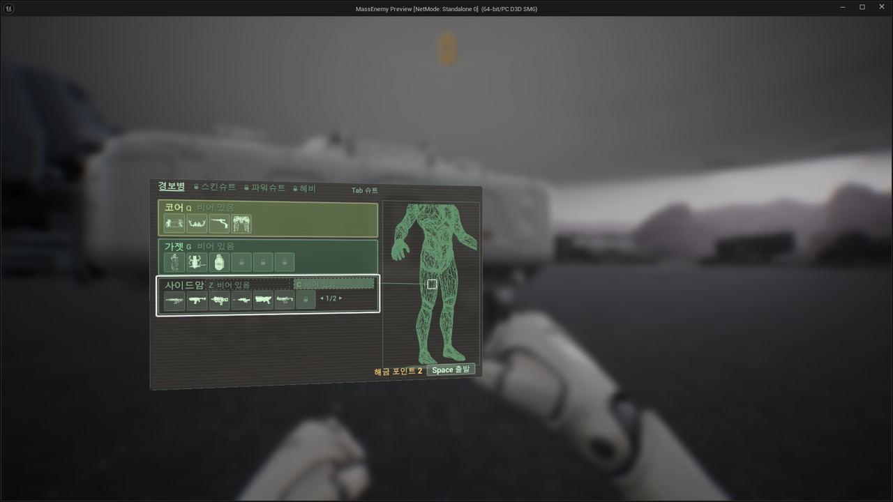</a>

22:33 장비창 색을 초록에서 호박색과 안내선 중심으로 바꿨습니다

<a href="/assets/d/2026-10-08/WindowsEditor_ScreenShot00324.jpg" target="_blank">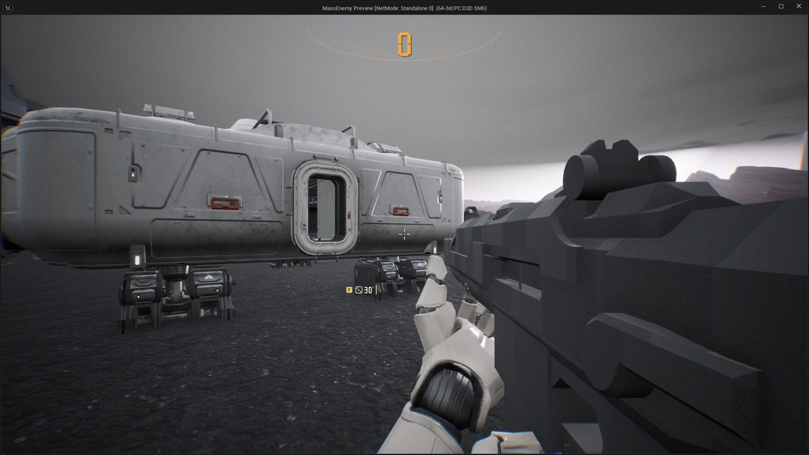</a>

23:06 장비 포인트 이름을 해금 포인트로 바꾸고 환불이 되게 했습니다.

<a href="/assets/d/2026-10-08/WindowsEditor_HighresScreenshot00215.jpg" target="_blank">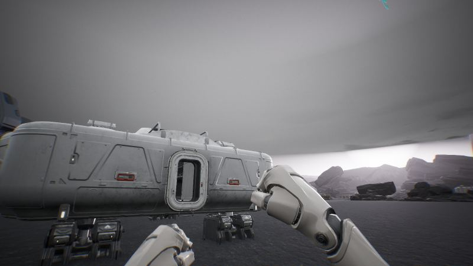</a>

23:37 건설 팩 글자를 원작 단축키에 맞추고 원작 상점은 우리 몸 부품 탭으로 정리했습니다.

<a href="/assets/d/2026-10-08/WindowsEditor_HighresScreenshot00216.jpg" target="_blank">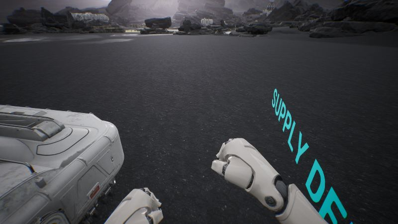</a>

23:51 제트팩을 계속 날지 않고 한 층씩 뛰어오르는 방식으로 바꿨습니다

<a href="/assets/d/2026-10-08/WindowsEditor_ScreenShot00328.jpg" target="_blank">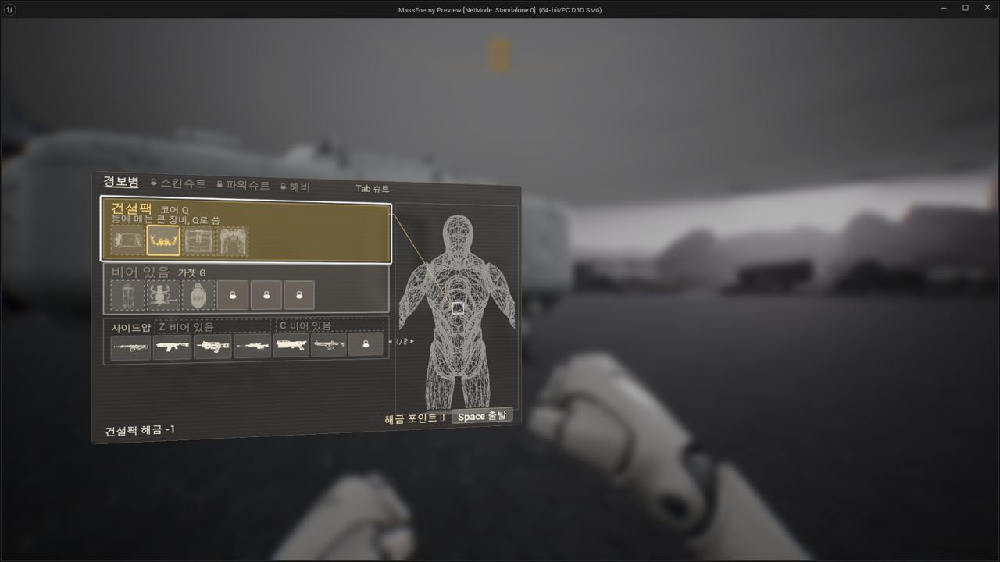</a>

23:57 제트팩을 터보, 정찰, 조명탄, 시간 지연 변형으로 나눴습니다.

<h2 id="ui">ui <small>화면 UI</small></h2>

총 패널의 F 글자를 숫자판 모양으로 바꿨습니다.

<a href="/assets/d/2026-10-08/WindowsEditor_ScreenShot00326.jpg" target="_blank">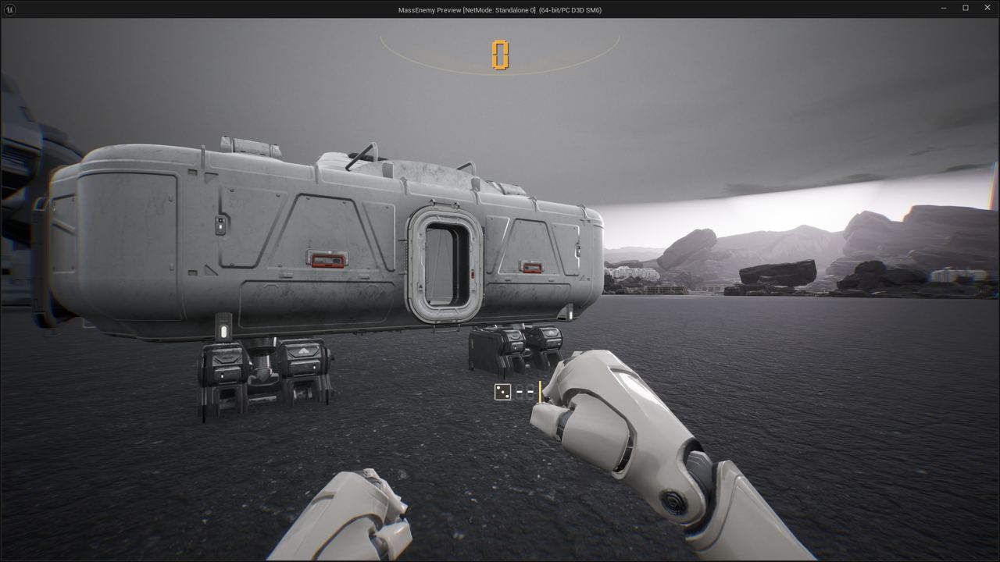</a>

23:20 총 패널의 F 표시를 7세그먼트 글자로 바꿨습니다

<h2 id="building">building <small>건물</small></h2>

보급고가 피스톤 네 개 위에 서도록 배치했습니다.

<h2 id="level">level <small>맵</small></h2>

사령부 건물이 원점으로 떨어지는 문제를 다시 고쳤습니다.

<h2 id="perf">perf <small>성능</small></h2>

풀HD 측정이 제 해상도로 돌도록 바로잡았습니다.

<h2 id="terran">terran <small>테란 아군</small></h2>

쓰러진 아군이 떨리지 않고 카메라가 땅 아래로 꺼지지 않게 했습니다.

<h2 id="vfx">vfx <small>이펙트</small></h2>

빗나간 총알은 저글링에 맞은 것으로 치지 않게 했습니다.

