
작업 7개 · 사진 13장

<ul class="toc">
<li><a href="#ui">화면 UI</a></li>
<li><a href="#terran">테란 아군</a></li>
<li><a href="#design">기획</a></li>
<li><a href="#weapon">무기</a></li>
<li><a href="#audio">소리</a></li>
<li><a href="#vfx">이펙트</a></li>
<li><a href="#zerg">저그</a></li>
</ul>
<h2 id="ui">화면 UI</h2>

총 패널이 총에 붙어 따라오게 했습니다.

<a href="/assets/d/2026-10-09/WindowsEditor_ScreenShot00330.jpg" target="_blank">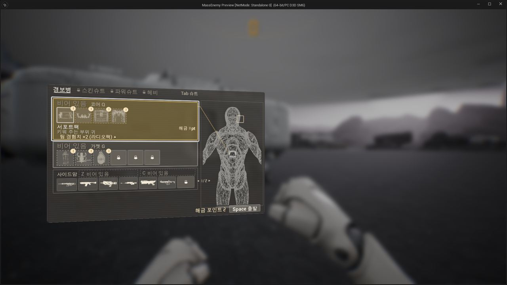</a>

00:02 장비 화면의 잠금 표시와 아이콘 칸 크기를 시안대로 다듬었습니다.

01:14 능력치 화면의 막대가 각 부품 수치대로 차오르게 했습니다.

<a href="/assets/d/2026-10-09/WindowsEditor_ScreenShot00340.jpg" target="_blank">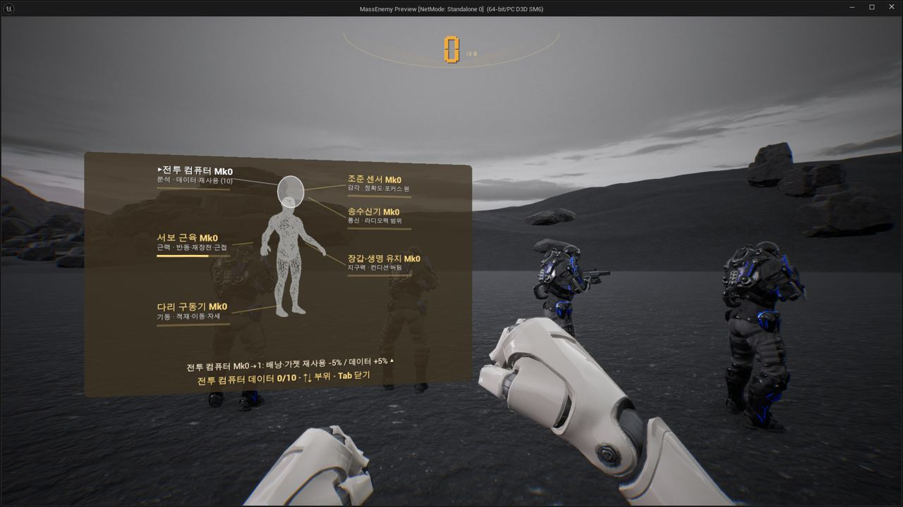</a>

01:22 능력치 화면의 비교 수치를 숫자판 모양으로 보여 줍니다.

<h2 id="terran">테란 아군</h2>

아군 총구 불꽃을 키웠습니다.

<a href="/assets/d/2026-10-09/WindowsEditor_ScreenShot00332.jpg" target="_blank">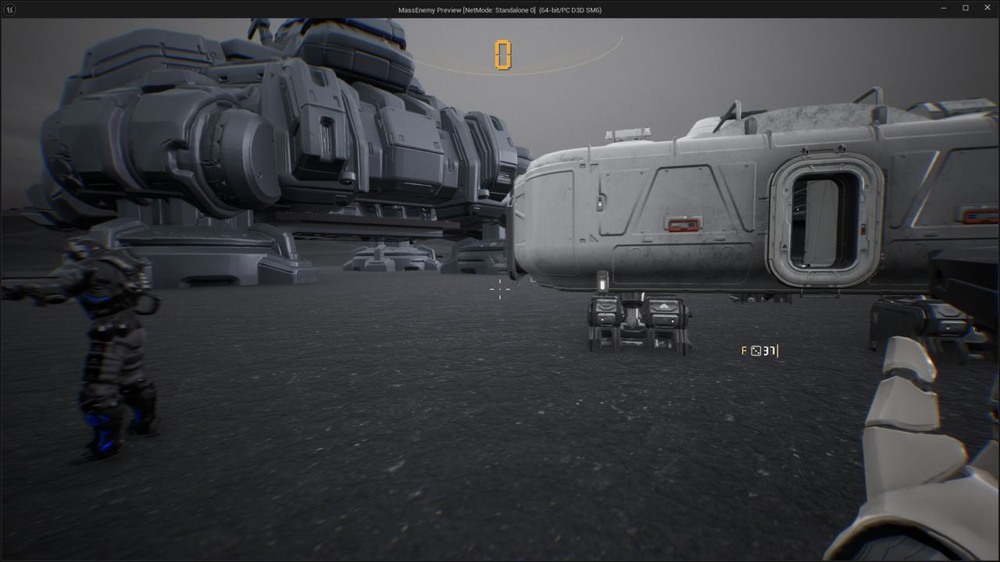</a>

00:22 아군이 쏠 때 총구에서 큰 불꽃이 보이게 했습니다.

<h2 id="design">기획</h2>

4연장 로켓은 어깨 발사기로 쏘도록 정했습니다.

00:29 아군은 플레이어가 웅크릴 때만 따라 웅크리게 정했습니다.

<h2 id="weapon">무기</h2>

카빈 모델과 어깨 발사기, 등 탄약통을 넣었습니다.

<a href="/assets/d/2026-10-09/WindowsEditor_ScreenShot00347.jpg" target="_blank">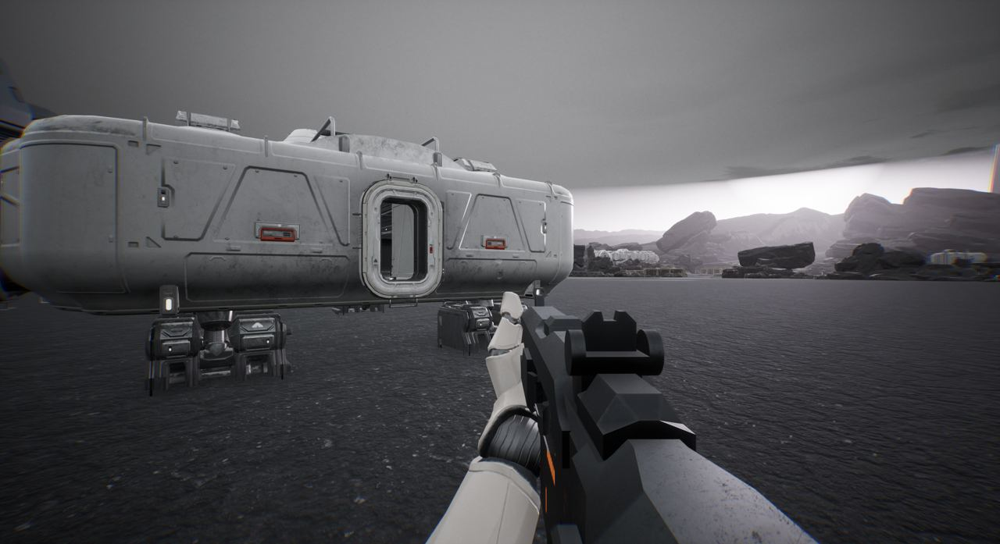</a>

02:58 탄창이 비면 총 패널의 탄약 숫자가 빨갛게 깜빡입니다.

<a href="/assets/d/2026-10-09/WindowsEditor_HighresScreenshot00221.jpg" target="_blank">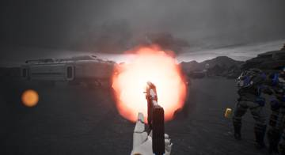</a>
<a href="/assets/d/2026-10-09/WindowsEditor_HighresScreenshot00223.jpg" target="_blank">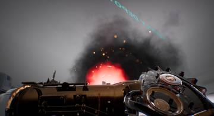</a>
<a href="/assets/d/2026-10-09/WindowsEditor_HighresScreenshot00225.jpg" target="_blank">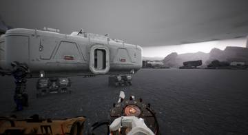</a>

18:43 화염방사기를 소각기 모델과 등 연료통으로 새로 만들었습니다.

<a href="/assets/d/2026-10-09/WindowsEditor_HighresScreenshot00230.jpg" target="_blank">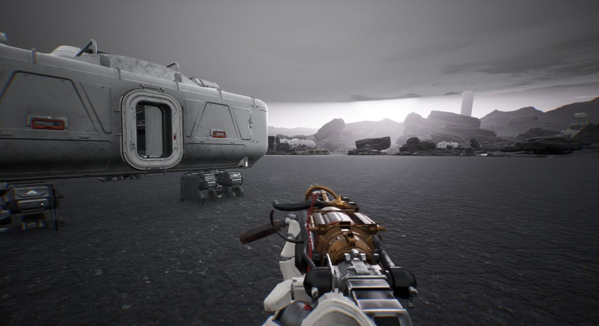</a>

21:41 화염방사기를 들 때 왼손이 세로 손잡이를 쥐게 했습니다.

<a href="/assets/d/2026-10-09/WindowsEditor_HighresScreenshot00234.jpg" target="_blank">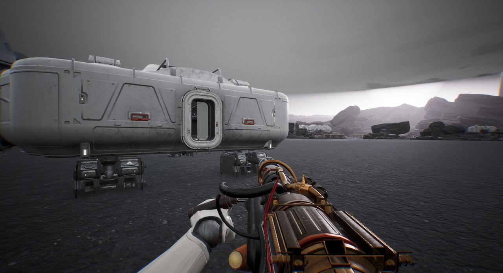</a>

21:59 총을 쥔 왼손의 회전을 조절하는 메뉴를 추가했습니다.

<a href="/assets/d/2026-10-09/WindowsEditor_HighresScreenshot00236.jpg" target="_blank">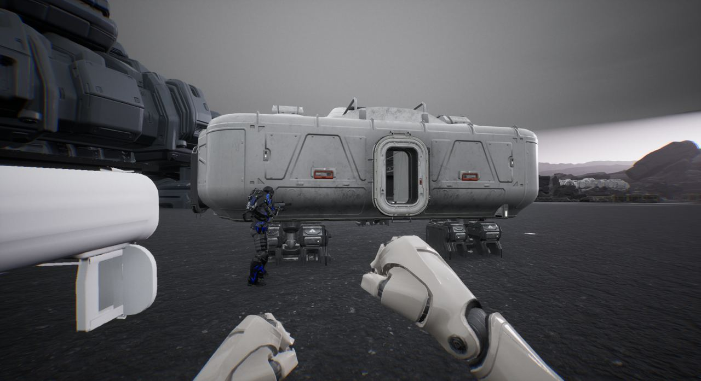</a>

23:08 돌 때 팔이 떨리던 것을 고치고 4연장 로켓을 어깨 발사기로 바꿨습니다.

<a href="/assets/d/2026-10-09/WindowsEditor_HighresScreenshot00237.jpg" target="_blank">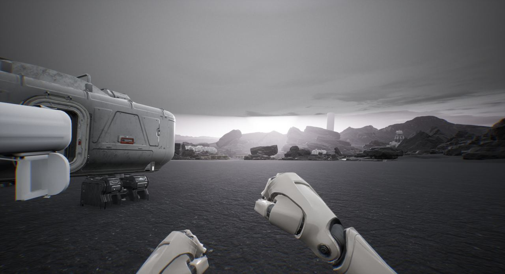</a>

23:19 어깨 발사기의 기본 위치와 크기를 정했습니다.

<a href="/assets/d/2026-10-09/WindowsEditor_HighresScreenshot00247.jpg" target="_blank">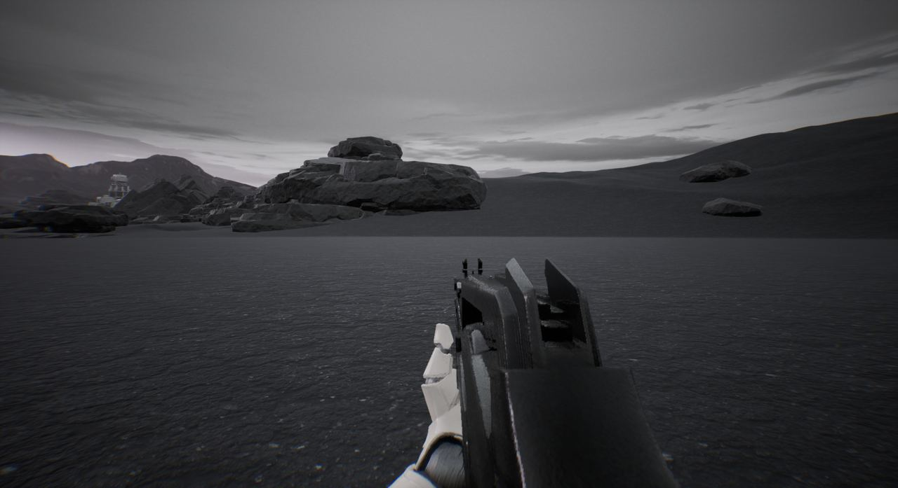</a>

23:48 카빈 소총을 새 모델로 바꿨습니다.

<a href="/assets/d/2026-10-09/WindowsEditor_HighresScreenshot00251.jpg" target="_blank">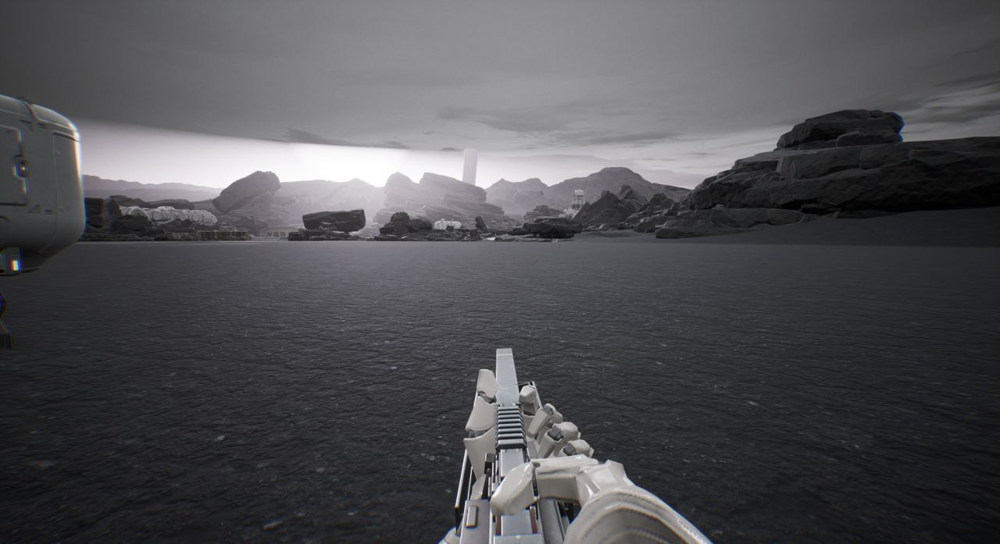</a>

23:50 경기관총 탄약 상자를 등에 메게 했습니다.

<h2 id="audio">소리</h2>

아군 목소리가 멀리서도 들리고 갑자기 끊기지 않게 했습니다.

<h2 id="vfx">이펙트</h2>

로켓 발사기와 소각기의 질감을 다듬었습니다.

<h2 id="zerg">저그</h2>

쓰러진 아군에게 저글링이 여럿 한꺼번에 덮치도록 했습니다.

