
세션 8개 · 사진 28장

<ul class="toc">
<li><a href="#ui">ui — 화면 UI</a></li>
<li><a href="#terran">terran — 테란 아군</a></li>
<li><a href="#design">design — 기획</a></li>
<li><a href="#audio">audio — 소리</a></li>
<li><a href="#weapon">weapon — 무기</a></li>
<li><a href="#perf">perf — 성능</a></li>
<li><a href="#vfx">vfx — 이펙트</a></li>
<li><a href="#zerg">zerg — 저그</a></li>
</ul>
<h2 id="ui">ui <small>화면 UI</small></h2>

총 패널이 총에 바로 붙어 따라오게 했습니다.

00:02 장비창의 잠금 표시와 아이콘 칸 크기를 시안에 맞췄습니다

<a href="/assets/d/2026-10-09/WindowsEditor_ScreenShot00339.jpg" target="_blank">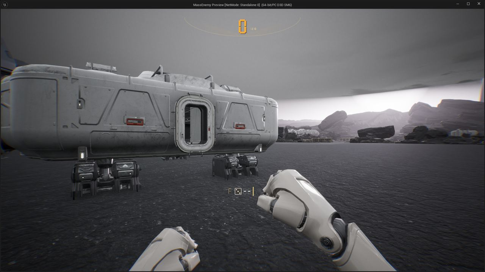</a>

01:14 Tab 능력치 화면의 막대가 각 부위의 실제 데이터로 차오르게 했습니다.

<a href="/assets/d/2026-10-09/WindowsEditor_ScreenShot00340.jpg" target="_blank">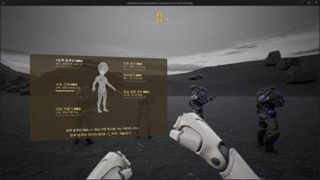</a>
<a href="/assets/d/2026-10-09/WindowsEditor_ScreenShot00341.jpg" target="_blank">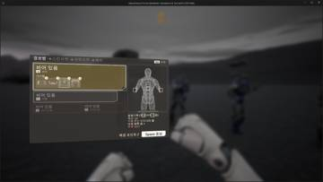</a>

01:22 능력치 화면을 확인용으로 열 수 있게 했고, 단순 수치는 칠세그먼트 숫자로 그렸습니다.

<h2 id="terran">terran <small>테란 아군</small></h2>

아군 총구 불꽃을 껐고 무전기 효과 수치를 조정했습니다.

00:22 아군이 쏠 때 총구에서 큰 섬광이 나게 했습니다.

<h2 id="design">design <small>기획</small></h2>

4연장 로켓은 어깨 포드에서 발사하도록 정했습니다.

<a href="/assets/d/2026-10-09/WindowsEditor_ScreenShot00333.jpg" target="_blank">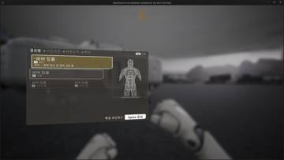</a>
<a href="/assets/d/2026-10-09/WindowsEditor_ScreenShot00335.jpg" target="_blank">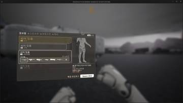</a>

00:29 아군이 플레이어가 웅크릴 때 함께 웅크리도록 바꿨습니다.

<h2 id="audio">audio <small>소리</small></h2>

아군 목소리가 멀리서도 들리고 갑자기 끊기지 않게 했습니다.

<a href="/assets/d/2026-10-09/WindowsEditor_ScreenShot00345.jpg" target="_blank">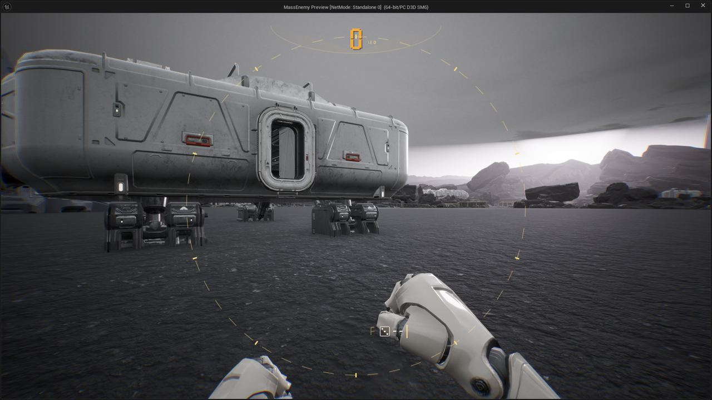</a>

01:59 소리 소스 목록을 연도별로 정리해 확보한 것과 구할 것을 나눴습니다.

<a href="/assets/d/2026-10-09/WindowsEditor_ScreenShot00350.jpg" target="_blank">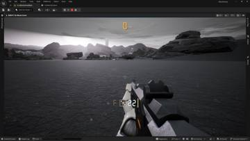</a>
<a href="/assets/d/2026-10-09/WindowsEditor_ScreenShot00351.jpg" target="_blank">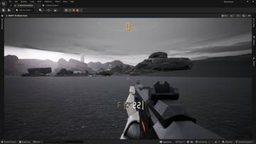</a>

03:59 소리 자료 폴더를 정리하고 저글링 달리기 미리듣기를 따로 모았습니다.

<h2 id="weapon">weapon <small>무기</small></h2>

카빈 모델을 바꾸고 어깨 발사기와 등 탄약통을 넣었습니다.

02:58 탄창이 비면 탄수 숫자가 붉게 깜빡이게 했습니다.

<a href="/assets/d/2026-10-09/WindowsEditor_HighresScreenshot00220.jpg" target="_blank">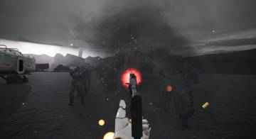</a>

<a href="/assets/d/2026-10-09/WindowsEditor_HighresScreenshot00222.jpg" target="_blank">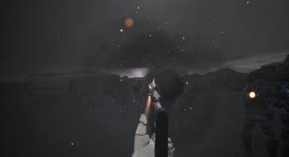</a>

<a href="/assets/d/2026-10-09/WindowsEditor_HighresScreenshot00224.jpg" target="_blank">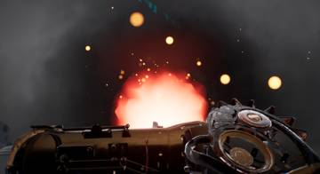</a>

<a href="/assets/d/2026-10-09/WindowsEditor_HighresScreenshot00228.jpg" target="_blank">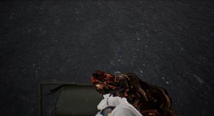</a>

18:43 화염방사기를 소각기 모델에 연료통과 호스를 달아 만들었습니다.

21:41 화염방사기 왼손을 세로 손잡이 자세로 바꿨습니다.

21:59 F7 패널에 왼손 회전 탭을 넣어 손의 기울기를 따로 맞출 수 있게 했습니다.

<a href="/assets/d/2026-10-09/WindowsEditor_HighresScreenshot00235.jpg" target="_blank">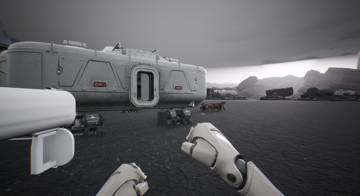</a>
<a href="/assets/d/2026-10-09/WindowsEditor_HighresScreenshot00236.jpg" target="_blank">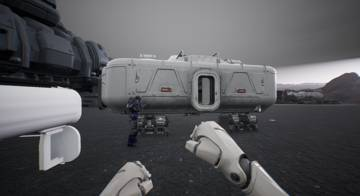</a>

23:08 회전할 때 팔이 흔들리던 문제를 고치고 로켓을 어깨 발사 방식으로 바꿨습니다

<a href="/assets/d/2026-10-09/WindowsEditor_HighresScreenshot00237.jpg" target="_blank">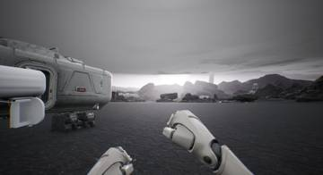</a>
<a href="/assets/d/2026-10-09/WindowsEditor_HighresScreenshot00239.jpg" target="_blank">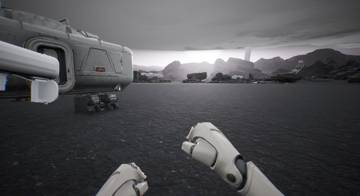</a>

23:19 어깨 발사기의 기본 위치와 크기를 정했습니다.

<a href="/assets/d/2026-10-09/fire_lineup.jpg" target="_blank">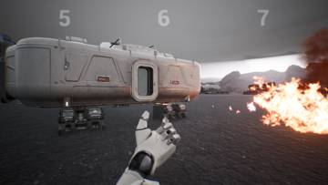</a>
<a href="/assets/d/2026-10-09/WindowsEditor_HighresScreenshot00247.jpg" target="_blank">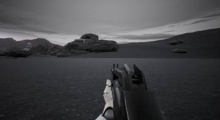</a>

23:48 카빈 총 모델을 새 돌격소총 모델로 바꿨습니다.

<a href="/assets/d/2026-10-09/WindowsEditor_HighresScreenshot00248.jpg" target="_blank">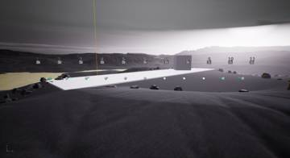</a>
<a href="/assets/d/2026-10-09/WindowsEditor_HighresScreenshot00251.jpg" target="_blank">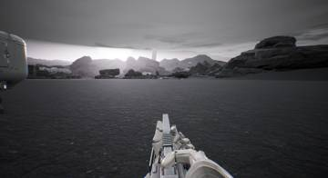</a>

23:50 경기관총 탄약 상자를 등에 메게 했습니다.

<h2 id="perf">perf <small>성능</small></h2>

조명 방식을 바꾸자는 의견을 다른 담당에게 전했습니다.

<h2 id="vfx">vfx <small>이펙트</small></h2>

로켓 발사기와 소각기의 텍스처를 다듬었습니다.

<h2 id="zerg">zerg <small>저그</small></h2>

쓰러진 아군에게 저글링이 최대 8마리까지 한꺼번에 덮치도록 했습니다.

