
세션 7개 · 사진 15장

<ul class="toc">
<li><a href="#weapon">weapon — 무기</a></li>
<li><a href="#terran">terran — 테란 아군</a></li>
<li><a href="#design">design — 기획</a></li>
<li><a href="#ui">ui — 화면 UI</a></li>
<li><a href="#audio">audio — 소리</a></li>
<li><a href="#vfx">vfx — 이펙트</a></li>
<li><a href="#zerg">zerg — 저그</a></li>
</ul>
<h2 id="weapon">weapon <small>무기</small></h2>

제트팩 정찰 표식과 디코이, 보급품 요청 같은 새 장비를 넣었습니다.

<a href="/assets/d/2026-10-10/WindowsEditor_HighresScreenshot00253.jpg" target="_blank">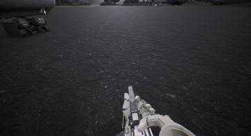</a>
<a href="/assets/d/2026-10-10/WindowsEditor_HighresScreenshot00254.jpg" target="_blank">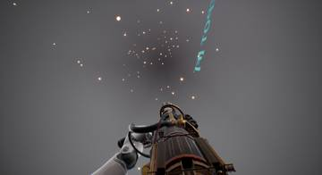</a>

00:12 게임 안에서 맞춘 총 위치 값들을 저장했습니다.

<a href="/assets/d/2026-10-10/WindowsEditor_HighresScreenshot00255.jpg" target="_blank">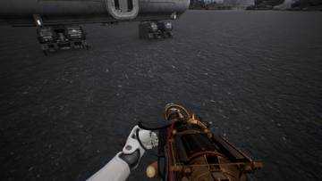</a>
<a href="/assets/d/2026-10-10/WindowsEditor_HighresScreenshot00256.jpg" target="_blank">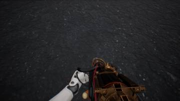</a>

04:55 화염방사기 연료 호스 끝 위치를 확인하는 도구를 추가했습니다

<a href="/assets/d/2026-10-10/WindowsEditor_ScreenShot00353.jpg" target="_blank">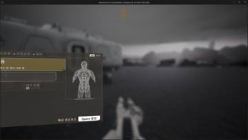</a>
<a href="/assets/d/2026-10-10/WindowsEditor_HighresScreenshot00260.jpg" target="_blank">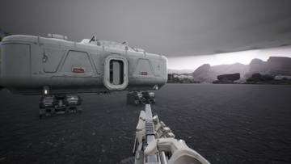</a>

18:15 상점은 몸 슬롯 4개만 팔도록 단순화했습니다

<a href="/assets/d/2026-10-10/WindowsEditor_HighresScreenshot00261.jpg" target="_blank">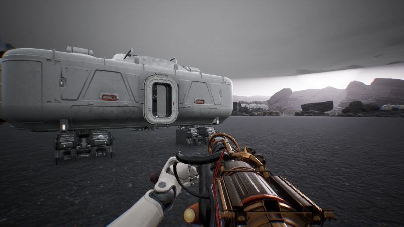</a>

18:40 화염방사기 연료 호스 끝을 총 앞쪽으로 옮겨 보이게 했습니다.

<a href="/assets/d/2026-10-10/WindowsEditor_HighresScreenshot00266.jpg" target="_blank">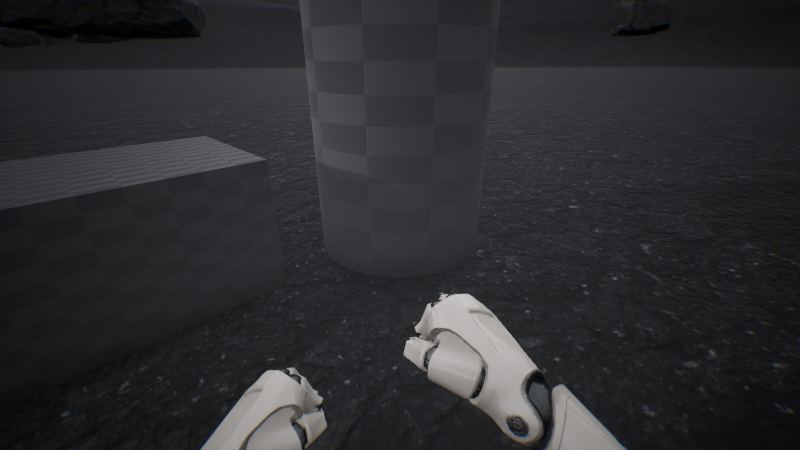</a>

20:37 Q로 건설 모드에 들어가 모래주머니 벽과 센트리 포탑을 세우는 첫 버전을 만들었습니다.

<h2 id="terran">terran <small>테란 아군</small></h2>

무전기를 멘 아군 근처에서는 아군 사격이 더 모이도록 했습니다.

<a href="/assets/d/2026-10-10/WindowsEditor_PounceShot_1.jpg" target="_blank">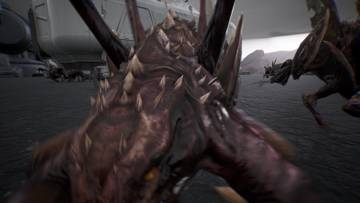</a>
<a href="/assets/d/2026-10-10/WindowsEditor_PounceShot_1_turned.jpg" target="_blank">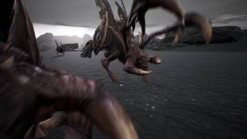</a>

03:53 누워 있을 때 시점이 가슴 위 저글링 쪽으로 돌아가던 문제를 고쳤습니다.

<h2 id="design">design <small>기획</small></h2>

업그레이드 화면을 타일 배치로 정했습니다.

<a href="/assets/d/2026-10-10/WindowsEditor_HighresScreenshot00258.jpg" target="_blank">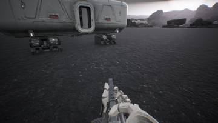</a>
<a href="/assets/d/2026-10-10/WindowsEditor_HighresScreenshot00259.jpg" target="_blank">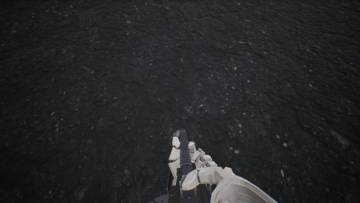</a>

05:22 폭발물 슬롯을 충전, 파편, 충격파 세 줄로 나눴습니다.

<a href="/assets/d/2026-10-10/WindowsEditor_ScreenShot00355.jpg" target="_blank">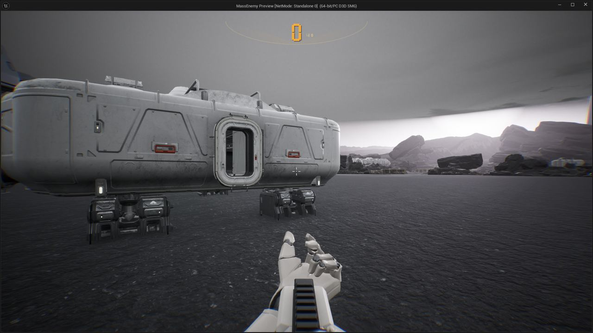</a>

19:53 부품 아이콘 10종을 시안에 맞춰 만들었습니다.

<a href="/assets/d/2026-10-10/WindowsEditor_HighresScreenshot00263.jpg" target="_blank">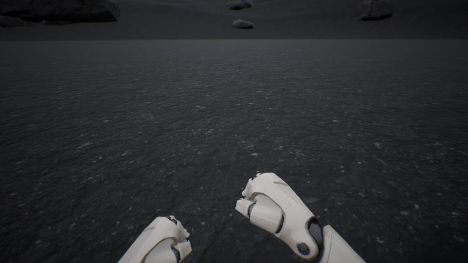</a>

20:28 업그레이드 탭을 선택된 타일 모양으로 바꿨습니다.

<h2 id="ui">ui <small>화면 UI</small></h2>

업그레이드 탭을 타일 방식으로 만들고 총 패널에 예비 탄창 수를 표시했습니다.

<a href="/assets/d/2026-10-10/WindowsEditor_ScreenShot00352.jpg" target="_blank">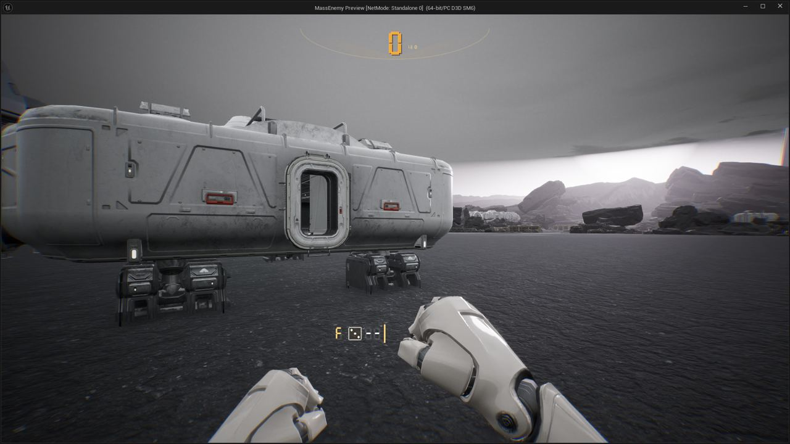</a>

18:10 총 패널에 예비 탄창과 장비 개수를 넣은 새 시안을 만들었습니다.

<h2 id="audio">audio <small>소리</small></h2>

저글링 달리기 소리와 헬멧 숨소리를 추가했습니다.

<h2 id="vfx">vfx <small>이펙트</small></h2>

화염방사기 불꽃 효과를 만들 준비를 했습니다.

<h2 id="zerg">zerg <small>저그</small></h2>

쓰러진 플레이어 위의 저글링 무리가 올바른 방향으로 서고 불에 타 죽도록 했습니다.

