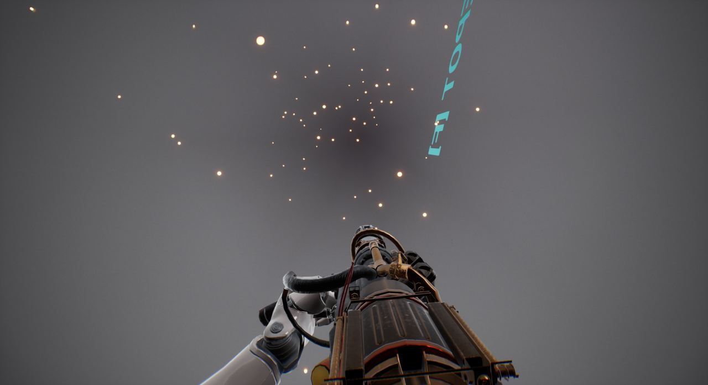
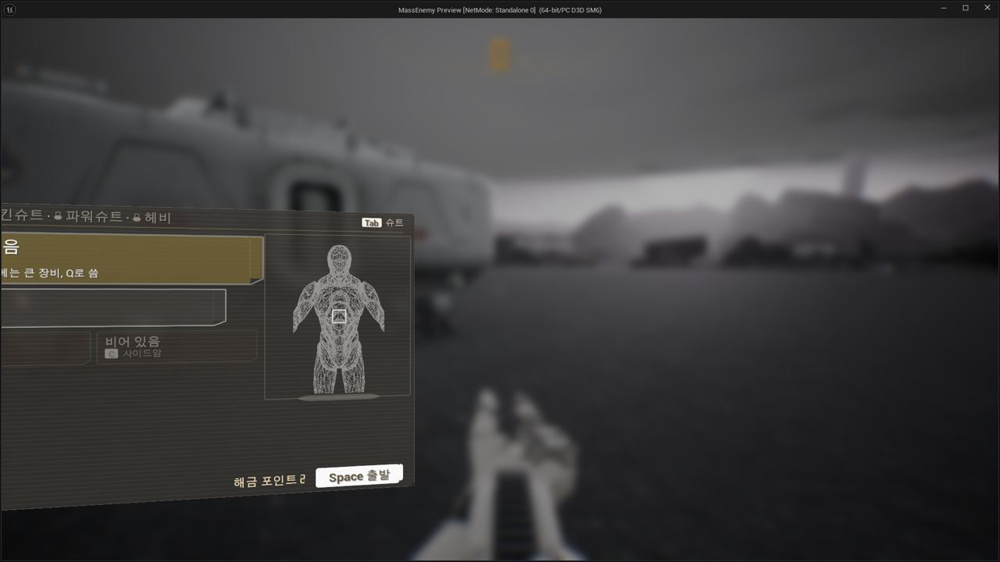
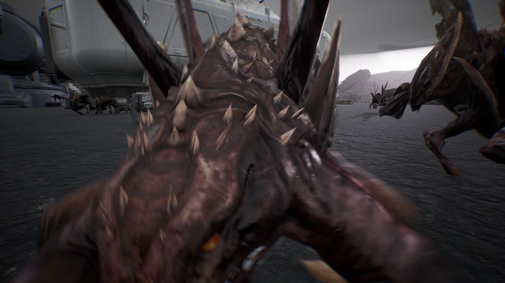

작업 7개 · 사진 4장

<ul class="toc">
<li><a href="#weapon">무기</a></li>
<li><a href="#terran">테란 아군</a></li>
<li><a href="#design">기획</a></li>
<li><a href="#ui">화면 UI</a></li>
<li><a href="#audio">소리</a></li>
<li><a href="#vfx">이펙트</a></li>
<li><a href="#zerg">저그</a></li>
</ul>
<h2 id="weapon">무기</h2>

화염방사기 호스와 상점 구성, 건설 팩 첫 버전을 넣었습니다.

00:12 직접 맞춘 총과 손 위치를 실제 플레이에 저장해 적용했습니다.

18:15 상점에서는 몸 부위 네 칸만 팔게 했습니다.

18:40 화염방사기 연료 호스 끝이 총 앞쪽에 보이게 옮겼습니다.

20:37 건설 팩 첫 버전으로 모래주머니 벽을 세울 수 있게 했습니다.

<h2 id="terran">테란 아군</h2>

무전기를 멘 아군 근처에서 아군 사격이 더 모이게 했습니다.

03:53 누운 시점이 가슴 위 저글링 쪽으로 돌아가지 않게 했습니다.

<h2 id="design">기획</h2>

업그레이드 화면을 타일 배치로 정했습니다.

05:22 폭발 칸 효과를 폭발 반경, 파편, 충격파로 나눠 정했습니다.

19:53 부품 아이콘 열 종의 시안을 정했습니다.

20:28 업그레이드 탭을 타일 방식으로 정했습니다.

<h2 id="ui">화면 UI</h2>

업그레이드 탭을 만들고 총 패널에 예비 탄창 수를 넣었습니다.

18:10 총 패널에 예비 탄창 수를 표시하게 했습니다.

<h2 id="audio">소리</h2>

저글링 달리기 소리와 헬멧 숨소리를 추가했습니다.

<h2 id="vfx">이펙트</h2>

화염방사기 불꽃 효과를 준비했습니다.

<h2 id="zerg">저그</h2>

쓰러진 플레이어 위의 저글링이 바른 방향으로 서게 했습니다.

