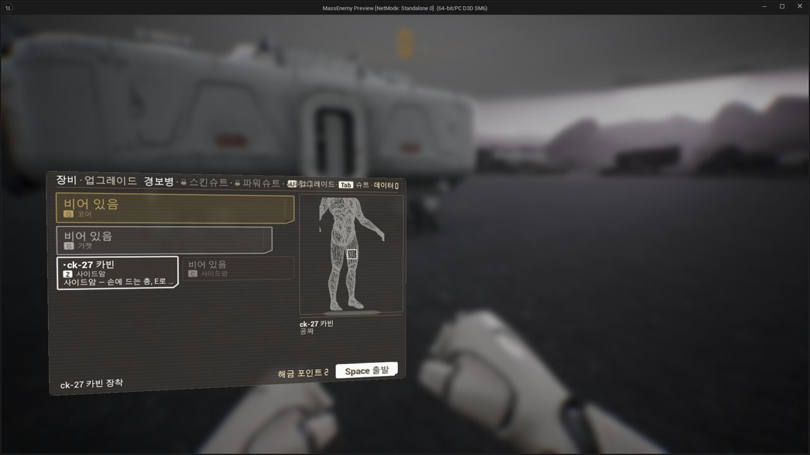
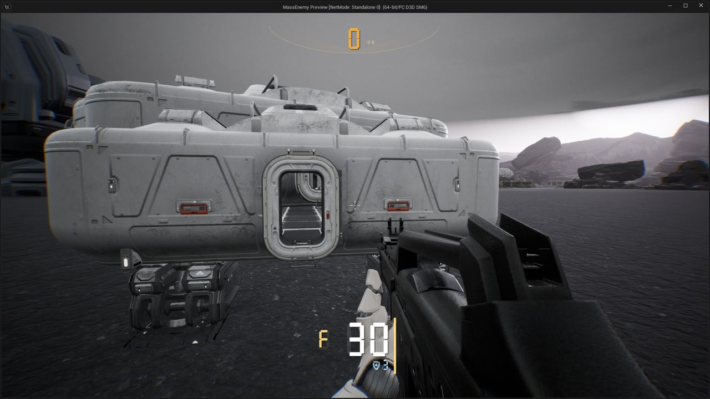
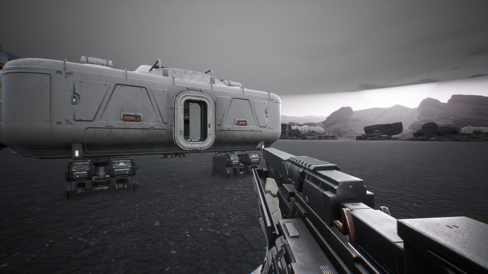

작업 7개 · 사진 6장

<ul class="toc">
<li><a href="#ui">화면 UI</a></li>
<li><a href="#design">기획</a></li>
<li><a href="#weapon">무기</a></li>
<li><a href="#audio">소리</a></li>
<li><a href="#terran">테란 아군</a></li>
<li><a href="#vfx">이펙트</a></li>
<li><a href="#zerg">저그</a></li>
</ul>
<h2 id="ui">화면 UI</h2>

업그레이드 화면을 새 시안으로 바꾸고 총 패널을 다듬었습니다.

00:19 업그레이드 탭 시안을 새로 바꿨습니다.

00:41 열린 칸의 이름 줄을 전체 폭으로 넓혔습니다.

00:54 총 패널의 장비 줄에 방패와 숫자를 시안대로 넣었습니다.

19:07 총 패널 숫자를 키우고 장비 줄 폭에 맞췄습니다.

21:14 맨손 장비 패널도 총 옆과 같은 폭으로 보이게 했습니다.

<h2 id="design">기획</h2>

업그레이드 탭 시안을 확정했습니다.

19:07 전투 중 몸 부품 업그레이드 알림을 없앴습니다.

<h2 id="weapon">무기</h2>

맨손으로 걸으면 팔이 내려가고 경기관총 탄띠를 길게 했습니다.

20:18 맨손으로 걸으면 팔이 아래로 내려가게 했습니다.

21:14 총을 집어넣다 다른 동작이 막히던 문제를 고쳤습니다.

21:30 경기관총 탄띠를 더 길게 만들고 탄약 상자를 없앴습니다.

<h2 id="audio">소리</h2>

먼 아군 목소리가 무전기 소리로 들리고 제트팩 소리를 넣었습니다.

<h2 id="terran">테란 아군</h2>

컨디션 최대치가 장갑 단계에 따라 늘어나게 했습니다.

<h2 id="vfx">이펙트</h2>

화염방사기의 연료 방울과 불꽃 효과를 만들었습니다.

<h2 id="zerg">저그</h2>

감속장과 디코이 등에 저글링이 반응하게 했습니다.

