
세션 7개 · 사진 26장

<ul class="toc">
<li><a href="#ui">ui — 화면 UI</a></li>
<li><a href="#design">design — 기획</a></li>
<li><a href="#weapon">weapon — 무기</a></li>
<li><a href="#audio">audio — 소리</a></li>
<li><a href="#terran">terran — 테란 아군</a></li>
<li><a href="#vfx">vfx — 이펙트</a></li>
<li><a href="#zerg">zerg — 저그</a></li>
</ul>
<h2 id="ui">ui <small>화면 UI</small></h2>

총 패널에 장비 줄을 항상 보이게 하고 업그레이드 화면을 새 시안으로 바꿨습니다.

<a href="/assets/d/2026-10-11/WindowsEditor_ScreenShot00358.jpg" target="_blank">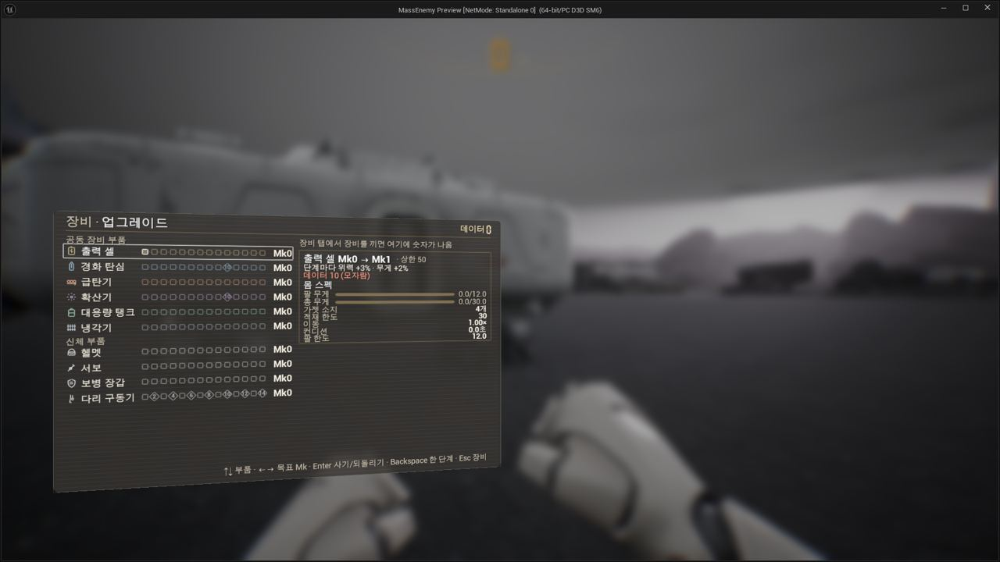</a>

00:19 업그레이드 탭 시안을 새로 만들어 부품 단계와 장비 카드를 정리했습니다.

<a href="/assets/d/2026-10-11/WindowsEditor_ScreenShot00361.jpg" target="_blank">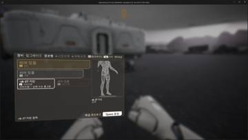</a>
<a href="/assets/d/2026-10-11/WindowsEditor_ScreenShot00362.jpg" target="_blank">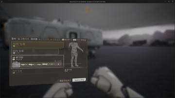</a>

00:41 열린 칸의 이름 줄을 전체 폭으로 넓히고 슈트 이름과 겹치던 표시를 지웠습니다.

<a href="/assets/d/2026-10-11/WindowsEditor_ScreenShot00365.jpg" target="_blank">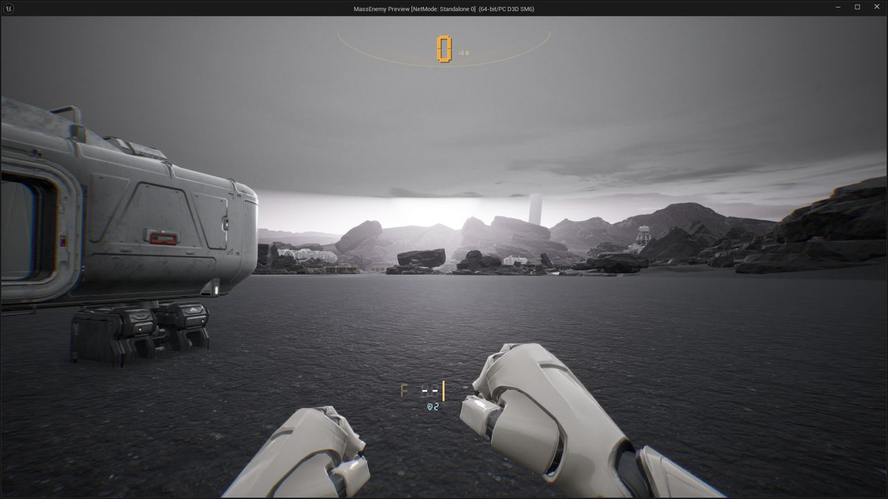</a>

00:54 총 패널에서 주사위를 빼고 가젯 줄에 방패와 숫자를 넣었습니다.

<a href="/assets/d/2026-10-11/WindowsEditor_ScreenShot00368.jpg" target="_blank">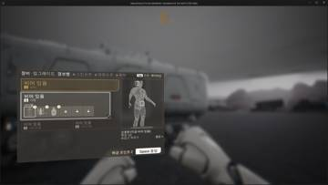</a>
<a href="/assets/d/2026-10-11/WindowsEditor_ScreenShot00367_c.jpg" target="_blank">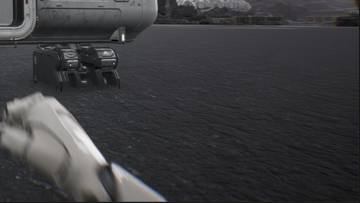</a>

19:07 총 패널을 HUD 새 시안에 맞춰 숫자를 키우고 겹침을 없앴습니다

<a href="/assets/d/2026-10-11/WindowsEditor_ScreenShot00372.jpg" target="_blank">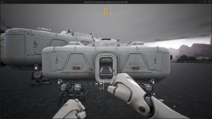</a>
<a href="/assets/d/2026-10-11/WindowsEditor_ScreenShot00376.jpg" target="_blank">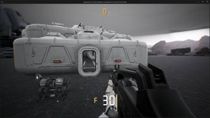</a>
<a href="/assets/d/2026-10-11/WindowsEditor_ScreenShot00377.jpg" target="_blank">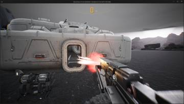</a>
<a href="/assets/d/2026-10-11/WindowsEditor_ScreenShot00378.jpg" target="_blank">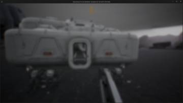</a>
<a href="/assets/d/2026-10-11/WindowsEditor_ScreenShot00381.jpg" target="_blank">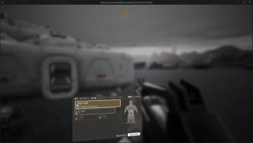</a>
<a href="/assets/d/2026-10-11/WindowsEditor_ScreenShot00386.jpg" target="_blank">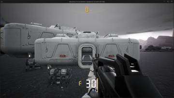</a>

21:14 맨손일 때 장비 판이 총을 들었을 때와 같은 너비로 보이게 했습니다.

<h2 id="design">design <small>기획</small></h2>

업그레이드 탭 시안을 확정해 넘겼습니다.

<a href="/assets/d/2026-10-11/WindowsEditor_ScreenShot00367.jpg" target="_blank">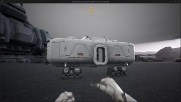</a>
<a href="/assets/d/2026-10-11/WindowsEditor_ScreenShot00368_c.jpg" target="_blank">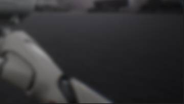</a>

19:07 전투 중에 뜨던 몸 강화 알림을 없앴습니다.

<h2 id="weapon">weapon <small>무기</small></h2>

맨손일 때 팔이 내려가고 화염방사기 불꽃 효과를 연결했습니다.

<a href="/assets/d/2026-10-11/WindowsEditor_HighresScreenshot00267.jpg" target="_blank">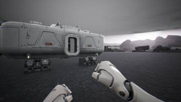</a>
<a href="/assets/d/2026-10-11/WindowsEditor_HighresScreenshot00268.jpg" target="_blank">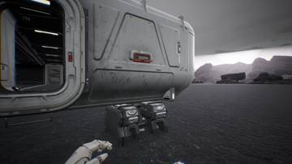</a>
<a href="/assets/d/2026-10-11/WindowsEditor_HighresScreenshot00269.jpg" target="_blank">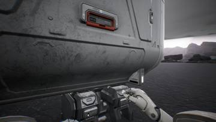</a>
<a href="/assets/d/2026-10-11/WindowsEditor_HighresScreenshot00271.jpg" target="_blank">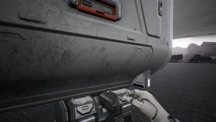</a>
<a href="/assets/d/2026-10-11/WindowsEditor_HighresScreenshot00273.jpg" target="_blank">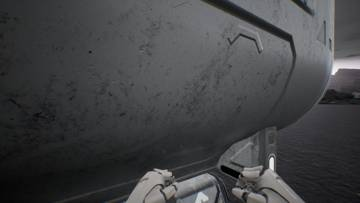</a>
<a href="/assets/d/2026-10-11/WindowsEditor_HighresScreenshot00277.jpg" target="_blank">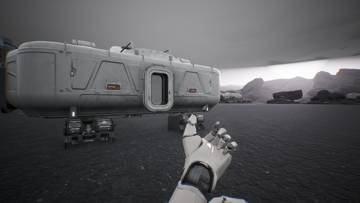</a>
<a href="/assets/d/2026-10-11/WindowsEditor_HighresScreenshot00278.jpg" target="_blank">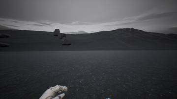</a>
<a href="/assets/d/2026-10-11/WindowsEditor_HighresScreenshot00279.jpg" target="_blank">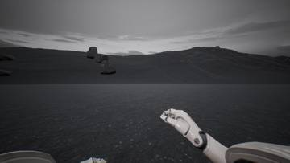</a>

20:18 맨손으로 걸을 때 팔이 화면 가장자리에 걸리지 않게 아래로 내렸습니다.

<a href="/assets/d/2026-10-11/WindowsEditor_ScreenShot00373.jpg" target="_blank">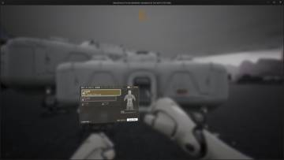</a>
<a href="/assets/d/2026-10-11/WindowsEditor_ScreenShot00375.jpg" target="_blank">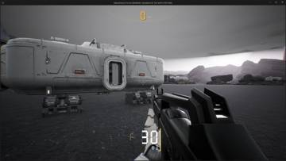</a>

21:14 Q 키로 중화기를 꺼내지 못하던 문제를 고치고 달리기는 Shift만 쓰게 했습니다.

<a href="/assets/d/2026-10-11/WindowsEditor_HighresScreenshot00294.jpg" target="_blank">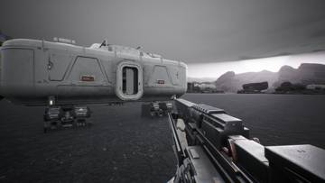</a>
<a href="/assets/d/2026-10-11/WindowsEditor_HighresScreenshot00295.jpg" target="_blank">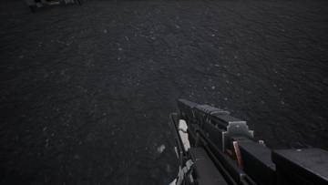</a>

21:30 RGX 기관총 탄약 상자를 없애고 탄띠를 더 길게 늘어뜨렸습니다.

<h2 id="audio">audio <small>소리</small></h2>

먼 아군 목소리가 무전기 소리로 들리고 제트팩 소리를 추가했습니다.

<h2 id="terran">terran <small>테란 아군</small></h2>

컨디션 최대치가 장갑 단계에 따라 늘어나도록 했습니다.

<h2 id="vfx">vfx <small>이펙트</small></h2>

화염방사기의 연료 방울과 불꽃 효과를 만들었습니다.

<h2 id="zerg">zerg <small>저그</small></h2>

감속장과 디코이 등에 저글링이 반응하도록 했습니다.

