
세션 7개 · 사진 53장

<ul class="toc">
<li><a href="#ui">ui — 화면 UI</a></li>
<li><a href="#weapon">weapon — 무기</a></li>
<li><a href="#zerg">zerg — 저그</a></li>
<li><a href="#design">design — 기획</a></li>
<li><a href="#audio">audio — 소리</a></li>
<li><a href="#building">building — 건물</a></li>
<li><a href="#vfx">vfx — 이펙트</a></li>
</ul>
<h2 id="ui">ui <small>화면 UI</small></h2>

장비 화면의 크기와 총 패널 배치를 조절할 수 있게 했습니다.

<a href="/assets/d/2026-10-12/WindowsEditor_ScreenShot00395.jpg" target="_blank">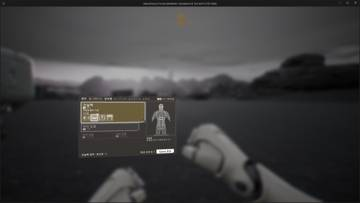</a>
<a href="/assets/d/2026-10-12/WindowsEditor_ScreenShot00397.jpg" target="_blank">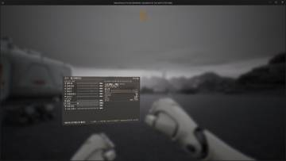</a>

00:53 장비 화면 조작키를 시안대로 바꾸고 입은 장비에 따라 포인트가 바뀌게 했습니다.

00:59 장비 화면 하단에 고르기, 뒤로, 환불 키 안내를 넣고 슈트 번호와 탭 이름을 정리했습니다.

<a href="/assets/d/2026-10-12/WindowsEditor_HighresScreenshot00307.jpg" target="_blank">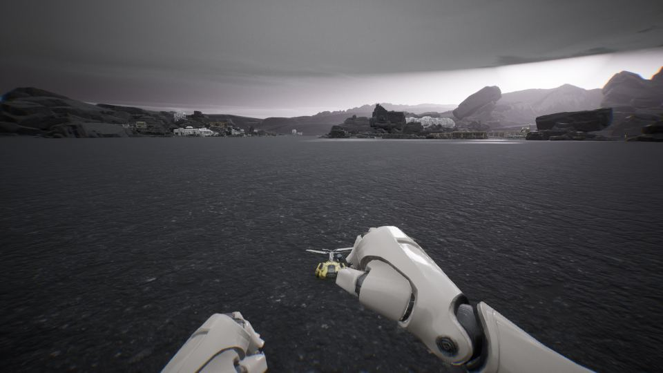</a>

01:23 열린 보조무기 카드가 옆 카드 위로 창처럼 겹쳐 보이게 바꿨습니다.

07:23 총 패널을 총에 붙은 평면에 그려 총이나 손에 가려지게 했습니다.

15:41 총 패널이 조준경 위로 뜨지 않고 뒤로 가려지게 그리는 순서를 바꿨습니다.

<a href="/assets/d/2026-10-12/WindowsEditor_HighresScreenshot00415.jpg" target="_blank">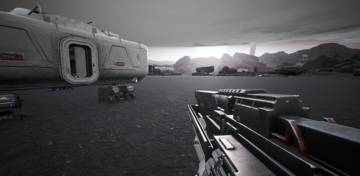</a>
<a href="/assets/d/2026-10-12/WindowsEditor_ScreenShot00431.jpg" target="_blank">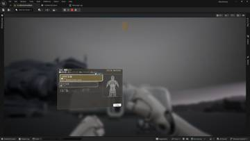</a>
<a href="/assets/d/2026-10-12/WindowsEditor_ScreenShot00432.jpg" target="_blank">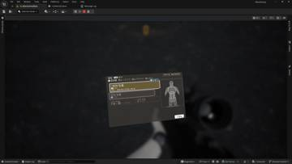</a>
<a href="/assets/d/2026-10-12/WindowsEditor_ScreenShot00433.jpg" target="_blank">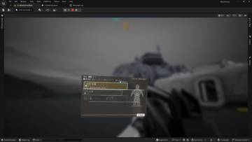</a>
<a href="/assets/d/2026-10-12/WindowsEditor_ScreenShot00434.jpg" target="_blank">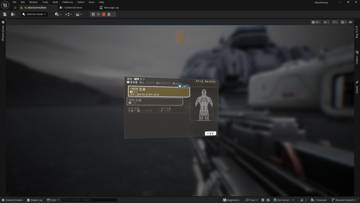</a>

16:19 장비창 크기를 화면 비율에 맞춰 모든 총과 맨손에 똑같이 적용했습니다

<h2 id="weapon">weapon <small>무기</small></h2>

쌍권총 재장전과 반동을 고치고 총구 불꽃을 고르는 메뉴를 넣었습니다.

<a href="/assets/d/2026-10-12/WindowsEditor_HighresScreenshot00296.jpg" target="_blank">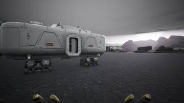</a>
<a href="/assets/d/2026-10-12/WindowsEditor_HighresScreenshot00297.jpg" target="_blank">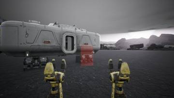</a>

<a href="/assets/d/2026-10-12/WindowsEditor_HighresScreenshot00300.jpg" target="_blank">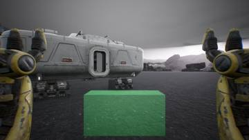</a>

01:00 설치물마다 건설 시간을 두고 Q를 누르면 로봇 팔이 올라오게 했습니다.

<a href="/assets/d/2026-10-12/WindowsEditor_HighresScreenshot00304.jpg" target="_blank">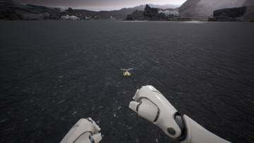</a>
<a href="/assets/d/2026-10-12/WindowsEditor_HighresScreenshot00305.jpg" target="_blank">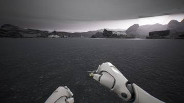</a>

01:13 작은 센트리 포탑과 가젯 다섯 종류, 코어 번호를 만들어 설치를 확인했습니다.

<a href="/assets/d/2026-10-12/WindowsEditor_HighresScreenshot00316.jpg" target="_blank">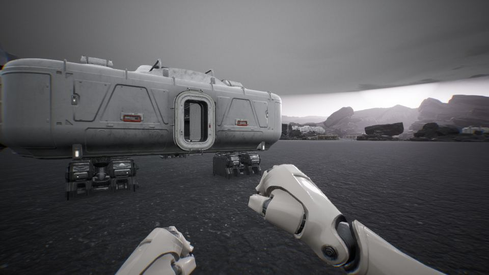</a>

02:13 F7 패널이 지금 든 것에 맞는 탭만 보이게 바꿨습니다.

<a href="/assets/d/2026-10-12/WindowsEditor_HighresScreenshot00318.jpg" target="_blank">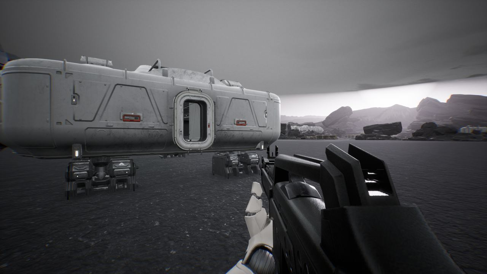</a>

02:34 F7 패널에 수치와 소리 탭을 넣어 든 총의 값을 바로 만질 수 있게 했습니다.

<a href="/assets/d/2026-10-12/WindowsEditor_HighresScreenshot00367.jpg" target="_blank">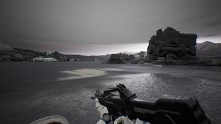</a>
<a href="/assets/d/2026-10-12/WindowsEditor_HighresScreenshot00369.jpg" target="_blank">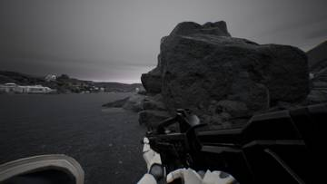</a>
<a href="/assets/d/2026-10-12/WindowsEditor_HighresScreenshot00371.jpg" target="_blank">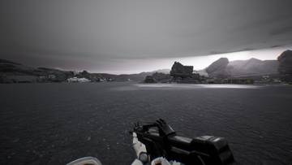</a>
<a href="/assets/d/2026-10-12/WindowsEditor_HighresScreenshot00373.jpg" target="_blank">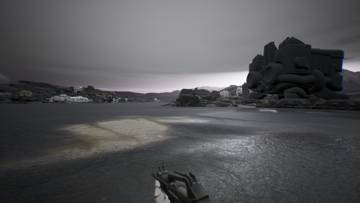</a>

03:10 달릴 때 팔과 총이 앞으로 내려가 어깨가 크게 보이던 문제를 고쳤습니다.

<a href="/assets/d/2026-10-12/WindowsEditor_HighresScreenshot00374.jpg" target="_blank">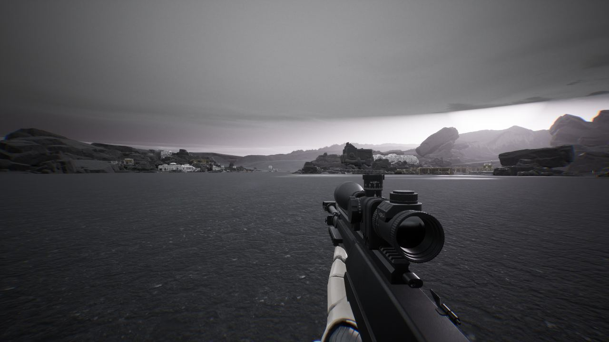</a>

03:52 F7으로 모션을 바꾸다 손이 비는 경우를 막았습니다.

<a href="/assets/d/2026-10-12/WindowsEditor_HighresScreenshot00377.jpg" target="_blank">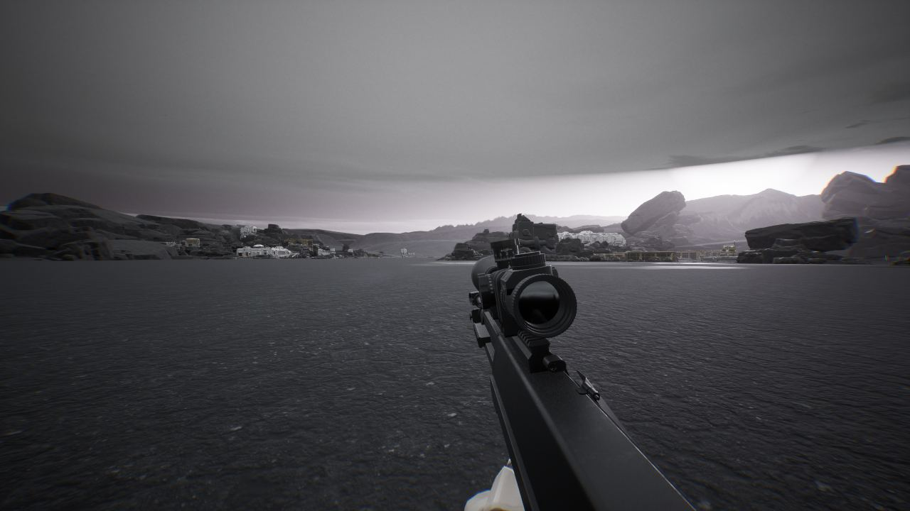</a>

06:05 F7 애니메이션을 돌릴 때 총을 다시 쥐게 해서 손이 빈 채로 남던 문제를 고쳤습니다.

<a href="/assets/d/2026-10-12/WindowsEditor_HighresScreenshot00378.jpg" target="_blank">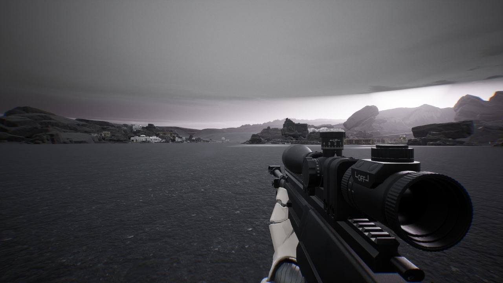</a>

06:13 F7 메뉴에 팔 애니메이션별 버튼을 넣어 좌우 순환 방식을 바꿨습니다.

<a href="/assets/d/2026-10-12/WindowsEditor_HighresScreenshot00385.jpg" target="_blank">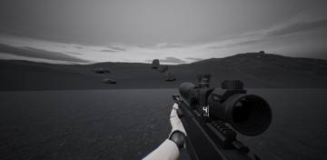</a>
<a href="/assets/d/2026-10-12/WindowsEditor_HighresScreenshot00401.jpg" target="_blank">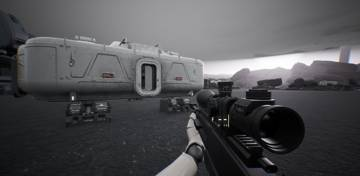</a>

15:30 FN92가 한 발만 쏘고 멈추던 문제를 고쳐 볼트액션을 꺼 정상으로 쏘게 했습니다.

17:08 양손 권총을 총마다 따로 재장전하게 했습니다. 탄이 적은 총부터 하나씩 합니다.

<h2 id="zerg">zerg <small>저그</small></h2>

저글링이 덮칠 때 소리가 나도록 신호를 추가했습니다.

<a href="/assets/d/2026-10-12/WindowsEditor_HighresScreenshot00302.jpg" target="_blank">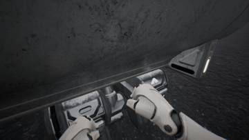</a>
<a href="/assets/d/2026-10-12/WindowsEditor_HighresScreenshot00303.jpg" target="_blank">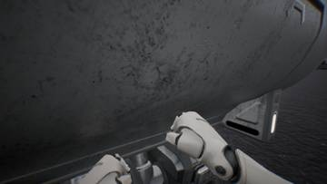</a>

01:12 저그의 도약 소리를 낼 수 있도록 신호를 추가했습니다

<h2 id="design">design <small>기획</small></h2>

총 부착물을 데이터로 하나씩 사도록 정했습니다.

<a href="/assets/d/2026-10-12/WindowsEditor_HighresScreenshot00319.jpg" target="_blank">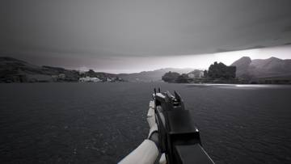</a>
<a href="/assets/d/2026-10-12/WindowsEditor_HighresScreenshot00320.jpg" target="_blank">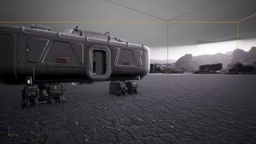</a>
<a href="/assets/d/2026-10-12/WindowsEditor_HighresScreenshot00328.jpg" target="_blank">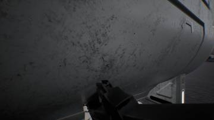</a>
<a href="/assets/d/2026-10-12/WindowsEditor_HighresScreenshot00332.jpg" target="_blank">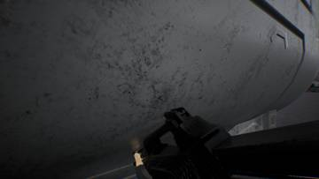</a>
<a href="/assets/d/2026-10-12/WindowsEditor_HighresScreenshot00338.jpg" target="_blank">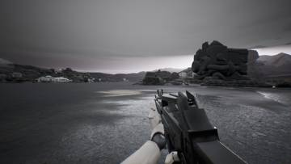</a>
<a href="/assets/d/2026-10-12/WindowsEditor_HighresScreenshot00340.jpg" target="_blank">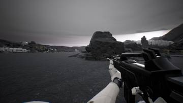</a>
<a href="/assets/d/2026-10-12/WindowsEditor_HighresScreenshot00342.jpg" target="_blank">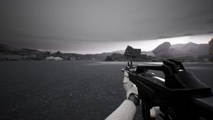</a>
<a href="/assets/d/2026-10-12/WindowsEditor_HighresScreenshot00344.jpg" target="_blank">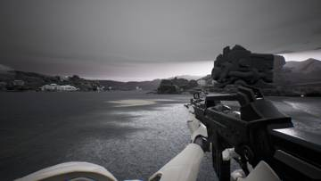</a>
<a href="/assets/d/2026-10-12/WindowsEditor_HighresScreenshot00347.jpg" target="_blank">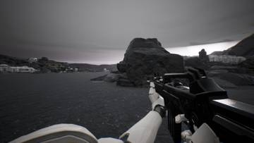</a>
<a href="/assets/d/2026-10-12/WindowsEditor_HighresScreenshot00350.jpg" target="_blank">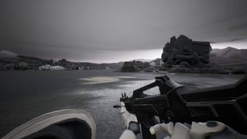</a>
<a href="/assets/d/2026-10-12/WindowsEditor_HighresScreenshot00351.jpg" target="_blank">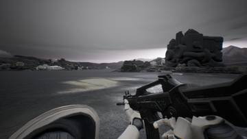</a>
<a href="/assets/d/2026-10-12/WindowsEditor_HighresScreenshot00352.jpg" target="_blank">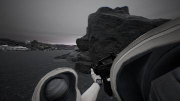</a>
<a href="/assets/d/2026-10-12/WindowsEditor_HighresScreenshot00353.jpg" target="_blank">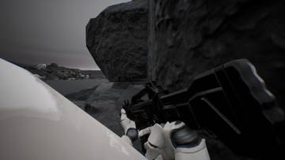</a>
<a href="/assets/d/2026-10-12/WindowsEditor_HighresScreenshot00358.jpg" target="_blank">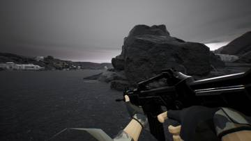</a>
<a href="/assets/d/2026-10-12/WindowsEditor_HighresScreenshot00359.jpg" target="_blank">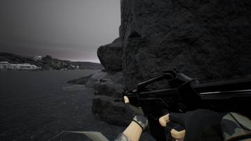</a>
<a href="/assets/d/2026-10-12/WindowsEditor_HighresScreenshot00360.jpg" target="_blank">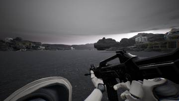</a>
<a href="/assets/d/2026-10-12/WindowsEditor_HighresScreenshot00366.jpg" target="_blank">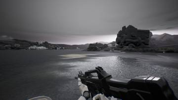</a>
<a href="/assets/d/2026-10-12/WindowsEditor_HighresScreenshot00368.jpg" target="_blank">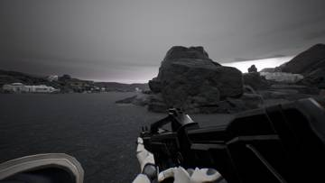</a>

02:54 디자인 담당에게 시안 문구와 장비 화면 코드 검토 결과를 넘겼습니다.

<a href="/assets/d/2026-10-12/WindowsEditor_HighresScreenshot00370.jpg" target="_blank">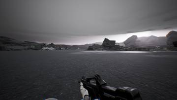</a>
<a href="/assets/d/2026-10-12/WindowsEditor_HighresScreenshot00372.jpg" target="_blank">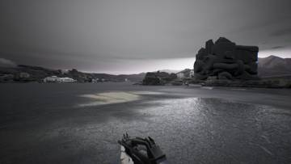</a>

03:11 C 키로 발사 모드를 바꾸게 했고, 두 정 들 때는 손마다 따로 바뀝니다.

<a href="/assets/d/2026-10-12/WindowsEditor_ScreenShot00436.jpg" target="_blank">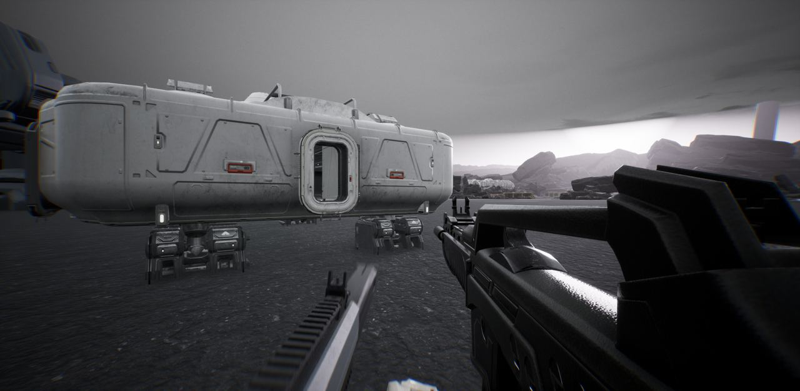</a>

17:09 장비 화면 미리보기에 부착물 모델이 총 와이어프레임 위에 보이게 했습니다.

<h2 id="audio">audio <small>소리</small></h2>

저글링 덮치기 경고음과 아군 목소리 소리를 다듬었습니다.

<h2 id="building">building <small>건물</small></h2>

서플라이 디팟 참고 자료를 정리했습니다.

<h2 id="vfx">vfx <small>이펙트</small></h2>

로켓 발사 효과를 만들고 총구 불꽃 목록을 정리했습니다.

