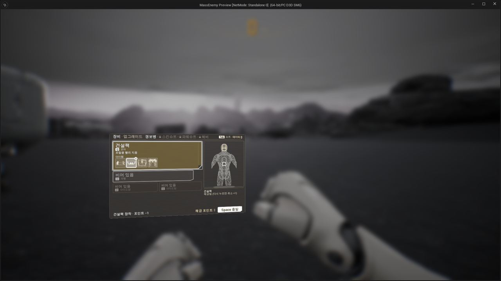
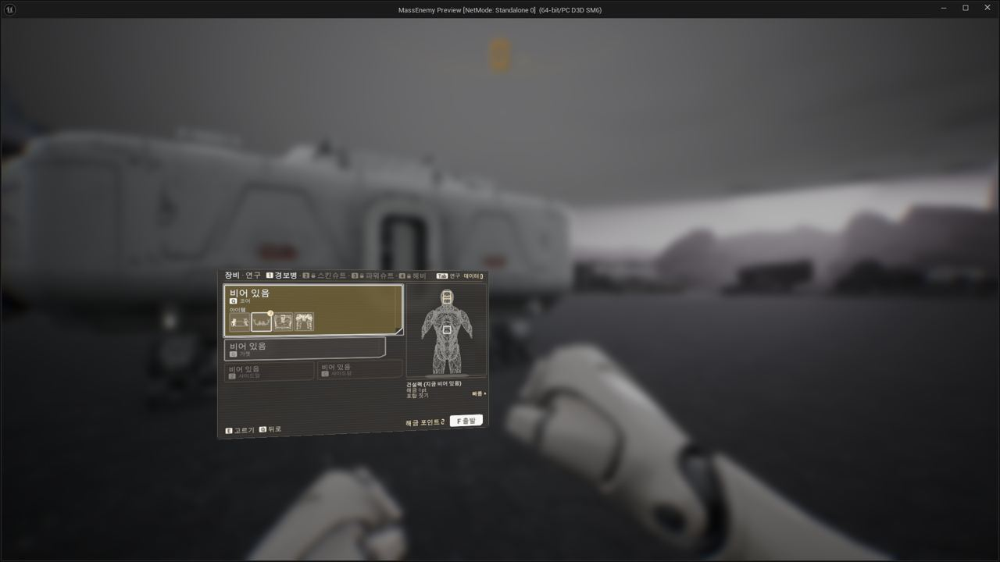
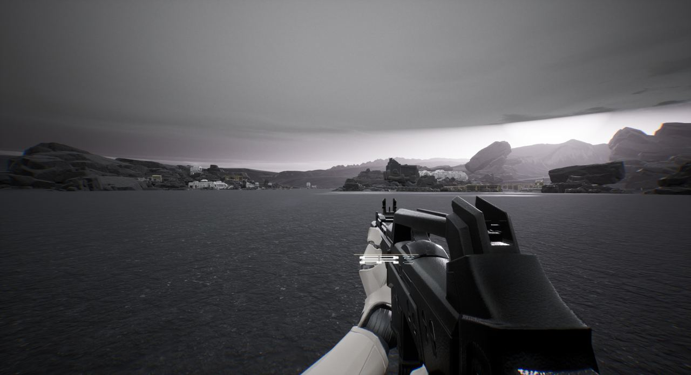
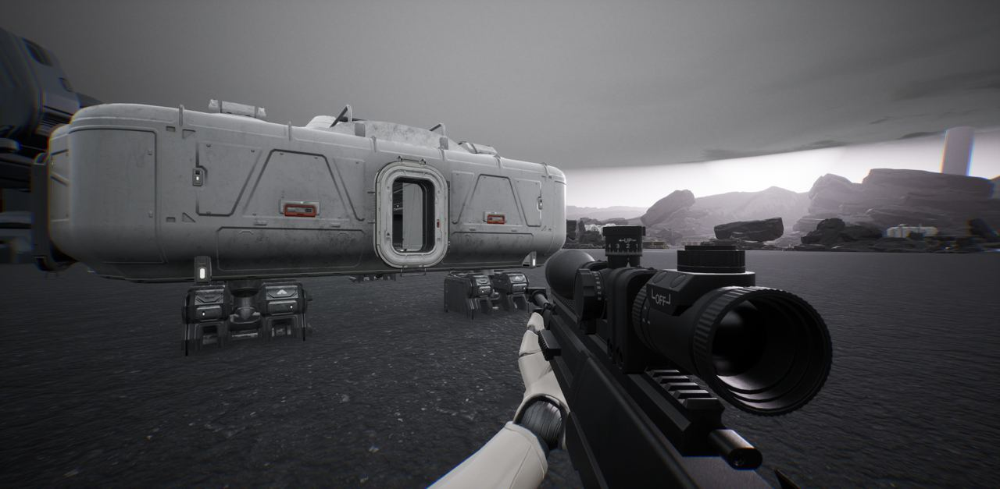
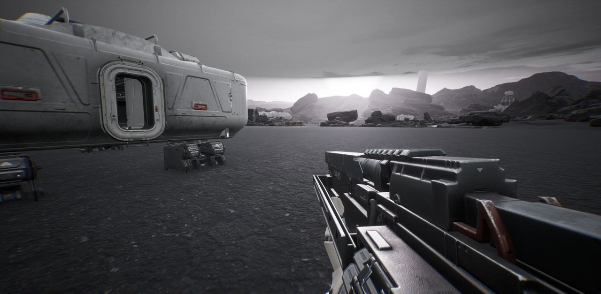
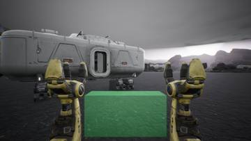
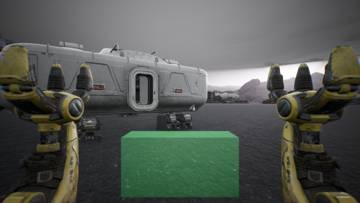
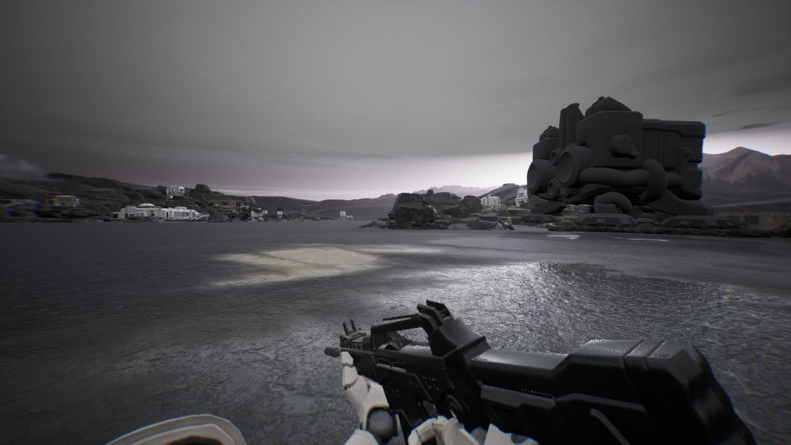
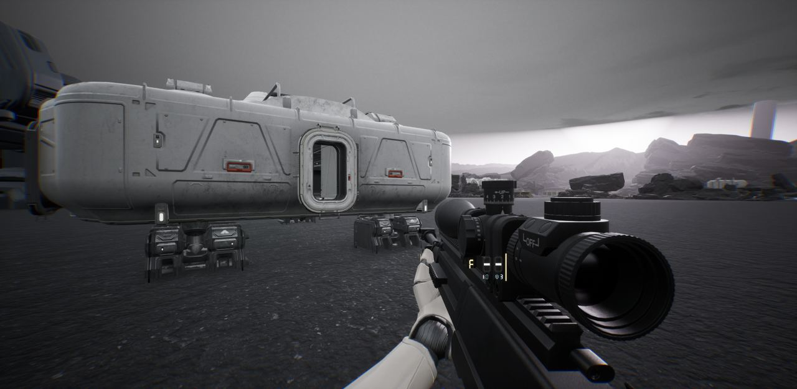
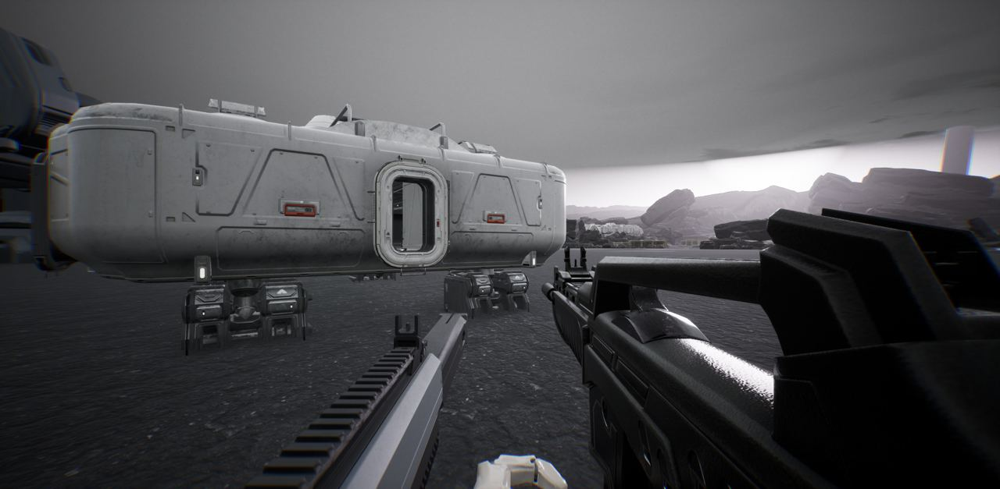

작업 5개 · 사진 10장

<ul class="toc">
<li><a href="#ui">화면 UI</a></li>
<li><a href="#weapon">무기</a></li>
<li><a href="#design">기획</a></li>
<li><a href="#audio">소리</a></li>
<li><a href="#vfx">이펙트</a></li>
</ul>
<h2 id="ui">화면 UI</h2>

장비 화면 조작과 총 패널 배치를 새 시안대로 바꿨습니다.

00:53 장비 화면 조작 키를 새 시안대로 바꿨습니다.

00:59 장비 화면 아래에 조작 안내를 넣었습니다.

01:23 열린 보조 무기 카드가 이웃 카드 위에 창처럼 뜨게 했습니다.

07:23 총 패널을 총에 붙은 평면에 그려 총 뒤로 가려지게 했습니다.

15:41 총 패널이 조준경 앞에 겹쳐 보이던 문제를 고쳤습니다.

16:19 장비 화면 크기를 화면 비율에 맞춰 정했습니다.

<h2 id="weapon">무기</h2>

쌍권총 재장전과 달리기 자세, 건설 팩을 손봤습니다.

01:00 건설 팩 종류마다 건설 시간이 걸리고 로봇 팔이 올라옵니다.

01:13 작은 센트리 건과 새 가젯 다섯 종을 넣었습니다.

02:13 들고 있는 장비에 맞는 조정 탭만 보이게 했습니다.

02:34 총별 수치와 소리를 조절하는 탭을 추가했습니다.

03:10 달릴 때 팔과 총이 아래 앞쪽으로 내려가게 했습니다.

03:52 애니메이션을 바꿀 때 손이 비는 문제를 고쳤습니다.

06:05 애니메이션을 바꾸면 총을 다시 들게 했습니다.

06:13 팔 애니메이션을 버튼 하나씩 골라 쓰게 했습니다.

15:30 저격총이 한 발만 쏘고 멈추던 문제를 고쳤습니다.

17:08 쌍권총은 탄이 적은 총부터 한 정씩 재장전합니다.

<h2 id="design">기획</h2>

총 부착물을 하나씩 사게 하고 발사 모드 전환을 정했습니다.

03:11 발사 모드 전환 키를 정했습니다.

17:09 장비 화면에서 부착물 모델을 총 위에 보여 주기로 했습니다.

<h2 id="audio">소리</h2>

저글링 덮치기 경고음과 아군 목소리를 다듬었습니다.

<h2 id="vfx">이펙트</h2>

로켓 발사 효과를 만들고 총구 불꽃을 정리했습니다.

