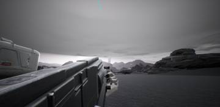
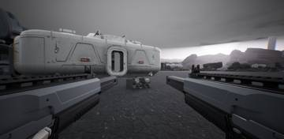
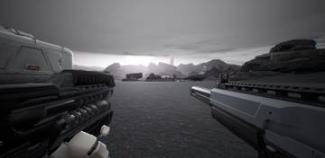
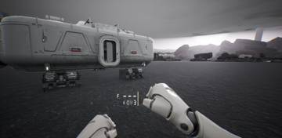
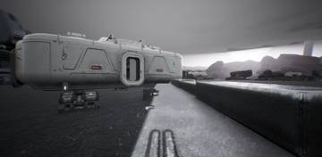
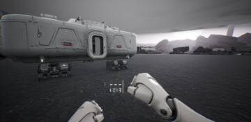
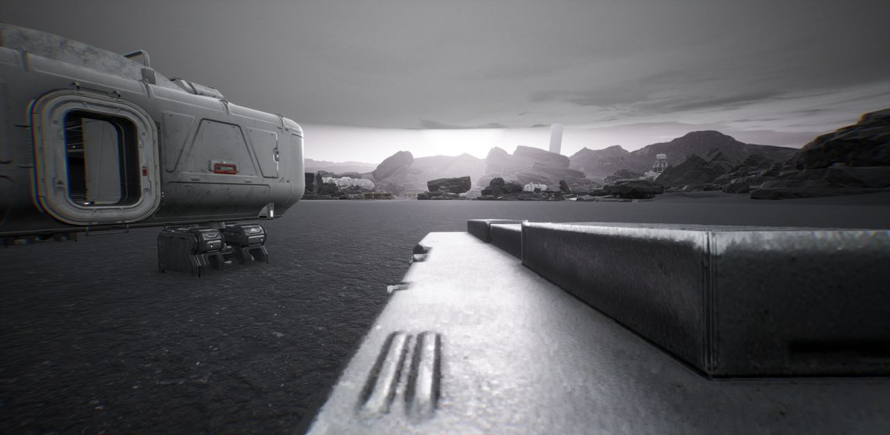

세션 4개 · 사진 13장

<ul class="toc">
<li><a href="#ui">ui — 화면 UI</a></li>
<li><a href="#weapon">weapon — 무기</a></li>
<li><a href="#design">design — 기획</a></li>
<li><a href="#audio">audio — 소리</a></li>
</ul>
<h2 id="ui">ui <small>화면 UI</small></h2>

쌍권총 패널 위치와 장비 줄 모양을 다듬었습니다.

02:02 가젯 줄 칸을 균등하게 나누고 색을 시안대로 정리했습니다.

<h2 id="weapon">weapon <small>무기</small></h2>

장비 화면 크기 조절과 쌍권총 왼손 총 조준을 추가했습니다.

02:11 양손 권총의 왼쪽 총 방향을 돌리는 조절 항목을 추가했습니다.

02:51 FN92에 RGX 광학 조준경을 달았습니다.

<h2 id="design">design <small>기획</small></h2>

관통 계산과 쌍권총 재장전 순서, 건설 방식을 정했습니다.

02:51 장비창 아이템을 3D 렌더 대신 단순한 선 아이콘과 이름으로 바꿨습니다

02:54 장비 화면에서 항목 이름 줄을 없애고 아이콘 결정은 보류로 적어 두었습니다.

<h2 id="audio">audio <small>소리</small></h2>

장비 화면 소리를 총마다 새로 만들고 권총 사격음을 실제 녹음으로 바꿨습니다.

