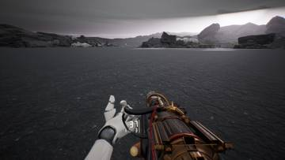
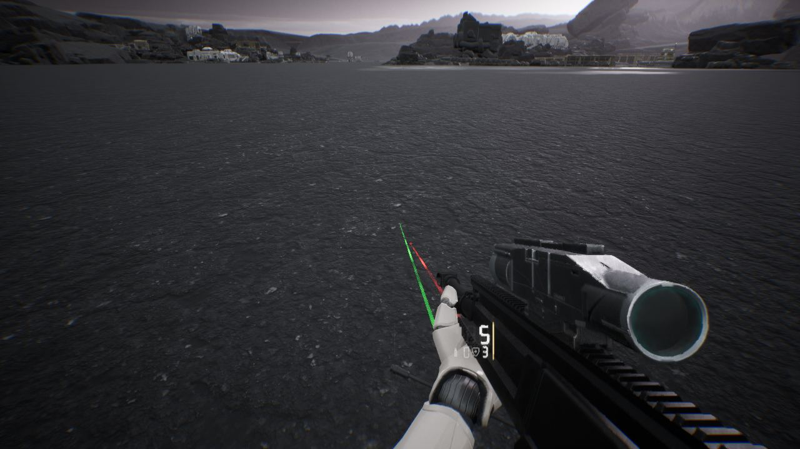
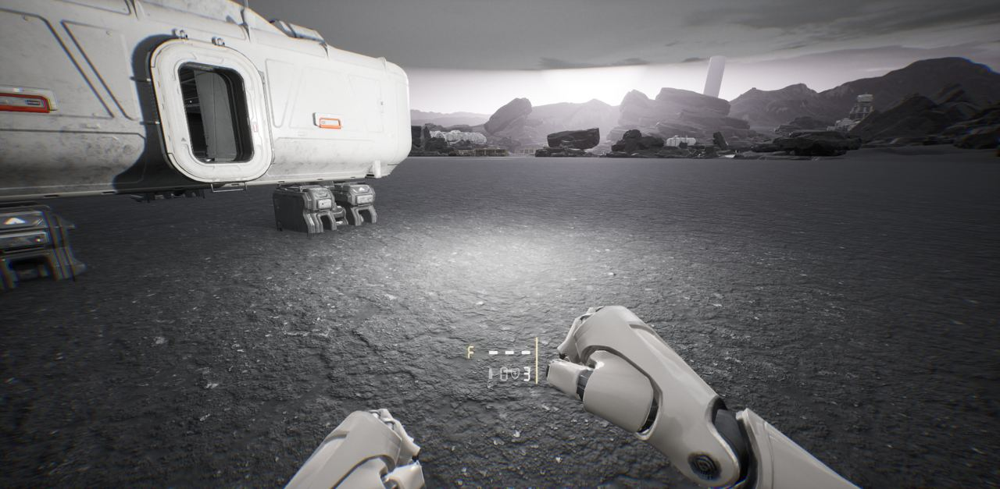

세션 6개 · 사진 4장

<ul class="toc">
<li><a href="#weapon">weapon — 무기</a></li>
<li><a href="#vfx">vfx — 이펙트</a></li>
<li><a href="#audio">audio — 소리</a></li>
<li><a href="#design">design — 기획</a></li>
<li><a href="#terran">terran — 테란 아군</a></li>
<li><a href="#ui">ui — 화면 UI</a></li>
</ul>
<h2 id="weapon">weapon <small>무기</small></h2>

수류탄과 시간 팩, 제트팩 조작을 새로 넣었습니다.

01:05 모든 총에 레이저 조준기를 달았습니다.

01:42 무전 팩의 Q 키 레이저 지시기를 넣어 지원 요청을 표시하게 했습니다.

<h2 id="vfx">vfx <small>이펙트</small></h2>

피살점 조각과 아군 탄피가 바닥에 실제로 쌓이게 했습니다.

17:32 맞거나 죽을 때 살점 조각이 튀고 바닥에 구르게 했습니다.

<h2 id="audio">audio <small>소리</small></h2>

저글링 무리 소리를 새로 만들고 아군 외침을 추가했습니다.

<h2 id="design">design <small>기획</small></h2>

연구 슬롯과 부품 규칙을 정리하고 크라이시스 개조 화면을 조사했습니다.

<h2 id="terran">terran <small>테란 아군</small></h2>

아군이 쏜 탄피가 바닥에 떨어지게 했습니다.

<h2 id="ui">ui <small>화면 UI</small></h2>

장비 아이콘과 부착물 구매 화면을 만들었습니다.

