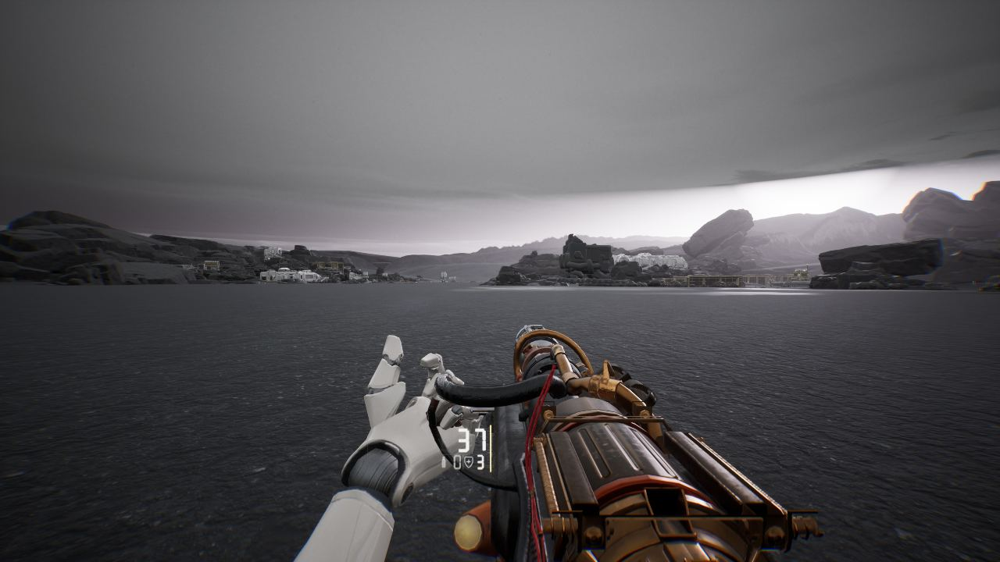

작업 5개 · 사진 2장

<ul class="toc">
<li><a href="#weapon">무기</a></li>
<li><a href="#vfx">이펙트</a></li>
<li><a href="#audio">소리</a></li>
<li><a href="#terran">테란 아군</a></li>
<li><a href="#ui">화면 UI</a></li>
</ul>
<h2 id="weapon">무기</h2>

모든 총에 레이저 조준기를 달고 레이저 지시기를 넣었습니다.

01:05 모든 총에 레이저 조준기를 달았습니다.

01:42 무전기 팩으로 레이저 지시기를 쓰고 지원을 요청하게 했습니다.

<h2 id="vfx">이펙트</h2>

피 살점 조각과 아군 탄피가 바닥에 남게 했습니다.

17:32 피격과 사망 때 살점 조각이 튀게 했습니다.

<h2 id="audio">소리</h2>

저글링 무리 소리를 새로 만들고 아군 외침을 넣었습니다.

<h2 id="terran">테란 아군</h2>

아군이 쏜 탄피가 바닥에 떨어지게 했습니다.

<h2 id="ui">화면 UI</h2>

장비 아이콘과 부착물 구매 화면을 만들었습니다.

