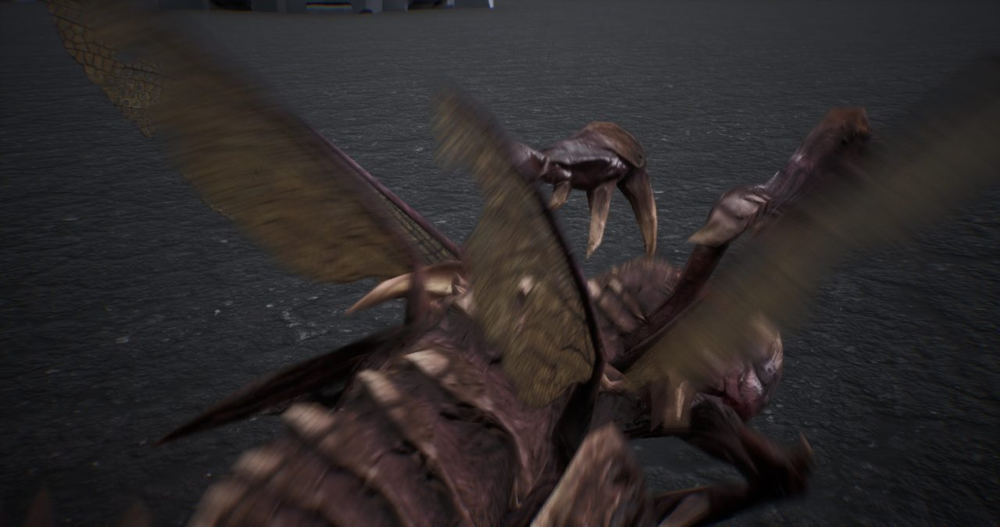
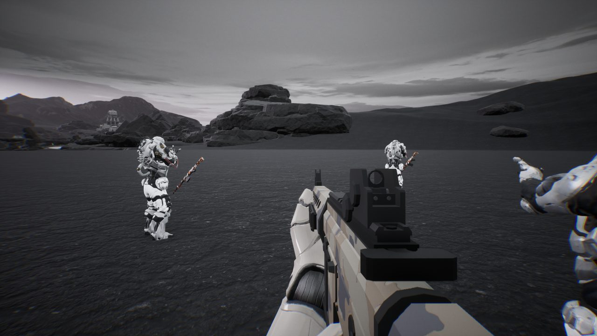
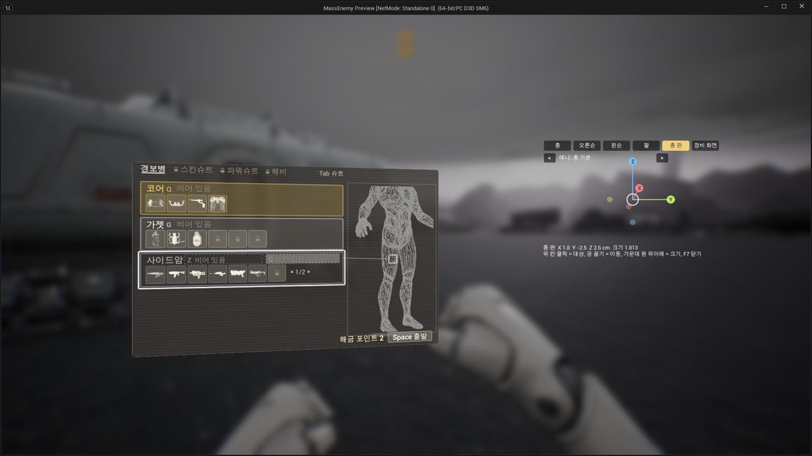
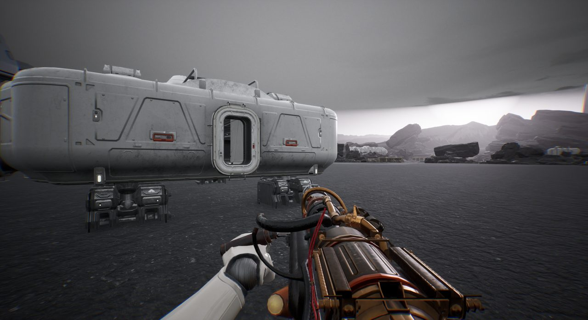
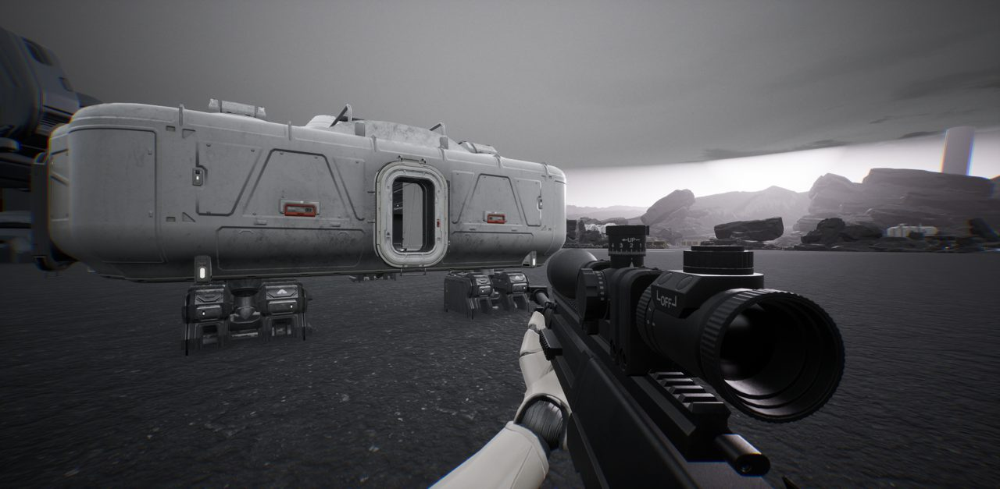

## 한 일

- 저글링에게 붙잡힌 아군이 쓰러졌다가 다시 일어납니다(래그돌 → 일어나기 동작).
- 플레이어도 저글링에게 덮쳐질 수 있고, 반격해서 빠져나올 수 있습니다.
- 하늘에서 보급창이 내려와 착륙합니다.
- 조명탄을 던지면 탄약·치료 상자가 하늘에서 떨어집니다.
- 장비 화면: 몸을 선으로 그린 그림 위에, 고른 장비가 강화하는 부위가 빛납니다.
- 코어 장비 5종과 보조 장비 5종의 틀을 잡았습니다.
- 피격 때 튀는 살점 이펙트를 넣었습니다.

*저글링을 가까이에서 본 모습입니다.*

*흰 장갑을 입은 아군들입니다.*

*장비 화면. 왼쪽이 장비 목록, 오른쪽이 몸 그림입니다.*

## 막혔던 것

- **DX12가 더 느림**: DX11보다 평균 16fps, 1% low 11fps 낮았습니다.
- **장비 미리보기가 무거움**: 보급 메뉴의 3D 미리보기를 켜면 전투 중 1% low가 46에서 32로 떨어졌습니다. 기본값을 끔으로 바꿨습니다.
- **저그끼리 비켜 가기 계산이 한 스레드에 몰림**: 2.75ms씩 게임을 붙잡고 있었습니다. 직접 병렬 처리기를 만들어 비교한 뒤 기본값을 정했습니다.
