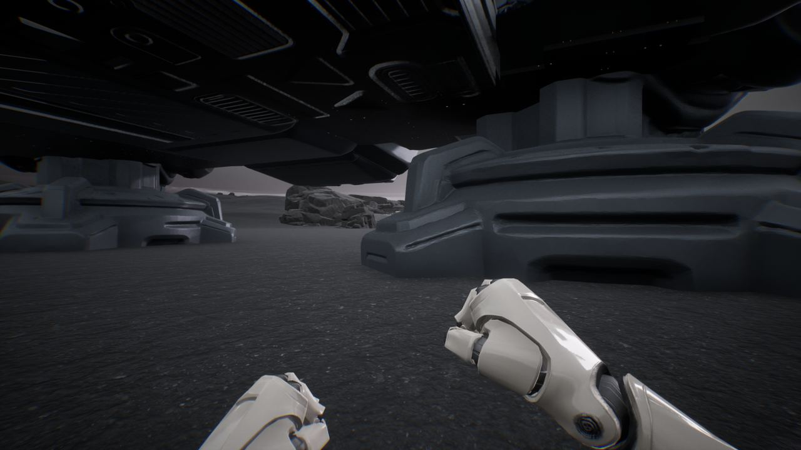
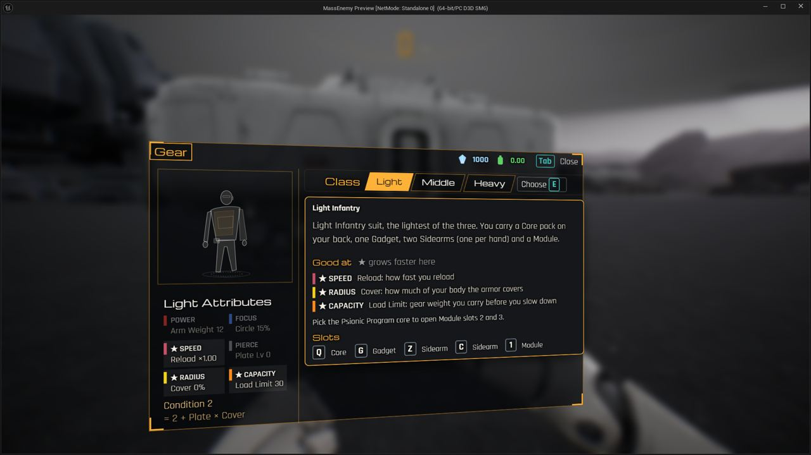

세션 3개 · 사진 2장

<ul class="toc">
<li><a href="#ui">ui — 화면 UI</a></li>
<li><a href="#design">design — 기획</a></li>
<li><a href="#weapon">weapon — 무기</a></li>
</ul>
<h2 id="ui">ui <small>화면 UI</small></h2>

장비 화면을 새로 만들고 안내와 키 조작을 넣었습니다.

18:24 장비 화면을 디자인팀의 웹 페이지 하나로 통일하고 옛 화면 코드를 지웠습니다.

<h2 id="design">design <small>기획</small></h2>

장비 화면을 웹 방식으로 바꾸고 키 입력 테스트를 추가했습니다.

21:47 장비 화면을 시뮬레이션 페이지 그대로 게임 안 웹 화면으로 띄웠습니다.

<h2 id="weapon">weapon <small>무기</small></h2>

장비를 고르면 총이 바로 들리게 하고 새 총 모델 여러 종을 넣었습니다.

