
세션 10개 · 사진 105장

<ul class="toc">
<li><a href="#building">building — 건물</a></li>
<li><a href="#terran">terran — 테란 아군</a></li>
<li><a href="#audio">audio — 소리</a></li>
<li><a href="#vfx">vfx — 이펙트</a></li>
<li><a href="#weapon">weapon — 무기</a></li>
<li><a href="#level">level — 맵</a></li>
<li><a href="#anim">anim — 애니메이션</a></li>
<li><a href="#design">design — 기획</a></li>
<li><a href="#ui">ui — 화면 UI</a></li>
<li><a href="#zerg">zerg — 저그</a></li>
</ul>
<h2 id="building">building <small>건물</small></h2>

배럭 내부 조명과 문을 다듬었습니다.

<a href="/assets/d/2026-10-18/WindowsEditor_HighresScreenshot00439.jpg" target="_blank">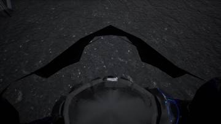</a>
<a href="/assets/d/2026-10-18/WindowsEditor_HighresScreenshot00440.jpg" target="_blank">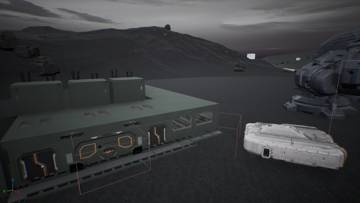</a>
<a href="/assets/d/2026-10-18/WindowsEditor_HighresScreenshot00441.jpg" target="_blank">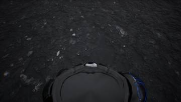</a>

02:41 슈트를 입는 스테이션 모델을 분해해 계단과 플랫폼까지 만들었습니다

<a href="/assets/d/2026-10-18/WindowsEditor_HighresScreenshot00462.jpg" target="_blank">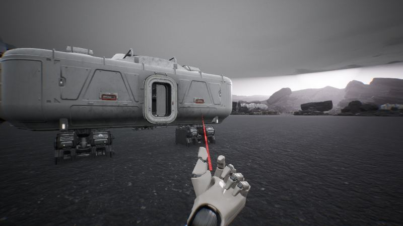</a>

04:35 장갑 헬멧에 올리고 내릴 수 있는 바이저를 만들어 붙였습니다.

<a href="/assets/d/2026-10-18/WindowsEditor_HighresScreenshot00498.jpg" target="_blank">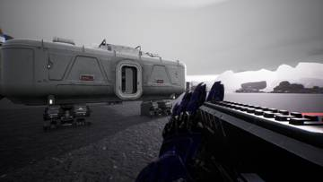</a>
<a href="/assets/d/2026-10-18/WindowsEditor_HighresScreenshot00499.jpg" target="_blank">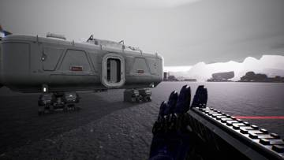</a>
<a href="/assets/d/2026-10-18/WindowsEditor_HighresScreenshot00501.jpg" target="_blank">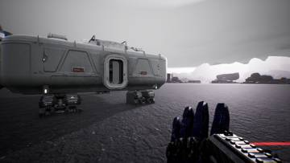</a>
<a href="/assets/d/2026-10-18/WindowsEditor_HighresScreenshot00507.jpg" target="_blank">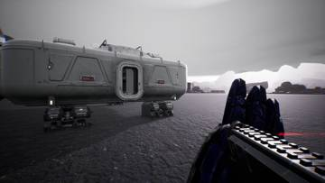</a>
<a href="/assets/d/2026-10-18/WindowsEditor_HighresScreenshot00512.jpg" target="_blank">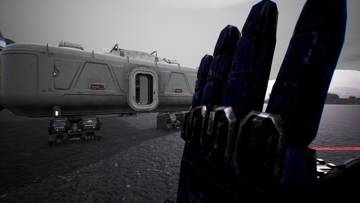</a>

10:29 배럭 입구 문을 열어 드나들 수 있게 잘라냈습니다.

<a href="/assets/d/2026-10-18/WindowsEditor_HighresScreenshot00529.jpg" target="_blank">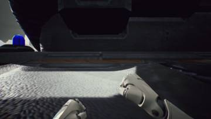</a>
<a href="/assets/d/2026-10-18/WindowsEditor_HighresScreenshot00531.jpg" target="_blank">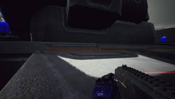</a>

15:51 커맨드센터 입구 보 위치를 올려 SCV가 지나다닐 높이를 확보했습니다.

<a href="/assets/d/2026-10-18/brk_st1.jpg" target="_blank">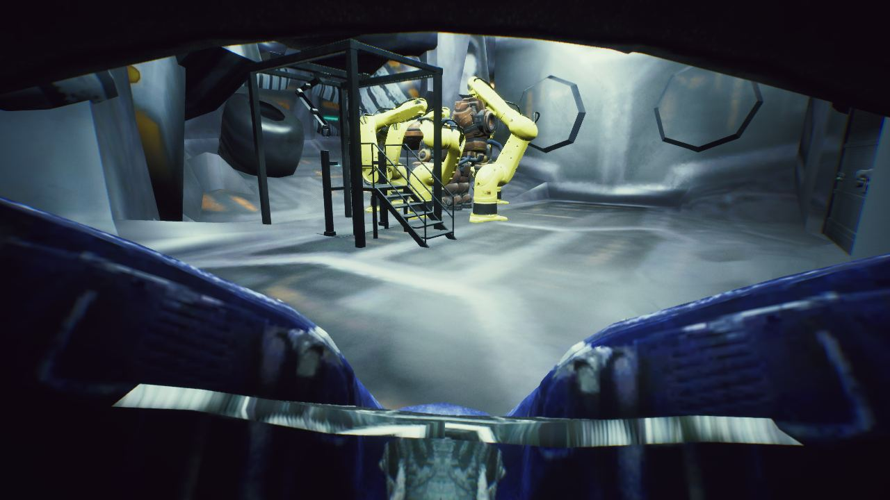</a>

22:04 병영 내부에 점광원 4개를 달아 실내를 밝혔습니다.

<h2 id="terran">terran <small>테란 아군</small></h2>

시즈 탱크를 4.6m 크기로 만들고 슈트 시야를 다듬었습니다.

<a href="/assets/d/2026-10-18/WindowsEditor_HighresScreenshot00442.jpg" target="_blank">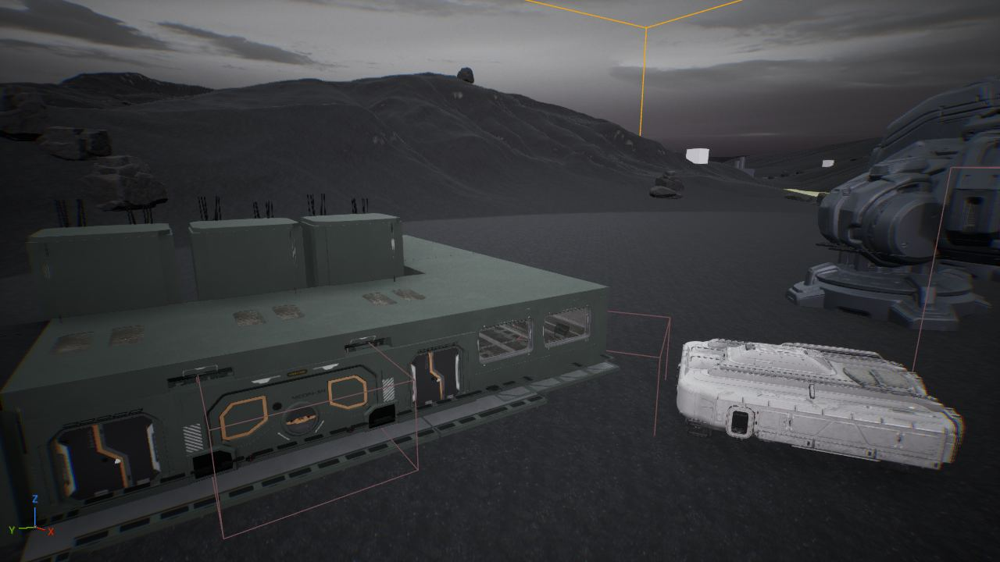</a>

02:41 파워슈트 정거장 뒤에 서면 2.5초 동안 슈트에 들어가는 연출을 넣었습니다.

<a href="/assets/d/2026-10-18/WindowsEditor_HighresScreenshot00446.jpg" target="_blank">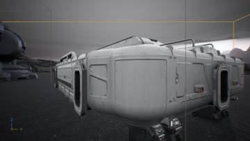</a>
<a href="/assets/d/2026-10-18/WindowsEditor_HighresScreenshot00450.jpg" target="_blank">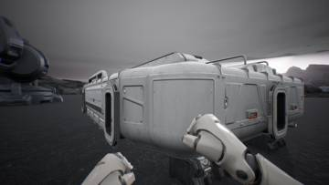</a>
<a href="/assets/d/2026-10-18/WindowsEditor_suitv2_ext_01.jpg" target="_blank">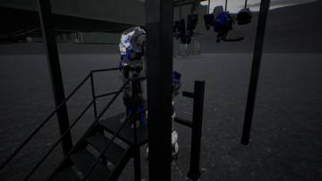</a>
<a href="/assets/d/2026-10-18/WindowsEditor_suitv2_ext_02.jpg" target="_blank">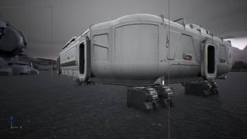</a>
<a href="/assets/d/2026-10-18/suitv2_on01_fp_b.jpg" target="_blank">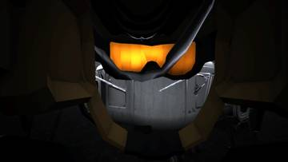</a>

03:40 슈트 정거장에서 로봇이 몸통, 팔, 헬멧을 차례로 입혀주게 했습니다.

<a href="/assets/d/2026-10-18/suitv2_on00_fp_b.jpg" target="_blank">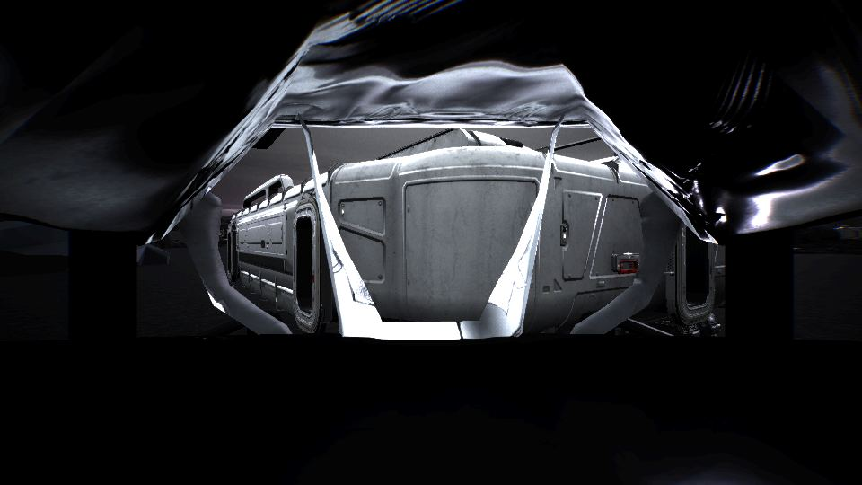</a>

04:37 정비소 슈트 부품이 안쪽에서도 보이도록 양면 재질을 적용했습니다.

<a href="/assets/d/2026-10-18/suitv2_visor_grid.jpg" target="_blank">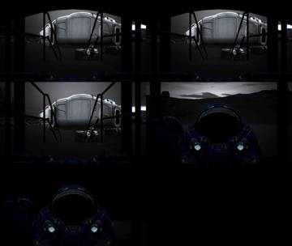</a>
<a href="/assets/d/2026-10-18/suitv2_bl_visor_grid.jpg" target="_blank">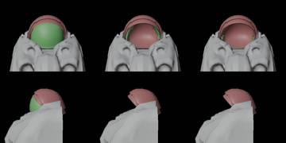</a>

04:49 H키로 슈트 바이저를 올리고 내리게 했습니다

<a href="/assets/d/2026-10-18/suitv2_on_fp_grid.jpg" target="_blank">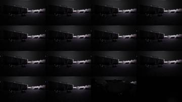</a>
<a href="/assets/d/2026-10-18/WindowsEditor_HighresScreenshot00494.jpg" target="_blank">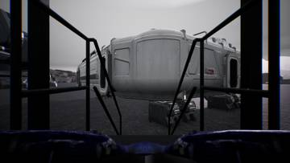</a>
<a href="/assets/d/2026-10-18/WindowsEditor_HighresScreenshot00497.jpg" target="_blank">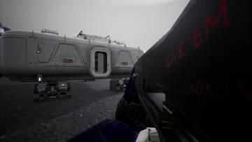</a>

05:39 슈트를 입을 때 화면이 까맣게 가려지던 문제를 고쳤습니다.

<a href="/assets/d/2026-10-18/WindowsEditor_suitv3_ext.jpg" target="_blank">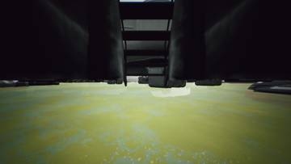</a>
<a href="/assets/d/2026-10-18/WindowsEditor_suitv3_ext_front.jpg" target="_blank">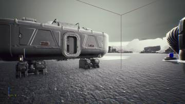</a>
<a href="/assets/d/2026-10-18/WindowsEditor_suitv3_fp_look.jpg" target="_blank">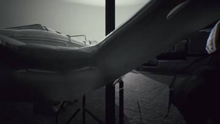</a>

17:16 슈트 정거장에 로봇팔과 받침대 장식을 달았고, 착용 중에도 주위를 볼 수 있게 했습니다.

<a href="/assets/d/2026-10-18/hv_a_0_all.jpg" target="_blank">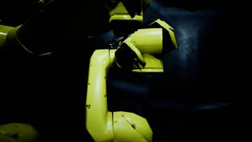</a>
<a href="/assets/d/2026-10-18/hv_a_35_all.jpg" target="_blank">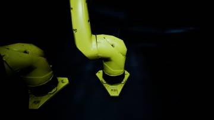</a>

22:12 시즈 탱크 해치와 내부 바구니 모델을 만들고 열린 자세를 정했습니다.

<a href="/assets/d/2026-10-18/WindowsEditor_HighresScreenshot00535.jpg" target="_blank">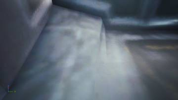</a>
<a href="/assets/d/2026-10-18/WindowsEditor_HighresScreenshot00536.jpg" target="_blank">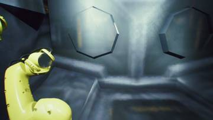</a>
<a href="/assets/d/2026-10-18/WindowsEditor_HighresScreenshot00537.jpg" target="_blank">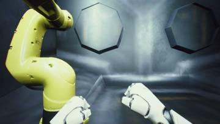</a>
<a href="/assets/d/2026-10-18/WindowsEditor_HighresScreenshot00538.jpg" target="_blank">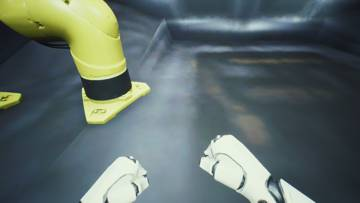</a>

22:21 실제 전차 내부 구조를 조사해 정리했습니다

<a href="/assets/d/2026-10-18/WindowsEditor_HighresScreenshot00539.jpg" target="_blank">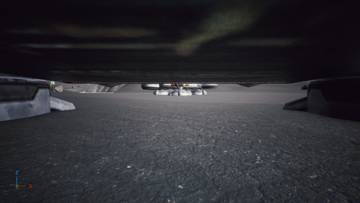</a>
<a href="/assets/d/2026-10-18/WindowsEditor_HighresScreenshot00542.jpg" target="_blank">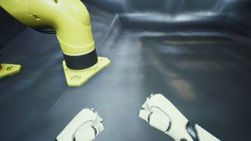</a>
<a href="/assets/d/2026-10-18/WindowsEditor_HighresScreenshot00543.jpg" target="_blank">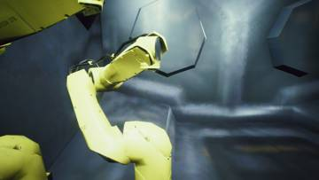</a>
<a href="/assets/d/2026-10-18/WindowsEditor_HighresScreenshot00544.jpg" target="_blank">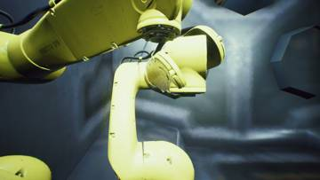</a>
<a href="/assets/d/2026-10-18/WindowsEditor_HighresScreenshot00545.jpg" target="_blank">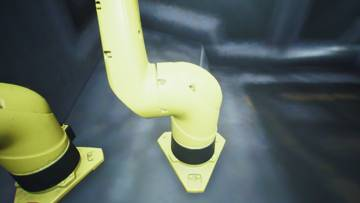</a>

22:27 시즈 탱크 내부 설정으로 스타크래프트 2의 탱크 자료를 정리했습니다.

<a href="/assets/d/2026-10-18/WindowsEditor_HighresScreenshot00550.jpg" target="_blank">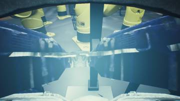</a>

<a href="/assets/d/2026-10-18/WindowsEditor_HighresScreenshot00570.jpg" target="_blank">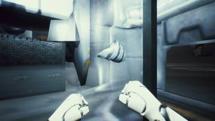</a>
<a href="/assets/d/2026-10-18/WindowsEditor_HighresScreenshot00571.jpg" target="_blank">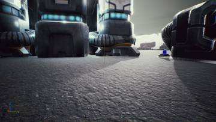</a>
<a href="/assets/d/2026-10-18/WindowsEditor_HighresScreenshot00573.jpg" target="_blank">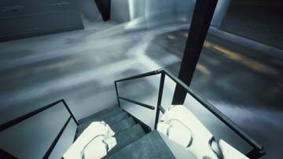</a>
<a href="/assets/d/2026-10-18/WindowsEditor_HighresScreenshot00574.jpg" target="_blank">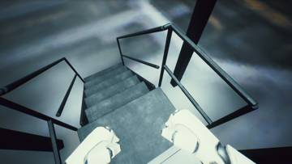</a>
<a href="/assets/d/2026-10-18/WindowsEditor_HighresScreenshot00577.jpg" target="_blank">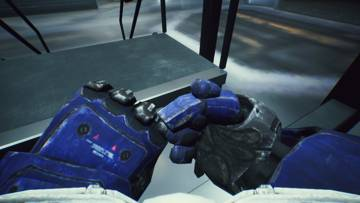</a>

22:45 터보 서보 소리가 파워슈트와 중장갑에서만 나게 했고, 경보병은 소리가 나지 않습니다.

<a href="/assets/d/2026-10-18/WindowsEditor_HighresScreenshot00581.jpg" target="_blank">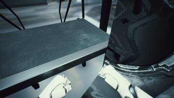</a>
<a href="/assets/d/2026-10-18/suitarm_bare_0.jpg" target="_blank">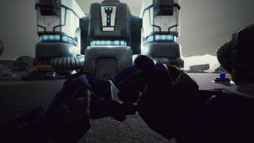</a>
<a href="/assets/d/2026-10-18/suitarm_bare_90.jpg" target="_blank">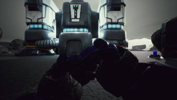</a>
<a href="/assets/d/2026-10-18/suitarm_gun_270.jpg" target="_blank">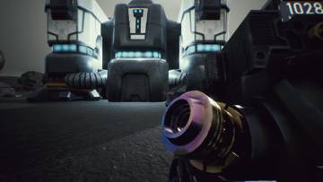</a>

23:14 중형 슈트를 입으면 바이저 유리가 시야를 가리지 않게 숨겼습니다.

<a href="/assets/d/2026-10-18/WindowsEditor_HighresScreenshot00589.jpg" target="_blank">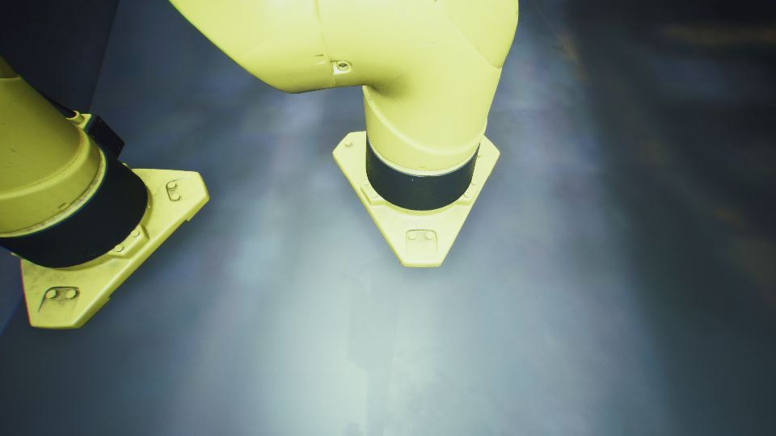</a>

23:33 시즈 탱크 포탑 아래에 조명을 달아 칠흑 같던 내부가 보이게 했습니다.

<h2 id="audio">audio <small>소리</small></h2>

보병 발소리를 일반 군화로 바꾸고 배틀필드식 음성 규칙을 넣었습니다.

<a href="/assets/d/2026-10-18/WindowsEditor_HighresScreenshot00444.jpg" target="_blank">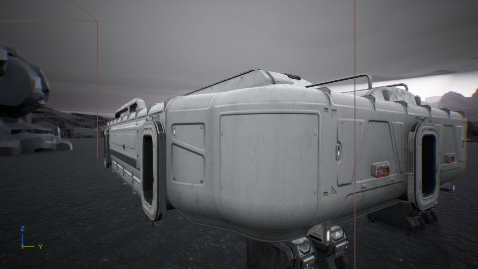</a>

03:40 저그 무리 레이어를 새 폴더 경로에 맞춰 다시 가져왔습니다

<h2 id="vfx">vfx <small>이펙트</small></h2>

건물 재질과 슈트 정거장 색을 손봤습니다.

04:07 저글링의 눈이 작고 날카로운 붉은 점으로 빛나게 했습니다

04:58 참고 화면과 우리 화면의 밝기와 대비 수치를 비교하는 도구를 만들었습니다.

<h2 id="weapon">weapon <small>무기</small></h2>

C-14 총을 해병 크기에 맞춰 키우고 슈트 팔 모드를 넣었습니다.

04:34 T-200이 쏠 때마다 RPG 로켓이 나가 폭발하게 만들었습니다.

04:57 T-200을 복사본이 아닌 새 무기 블루프린트로 다시 만들었습니다.

05:04 슈트를 입으면 장비 화면에서 고른 무기가 손에 들리게 고쳤습니다.

05:46 가우스 소총을 직접 만든 임팔러 모델로 바꿨습니다.

15:17 오른쪽 슈트 팔 모델을 만들어 왼쪽과 같은 크기로 맞췄습니다.

15:45 슈트를 입으면 묵직한 걸음이 되고 맨손일 때 오른쪽 슈트 주먹이 보이게 했습니다.

17:34 HEV 소총 원본 모델을 스타크래프트 2 자료에서 만들었습니다.

18:33 슈트 정비소 옆에 총 15종을 걸어 둔 무기 벽을 만들었습니다.

22:23 무기 벽의 총을 실제 크기로 맞추고 체인건을 추가했습니다.

22:46 C-14 소총을 새로 정리해 손에 하나만 보이도록 고쳤습니다

23:18 슈트 입은 1인칭 팔의 동작 요청을 만들고 무기 크기 비교 도구를 만들었습니다.

23:27 C-14 소총의 총검을 뺀 길이를 기준으로 크기를 다시 맞췄습니다

23:45 슈트 팔이 붙은 스킨 모드와 흰색 슈트 재질을 넣어 1인칭 팔을 바꿨습니다.

<h2 id="level">level <small>맵</small></h2>

맵에 시즈 탱크를 놓고 건물을 새 모델로 바꿨으며 안개를 짙게 했습니다.

04:49 메인 맵 그림자 설정을 점검해 그림자가 흐린 원인을 하늘 밝기로 추정했습니다.

04:52 안개와 하늘 실험 뒤에 메인 맵을 원래 값으로 되돌려 저장했습니다.

04:56 안개와 그림자를 비교해 그림자가 안 보이는 원인과 겹겹이 산이 보이는 설정을 찾았습니다.

13:57 공포 분위기와 피로가 적은 화면 방향의 조사 결과를 디자인 담당에게 넘겼습니다.

14:05 루틴 게임 색 보정을 섞어 공포 분위기의 화면 색으로 시험했습니다.

<h2 id="anim">anim <small>애니메이션</small></h2>

해병 1인칭 팔 동작 63개와 저글링 덮치기 동작을 만들었습니다.

23:41 1인칭 팔 애니메이션 63개를 모두 새 팔 모델에 옮겼습니다.

<h2 id="design">design <small>기획</small></h2>

테란 유닛 크기표와 중장갑 슈트 정거장 설계를 정했습니다.

<h2 id="ui">ui <small>화면 UI</small></h2>

장비 화면 키 입력과 설정 연결을 고쳤습니다.

<h2 id="zerg">zerg <small>저그</small></h2>

저글링이 가장 가까운 테란을 쫓고 쓰러진 플레이어를 덮치는 동작을 넣었습니다.

