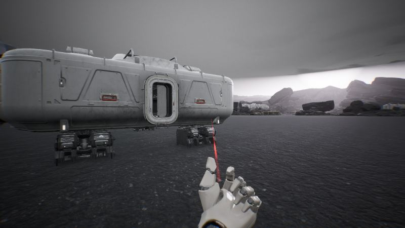
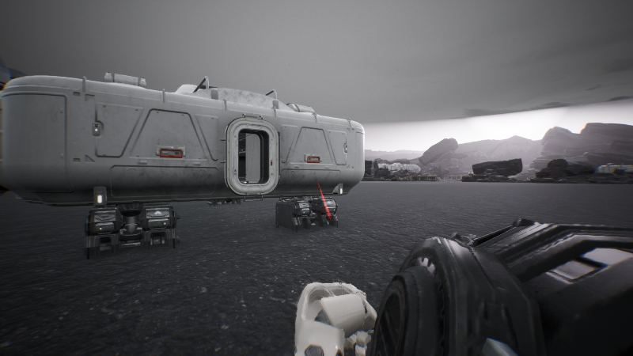
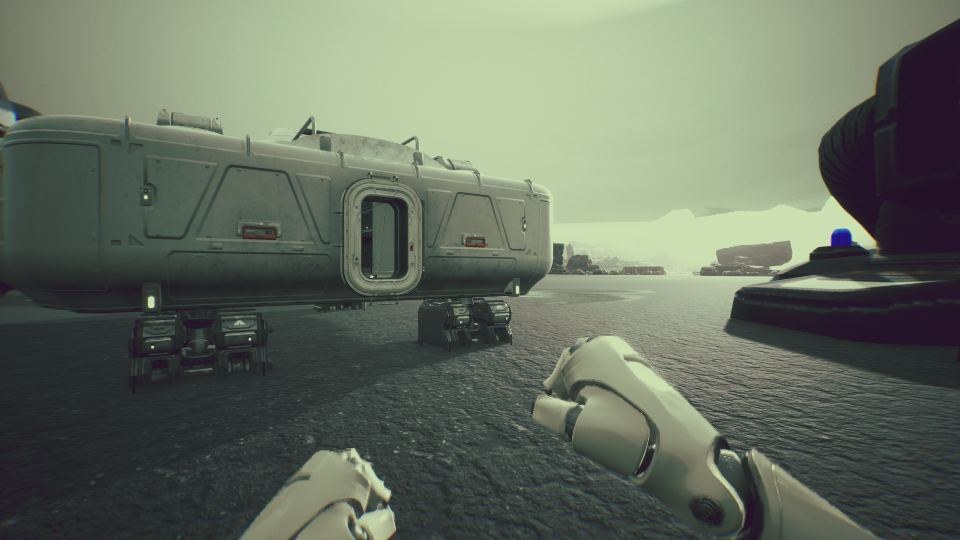

작업 10개 · 사진 5장

<ul class="toc">
<li><a href="#building">건물</a></li>
<li><a href="#terran">테란 아군</a></li>
<li><a href="#vfx">이펙트</a></li>
<li><a href="#weapon">무기</a></li>
<li><a href="#level">맵</a></li>
<li><a href="#anim">애니메이션</a></li>
<li><a href="#audio">소리</a></li>
<li><a href="#design">기획</a></li>
<li><a href="#ui">화면 UI</a></li>
<li><a href="#zerg">저그</a></li>
</ul>
<h2 id="building">건물</h2>

배럭 조명과 문을 다듬었습니다.

02:41 강화복 정거장 모델을 몸통, 등판, 다리 덮개로 나눴습니다.

04:35 강화복 정거장에 올리고 내리는 바이저를 만들었습니다.

10:29 배럭 입구의 닫힌 문을 뚫어 열었습니다.

15:51 사령부 입구 위 들보를 SCV가 지나가게 올렸습니다.

22:04 배럭 안에 조명 네 개를 달았습니다.

<h2 id="terran">테란 아군</h2>

시즈 탱크를 키우고 강화복 정거장과 시야를 다듬었습니다.

02:41 강화복 정거장 뒤에 서면 입는 동작이 시작되게 했습니다.

03:40 정거장 로봇이 몸통, 팔, 헬멧을 차례로 입혀 주게 했습니다.

04:37 정거장 부품을 양면 재질로 바꿔 안에서도 보이게 했습니다.

04:50 강화복 헬멧의 바이저를 올리고 내릴 수 있게 했습니다.

06:02 강화복을 입을 때 화면이 까맣게 가려지던 문제를 고쳤습니다.

17:16 강화복 정거장에 로봇 팔 장식을 놓았습니다.

22:45 가벼운 보병이 강화복 소리를 내던 문제를 고쳤습니다.

23:14 강화복을 입으면 헬멧 유리가 시야를 흐리지 않게 했습니다.

23:33 시즈 탱크 실내에 천장 조명을 달았습니다.

<h2 id="vfx">이펙트</h2>

건물 재질과 강화복 정거장 색을 손봤습니다.

04:07 저글링 눈이 작고 날카로운 붉은 점으로 빛나게 했습니다.

<h2 id="weapon">무기</h2>

C-14 소총을 해병 크기에 맞추고 강화복 팔을 넣었습니다.

04:34 T-200이 한 발마다 RPG 로켓을 쏘게 했습니다.

04:57 T-200을 새로 만든 무기로 바꿨습니다.

05:04 강화복을 입으면 장비 화면에서 고른 무기가 들리게 했습니다.

05:46 가우스 소총을 직접 만든 임팔러 모델로 바꿨습니다.

15:17 강화복 오른팔 주먹 모델을 만들었습니다.

15:45 강화복 걸음을 무겁게 하고 맨손일 때 강화복 주먹을 보여 줍니다.

17:34 HEV 소총의 원본 모델을 만들었습니다.

18:33 강화복 정거장 옆에 무기 선반 벽을 만들었습니다.

22:46 C-14 소총을 깔끔하게 새로 정리했습니다.

23:27 C-14 소총에서 총검을 뺀 길이를 맞췄습니다.

23:45 강화복 팔이 1인칭 동작에 맞춰 움직이게 했습니다.

<h2 id="level">맵</h2>

맵에 시즈 탱크를 놓고 건물을 새 모델로 바꾸고 안개를 짙게 했습니다.

14:05 맵에 으스스한 분위기의 색 보정을 시험했습니다.

<h2 id="anim">애니메이션</h2>

해병 1인칭 팔 동작을 대거 넣었습니다.

23:41 해병 1인칭 팔 동작 예순세 개를 넣었습니다.

<h2 id="audio">소리</h2>

보병 발소리를 일반 군화 소리로 바꿨습니다.

<h2 id="design">기획</h2>

테란 유닛 크기표와 중장갑 강화복 정거장을 설계했습니다.

<h2 id="ui">화면 UI</h2>

장비 화면 조작과 설정 연결을 고쳤습니다.

<h2 id="zerg">저그</h2>

저글링이 가까운 테란을 쫓고 쓰러진 플레이어를 덮치게 했습니다.

