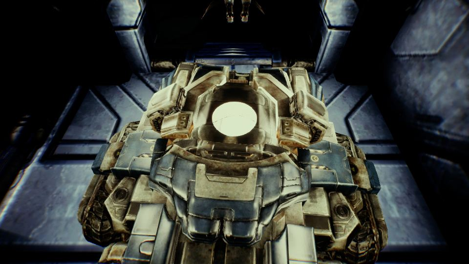
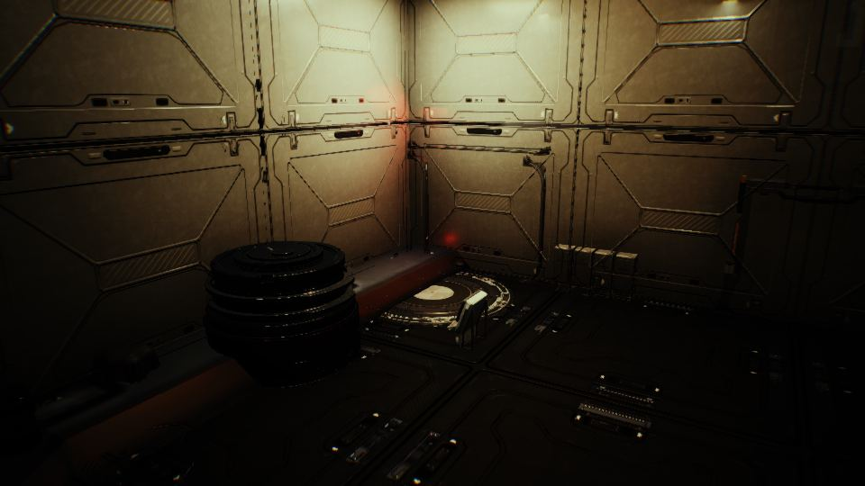

작업 7개 · 사진 4장

<ul class="toc">
<li><a href="#terran">테란 아군</a></li>
<li><a href="#weapon">무기</a></li>
<li><a href="#building">건물</a></li>
<li><a href="#audio">소리</a></li>
<li><a href="#design">기획</a></li>
<li><a href="#level">맵</a></li>
<li><a href="#vfx">이펙트</a></li>
</ul>
<h2 id="terran">테란 아군</h2>

SCV를 키우고 바이저와 걷기 동작을 넣었습니다.

00:09 시즈 탱크 내부 벽에 흰 페인트 재질을 입혔습니다.

<h2 id="weapon">무기</h2>

사령부 무기 벽을 옮기고 카메라 흔들림을 줄였습니다.

00:23 강화복 팔이 시야 카메라를 따라가게 고쳤습니다.

00:41 강화복 팔이 총과 함께 움직이게 했습니다.

00:55 강화복 팔이 총 앞손잡이를 쥐도록 동작을 넣었습니다.

01:02 강화복 오른손이 총 손잡이를 쥐게 했습니다.

23:07 HEV와 체인건 크기를 C-14 손잡이에 맞췄습니다.

23:37 무기 벽을 사령부 안쪽 오른쪽 벽으로 옮겼습니다.

23:46 바이저 키가 총을 같이 내리던 문제를 고쳤습니다.

<h2 id="building">건물</h2>

사령부와 배럭 내부를 새로 꾸몄습니다.

16:57 배럭 강화복 정거장의 로봇을 일곱에서 둘로 줄였습니다.

23:57 배럭 내부를 사령부 스타일로 새로 꾸몄습니다.

<h2 id="audio">소리</h2>

바이저를 내리면 소리가 먹먹해지고 발소리를 발 디딤에 맞췄습니다.

<h2 id="design">기획</h2>

바이저와 강화복 정거장 규칙을 정했습니다.

<h2 id="level">맵</h2>

사령부 크기를 키우고 공장에 조명을 달았습니다.

<h2 id="vfx">이펙트</h2>

건물 금속 질감을 밝게 조정했습니다.

