
세션 9개 · 사진 34장

<ul class="toc">
<li><a href="#level">level — 맵</a></li>
<li><a href="#terran">terran — 테란 아군</a></li>
<li><a href="#weapon">weapon — 무기</a></li>
<li><a href="#building">building — 건물</a></li>
<li><a href="#audio">audio — 소리</a></li>
<li><a href="#design">design — 기획</a></li>
<li><a href="#perf">perf — 성능</a></li>
<li><a href="#vfx">vfx — 이펙트</a></li>
<li><a href="#zerg">zerg — 저그</a></li>
</ul>
<h2 id="level">level <small>맵</small></h2>

지휘 센터 크기를 키우고 공장에 조명을 달았습니다.

<a href="/assets/d/2026-10-19/capture_factory1019_cd100_in_w.jpg" target="_blank">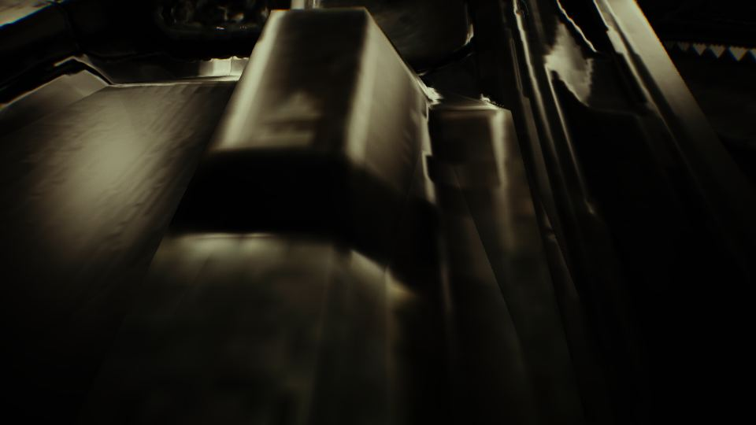</a>

00:02 메인 레벨 공장 안에 점광원 네 개를 놓아 내부가 훨씬 밝아졌습니다.

<h2 id="terran">terran <small>테란 아군</small></h2>

SCV를 키우고 H키 바이저와 걷기 동작을 추가했습니다.

<a href="/assets/d/2026-10-19/WindowsEditor_HighresScreenshot00596.jpg" target="_blank">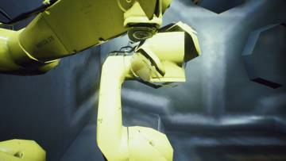</a>
<a href="/assets/d/2026-10-19/WindowsEditor_HighresScreenshot00597.jpg" target="_blank">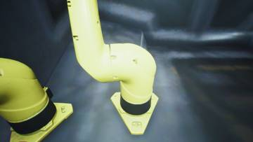</a>
<a href="/assets/d/2026-10-19/WindowsEditor_HighresScreenshot00598.jpg" target="_blank">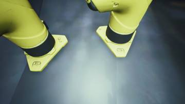</a>
<a href="/assets/d/2026-10-19/WindowsEditor_HighresScreenshot00599.jpg" target="_blank">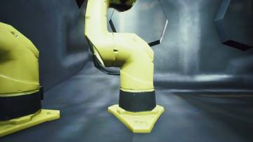</a>
<a href="/assets/d/2026-10-19/WindowsEditor_HighresScreenshot00600.jpg" target="_blank">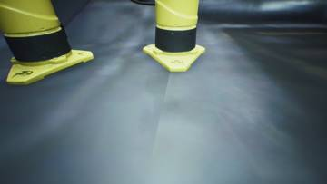</a>
<a href="/assets/d/2026-10-19/WindowsEditor_HighresScreenshot00601.jpg" target="_blank">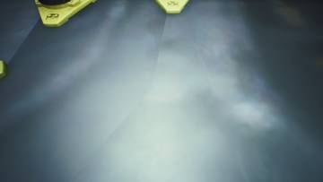</a>
<a href="/assets/d/2026-10-19/tank_closed.jpg" target="_blank">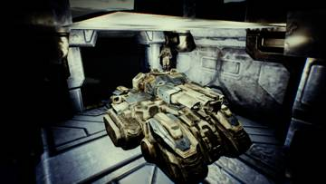</a>
<a href="/assets/d/2026-10-19/tank_open_top.jpg" target="_blank">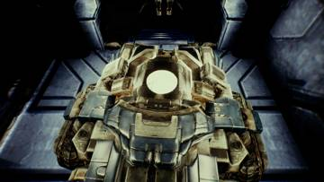</a>
<a href="/assets/d/2026-10-19/tank_in_fwd.jpg" target="_blank">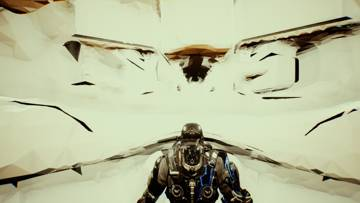</a>
<a href="/assets/d/2026-10-19/tank_in_up.jpg" target="_blank">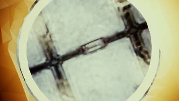</a>
<a href="/assets/d/2026-10-19/tank_in_back.jpg" target="_blank">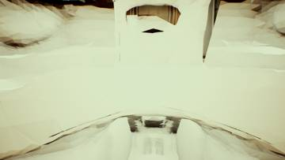</a>

00:09 시즈 탱크 내부 벽에 흰색 도장 재질을 따로 만들어 입혔습니다.

<a href="/assets/d/2026-10-19/sweep0.jpg" target="_blank">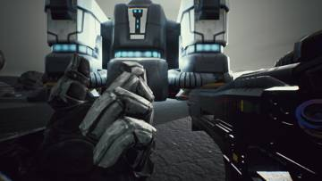</a>
<a href="/assets/d/2026-10-19/sweep1.jpg" target="_blank">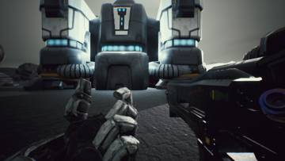</a>
<a href="/assets/d/2026-10-19/sweep3.jpg" target="_blank">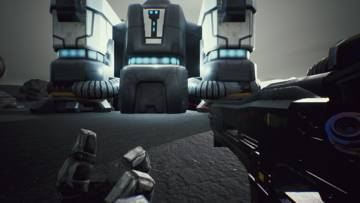</a>
<a href="/assets/d/2026-10-19/f7_0.jpg" target="_blank">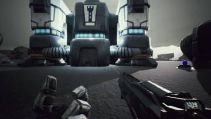</a>

00:25 최신 주력 전차 내부 모습을 조사해 정리했습니다

<h2 id="weapon">weapon <small>무기</small></h2>

지휘 센터 무기 벽을 옮기고 카메라 흔들림을 줄였습니다.

<a href="/assets/d/2026-10-19/skin4_bare.jpg" target="_blank">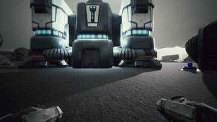</a>
<a href="/assets/d/2026-10-19/skin4_c14.jpg" target="_blank">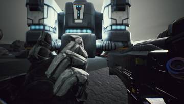</a>

00:23 슈트 팔이 카메라 위치에 맞게 보이도록 고치고 총 손잡이를 손목에 붙였습니다.

<a href="/assets/d/2026-10-19/f7b_0.jpg" target="_blank">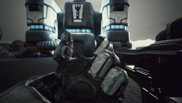</a>
<a href="/assets/d/2026-10-19/f7b_2.jpg" target="_blank">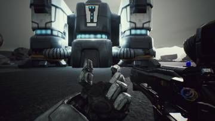</a>

00:41 슈트 팔이 총처럼 카메라 위치를 따라 같이 움직이게 했습니다.

<a href="/assets/d/2026-10-19/ik_on.jpg" target="_blank">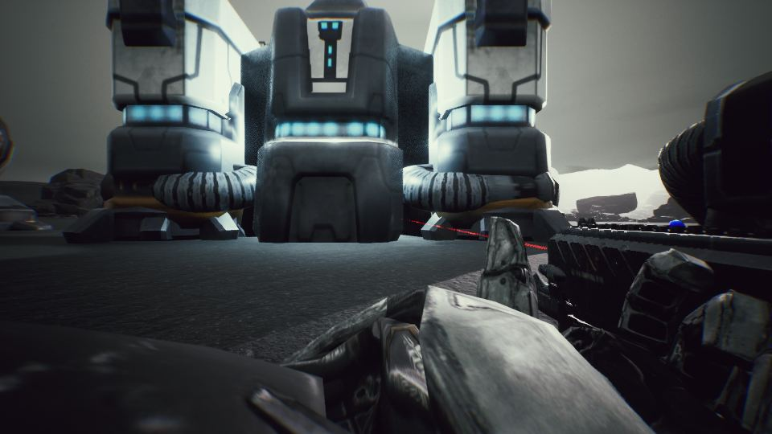</a>

00:55 슈트 팔이 총의 앞손잡이를 잡도록 애니메이션과 손 위치 계산을 넣었습니다.

<a href="/assets/d/2026-10-19/rik_on.jpg" target="_blank">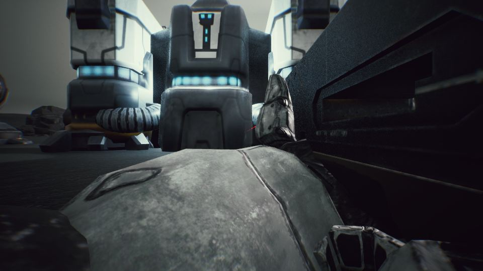</a>

01:02 보병 오른팔이 1인칭 팔 위치를 따라가 소총을 제대로 쥐게 했습니다

<a href="/assets/d/2026-10-19/medgrip_HEV.jpg" target="_blank">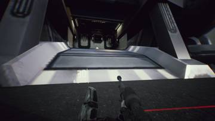</a>
<a href="/assets/d/2026-10-19/medgrip_C14.jpg" target="_blank">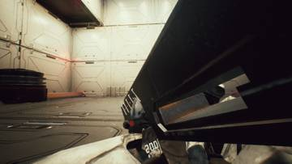</a>
<a href="/assets/d/2026-10-19/medgrip_T200.jpg" target="_blank">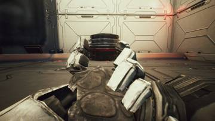</a>
<a href="/assets/d/2026-10-19/medgrip_Chaingun.jpg" target="_blank">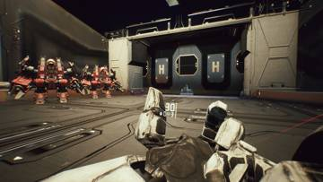</a>

23:07 HEV와 체인건 크기를 키워 손잡이 길이를 C-14와 맞췄습니다.

<a href="/assets/d/2026-10-19/ccwall.jpg" target="_blank">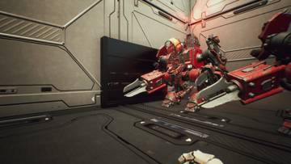</a>
<a href="/assets/d/2026-10-19/ccwall_r.jpg" target="_blank">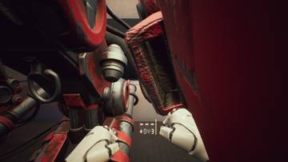</a>

23:37 사령부 무기 벽을 새로 만든 내부 오른쪽 벽으로 옮겼습니다

<a href="/assets/d/2026-10-19/ccwall5.jpg" target="_blank">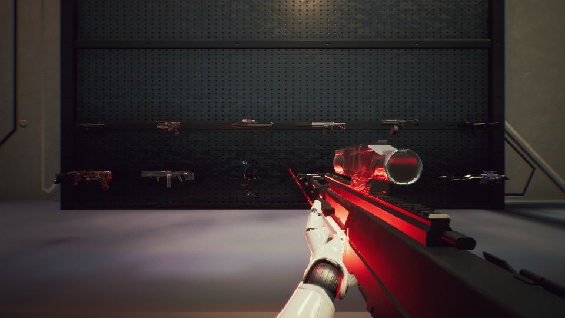</a>

23:46 H 키가 조준경 키라서 총을 내리던 입력을 떼어 냈습니다.

<h2 id="building">building <small>건물</small></h2>

지휘 센터와 배럭 내부를 새로 꾸몄습니다.

<a href="/assets/d/2026-10-19/WindowsEditor_HighresScreenshot00602.jpg" target="_blank">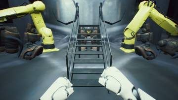</a>
<a href="/assets/d/2026-10-19/WindowsEditor_HighresScreenshot00603.jpg" target="_blank">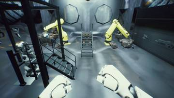</a>
<a href="/assets/d/2026-10-19/WindowsEditor_HighresScreenshot00604.jpg" target="_blank">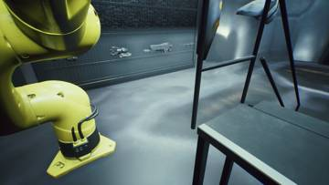</a>

16:57 배럭 중형 슈트 정비소를 로봇 두 대만 남기고 정리했습니다.

<a href="/assets/d/2026-10-19/capture_bay_a.jpg" target="_blank">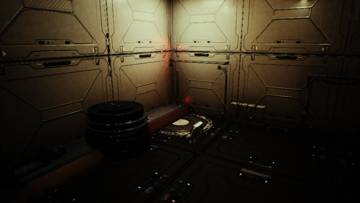</a>
<a href="/assets/d/2026-10-19/capture_bay_b.jpg" target="_blank">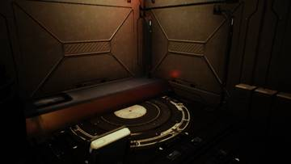</a>

23:57 배럭 내부를 사물함과 장비, 조명으로 꾸며 커맨드센터 스타일로 만들었습니다.

<h2 id="audio">audio <small>소리</small></h2>

바이저를 내리면 소리가 먹먹해지고 발소리를 발 디딤에 맞췄습니다.

<h2 id="design">design <small>기획</small></h2>

H키 바이저와 슈트 정거장 규칙을 정했습니다.

<h2 id="perf">perf <small>성능</small></h2>

작업 설정을 정리했습니다.

<h2 id="vfx">vfx <small>이펙트</small></h2>

건물 금속 질감을 밝게 조정했습니다.

<h2 id="zerg">zerg <small>저그</small></h2>

빌드 오류를 고쳤습니다.

