
세션 10개 · 사진 71장

<ul class="toc">
<li><a href="#weapon">weapon — 무기</a></li>
<li><a href="#building">building — 건물</a></li>
<li><a href="#terran">terran — 테란 아군</a></li>
<li><a href="#vfx">vfx — 이펙트</a></li>
<li><a href="#perf">perf — 성능</a></li>
<li><a href="#audio">audio — 소리</a></li>
<li><a href="#design">design — 기획</a></li>
<li><a href="#level">level — 맵</a></li>
<li><a href="#ui">ui — 화면 UI</a></li>
<li><a href="#vehicle">vehicle — 차량</a></li>
</ul>
<h2 id="weapon">weapon <small>무기</small></h2>

모든 총에 레이저 지시기를 달고 가우스 오토샷건을 추가했습니다.

<a href="/assets/d/2026-10-20/low_now.jpg" target="_blank">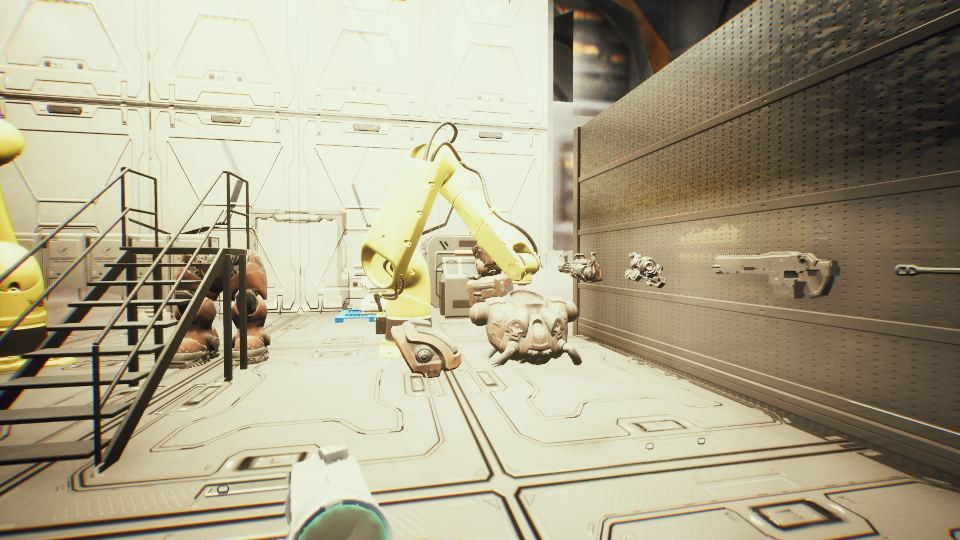</a>

00:08 H 키가 조준경 키라서 총을 내리던 입력을 떼어 냈습니다.

<a href="/assets/d/2026-10-20/WindowsEditor_ft_held.jpg" target="_blank">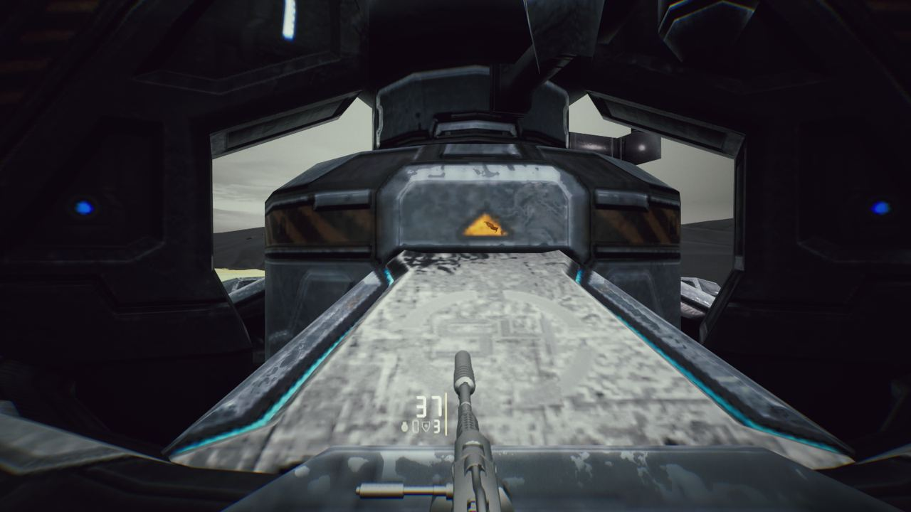</a>

00:52 화염방사기 모델을 새 모델로 교체했습니다.

<a href="/assets/d/2026-10-20/bayo_held.jpg" target="_blank">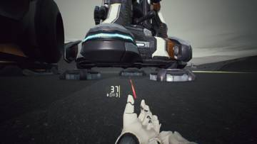</a>
<a href="/assets/d/2026-10-20/bayo_burn.jpg" target="_blank">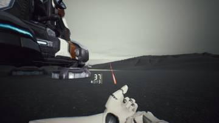</a>

01:26 화염 총검 베기 코드를 만들다가 근접 애니메이션 작업 전까지 멈췄습니다.

<a href="/assets/d/2026-10-20/WindowsEditor_HighresScreenshot00637.jpg" target="_blank">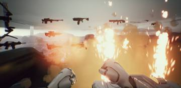</a>
<a href="/assets/d/2026-10-20/WindowsEditor_HighresScreenshot00643.jpg" target="_blank">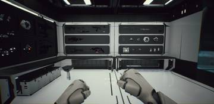</a>

04:51 보급고 무기실의 흰 슬롯 23칸 중 22칸에 총 22정을 걸었습니다.

<a href="/assets/d/2026-10-20/gasp0_ck27.jpg" target="_blank">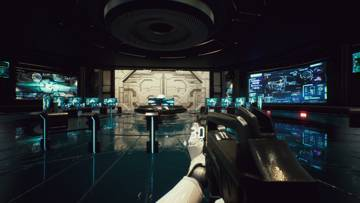</a>
<a href="/assets/d/2026-10-20/laserz_CK27.jpg" target="_blank">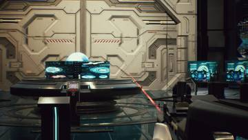</a>
<a href="/assets/d/2026-10-20/laserz_FN92.jpg" target="_blank">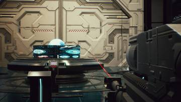</a>
<a href="/assets/d/2026-10-20/laser_HP_LMG.jpg" target="_blank">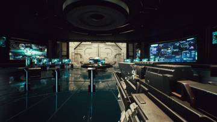</a>
<a href="/assets/d/2026-10-20/laser_C14.jpg" target="_blank">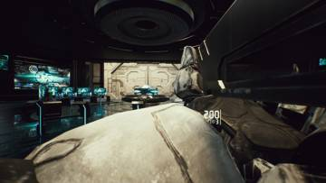</a>

18:22 모든 총에 레이저 지시기를 달고 일부 총은 기본 내장으로 처리했습니다.

<h2 id="building">building <small>건물</small></h2>

지휘 센터 모델에서 안 보이는 면을 줄이는 도구를 만들었습니다.

<a href="/assets/d/2026-10-20/scifi_s.jpg" target="_blank">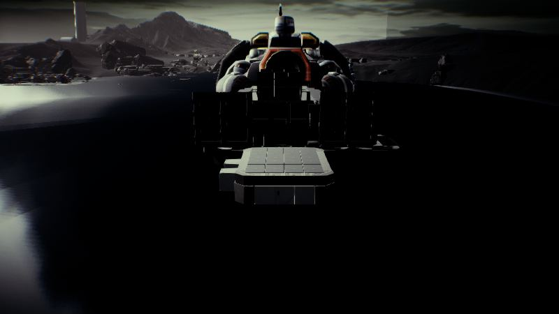</a>

03:06 사령부 무기실을 관제실 벽 뒤로 10도 돌려 배치했습니다

<a href="/assets/d/2026-10-20/capture_doorc_in.jpg" target="_blank">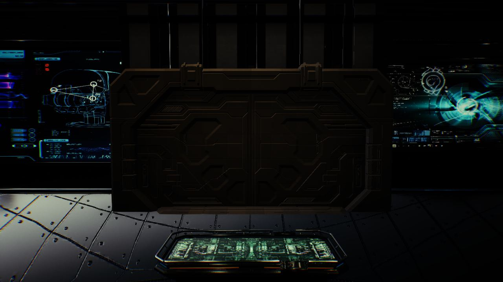</a>

15:35 사령부 입구 문을 없애고 통제실 입구에 SF 문 세트를 달았습니다.

<a href="/assets/d/2026-10-20/capture_ext_a.jpg" target="_blank">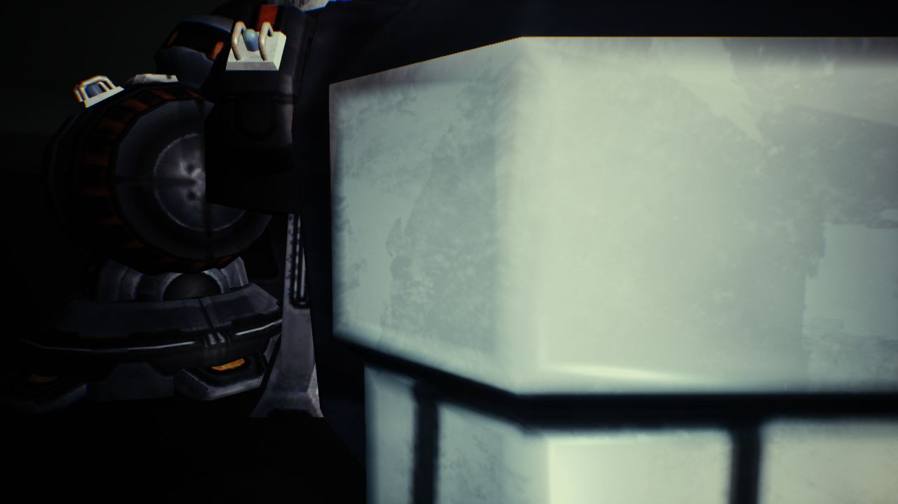</a>

15:44 문 C를 사령부 입구 통로로 옮기고 바깥에서는 문만 보이게 했습니다.

<a href="/assets/d/2026-10-20/capture_user_view.jpg" target="_blank">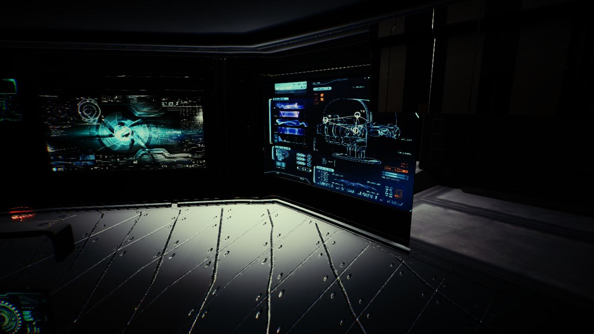</a>

15:55 문 C 부품에 재질을 다시 입히고 통제실의 문틀 하나를 없앴습니다.

<a href="/assets/d/2026-10-20/WindowsEditor_HighresScreenshot00649.jpg" target="_blank">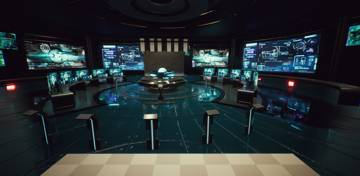</a>
<a href="/assets/d/2026-10-20/WindowsEditor_HighresScreenshot00650.jpg" target="_blank">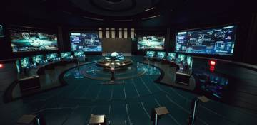</a>

16:29 통제실 앞쪽을 잘라 내고 문 C를 통제실 앞으로 옮겼습니다.

<a href="/assets/d/2026-10-20/capture_lit_cor.jpg" target="_blank">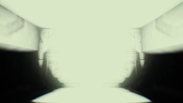</a>
<a href="/assets/d/2026-10-20/capture_lit_corU.jpg" target="_blank">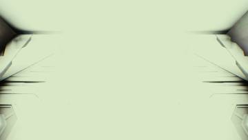</a>
<a href="/assets/d/2026-10-20/capture_lit_room.jpg" target="_blank">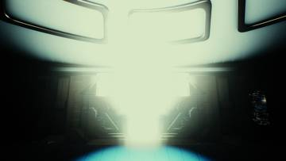</a>
<a href="/assets/d/2026-10-20/capture_lit_roomU.jpg" target="_blank">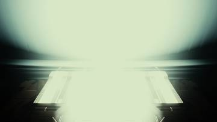</a>

16:47 통제실의 구멍처럼 보이던 옛 문 위 패널을 없애고 번호를 다시 매겼습니다.

<a href="/assets/d/2026-10-20/capture_h_on.jpg" target="_blank">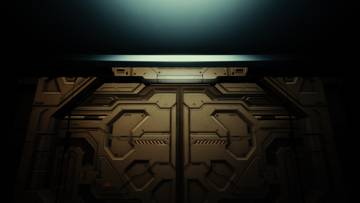</a>
<a href="/assets/d/2026-10-20/capture_d_cor.jpg" target="_blank">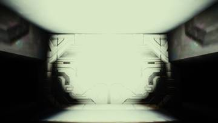</a>
<a href="/assets/d/2026-10-20/capture_d_corU.jpg" target="_blank">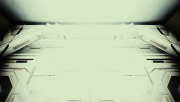</a>
<a href="/assets/d/2026-10-20/capture_d_room.jpg" target="_blank">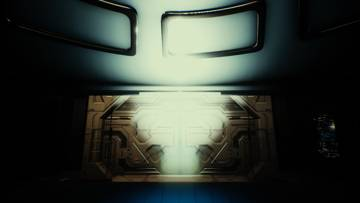</a>
<a href="/assets/d/2026-10-20/capture_d_out.jpg" target="_blank">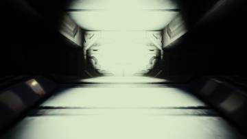</a>

16:52 문 C 틀과 양쪽 문짝 재질이 제대로 저장되게 고쳤습니다.

<a href="/assets/d/2026-10-20/capture_light_left.jpg" target="_blank">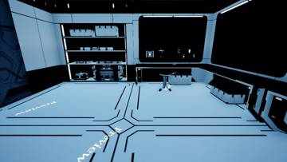</a>
<a href="/assets/d/2026-10-20/capture_light_back.jpg" target="_blank">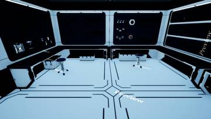</a>
<a href="/assets/d/2026-10-20/capture_light_a.jpg" target="_blank">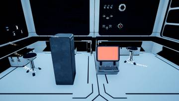</a>
<a href="/assets/d/2026-10-20/capture_light_b.jpg" target="_blank">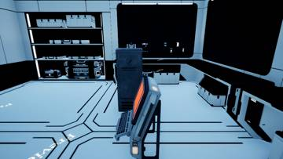</a>
<a href="/assets/d/2026-10-20/capture_light_c.jpg" target="_blank">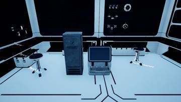</a>

17:14 보급고에 사물함과 모니터를 문을 향하게 놓았습니다.

<a href="/assets/d/2026-10-20/WindowsEditor_HighresScreenshot00656.jpg" target="_blank">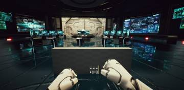</a>
<a href="/assets/d/2026-10-20/WindowsEditor_HighresScreenshot00657.jpg" target="_blank">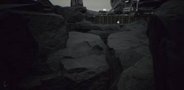</a>
<a href="/assets/d/2026-10-20/WindowsEditor_HighresScreenshot00658.jpg" target="_blank">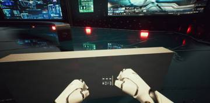</a>
<a href="/assets/d/2026-10-20/WindowsEditor_HighresScreenshot00659.jpg" target="_blank">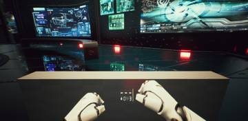</a>
<a href="/assets/d/2026-10-20/WindowsEditor_HighresScreenshot00661.jpg" target="_blank">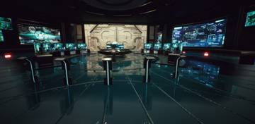</a>
<a href="/assets/d/2026-10-20/WindowsEditor_HighresScreenshot00662.jpg" target="_blank">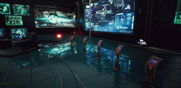</a>

19:15 사령부 브리지에 큰 유리창을 달고 앞쪽 벽을 걷어 바깥이 보이게 했습니다

<a href="/assets/d/2026-10-20/WindowsEditor_HighresScreenshot00671.jpg" target="_blank">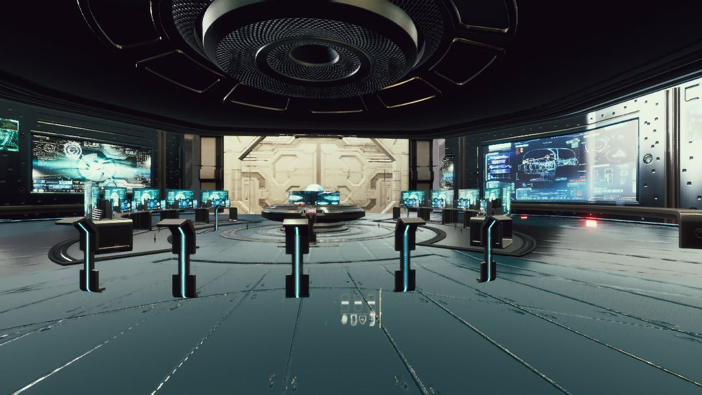</a>

20:06 사령부 옆 단면을 브리지 크기에 맞춰 확인했더니 큰 방들은 들어가지 않았습니다

<a href="/assets/d/2026-10-20/WindowsEditor_HighresScreenshot00679.jpg" target="_blank">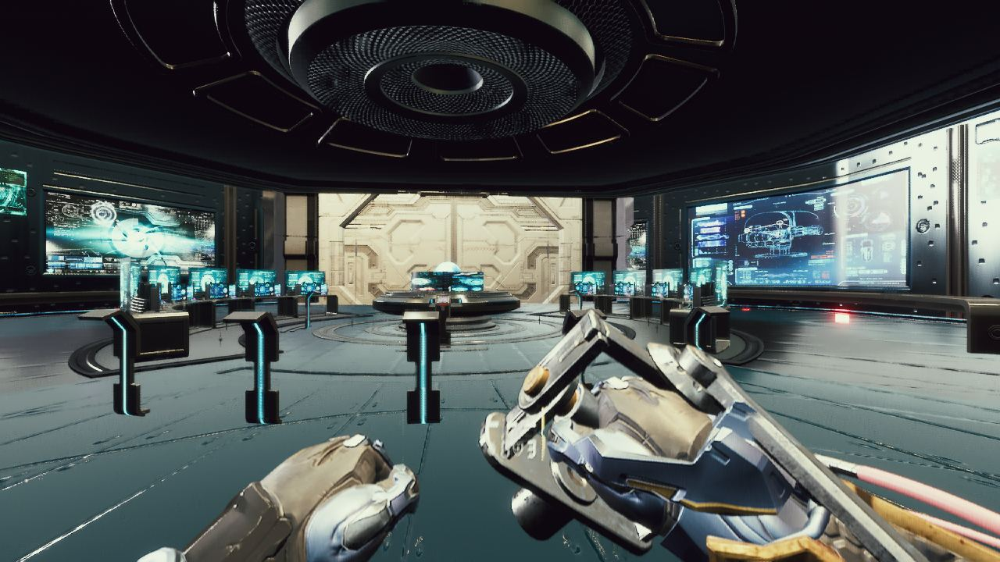</a>

20:43 사령부 단면을 재서 어떤 방이 들어가고 어떤 방이 넘치는지 확인했습니다

<h2 id="terran">terran <small>테란 아군</small></h2>

1인칭 팔을 머독 팔로 바꾸고 시점 제한과 발 디딤을 고쳤습니다.

<a href="/assets/d/2026-10-20/WindowsEditor_HighresScreenshot00606.jpg" target="_blank">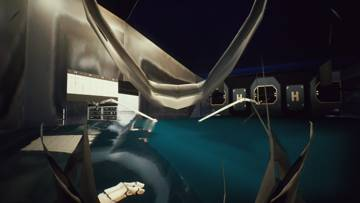</a>
<a href="/assets/d/2026-10-20/WindowsEditor_HighresScreenshot00607.jpg" target="_blank">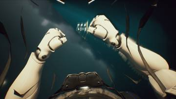</a>

03:18 공성 전차 위에 올라설 수 있도록 발판 계단을 만들었습니다.

<a href="/assets/d/2026-10-20/WindowsEditor_HighresScreenshot00610.jpg" target="_blank">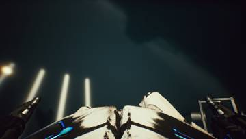</a>
<a href="/assets/d/2026-10-20/WindowsEditor_HighresScreenshot00611.jpg" target="_blank">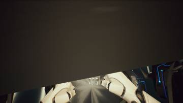</a>
<a href="/assets/d/2026-10-20/WindowsEditor_HighresScreenshot00612.jpg" target="_blank">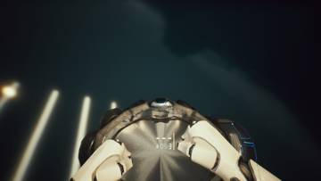</a>
<a href="/assets/d/2026-10-20/WindowsEditor_HighresScreenshot00613.jpg" target="_blank">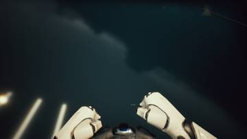</a>
<a href="/assets/d/2026-10-20/WindowsEditor_HighresScreenshot00614.jpg" target="_blank">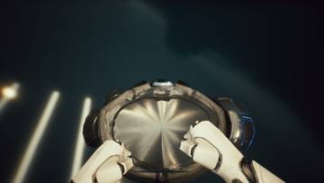</a>
<a href="/assets/d/2026-10-20/WindowsEditor_HighresScreenshot00615.jpg" target="_blank">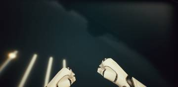</a>
<a href="/assets/d/2026-10-20/WindowsEditor_HighresScreenshot00616.jpg" target="_blank">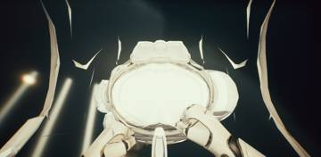</a>

03:31 내 시점용 머독 몸통과 다리를 따로 만들고 전신은 그림자만 남겼습니다.

<a href="/assets/d/2026-10-20/WindowsEditor_HighresScreenshot00620.jpg" target="_blank">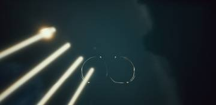</a>
<a href="/assets/d/2026-10-20/WindowsEditor_HighresScreenshot00621.jpg" target="_blank">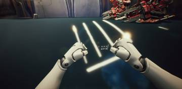</a>

03:53 내 몸 가림 기본값을 정해 배 부분이 앞에서 자연스럽게 보이게 했습니다.

16:14 스페이스 키로 장애물을 넘고 오르는 동작을 플레이어에게 붙였습니다.

19:23 위아래 시야 제한을 65도로 줄였고 실제로 적용되게 고쳤습니다.

20:11 1인칭 팔을 머독 팔 모델로 바꾸고 손 위치를 기존 팔에 맞췄습니다.

20:49 머독 1인칭 팔에서 총, 로봇 집게, 팔뚝 막대를 숨겼습니다.

<h2 id="vfx">vfx <small>이펙트</small></h2>

1인칭에서 몸이 시야를 가리지 않도록 재질을 만들었습니다.

04:45 몸 가림 재질에 카메라 둘레 잘라내기를 더하고 양면으로 보이게 했습니다.

<h2 id="perf">perf <small>성능</small></h2>

20:49 

<h2 id="audio">audio <small>소리</small></h2>

헬멧 숨소리를 기본으로 껐습니다.

<h2 id="design">design <small>기획</small></h2>

디팟마다 장비 화면과 무기 벽 구성을 정했습니다.

<h2 id="level">level <small>맵</small></h2>

맵의 건물과 불필요한 물체를 정리했습니다.

<h2 id="ui">ui <small>화면 UI</small></h2>

새 총 10종의 패널 줄을 만들었습니다.

<h2 id="vehicle">vehicle <small>차량</small></h2>

시즈 탱크 해골 문양을 지웠습니다.

