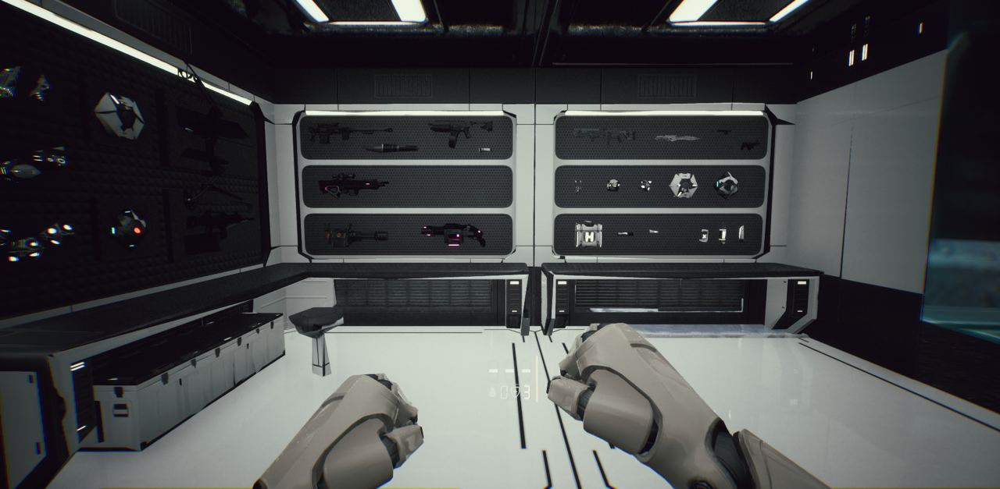
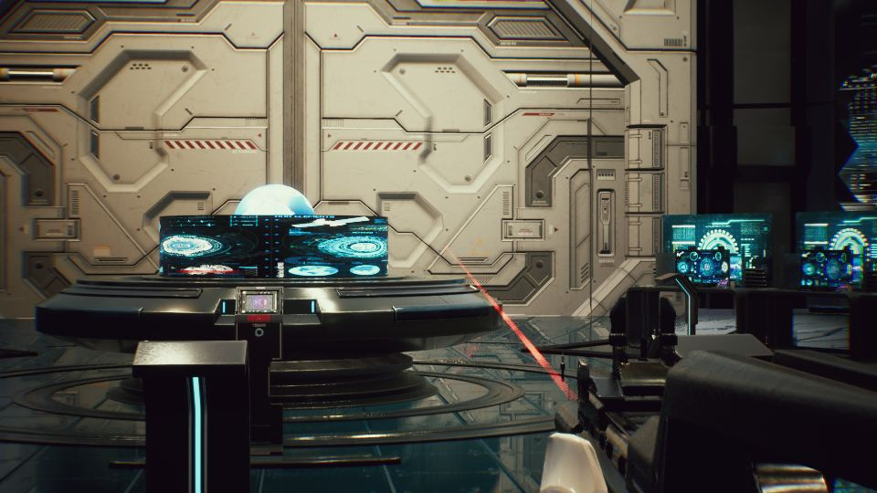
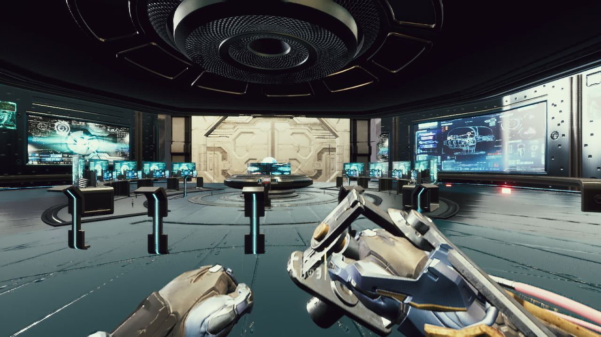
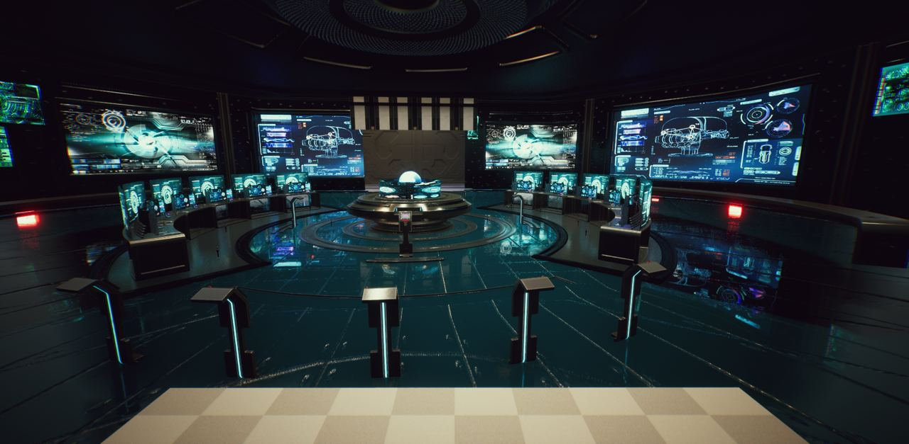
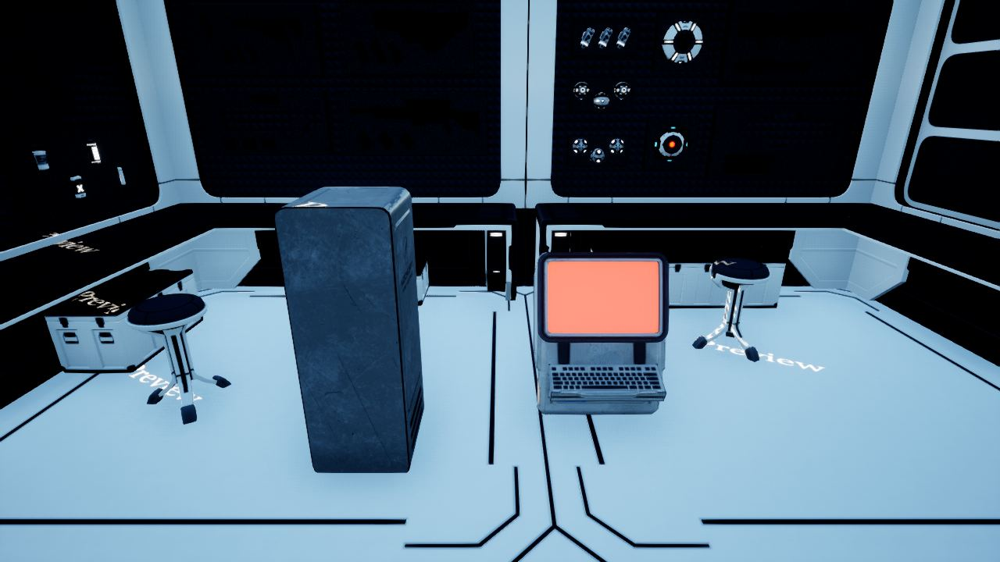

작업 9개 · 사진 9장

<ul class="toc">
<li><a href="#weapon">무기</a></li>
<li><a href="#terran">테란 아군</a></li>
<li><a href="#vfx">이펙트</a></li>
<li><a href="#building">건물</a></li>
<li><a href="#audio">소리</a></li>
<li><a href="#design">기획</a></li>
<li><a href="#level">맵</a></li>
<li><a href="#ui">화면 UI</a></li>
<li><a href="#vehicle">차량</a></li>
</ul>
<h2 id="weapon">무기</h2>

모든 총에 레이저 지시기를 달고 가우스 오토샷건을 넣었습니다.

00:52 화염방사기 모델을 새 모델로 바꿨습니다.

04:51 보급고에 총 스물두 자루를 걸어 둔 무기 방을 만들었습니다.

18:22 모든 총에 레이저 지시기를 달았습니다.

<h2 id="terran">테란 아군</h2>

1인칭 팔을 머독 팔로 바꾸고 시점 제한을 고쳤습니다.

03:18 시즈 탱크에 오를 수 있는 발판을 만들었습니다.

03:31 플레이어에게만 보이는 머독 몸통을 만들었습니다.

03:53 몸통이 시야를 가리지 않게 잘라 냈습니다.

16:14 장애물을 넘고 오르는 이동을 플레이어에 넣었습니다.

19:23 시점의 위아래 제한을 좁혀 실제로 적용했습니다.

20:11 1인칭 팔을 머독 팔로 바꿨습니다.

20:49 머독 팔의 총과 로봇 손 부분을 숨겼습니다.

<h2 id="vfx">이펙트</h2>

1인칭에서 몸이 시야를 가리지 않게 재질을 만들었습니다.

04:45 1인칭에서 몸이 시야를 가리지 않게 재질을 손봤습니다.

<h2 id="building">건물</h2>

사령부 모델에서 안 보이는 면을 줄였습니다.

15:44 문 C를 사령부 입구 복도로 옮겼습니다.

16:29 문을 관제실 앞으로 옮겼습니다.

16:47 관제실의 낡은 문 위 패널을 지웠습니다.

16:52 문 C의 틀과 문짝 재질을 저장했습니다.

17:14 보급고 변형 건물에 사물함과 모니터를 놓았습니다.

19:15 사령부 함교 창을 투명한 큰 유리로 바꿨습니다.

20:06 사령부를 함교 기준 크기로 맞췄습니다.

20:43 사령부 앞 구역 크기를 설계에 맞춰 조사했습니다.

<h2 id="audio">소리</h2>

헬멧 숨소리를 기본으로 껐습니다.

<h2 id="design">기획</h2>

보급고마다 장비 화면과 무기 벽 구성을 정했습니다.

<h2 id="level">맵</h2>

맵의 건물과 불필요한 물체를 정리했습니다.

<h2 id="ui">화면 UI</h2>

새 총 열 종의 패널 줄을 만들었습니다.

<h2 id="vehicle">차량</h2>

시즈 탱크의 해골 문양을 지웠습니다.

