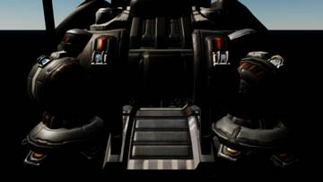
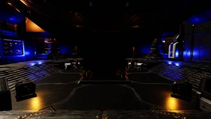
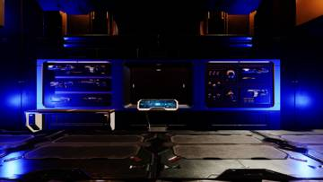

세션 8개 · 사진 3장

<ul class="toc">
<li><a href="#building">building — 건물</a></li>
<li><a href="#design">design — 기획</a></li>
<li><a href="#level">level — 맵</a></li>
<li><a href="#perf">perf — 성능</a></li>
<li><a href="#terran">terran — 테란 아군</a></li>
<li><a href="#vfx">vfx — 이펙트</a></li>
<li><a href="#weapon">weapon — 무기</a></li>
<li><a href="#zerg">zerg — 저그</a></li>
</ul>
<h2 id="building">building <small>건물</small></h2>

지휘 센터 내부와 배럭 문을 다듬고 경사로를 걸을 수 있게 했습니다.

23:20 커맨드센터 내부를 에디터에 옮겨 수천 개 부품과 조명을 배치했습니다.

<h2 id="design">design <small>기획</small></h2>

슈트 보관함을 열고 F로 입는 방식으로 정했습니다.

<h2 id="level">level <small>맵</small></h2>

맵에서 쓰지 않는 물체를 정리했습니다.

<h2 id="perf">perf <small>성능</small></h2>

끊김을 줄이도록 그래픽 설정을 조정했습니다.

<h2 id="terran">terran <small>테란 아군</small></h2>

플레이어 눈높이를 높이고 쓰러진 아군이 애니메이션으로만 눕게 했습니다.

<h2 id="vfx">vfx <small>이펙트</small></h2>

입체 총구 불꽃을 추가하고 머독 재질을 가볍게 했습니다.

<h2 id="weapon">weapon <small>무기</small></h2>

아군 총에 레이저를 달고 쓰러질 때 끊김을 줄였습니다.

<h2 id="zerg">zerg <small>저그</small></h2>

저글링 덮치기 동작을 미리 불러 끊김을 줄였습니다.

