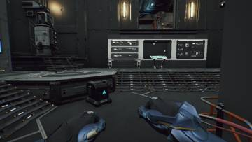
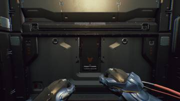
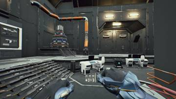
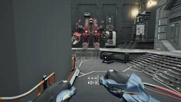
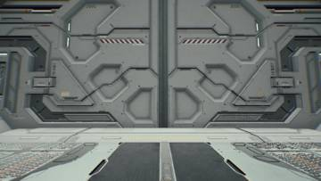
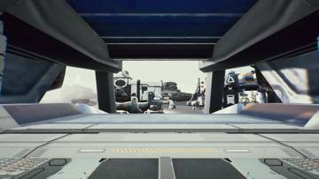
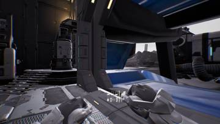
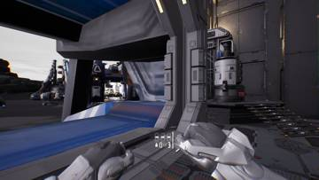
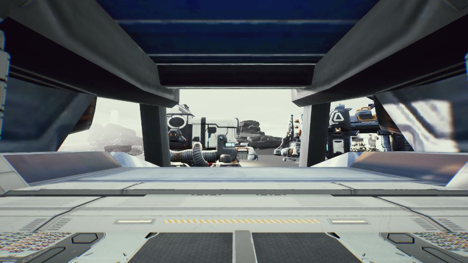

작업 5개 · 사진 9장

<ul class="toc">
<li><a href="#building">건물</a></li>
<li><a href="#terran">테란 아군</a></li>
<li><a href="#design">기획</a></li>
<li><a href="#weapon">무기</a></li>
<li><a href="#vfx">이펙트</a></li>
</ul>
<h2 id="building">건물</h2>

사령부와 병영의 문, 중앙홀 SCV를 손봤습니다.

00:02 사령부 안쪽에만 화면 분위기 효과를 넣었습니다.

00:19 사령부 중앙홀 무기 벽 맞은편에 SCV를 세웠습니다.

00:27 사령부 문이 옆으로 미끄러져 열리게 했습니다.

01:26 병영 문이 옆으로 열리고 밖에서는 건물이 보이게 했습니다.

03:37 사령부 문짝이 벽을 뚫고 겹치던 문제를 고쳤습니다.

<h2 id="terran">테란 아군</h2>

머독 팔을 흰색으로 바꾸고 슈트 정비소 위치를 고쳤습니다.

00:28 머독 1인칭 팔의 호스를 숨기고 흰색 재질을 입혔습니다.

01:40 병영이 없으면 슈트 정비소가 엉뚱한 곳에 생기지 않게 했습니다.

<h2 id="design">기획</h2>

슈트, 무기, 장비 벽에 조작 안내를 달았습니다.

02:12 슈트, 무기, 장비 벽에 조작 안내 홀로그램을 달았습니다.

<h2 id="weapon">무기</h2>

모든 총을 머독 손 크기에 맞게 키웠습니다.

19:56 모든 총을 캐릭터 손에 맞게 1.1배로 키웠습니다.

<h2 id="vfx">이펙트</h2>

영화 같은 총구 불꽃을 추가했습니다.

