
세션 8개 · 사진 47장

<ul class="toc">
<li><a href="#building">building — 건물</a></li>
<li><a href="#terran">terran — 테란 아군</a></li>
<li><a href="#level">level — 맵</a></li>
<li><a href="#design">design — 기획</a></li>
<li><a href="#weapon">weapon — 무기</a></li>
<li><a href="#anim">anim — 애니메이션</a></li>
<li><a href="#perf">perf — 성능</a></li>
<li><a href="#vfx">vfx — 이펙트</a></li>
</ul>
<h2 id="building">building <small>건물</small></h2>

배럭과 SCV 승강기 내부 실험을 했습니다.

<a href="/assets/d/2026-10-23/WindowsEditor_HighresScreenshot00686.jpg" target="_blank">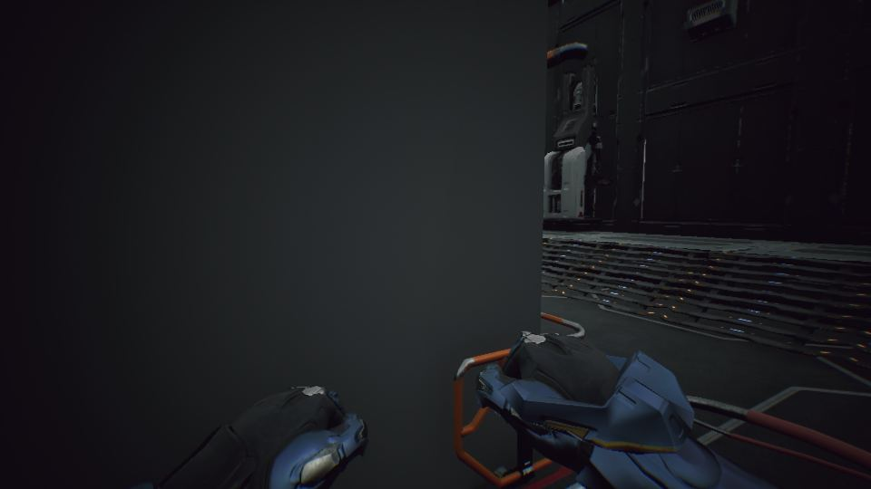</a>

00:00 사령부 조명을 램프마다 하나씩으로 줄여 86개에서 42개로 만들었습니다.

<a href="/assets/d/2026-10-23/WindowsEditor_HighresScreenshot00688.jpg" target="_blank">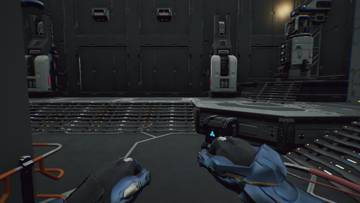</a>
<a href="/assets/d/2026-10-23/WindowsEditor_HighresScreenshot00689.jpg" target="_blank">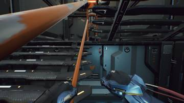</a>
<a href="/assets/d/2026-10-23/WindowsEditor_HighresScreenshot00690.jpg" target="_blank">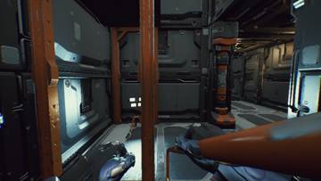</a>

00:02 사령부 안에만 적용되는 화면 후처리를 넣어 내부 분위기를 잡았습니다.

<a href="/assets/d/2026-10-23/WindowsEditor_HighresScreenshot00698.jpg" target="_blank">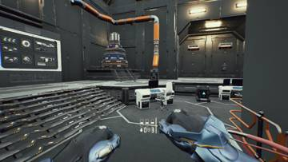</a>
<a href="/assets/d/2026-10-23/WindowsEditor_HighresScreenshot00699.jpg" target="_blank">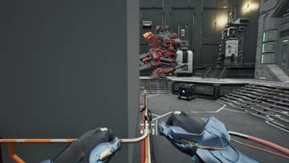</a>
<a href="/assets/d/2026-10-23/WindowsEditor_HighresScreenshot00700.jpg" target="_blank">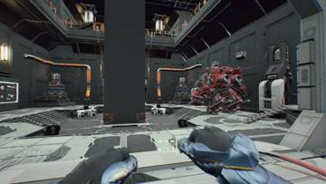</a>

00:19 사령부 중앙홀에 SCV를 무기 벽 맞은편에 세웠습니다

00:27 사령부 문이 옆으로 미끄러지며 열리고 벽 속으로 들어가는 것처럼 보이게 했습니다

<a href="/assets/d/2026-10-23/WindowsEditor_bx_out.jpg" target="_blank">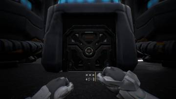</a>
<a href="/assets/d/2026-10-23/WindowsEditor_bx_in.jpg" target="_blank">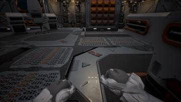</a>
<a href="/assets/d/2026-10-23/WindowsEditor_bx_gate.jpg" target="_blank">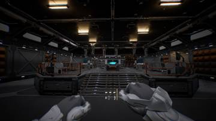</a>

01:26 병영 문이 0.8초에 걸쳐 옆으로 열리고 밖에서는 건물이 유지되게 했습니다

<a href="/assets/d/2026-10-23/WindowsEditor_bxd_in.jpg" target="_blank">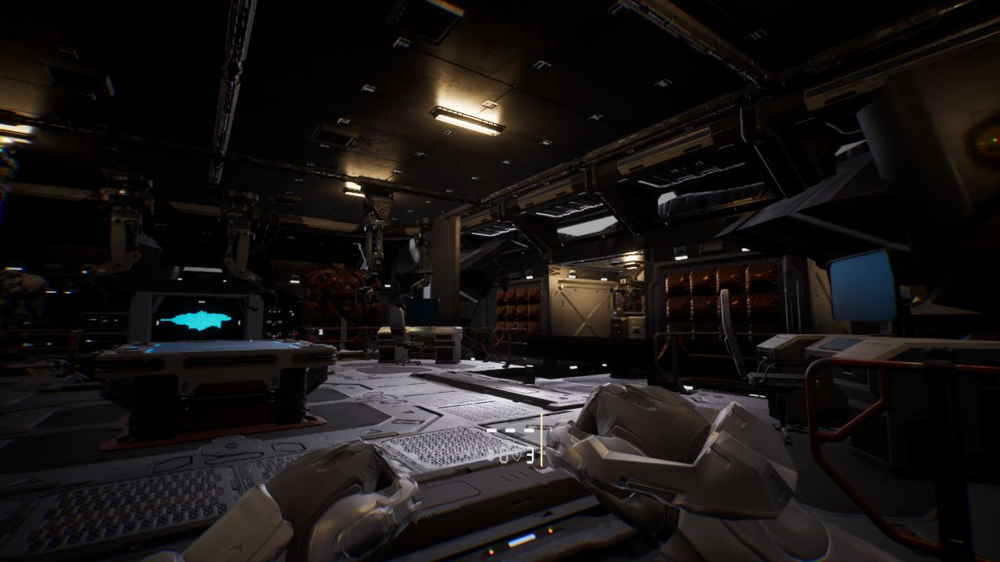</a>

01:55 병영 출입 판정이 엔진 패치 뒤 사라지던 문제를 고쳤습니다

<a href="/assets/d/2026-10-23/WindowsEditor_bxl_box.jpg" target="_blank">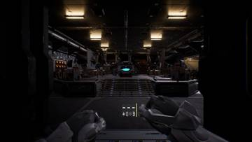</a>
<a href="/assets/d/2026-10-23/WindowsEditor_bxh_in.jpg" target="_blank">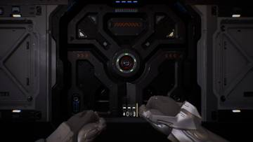</a>

02:14 병영 출입문 주변의 어두운 틈을 문틀 크기에 맞춰 줄였습니다

03:37 커맨드센터 문짝이 벽을 뚫고 겹치던 문제를 고쳤습니다.

<a href="/assets/d/2026-10-23/WindowsEditor_bxs_c.jpg" target="_blank">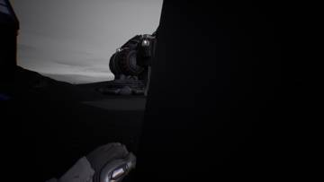</a>
<a href="/assets/d/2026-10-23/WindowsEditor_bxs_g.jpg" target="_blank">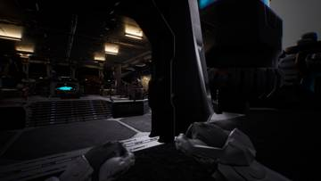</a>

14:09 병영 문 상태에서 문 옆으로 다리 사이에 비치던 구조물을 숨겼습니다.

<h2 id="terran">terran <small>테란 아군</small></h2>

SCV 걷기와 사다리 타기 동작을 만들었습니다.

00:28 머독 1인칭 팔의 호스와 손목 덮개를 숨기고 흰색 재질을 입혔습니다.

<a href="/assets/d/2026-10-23/WindowsEditor_HighresScreenshot00706.jpg" target="_blank">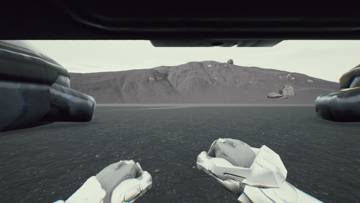</a>
<a href="/assets/d/2026-10-23/WindowsEditor_HighresScreenshot00707.jpg" target="_blank">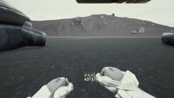</a>
<a href="/assets/d/2026-10-23/WindowsEditor_HighresScreenshot00708.jpg" target="_blank">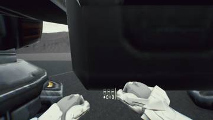</a>
<a href="/assets/d/2026-10-23/WindowsEditor_HighresScreenshot00709.jpg" target="_blank">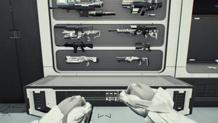</a>
<a href="/assets/d/2026-10-23/WindowsEditor_HighresScreenshot00710.jpg" target="_blank">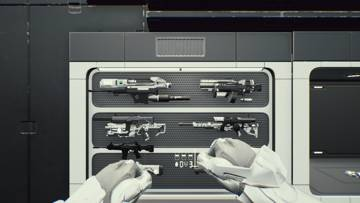</a>

01:40 배럭이 없으면 슈트 정비소가 엉뚱하게 생기지 않도록 고쳤습니다.

<h2 id="level">level <small>맵</small></h2>

하늘과 안개, 밤 조명 연구를 하고 하늘 모습을 바꿨습니다.

<a href="/assets/d/2026-10-23/capture_lt_before_e.jpg" target="_blank">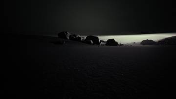</a>
<a href="/assets/d/2026-10-23/WindowsEditor_lt_a_90.jpg" target="_blank">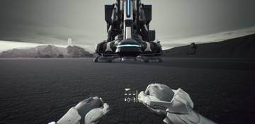</a>
<a href="/assets/d/2026-10-23/WindowsEditor_lt_a_270.jpg" target="_blank">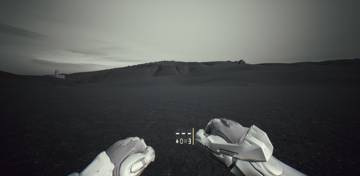</a>
<a href="/assets/d/2026-10-23/WindowsEditor_lt_a_180.jpg" target="_blank">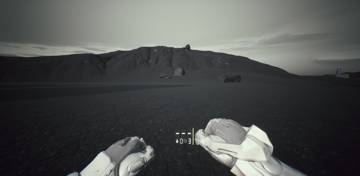</a>
<a href="/assets/d/2026-10-23/WindowsEditor_lt_b_90.jpg" target="_blank">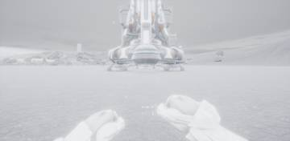</a>
<a href="/assets/d/2026-10-23/WindowsEditor_lt_b_0.jpg" target="_blank">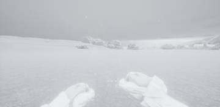</a>

00:47 실제 게임의 야외 조명 수치를 분석해 정리했습니다

<h2 id="design">design <small>기획</small></h2>

슈트 선택 화면 시안과 규칙을 다듬었습니다.

<a href="/assets/d/2026-10-23/WindowsEditor_bxd_out.jpg" target="_blank">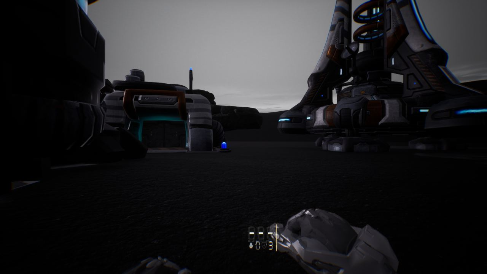</a>

01:55 에픽 런처 없이 Fab 구매 에셋을 내려받는 도구를 만들어 속도를 높였습니다.

<a href="/assets/d/2026-10-23/WindowsEditor_ScreenShot00441.jpg" target="_blank">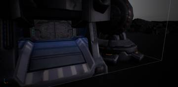</a>
<a href="/assets/d/2026-10-23/WindowsEditor_HighresScreenshot00712.jpg" target="_blank">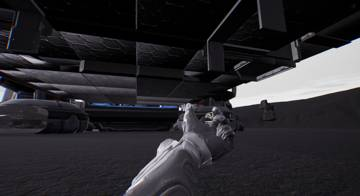</a>
<a href="/assets/d/2026-10-23/WindowsEditor_HighresScreenshot00713.jpg" target="_blank">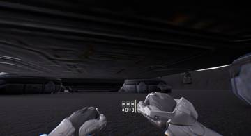</a>

02:12 슈트, 무기, 장비 벽에 장착, 조정, 환불 키 안내 홀로그램을 달았습니다.

<h2 id="weapon">weapon <small>무기</small></h2>

모든 총을 머독 손 크기에 맞게 키웠습니다.

<a href="/assets/d/2026-10-23/WindowsEditor_tod_0_90.jpg" target="_blank">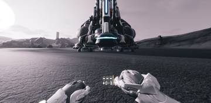</a>
<a href="/assets/d/2026-10-23/WindowsEditor_tod_0_270.jpg" target="_blank">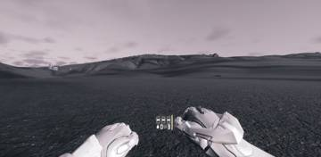</a>
<a href="/assets/d/2026-10-23/WindowsEditor_tod_1_90.jpg" target="_blank">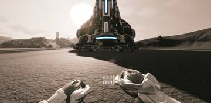</a>
<a href="/assets/d/2026-10-23/WindowsEditor_tod_1_270.jpg" target="_blank">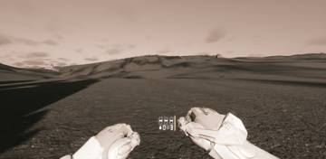</a>
<a href="/assets/d/2026-10-23/WindowsEditor_tod_2_90.jpg" target="_blank">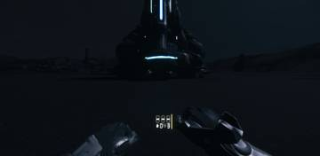</a>
<a href="/assets/d/2026-10-23/WindowsEditor_tod_2_270.jpg" target="_blank">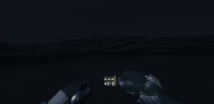</a>
<a href="/assets/d/2026-10-23/WindowsEditor_tod_3_90.jpg" target="_blank">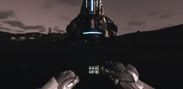</a>
<a href="/assets/d/2026-10-23/WindowsEditor_tod_3_270.jpg" target="_blank">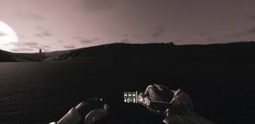</a>

19:56 모든 총을 캐릭터 손에 맞게 1.1배로 키웠습니다

<h2 id="anim">anim <small>애니메이션</small></h2>

플레이어 걸음 폭에 대한 메모를 남겼습니다.

<h2 id="perf">perf <small>성능</small></h2>

측정 규칙 문서를 정리했습니다.

<h2 id="vfx">vfx <small>이펙트</small></h2>

영화 같은 총구 불꽃을 추가했습니다.

