
세션 8개 · 사진 12장

<ul class="toc">
<li><a href="#building">building — 건물</a></li>
<li><a href="#anim">anim — 애니메이션</a></li>
<li><a href="#audio">audio — 소리</a></li>
<li><a href="#design">design — 기획</a></li>
<li><a href="#terran">terran — 테란 아군</a></li>
<li><a href="#vfx">vfx — 이펙트</a></li>
<li><a href="#weapon">weapon — 무기</a></li>
<li><a href="#zerg">zerg — 저그</a></li>
</ul>
<h2 id="building">building <small>건물</small></h2>

디팟 방을 정리하고 슈트 플랫폼과 콘솔을 배치했습니다.

<a href="/assets/d/2026-10-24/capture_droom_south.jpg" target="_blank">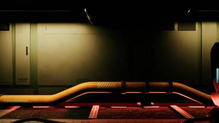</a>
<a href="/assets/d/2026-10-24/capture_droom_west.jpg" target="_blank">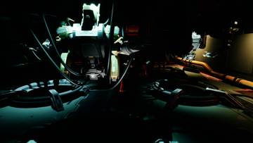</a>

18:21 사령부 에어락을 없애고 왼쪽 방을 광장 출입구에 맞게 옮겼습니다

<a href="/assets/d/2026-10-24/WindowsEditor_cc_atr_gate2.jpg" target="_blank">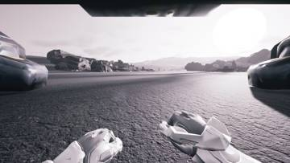</a>
<a href="/assets/d/2026-10-24/WindowsEditor_cc_atr_far.jpg" target="_blank">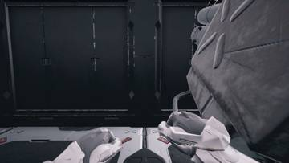</a>
<a href="/assets/d/2026-10-24/WindowsEditor_cc_atr_gate.jpg" target="_blank">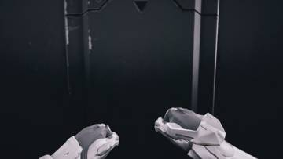</a>
<a href="/assets/d/2026-10-24/WindowsEditor_cc_left_wall.jpg" target="_blank">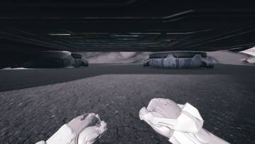</a>
<a href="/assets/d/2026-10-24/WindowsEditor_cc_d1.jpg" target="_blank">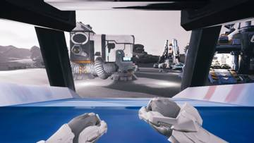</a>
<a href="/assets/d/2026-10-24/WindowsEditor_cc_d2.jpg" target="_blank">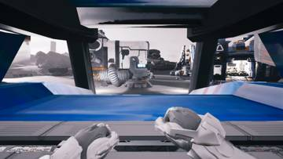</a>
<a href="/assets/d/2026-10-24/WindowsEditor_cc_gate.jpg" target="_blank">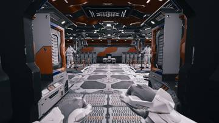</a>
<a href="/assets/d/2026-10-24/WindowsEditor_cc_left.jpg" target="_blank">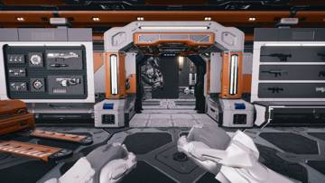</a>
<a href="/assets/d/2026-10-24/WindowsEditor_cc_left_w.jpg" target="_blank">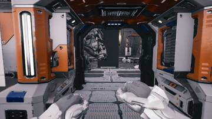</a>
<a href="/assets/d/2026-10-24/WindowsEditor_cc_left_suits.jpg" target="_blank">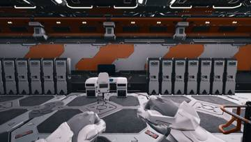</a>

19:23 사령부를 언리얼에 구현해 장비실과 슈트 플랫폼, 무기 벽을 만들었습니다.

<h2 id="anim">anim <small>애니메이션</small></h2>

해병 1인칭 팔을 손으로 고치는 작업대를 만들었습니다.

<h2 id="audio">audio <small>소리</small></h2>

건물 내부 환경음을 넣었습니다.

<h2 id="design">design <small>기획</small></h2>

사망 후 30초 뒤 지휘 센터에서 부활하는 규칙을 정했습니다.

<h2 id="terran">terran <small>테란 아군</small></h2>

아군 스킨을 추가하고 슈트 머리를 다듬었으며 부활 규칙을 넣었습니다.

<h2 id="vfx">vfx <small>이펙트</small></h2>

하얀 머독 아군 재질과 총구 불꽃을 고쳤습니다.

<h2 id="weapon">weapon <small>무기</small></h2>

C14 부품을 총에 되돌리고 팔 위치 오류를 고쳤습니다.

<h2 id="zerg">zerg <small>저그</small></h2>

시체 더미가 10초 뒤 굳고 개수 제한을 두도록 했습니다.

