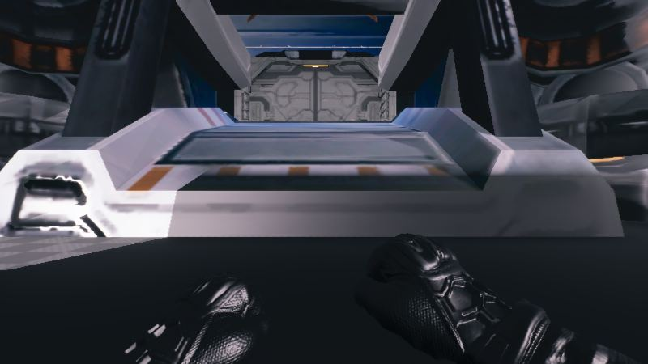
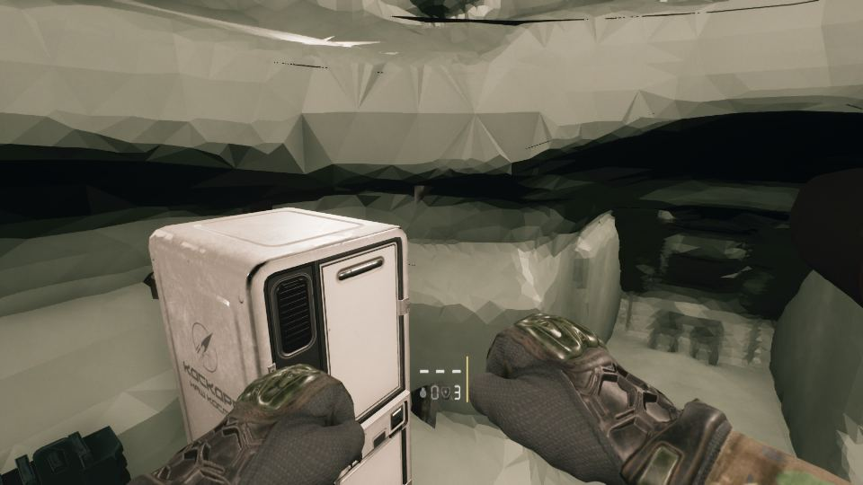

작업 7개 · 사진 12장

<ul class="toc">
<li><a href="#weapon">무기</a></li>
<li><a href="#terran">테란 아군</a></li>
<li><a href="#building">건물</a></li>
<li><a href="#anim">애니메이션</a></li>
<li><a href="#audio">소리</a></li>
<li><a href="#character_mesh">캐릭터 모델</a></li>
<li><a href="#vfx">이펙트</a></li>
</ul>
<h2 id="weapon">무기</h2>

총 모델을 실제 크기에 맞추고 쌍권총 위치를 조정했습니다.

16:17 샷건과 라이플을 고해상도 모델로 바꿨습니다.

16:43 가우스 소총 총검을 수평으로 맞췄습니다.

17:23 가우스 총의 드럼 윗부분도 함께 떨어지게 고쳤습니다.

18:50 장갑을 새 모델로 바꿔 총 확인에 쓰게 했습니다.

19:18 장갑 질감이 보라색으로 나오던 문제를 고쳤습니다.

19:21 쌍권총에서 왼팔이 거울 반전된 자기 동작을 쓰게 했습니다.

22:32 쌍권총의 왼쪽 총을 따로 조정할 수 있게 했습니다.

<h2 id="terran">테란 아군</h2>

공성 전차 내부와 좌석을 다듬고 플레이어 몸을 바꿨습니다.

18:04 플레이어 1인칭 팔을 레네게이드 팔로 바꿨습니다.

18:28 플레이어 몸 전체를 레네게이드 모델로 바꿨습니다.

20:32 사령부 안뜰에 직접 몰 수 있는 SCV를 놓았습니다.

22:28 공성 전차 좌석 뒤쪽 구멍을 막았습니다.

22:56 공성 전차 내부 색을 어두운 올리브색 금속으로 바꿨습니다.

23:15 공성 전차에 앞뒤로 움직이는 운전석과 소품을 넣었습니다.

<h2 id="building">건물</h2>

병영과 보급고 벽에 우리 게임의 총을 걸었습니다.

21:54 사령부 무기 벽의 총 크기를 손에 쥔 크기에 맞췄습니다.

22:07 보급고 입구 바닥의 주황색 고리를 지웠습니다.

22:19 보급고 문을 새 SF 문으로 교체했습니다.

22:42 보급고 장비 벽에 우리 게임의 총 18종을 걸었습니다.

<h2 id="anim">애니메이션</h2>

손가락과 파워슈트 팔 움직임을 자연스럽게 다듬었습니다.

<h2 id="audio">소리</h2>

왼손 총 소리 오류를 고쳤습니다.

<h2 id="character_mesh">캐릭터 모델</h2>

스타2 스펙터 모델을 실제 키에 맞춰 배치했습니다.

<h2 id="vfx">이펙트</h2>

요원 모델의 청록빛 줄을 끄고 저렴한 재질을 만들었습니다.

